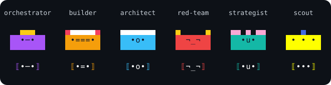

<p align="center"></p>

# Delphi

**A team of AI agents that works together, remembers what it learns, goes where you work, and grows a knowledge base it can cite.**

> Status: pre-1.0, macOS and Linux, one person per install. Latest release: v0.6.0 (`delphi update --dev` follows `main`). What is proven and what is not: [Status and limitations](#status-and-limitations).

## What is Delphi?

Delphi is a harness for AI agents, in the family of Claude Code and Codex, built for work that has no test suite: research, strategy, business analysis and product decisions.

A single agent in a single chat has four limits. It works alone, so nothing checks it. It forgets, so every session starts from nothing. It lives in one tool. And what it finds out is gone when the window closes, so it never gets better at your subject. Delphi is built to remove those four limits:

1. **Agents work together.** Thirteen roles, one of them an orchestrator that coordinates the rest, hand work to one another, check one another and argue the hard calls in a **Council**.
2. **They keep memory and context.** What a role learned on the last task is there for the next one, each project has its own layer of context, and a lesson becomes a standing rule only when you approve it.
3. **They live in more than one place.** The same team, with the same names, memory and knowledge, works in Delphi's console, inside Claude Code, Copilot CLI and Codex, in a script or a CI job, and on whichever models you have access to.
4. **They grow a knowledge base.** Research, verdicts and decisions are kept with their sources and a status that says how far each claim can be relied on. Expertise comes from that base, not from a bigger model.

One rule sits under all four: **agents ask before they act.** Reading is free. A merge, a new dependency or anything that leaves your machine shows you a card and waits. If nobody answers, the answer is no.

```
› /research pricing models for developer tools
› @strategist what are our options for the free tier?
› /council Should the free tier be time-limited or feature-limited?
› @architect draft a spec for the winning option
› /build implement specs/011-free-tier.md
```

Delphi is one Rust executable plus a full-screen console that adapts to dark and light terminals. It needs no server and no account. It uses the AI access you already have (an API key, a cloud such as Bedrock or Vertex, a corporate gateway, a local Ollama model, or your own `claude`, `agy`, `codex` or `copilot` subscription). It keeps its state in `~/.delphi`, never reads your logins and writes into a project only what you register or scaffold.

## Why it exists

AI for code has an oracle: a test passes or it does not. Research and strategy have none. Sources disagree, facts go stale, and a confident wrong answer looks the same as a right one. A more capable model does not fix this, because capability is not what is missing. The model has no colleagues, no memory and no library.

People solved the same problem with teams. An expert is someone who has read the sources, been argued with by people who disagree, kept what held up and remembers what went wrong last time. Delphi gives agents that footing, and keeps a person in charge of what counts as true and of what is allowed to happen.

The claim Delphi makes ([Thesis](docs/thesis.md)):

> Teams make better decisions when every person works from the same *trusted* understanding, and that understanding grows every time anyone does research.

So each person runs their own install and their own agent team, and every install can start from the same shared baseline of knowledge, skills and goals. Delphi does not replace your coding agent. It gives that agent, and you, a team, a memory and a library.

## How it works

### 1. Agents that work together

A role is a job with a manifest: what it may read, write and call, and which skills it can load. Thirteen roles and 66 skills ship with Delphi ([catalog](docs/reference/catalog.md)).

| Work | Roles |
| :-- | :-- |
| Find and check | `scout` surveys sources, `investigator` digs into one question, `validator` checks facts and guards the knowledge base |
| Think and decide | `strategist` turns findings into options, `architect` designs and writes specs, `red-team` attacks the plan, `advocate` speaks for the person using the product |
| Make and deliver | `writer`, `builder`, `messenger` (GitHub and outside services), `administrator` (process and setup), `assistant` (messages and briefs) |
| Coordinate | `orchestrator` |

- **One conversation, many specialists.** You talk to one window. The orchestrator breaks the work down, picks the specialist and passes a structured handoff that says what done looks like. A specialist it brings into the conversation is introduced by name, and you can address it directly from then on (`@strategist …`). `/solo` keeps a conversation to one agent and `/quarantine <role>` blocks one.
- **Nobody marks their own work.** The agent that audits a build is never the one that built it, and it runs on a different model family where you have one. In research, the validator re-checks what the scout read.
- **The Council argues before it answers.** `/council <proposition>` puts a hard question to several seats, each answering blind. They cross-examine one another, and you get a verdict *and* the strongest dissent, copied verbatim by the daemon and not summarized by the arbiter. Seats are spread across model families where you have them, because agreement inside one family is weak evidence; a one-family Council is labelled `homogeneous`. A deadlock becomes a structured choice for you.
- **You can see who is speaking.** Every agent has a name, a badge and a colour, the same wherever it runs. A change of speaker tells you the framing changed and whose concern is being raised.
- **The team can grow.** An org bundle can add its own specialists and skills. A searchable agent registry, so a large fleet does not swell the orchestrator's context, is built and off by default.

More: [Builds and Councils](docs/guides/builds-and-councils.md) · [Features](docs/features.md).

### 2. Memory and context that carry over

A model's context window is its whole world, and it empties when the session ends. Delphi keeps memory outside the model, in files and a local index on your machine, and decides in code what each agent sees.

- **The log is the source of truth.** The daemon writes every event to a log that agents cannot read or change. Memory is derived from that log, not from an agent's account of itself.
- **Roles remember their work.** After a task, Delphi distils what the role did (the tools it used, the errors it hit, what fixed them, what the research found) into a short record, without a model call. When a similar task starts, the role can recall those records, failed attempts included. A role recalls its own records, not another role's.
- **Context has layers.** A home layer is yours everywhere. A project layer belongs to one registered directory. What is learned in a project stays there until you promote a summary of it.
- **Your normal work is captured.** An answer you accept, a Council verdict, a decision you resolve and a finished research run each leave a note with its sources, searchable at once. A daily digest in the decisions pane asks what to keep, check or promote.
- **Learning is on a leash.** Notes and lessons are staged first. `/retro` proposes rules from them, and nothing enters an always-loaded prompt until you ratify it. Those rule files are capped (25 rules, 6 KB each), so memory never crowds out the task, and text read from outside cannot be passed off as trusted memory.
- **Context stays clean.** Each task starts from a frozen snapshot of its rules, so the prompt cache holds. Agents hand each other results and pointers, not transcripts. Relevant knowledge is retrieved when a task starts. The loop around the model tells an agent when it is repeating itself and makes it verify before it says "done".

More: [Features](docs/features.md#memory-that-carries-over) · the designs in [`specs/004`](specs/004-memory-and-coaching.md), [`specs/058`](specs/058-project-scopes-scaffolding-and-promotion.md) and [`specs/065`](specs/065-episodic-traces-and-agent-long-term-memory.md).

### 3. One team, many environments

- **The console.** `delphi` opens a full-screen terminal console. `/observe` opens a read-only second window with the live Council, the threads of work, the agents, token use and a change log of what they finished.
- **Inside the agent tools you already use.** Claude Code, Copilot CLI and Codex install Delphi as a plugin. Mention `@delphi` or a role such as `@strategist` there and the host gets that role's full pack: its instructions, its lessons and the project's context. The host can search the knowledge base, ask for sourced research, ask the orchestrator for help and convene a Council. Outside the console the default is a **Panel**: the seats are the host's own subagents, and Delphi holds the blind round, the cross-examination rules and the dissent. What the host learns comes back as staged notes, and work can be handed over in either direction.
- **On the models you have.** A seat is a model reached over one path: an API, a cloud, a gateway, a local model, or your own `claude`, `agy`, `codex` or `copilot` program on its subscription. Roles ask for a tier, never a named model. When one model runs out of quota the next takes over, and the daemon records which model actually served each seat where the carrier reports it.
- **Without you at the desk.** `delphi run "<task>"` does one task headless for a script or CI. `delphi relay` sends approval cards to your email or Telegram and takes your answers. Timers wake a role later.
- **The same team in each.** An agent has the same name, badge, memory and knowledge wherever it runs; outside the console its answers are marked `via delphi`. Authority does not travel with it. A role served to another tool is instructions, not permission: that tool's own approvals apply, and nothing Delphi returns can approve an action.

More: [Using Delphi from other tools](docs/guides/using-delphi-from-other-tools.md) · [Model access](docs/guides/model-access.md) · [Headless runs and CI](docs/guides/headless-and-ci.md) · [Away mode](docs/guides/away-mode.md).

### 4. A knowledge base that grows into expertise

- **Research adds to it.** `/research <topic>` sends the scout to read. Code, not a model, sorts each page by the class of its source: primary and reputable sources are kept, weak ones wait for your `/validate`. Nothing read from outside can raise its own trust.
- **It is a library, not a pile of notes.** Sources are kept whole or by excerpt. Claims point into them. Pages are written from the claims, labelled as generated, and checked by the validator for real citations and for contradiction with what is already known. A source older than 30 days is rechecked when it is opened.
- **Every claim says how far to rely on it.** One ladder everywhere: noted, checking, validated, contested, disproved, retired. Being popular, recent or repeated promotes nothing.
- **Search stays on your machine.** `/search` combines keyword matching, a local embedding search and a reranking pass, with models compiled into the release. A search ends in a readable page with its bibliography.
- **It compounds.** Agents retrieve from the base at the start of a task and other tools reach it over MCP, so each piece of research lets the next one start further along.
- **A team shares one baseline.** An **org bundle** is a directory an organization publishes so every install starts from the same knowledge, skills, specialists and stated goals. **Xenia** moves signed knowledge between installs so the baseline stays current. People work alone and stay aligned.

Whether a larger base measurably improves the work is the thing Delphi has to prove. [Status and limitations](#status-and-limitations) says what has been measured so far.

More: [Getting started](docs/getting-started.md#research-and-the-knowledge-base) · [Org bundles](docs/guides/org-bundles.md) · [Xenia operator guide](docs/guides/xenia-operator.md).

## Install

```sh
gh release download --repo jessevondoom/delphi --pattern install.sh --output - | sh
# a public repository also works without gh:
curl -fsSL https://github.com/jessevondoom/delphi/releases/latest/download/install.sh | sh
```

This puts `delphi` and `delphi-ui` in `~/.local/bin`; make sure that directory is on your `PATH`. The installer checks the download against its SHA-256 and the release's build attestation, so it needs the `gh` CLI signed in (or `GH_TOKEN`, which a private repository needs). Where the repository has no attestations, it checks the maintainers' release signature the build carries instead ([`specs/076`](specs/076-private-repo-distribution.md)). With neither it stops, unless you set `DELPHI_SKIP_ATTESTATION=1` to accept the checksum alone.

Homebrew, updating, rollback and building from source: [Getting started](docs/getting-started.md#1-install). macOS (Apple silicon and Intel) and Linux (x86_64 and aarch64); no Windows.

## Get started

```sh
delphi
```

Run it from any directory; a git repository is not required. The first time, Delphi creates a workspace, finds the model access you already have (it asks only for what it cannot find), runs a health check and opens the console. After that it just opens the console.

Then try, at the `›` prompt:

| You want to… | Do this |
| :-- | :-- |
| Research a topic | `/research <topic>`. Trusted pages enter the knowledge base; the rest are held for `/validate`. |
| Ask one specialist | `@strategist what are our options for …` |
| Settle a hard decision | `/council <proposition>` |
| Find something Delphi knows | `/search` (or `ctrl+k`); nothing leaves your machine |
| Ask a question about your files | Type it. `@project/my-app/src/lib.rs` points at a file. |
| Give a project its own context | `delphi project register`, then `/projects` to switch |
| Get a design or spec drafted | `@architect draft a spec for …` |
| Have a change built and reviewed | `/build <request>` ends with a merge card |
| Watch the team live | `/observe` opens a read-only second window |
| Review what the team learned | `/decisions` for the digest, `/retro` for proposed rules |
| Answer approvals away from your desk | `delphi relay` |
| Run a task from a script or CI | `delphi run "<task>"` |

Delphi builds software only from a written, approved spec ("No Spec, No Build"), so you see what it intends before it touches code. Documents, decks and notes need no spec. Next: [Getting started](docs/getting-started.md) takes about ten minutes from nothing to your first reviewed change, and covers research and the knowledge base on the way.

## Use Delphi from Claude Code, Copilot CLI or Codex

If you already work in another agent tool, bring the team to it. Install `delphi` first, then add the plugin with the tool's own commands:

```sh
claude plugin marketplace add jessevondoom/delphi && claude plugin install delphi@delphi
copilot plugin marketplace add jessevondoom/delphi && copilot plugin install delphi@delphi
codex plugin marketplace add jessevondoom/delphi && codex plugin add delphi@delphi
```

Or let Delphi run the two commands for you:

```sh
delphi connect claude-code --dry-run    # show the exact commands, the host binary and its checksum; run nothing
delphi connect claude-code              # or `copilot`: show the plan, then run it after you type a confirmation phrase
delphi connect claude-code --remove     # undo only what Delphi installed
```

Then, in that tool:

```
› @delphi what do we already know about usage-based pricing?
› @delphi research how three competitors price their free tier
› @strategist which of these options fits our goals?
› @delphi convene a panel: should the free tier be time-limited or feature-limited?
```

Answers arrive under the agent's own name and badge, marked `via delphi`, with their sources and the status of each claim.

`connect` needs a terminal and refuses to run from inside an agent. Codex uses the manual commands for now. Installing the plugin grants Delphi nothing and changes none of your approvals. It follows the latest release, and the tool's normal plugin update brings new versions. Check the connection with `delphi mcp --check claude-code` (or `copilot`, `codex`). Antigravity and the Gemini CLI use a printed config snippet instead. Details, removal and the full tool list: [Using Delphi from other tools](docs/guides/using-delphi-from-other-tools.md).

## How safety works

The rules live in code, not in prompts, so a mistaken or manipulated agent has little room to do harm.

- **Three approval tiers.** Green runs without asking (reading, notes, commands your `[exec] allow` rules cover, anything inside the OS sandbox). Amber (commits, other commands) is shown to you. Red (anything outbound, merges, new dependencies, edits to the charter, destructive commands) always asks and is denied if nobody answers. The one advance approval is narrow: for a headless test on macOS you may authorize, at a terminal beforehand, one pinned script that runs sandboxed with the network off ([`specs/092`](specs/092-operator-authorized-tests.md)).
- **Taint.** Whatever an agent reads from outside carries a trust level, and a step that has read untrusted content cannot write, run commands, call out or dispatch other agents without a Red card.
- **Ratification.** Model access, agent definitions, learned lessons, imported skills and release files arrive as proposals and take effect only when you `/ratify` them.
- **Separate checkers.** The agent that audits a build is never the one that built it, and a Council's dissent is written by the daemon, not by the arbiter.
- **Advice, not authority, outside.** What Delphi serves to another tool is data. It cannot approve an action there, and what that tool sends back is staged at the lowest trust until you review it.
- **Your repository stays clean.** State lives in `~/.delphi`; builds happen in separate worktrees; an optional OS sandbox (`sandbox-exec` on macOS, `bubblewrap` on Linux) is available.

The charter is [`GOVERNANCE.md`](GOVERNANCE.md) and the review rubric is [`REVIEW.md`](REVIEW.md). [Thesis](docs/thesis.md) explains why Delphi is built this way.

## Documentation

[`docs/`](docs/README.md) is the user documentation.

| For | Read |
| :-- | :-- |
| Your first session | [Getting started](docs/getting-started.md) |
| What it can do | [Features](docs/features.md) · [Thesis](docs/thesis.md) |
| A task | [Model access](docs/guides/model-access.md) · [Builds and Councils](docs/guides/builds-and-councils.md) · [Headless runs and CI](docs/guides/headless-and-ci.md) · [Away mode](docs/guides/away-mode.md) · [Org bundles](docs/guides/org-bundles.md) · [Other tools](docs/guides/using-delphi-from-other-tools.md) |
| Something broken | [Troubleshooting](docs/troubleshooting.md) |
| Every command, key and option | [Console and shell commands](docs/reference/console.md) · [Command reference](docs/reference/cli.md) · [Configuration](docs/reference/config.md) · [Roles and skills](docs/reference/catalog.md) |
| How it is built | [How it works inside](docs/how-it-works.md) · [Specifications](docs/specifications.md) · [`schemas/`](schemas/) |
| What changed, and contributing | [`CHANGELOG.md`](CHANGELOG.md) · [`CONTRIBUTING.md`](CONTRIBUTING.md) · [`AGENTS.md`](AGENTS.md) · [`llms.txt`](llms.txt) |

## Status and limitations

This is an early project built mostly by its own agents under one operator. The honest split, from the [spec tracker](missions/2026-10-23-foundational-design/spec-tracker.md):

**Built and exercised for real:** install, self-update, rollback and attestation from real releases (`brew install` has not been run by a person); the console on the daemon, the single-agent loop, worktree builds with gates and audit, the model pool with quota failover, and Claude and `agy` harness seats; Councils across model families, run many times on this project's own specs; Panels run from Claude Code; the Claude Code, Copilot CLI and Codex plugins, installed and removed live on one machine (Claude Code 2.1.314, Copilot CLI 1.0.105, Codex 0.166.0); one live round trip each on a Codex and a Copilot seat; local hybrid knowledge search with measured recall; the document readers and writers, `delphi run`, timers, hooks, skill import and export, and `bundle validate`. The operator's go/no-go (three real tasks on a real project) was passed on 2026-10-25.

**Built, but proven only by tests, mocks or a pty:** the full-screen console in real terminals (Terminal.app, iTerm2, Ghostty, tmux, ssh); episodic memory, capture on contact and the digest; the central library, generated pages and the validator; project scopes and promotion; the agent registry; research jobs against the live web; connectors (Drive, Slack, Zoom), never run against the real services; the relay by email or Telegram; live Gemini OAuth; failover to a local Ollama model mid-task; signed releases; org bundles and the Xenia library, with no store run against a real organization. The Antigravity and Gemini snippets are not verified against a live host.

**Not yet measured:** whether memory, a larger knowledge base or the loop techniques improve results. The harness to measure them exists ([`specs/037`](specs/037-training-experiments-quality-and-efficiency.md), [`specs/048`](specs/048-harness-benchmarking-and-targeted-evals.md)). Three pre-registered experiments have run. One found no effect from a change to how the orchestrator briefs outside agents. Two compared a Panel with a Council. The first was incomplete. The second did not support treating a single-family Panel as a Council's equal: it reached the same decision in five of six cases, but escalated and objected far less often.

**Approved, partly or not built:** role extensions that teach a built-in role an organization's craft, a tool for asking one question of another model family, recoverable compaction and the rest of the context-management work, the Librarian role, Xenia phases 2 and 3, ambient watches and rewind. Federation, a direct OpenAI API driver and multi-terminal auto-spawn are deferred. Spec by spec: the tracker above.

**Other limits:** git repositories only for builds; one operator per install; no Windows; harness seats are governed by each provider's terms for automated use of a subscription ([`specs/009`](specs/009-model-access-and-auth.md) §7); CJK PDFs without a ToUnicode map read as empty and there is no OCR; the reranker was trained on MS MARCO, whose data terms you should weigh before commercial distribution.

## Development

Run the three gates before committing (details in [`CONTRIBUTING.md`](CONTRIBUTING.md)):

```sh
cargo test --workspace --locked
cargo clippy --workspace --all-targets --locked -- -D warnings
cargo run -q --locked -p delphi -- lint --repo .
```

Build only against an `approved` spec, one slice per pull request. When running the binary in a scratch setting always pass `--home <tmpdir>`: bare `delphi` and `delphi init` create a real workspace under `~/.delphi`. The repository layout is in [How it works inside](docs/how-it-works.md#repository-layout).

## License

[MIT](LICENSE). Delphi launches your own `claude`, `agy`, `codex` and `copilot` programs and never reads or stores their logins; each provider's terms govern automated use of a subscription.
