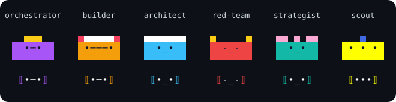

<p align="center"></p>

# Delphi

**A team of AI agents in your terminal that plans, builds and reviews software with you, and has to get your approval before anything leaves the sandbox.**

Delphi is a spec-driven, multi-agent working environment for software engineering, research and systems architecture. It is a single Rust executable plus a full-screen console. You talk to one window; behind it a small team of specialist agents reads your project, drafts specs, builds changes in isolated git worktrees, audits each other's work and argues in a Council when a decision is hard. It runs on the model access you already have: the Anthropic and Gemini APIs, AWS Bedrock, Google Vertex, an OpenAI-compatible gateway, your own `claude` and `agy` subscriptions, or a local Ollama fallback.

> Where things stand: [`missions/2026-10-23-foundational-design/spec-tracker.md`](missions/2026-10-23-foundational-design/spec-tracker.md) says, spec by spec, what is approved, built and proven. Design decisions are numbered (D-nn) in [`decisions.md`](missions/2026-10-23-foundational-design/decisions.md). Status: pre-1.0, macOS and Linux, one operator per install. The latest release is v0.2.7; `main` is well ahead of it (`delphi update --dev` follows `main`).

## Contents

- [What you get](#what-you-get)
- [How it works](#how-it-works)
- [Install](#install)
- [Quick start](#quick-start)
- [Using it](#using-it)
- [Configuration](#configuration)
- [Development](#development)
- [Status and limitations](#status-and-limitations)
- [Repository layout](#repository-layout)
- [Specifications](#specifications)

## What you get

- **A console** (just `delphi`). Ask questions, hand out work with `@architect …`, `/build …` or `/council …`, and answer approval cards. Nothing consequential happens without a card.
- **Builds you can trust.** The Builder works in a throwaway worktree; Delphi runs your tests and checks, has a different agent audit the exact commit, and asks you before merging (or opens a pull request).
- **Councils.** Several seats on different model families answer blind, cross-examine each other's answers, and the verdict carries a Minority Report that the runtime copies verbatim.
- **A second, read-only window** (`delphi observe`): the live Council, work grouped into threads, the agents, the archives and knowledge window, and a change log of what the agents finished (their own one-line reports, by session, never their reasoning). It never spends money.
- **Knowledge search** (`delphi kb search`, `/search` in the console): keywords, meaning and a reranking pass, all run locally from models compiled into the executable.
- **Documents without dependencies.** Agents read PDF, Office, archives, HTML, notebooks and more, and write HTML pages, reports, decks, spreadsheets, charts and diagrams, all with in-tree code.
- **Work while you are away.** `delphi run` does one task headless by a written policy; `delphi relay` mails approval cards to you (email or Telegram) and takes your replies; timers wake a role later.
- **Safety by construction.** Everything an agent reads from outside is tainted and limits what it may do next; model access, agent definitions and connector pins change only when you ratify them; using Delphi never writes into your project repository.

## How it works

### One runtime, two windows

```
 console (delphi) ──┐                 delphi __core daemon (one per workspace)
   input, approvals  ├── unix socket ──┤  agent loop · tools · approvals · builds · Council · timers
 narrator (observe) ─┘  JSON-RPC       │  model pool and routing, budget reservations
   read-only, live                     │  local/missions/<id>/*.jsonl ← the event log, single source of truth (agents cannot read it)
                                       │  local/state.db              ← derived index: FTS5 + vectors, usage ledger
 $DELPHI_HOME/workspaces/<name>/       ← all state lives here (default ~/.delphi); project repos stay clean
```

The daemon (`delphi-core`, `delphi-engine`) is the only writer of the event log and the index, and it enforces every invariant in code. The console and the narrator are clients. The console is `delphi-ui`, an [Ink](https://github.com/vadimdemedes/ink) program compiled with Bun and installed next to `delphi`; when it is absent `delphi` falls back to the Rust inline console (`delphi chat --inline`). If the daemon restarts, the console says so, re-attaches and rebuilds the conversation from the mission log.

### Roles and themes

Agents are data: each is an `agents/<role>/AGENT.md` with write globs, allowed tools and a model tier; each skill is a `SKILL.md` under `skills/` that loads only when used. Nine roles exist (`orchestrator`, `builder`, `architect`, `red-team`, `strategist`, `investigator`, `scout`, `writer`, `integrator`); the default roster enables the first five (D-07). Specs, config and manifests use role IDs only. Display names and voice come from a theme pack (Greek mythology by default; [`themes/greek/theme.md`](themes/greek/theme.md)); a theme can never change what a role may do, and the repo lint refuses a theme name outside `themes/` and Council records. The charter is [`GOVERNANCE.md`](GOVERNANCE.md) (*No Spec, No Build*, trust boundaries), and [`REVIEW.md`](REVIEW.md) is the review rubric; both are seeded into every workspace.

### Seats, harnesses and the model pool

Roles ask for capabilities and a tier (`fast` / `workhorse` / `frontier`), never for a named model. The adapter compiles one intermediate prompt representation into each provider's dialect, preserving reasoning signatures across tool loops. A **seat** is a model reached over one of these paths ([`specs/009`](specs/009-model-access-and-auth.md)):

| Path | What it is | Credentials |
| :-- | :-- | :-- |
| `api` | Anthropic or Gemini API directly | keychain / Secret Service, env, or a command |
| `cloud` | AWS Bedrock (SigV4) or Google Vertex | `aws:<profile>`, `gcloud-adc` |
| `gateway-native`, `gateway-compat` | a corporate gateway or any OpenAI-compatible endpoint; also a loopback Ollama with `credential = "none"` | OAuth2 device code / PKCE, or none |
| `harness` | your own `claude` (Claude Code) or `agy` (Antigravity) CLI as a subscription seat | the CLI's own login; Delphi never reads it |

Harness seats get Delphi's tools through a per-span MCP bridge ([`specs/020`](specs/020-harness-tool-bridge.md)): Claude seats run with delegated approvals and the account's own connectors by default; `agy` seats run behind a `PreToolUse` hook that denies every tool but Delphi's, start untrusted until `delphi endpoints test --probe` has watched the gate hold on the installed version, and can then act as a Builder with edits routed through Delphi's cards. The **model pool** ([`specs/002`](specs/002-adapter-and-routing.md) §4.1) keeps models in preference order per endpoint; when one is out of quota or cooling down the next takes over, a task waits rather than failing when none is left, and a weaker substitute needs your confirmation. `delphi models` shows where each stands.

### Trust, approvals and budget

Taint is computed, not declared: every span carries the lowest trust tier of anything it read (`external_untrusted` < `federated_peer` < `federated_verified` < `internal_generated` < `internal_empirical` < `user_ratified`), and a span that has read untrusted content cannot write, execute, call out or dispatch without a Red card. Three approval tiers: **Green** (reads, mission notes, commands your `[exec] allow` rules cover, and everything inside the OS sandbox when it is on) runs without asking; **Amber** (commits, pinned installs, other commands) is shown to you and can be approved per task with `/a`; **Red** (anything outbound, merges, new dependencies, charter edits, destructive commands) always asks and is denied if nobody answers. The OS sandbox (`sandbox-exec` on macOS, `bubblewrap` on Linux) is optional and off by default (D-24). Spending is reserved before each model call against a per-mission and per-Council ceiling (D-10) and shown by `/usage`.

### Builds and Councils

`/build <request>` runs the escalation ladder: a worktree is created, the Builder works under *No Spec, No Build*, your `test_command` and `check_command` run as merge gates, a different agent audits the exact commit, and a merge card (or a pull request) ends it. `/build --optimistic` lets the build decide its own worktree edits, records each as a provisional decision, and refuses to merge until you have reviewed them (`/decisions`, then `/merge`; [`specs/015`](specs/015-provisional-decisions.md)). `/council <proposition>` runs three rounds (blind answers, cross-examination, verdict) across seats on different model families, with the Minority Report written by the daemon, not the arbiter; a deadlock becomes a structured decision for you ([`specs/003`](specs/003-collaboration-and-council.md)).

### Knowledge search

`delphi kb search` combines FTS5 keyword matching (so `[REV-SEC-04]` still hits exactly), a local `bge-base` embedding search (sqlite-vec) and a MiniLM cross-encoder that reads the best few results with your question. The two models (about 146 MB) are compiled into release builds and run on your machine; nothing is sent anywhere. The index covers `context/`, `specs/`, `missions/`, agent memory and the agents and skills themselves, is refreshed on every search, ships with vectors for the built-in documents, and returns `path#L10-L40` pointers. Untrusted or inactive material is left out unless you ask, and an agent sees only its own private memory. `delphi kb serve` exposes the same search as a read-only local HTTP API (`/v1/search`, `/v1/doc`, `/v1/documents`, `/v1/collections`, `/v1/health`), which the narrator's knowledge window also uses over its socket ([`specs/004`](specs/004-memory-and-coaching.md), [`specs/028`](specs/028-knowledge-window.md)).

### Documents and data visualization

[`specs/014`](specs/014-documents-and-dataviz.md) is built with no new third-party crates: `crates/delphi-docs` holds in-tree zip, XML, PDF, HTML, PNG and chart code. Agents get `read_doc` (docx, xlsx, pptx, csv, PDF, HTML, JSON/YAML/TOML, notebooks, mail, ics, RTF, ODF, epub, images, archives, sqlite queries) and `write_archive`, `write_html`, `write_chart`, `write_report`, `write_deck`, `write_sheet` and `write_diagram`, each writing into a path the role's manifest allows with a provenance sidecar.

### Org bundles and sharing

An org bundle is a directory an organization publishes so every install starts from the same knowledge, skills, agents and stated goals; it is a superset of a Claude Code plugin ([`specs/022`](specs/022-xenia-sharing-overview.md) to [`027`](specs/027-bundle-authoring-distribution-and-evaluation.md)). Today `delphi bundle validate <dir>` and `delphi bundle manifest <dir>` check a bundle (the `delphi-bundle` crate; a golden bundle lives in `dev/bundles/acme-platform` and is checked in CI), and `delphi bundle add <dir or file.xbundle>` re-checks it (verifying a signature, if any, and the publisher's continuity), prints what it brings, copies it into `~/.delphi/bundles` and makes its knowledge searchable (`delphi kb search <words> --bundle org/name`; no model is called). A vector cache a bundle ships is used only if it matches your embedder and passes a local spot check (`add --no-vectors` skips it); the rest are embedded in the background, `bundle list` shows how far along they are, and until then results from the bundle say `(lexical only: vectors N% ready)`. `bundle list`, `remove`, `update`, `rollback` and `gc` complete the set; a publisher runs `bundle sign` (at a terminal) and `bundle package` (a reproducible `.xbundle`) ([`specs/024`](specs/024-bundle-trust-adoption-and-precedence.md)). The spec you are about to approve lists the goals and decisions of your bundles that it cites and that no longer stand (advice only; [`specs/026`](specs/026-team-alignment-and-strategist-integration.md)). `bundle serve` is a later slice (B12). Xenia, the signed org-level memory store ([`specs/011`](specs/011-xenia-trust-model.md), [`012`](specs/012-xenia-record-schema.md)), has its verification code in `crates/delphi-xenia` and `delphi xenia whoami`; the store itself is not built.

**Plugins in and out.** `delphi bundle import <plugin dir>` turns a plain Claude Code plugin into a new bundle directory and prints a table of what was imported, what was ignored and why (`hooks/`, `commands/`, `bin/` and the rest never run or load; `.mcp.json` servers become inert declarations with every value dropped; agents need a host role from you, `--agent-role reviewer=red-team`, and skills need `--agents`). It never adds. `delphi bundle export <name> --claude-plugin <dir> [--strip-delphi]` writes an added bundle as a plugin, `--agents-md [file]` writes a knowledge-only fragment (by default under `~/.delphi/exports`, never in a project), and `export <name>... --marketplace <dir> --repo owner/repo --sha <commit>` writes a `marketplace.json` that pins every bundle to a commit. `delphi bundle add --from-marketplace <repo> <name>` fetches only the entry's pinned commit (a locked-down fetch, nothing checked out) and then checks it exactly like a directory.

### Learning without memory poisoning

Lessons, rules, config changes, imported skills and release-refreshed files all arrive as **proposals** and only take effect when you `/ratify` them. Always-loaded rule files stay small (D-09), and only test-verified or ratified content can be promoted. Coaching automation, diff3 updates, team sync, ambient watches and `/rewind` are deliberately not built until `delphi needs` records evidence for them (roadmap Step 6).

## Install

```sh
curl -fsSL https://github.com/jessevondoom/delphi/releases/latest/download/install.sh | sh
# or
brew tap jessevondoom/delphi https://github.com/jessevondoom/delphi && brew install delphi
```

macOS (Apple silicon and Intel) and Linux (x86_64 and aarch64). The installer puts `delphi` and `delphi-ui` in `~/.local/bin` (`--dir`, `DELPHI_INSTALL_DIR`), checks the download against its SHA-256 and the release's GitHub build attestation, and therefore needs the `gh` CLI signed in; without it the install stops unless `DELPHI_SKIP_ATTESTATION=1` accepts the checksum alone. `--version vX.Y.Z` installs a specific release; `--no-setup` skips the offer to run `delphi setup`.

Later, `delphi update` fetches and verifies the newest release, replaces both executables, refreshes the built-in agents, skills and themes in your workspaces (as ratification proposals when they differ from yours; `--review` leaves them pending), and restarts any running daemon (`--no-restart` leaves them). `--check` shows what it would do, `--rollback` undoes all three steps, `--dev` follows the rolling build of `main`. When the build is a **signed release** (signed in CI by the maintainers' key; `delphi release` says, and `delphi doctor` check 2), the first `delphi chat` or `delphi run` after an update refreshes the workspace and ratifies the release's own files itself, so there is nothing for you to approve; your customized files and your own files are never touched, and a build whose signature does not hold ratifies nothing and is refused by `delphi update` (`specs/036`; `--require-signed`, `DELPHI_REQUIRE_SIGNED=1` or `[update] require_signed = true` in `config.toml` also refuse an unsigned build; `DELPHI_NO_AUTO_UPDATE=1` turns the refresh off).

**From source** (Rust 1.85 or newer; the repo pins a toolchain in `rust-toolchain.toml`):

```sh
cargo build --release                      # target/release/delphi (the daemon is `delphi __core`)
cd ui && npm ci && npm run build           # ui/dist/delphi-ui, the full-screen console (needs Bun from devDependencies)
```

Put `ui/dist/delphi-ui` next to `delphi` or point `$DELPHI_UI` at it; without it `delphi` uses the inline console. Release builds also pass `--features embedded-model` to compile the search models in; a plain `cargo build` searches by keyword only unless you install the models under `$DELPHI_HOME/models/` (`dev/fetch-model.sh`).

## Quick start

```sh
cd ~/code/my-project
delphi
```

The first time, `delphi` creates a workspace for the project under `~/.delphi/workspaces/`, runs the guided model setup if no model access exists (it finds `claude` and `agy`, asks only for what it cannot find, and ratifies the config), runs the doctor and offers to fix what it can, then opens the console. After that it just opens the console. Outside a git repository it uses a `default` workspace that holds only the built-in knowledge.

```
› What does @project/my-project/src/lib.rs do?
› @architect draft a spec for the retry ladder
› /build implement specs/011-retry.md in @project/my-project
› /council Should the retry queue be a table or a file?
› /observe
```

Paths in the prompt are logical: `@project/<name>/…` for a project repo, `@worktree/…` inside a build, `specs/…`, `missions/…` and `context/…` for the workspace's own files. `/search` (or `ctrl+k`) finds a document and puts its `@path` in the prompt.

## Using it

### In the console

| Command | What it does |
| :-- | :-- |
| `@<role> <request>` | ask one role directly (by role ID or its theme name) |
| `/build [--optimistic] <request>` | worktree, tests, audit, then your merge card |
| `/council [--lenses] <proposition>` | a blind three-round Council; `--lenses` gives each seat one of your bundles' perspectives to argue from |
| `/distill [<path\|missions/id> …]` | the writer drafts bundle knowledge from allow-listed sources (team context and specs, mission decisions and Council verdicts) into a staging directory of the mission; nothing is written into a bundle |
| `/timer <when> <note>`, `/timer @architect 1h …` | wake a role later; `/timer list`, `/timer cancel <id>` |
| `/y` `/a` `/n` `/d` | approve once, approve similar this task (Amber only), reject, show the card's payload |
| `/permissions [default\|accept-edits\|mission-auto\|optimistic]` | approval mode (`Shift+Tab` cycles it) |
| `/budget [dollars]`, `/usage [mission\|role\|task\|model]` | this mission's ceiling; tokens and spend |
| `/models`, `/agents`, `/connectors` | the pool, who is running, which connectors are pinned |
| `/decisions`, `/merge <task>` | review an optimistic build's decisions; rerun the gates and merge card |
| `/ratify` | pending proposals (config, manifests, skills, release files) |
| `/search`, `/sources`, `/pin`, `/notes`, `/export` | knowledge base, where answers came from, the mission notebook, save the conversation |
| `/org` | the added org bundles, their goals, perspectives and open items; add, update, roll back or remove a bundle (no approval card: your key is the decision) |
| `/observe [council\|epic\|agents\|archives\|changes]` | open the narrator in a new tmux or terminal window |
| `/resume`, `/pause`, `/mission`, `/missions`, `/clear`, `/mouse`, `/quit` | after a daemon restart; the current and past missions; housekeeping |

`?` on an empty prompt lists the keys. `Esc` clears the prompt, then stops the running task; `Alt+Enter` or `Ctrl+J` inserts a newline; the mouse wheel scrolls and `/mouse` hands selection back to the terminal. The console follows `NO_COLOR`, `TERM=dumb`, `DELPHI_THEME=dark|light`, `DELPHI_REDUCE_MOTION=1`, `DELPHI_NO_MOUSE=1` and `DELPHI_NO_TITLE=1`.

### From the shell

Every command takes `--workspace <name>` and `--home <dir>`; `delphi help <command>` prints one command's options without creating anything.

| Group | Commands |
| :-- | :-- |
| Start | `delphi` · `delphi chat [--inline] [--mission <id>]` · `delphi run "<task>" [--on-card deny\|policy:<file>] [--budget <usd>] [--timeout <dur>] [--json\|--jsonl]` |
| Set up | `setup` · `init` · `auth login\|status\|logout <endpoint>` · `endpoints test [--probe]` · `connectors status\|test\|pin <name>` · `relay [check\|totp-enroll\|totp-check]` · `skills check\|export\|import` · `bundle init\|validate [--report]\|distill\|manifest\|sign\|package [--vectors]\|import\|export\|add\|list\|remove\|update\|rollback\|gc` · `hooks` |
| Work | `decisions` · `timers` · `needs` · `kb index\|reindex\|stats\|search\|serve\|miss\|eval\|model info` · `observe [view] [--once]` (alias `narrator`) |
| Inspect | `status` · `missions` · `doctor [--fix]` · `models [--probe]` · `daemon status\|stop\|restart` · `lint --repo <path>` · `check <kind> <path>` |
| Maintain | `update` · `xenia whoami` · `help` |

`delphi run` is for scripts and CI: it answers cards by a written policy (never Red, never a merge), stops at "ready to merge", and exits 0 ok, 1 gates failed, 2 a card was denied, 3 budget, 4 infrastructure ([`specs/016`](specs/016-headless-run.md)). `delphi relay` and `delphi hooks` are long-running and need a terminal or tmux pane because the daemon issues tokens only to processes with a controlling tty. `delphi observe --once` prints one frame as text and works without a terminal.

## Configuration

Delphi keeps all state in `$DELPHI_HOME` (default `~/.delphi`) and never writes into a project repository (D-03):

```
~/.delphi/
├── workspaces/<name>/
│   ├── config.toml       # this workspace (seeded from crates/delphi/config.example.toml)
│   ├── base/             # zone 1, the release snapshot: GOVERNANCE.md, SPEC.md, agents/, skills/, themes/; refreshed by `delphi update`
│   ├── team/             # zone 2, shareable with a team: REVIEW.md, context/
│   ├── local/            # zone 3, private: missions/<id>/ (segmented event log), state.db, memory/agents/<role>/,
│   │                     #   proposals/, ratified/ and ratified.lock, kb-misses.jsonl, agy-gate.json
│   ├── locks/  worktrees/   # daemon locks; Builder worktrees
├── run/                  # the daemons' sockets
├── models/               # optional embed.dlphmdl / rerank.dlphmdl that override the compiled-in models
└── themes/               # your own theme packs
```

The workspace is chosen by `--workspace`, `DELPHI_WORKSPACE`, or the project containing the current directory. [`crates/delphi/config.example.toml`](crates/delphi/config.example.toml) documents every section; the ones you are most likely to touch:

| Section | Purpose |
| :-- | :-- |
| `[workspace]` | `projects` the workspace operates on; `untrusted_paths` read as `external_untrusted` |
| `[models.<family>]`, `[models.catalog."<id>"]` | tier → model ID per family; per-model limits and prices (prices drive budget reservation) |
| `[[endpoints]]`, `[access]`, `[auth.*]` | how each family is reached (`api`, `cloud`, `gateway-*`, `harness`), order and allow-list, OAuth flows. **Ratified**: changes are Red-tier proposals |
| `[routing]`, `[routing.pool]`, `[routing.targets]` | retry ladder, parallelism, pool order and throttling, optional target model per role |
| `[budget]`, `[hitl]` | mission and Council ceilings, what happens on exhaustion, card timeout (unanswered = deny) |
| `[exec]` | `sandbox = off\|prefer\|required`, `allow` / `deny` command patterns, `test_command`, `check_command`. **Ratified** |
| `[harness.claude]`, `[harness.agy]`, `[harness]` | narrow the subscription-CLI defaults (bridge, approvals, native web tools, connectors, env). **Ratified** |
| `[connectors.<name>]` | MCP connectors (Drive, Slack, Zoom): URL, login, allowed tools and their read/write class. **Ratified** |
| `[[hooks.observe]]`, `[[hooks.deny]]` | your commands on events or as vetoes; they can only watch or refuse ([`specs/018`](specs/018-operator-hooks.md)) |
| `[theme]`, `[agents]`, `[rag]`, `[events]` | theme name, enabled roster, search settings, thinking retention |

API keys never live in `config.toml`: they go to the macOS Keychain or Linux Secret Service, with `*_env` fallbacks. Environment variables Delphi reads: `DELPHI_HOME`, `DELPHI_WORKSPACE`, `DELPHI_UI`, `DELPHI_THEME`, `DELPHI_NO_ONBOARD`, `DELPHI_NO_MOUSE`, `DELPHI_REDUCE_MOTION`, `DELPHI_EMBED_MODEL` / `DELPHI_RERANK_MODEL` / `DELPHI_SEED_VECTORS` (a file path, or `off`), and `DELPHI_SKIP_ATTESTATION` for the installer.

## Development

```sh
cargo test --workspace --locked                      # everything (e2e console tests need ui/node_modules, else they skip)
cargo clippy --workspace --all-targets -- -D warnings
cargo run -q -p delphi -- lint --repo .              # this repository's own Delphi files (frontmatter, theme names, links)
cargo run -q -p delphi -- bundle validate dev/bundles/acme-platform --claude
python3 -I dev/bench/bench.py self-test              # the benchmark runner for the evaluation plan

cd ui
npm ci --ignore-scripts && npm run check-deps        # pinned dependencies, no install scripts
npm run typecheck && npm test                        # the screen is pure data: golden screens under test/snapshots*
./try.sh                                             # the console against a fake daemon, from source
```

CI (`.github/workflows/ci.yml`) runs the Rust suite on macOS and Ubuntu, the UI suite, pty end-to-end tests against the real daemon (from source and with the Bun-compiled executable), and a Linux job that requires the bubblewrap sandbox tests to really run. The `release` workflow (tag `vX.Y.Z` matching `crates/delphi/Cargo.toml`, on `main`) fetches and packs the search models, builds four targets with them embedded, smoke-tests, attests provenance, publishes, and updates `Formula/delphi.rb`; running it by hand is a dry run that publishes nothing.

Conventions: build only against an `approved` spec and name it in the commit (`Implements-Spec: specs/NNN-*.md`); one slice per pull request; update the spec tracker in the same PR that changes a spec's state. When running the binary in a scratch setting always pass `--home <tmpdir>`: bare `delphi` and `delphi init` create a real workspace. Builds fill disks quickly; `CARGO_INCREMENTAL=0 CARGO_PROFILE_DEV_DEBUG=0` helps.

## Status and limitations

This is an early project built mostly by its own agents under one operator. The honest split, from the spec tracker:

**Built and exercised for real**
- Install, self-update, rollback and attestation, from real releases (`brew install` has not been run by a person).
- The console on the daemon, the single-agent loop, worktree builds with gates and audit, the model pool with quota failover, Claude and `agy` harness seats with the tool bridge (exercised live by hand, including the gated `agy` Builder path), one real cross-family Council, local hybrid knowledge search with measured recall on a dev and a held-out question set, the document readers and writers, `delphi run`, timers, hooks, skills import/export, `bundle validate`.
- The operator's Step 2 go/no-go (three real tasks on a real project) was passed on 2026-10-25.

**Built, but proven only by tests, mocks or a pty**
- The full-screen console and narrator in real terminal programs (Terminal.app, iTerm2, Ghostty, tmux, ssh): CI covers a pseudo-terminal and an emulator; a person has barely watched them. `Shift+Enter` depends on the terminal.
- Connectors (Drive, Slack, Zoom): the policy pipeline is tested against a scripted MCP server; it has never been run against Google, Slack or Zoom, and the spec's server URLs are reported, not confirmed. Delphi ships no OAuth client IDs; you create your own.
- The relay by email or Telegram (TOTP step-up) has not had a live mailbox trial; live Gemini OAuth is unverified; the bridge on an org-managed Claude SSO account is unchecked.
- Failover to the Ollama local endpoint mid-task; Linux CPU search speed.

**Specified, not built**
- `bundle serve`, evaluation (slices B8, B11, B12; authoring and `package --vectors`, B10, and alignment, B9, are built; compatibility, B7, is built except `connectors map`, `references/` indexing and the handoff `AGENTS.md` pointer; adding, signing, archives, update and rollback, B2 and B6, and vectors, B3, are built); the Xenia store itself (011/012) and the Librarian role (013).
- Step 6, deliberately gated on recorded need (`delphi needs`): coaching automation and `/retro`, diff3 updates of customized files, team sync, ambient watches, `/rewind`.
- Deferred (D-06): federation planes 1 and 2, a direct OpenAI API driver, multi-terminal auto-spawn.

Other limits: git repositories only (D-13); one operator per install; no Windows; harness seats are governed by each provider's terms for automated use of a subscription (`specs/009` §7); CJK PDFs without a ToUnicode map read as empty and there is no OCR; the reranker was trained on MS MARCO, whose data terms you should weigh before commercial distribution.

## Repository layout

```text
delphi/
├── crates/
│   ├── delphi/            the executable: console, narrator, setup, run, update, lint, every subcommand; config.example.toml
│   ├── delphi-core/       daemon plumbing: events, segmented log, hub, path guard, budget, usage ledger, TOTP
│   ├── delphi-engine/     agent loop, tools, approvals, builds, Council, model pool, harness bridge, connectors, kb, timers, hooks
│   ├── delphi-adapter/    provider dialects (Claude, Gemini, OpenAI-compatible), credentials, OAuth2, SigV4, MCP client
│   ├── delphi-sandbox/    sandbox-exec (macOS) and bubblewrap (Linux), deny by default
│   ├── delphi-docs/       dependency-free document readers and writers, charts, diagrams, PNG
│   ├── delphi-bundle/     the org bundle standard: manifest, layout, deterministic validate
│   ├── delphi-xenia/      signed-record verification for the org memory store; the release signature
│   └── delphi-release/    the maintainers' release-signing tool (not shipped)
├── ui/                    delphi-ui, the Ink console and narrator (src/, test/, dev/, README.md, TERMINALS.md)
├── agents/<role>/AGENT.md role manifests        skills/        skill packages and CATALOG.md
├── themes/greek/          default theme pack     context/       seed knowledge (index, heuristics, capability matrix)
├── memory/agents/<role>/  seed private lessons   missions/      Delphi's own design records, roadmap, Councils, tracker
├── specs/                 subsystem specifications, UI blueprints and assets
├── GOVERNANCE.md  SPEC.md  REVIEW.md  OVERVIEW.md   charter, master spec, review rubric, one-page tour
├── dev/                   benchmark runner, kb eval sets, golden bundle, model fetch and seed-vector scripts, skill evals
├── Formula/delphi.rb      Homebrew formula (written by the release workflow)
└── install.sh             the installer behind the curl one-liner
```

`OVERVIEW.md` and `SPEC.md` are the original design documents and predate the build; where they disagree with this file or the spec tracker (for example the Ratatui console, which became Ink under D-28), the tracker is current.

## Specifications

All in [`specs/`](specs/); each file's `status` line says whether the operator has approved it.

| | Spec | State |
| :-- | :-- | :-- |
| 001 | [Governance and manifests](specs/001-governance-and-manifests.md): `AGENT.md`, `SKILL.md`, handoff envelope, taint lattice, themes | built |
| 002 | [Adapter and routing](specs/002-adapter-and-routing.md): IPR, dialects, model scaler, model pool | built |
| 003 | [Collaboration and Council](specs/003-collaboration-and-council.md): escalation ladder, DAG, retry ladder, Council | built; one real Council |
| 004 | [Memory, retrieval and coaching](specs/004-memory-and-coaching.md): hybrid search, ratified learning loop | search built; coaching gated |
| 005, 005a-g | [Console and narrator](specs/005-console-and-narrator-tui.md), [avatars](specs/005a-terminal-avatar-system.md), [decks and inbox](specs/005b-deck-navigation-and-visual-interface.md), [inline console](specs/005c-inline-console.md), [full-screen console](specs/005d-full-screen-console.md), [redesign](specs/005e-console-ux-review-and-redesign.md) and [build plan](specs/005f-console-redesign-build-plan.md), [epic threads](specs/005g-epic-threads.md) | built; real-terminal pass pending |
| 006 | [Installer, layout and updater](specs/006-installer-and-updater.md) | built (SHA-256 + attestation; the release signature of [036](specs/036-signed-releases-and-start-time-refresh.md) is built and waits for the maintainers' key) |
| 007 | [Federation and sync](specs/007-federated-mesh-and-sync.md) | deferred |
| 008 | [Ambient watch, rewind, HITL tiers](specs/008-ambient-watch-and-rewind.md) | tiers built; watches and rewind gated |
| 009 | [Model access and authentication](specs/009-model-access-and-auth.md) | built; live Gemini OAuth unverified |
| 010 | [Connectors (MCP)](specs/010-connectors-and-tool-access.md) | slice 1 built; never run live |
| 011-013 | [Xenia trust model](specs/011-xenia-trust-model.md), [record schema](specs/012-xenia-record-schema.md), [Librarian](specs/013-librarian-and-internal-retrieval.md) | approved; not built |
| 014 | [Documents and data visualization](specs/014-documents-and-dataviz.md) | built |
| 014 | [Relay and away mode](specs/014-relay-and-away-mode.md) | built; no live mailbox trial |
| 015-019 | [Provisional decisions](specs/015-provisional-decisions.md), [headless run](specs/016-headless-run.md), [timers](specs/017-timers.md), [operator hooks](specs/018-operator-hooks.md), [skills import/export](specs/019-skills-import-export.md) | built |
| 020, 021 | [Harness tool bridge](specs/020-harness-tool-bridge.md); [harness CLI features](specs/021-harness-cli-features.md) (draft) | built |
| 022-027 | [The sharing layer](specs/022-xenia-sharing-overview.md), [bundle standard](specs/023-org-bundle-standard.md), [provenance and precedence](specs/024-bundle-trust-adoption-and-precedence.md), [compatibility](specs/025-plugin-skill-and-tool-compatibility.md), [team alignment](specs/026-team-alignment-and-strategist-integration.md), [authoring and evaluation](specs/027-bundle-authoring-distribution-and-evaluation.md) | approved; B1 (`validate`) built |
| 028, 029 | [Knowledge window](specs/028-knowledge-window.md), [links and inline reader](specs/029-links-and-inline-reader.md) | drafts; first slices built in the narrator |

## License

[MIT](LICENSE). Delphi launches your own `claude` and `agy` programs and never reads or stores their logins; each provider's terms govern automated use of a subscription.
