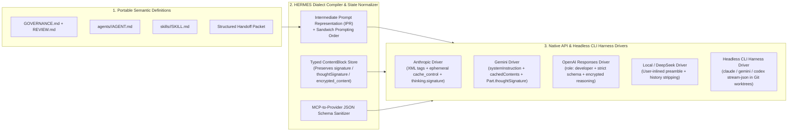
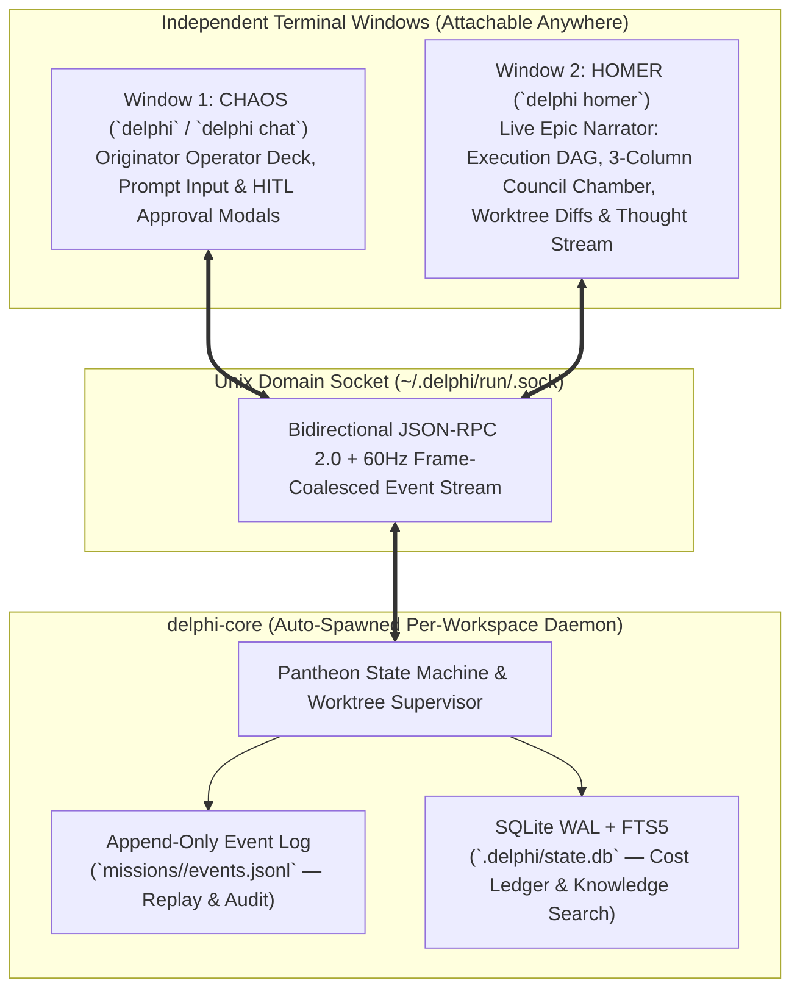

# Delphi: Master System Specification (`SPEC.md`)
> **Status:** Draft v0.3 — Empirically Hardened & Mythologically Grounded Architecture  
> **Governed By:** [GOVERNANCE.md](file:///Users/jessevondoom/projects/work/delphi/GOVERNANCE.md) (*Themis*) & [REVIEW.md](file:///Users/jessevondoom/projects/work/delphi/REVIEW.md)  
> **Role:** Central Architectural & Functional Source of Truth

---

## 1. System Overview & Cosmogony

**Delphi** is a terminal-first (CLI/TUI), multi-agent, Mixture-of-Experts (MoE) collaborative working environment built in **Rust** (`Tokio` + `Ratatui` + `rusqlite`/`sqlite-vec`), handling software engineering, deep research, strategic architecture, and personal project planning.

### 1.1 The Four Systemic Layers (Cosmogonic Architecture)
Drawing from Hesiod's *Theogony* and Aeschylus's *Eumenides* (see [`mythological-cosmogony-and-pantheon.md`](file:///Users/jessevondoom/projects/work/delphi/context/domains/mythological-cosmogony-and-pantheon.md)):

1. **CHAOS (*Khaos* — The Primordial Operator Deck & Runtime Substrate):**
   - In Hesiod, *Khaos* is the non-anthropomorphic clearing from which all gods emerge.
   - In Delphi, **Chaos** is the primary operator window (`delphi` / `delphi chat`) and the deterministic runtime daemon (`delphi-core`). Chaos is **not** a persona agent; it is the sovereign origin point where User intent enters, human-in-the-loop (HITL) approvals are granted, and process/worktree lifecycles are supervised.
2. **THEMIS ([GOVERNANCE.md](file:///Users/jessevondoom/projects/work/delphi/GOVERNANCE.md) & [REVIEW.md](file:///Users/jessevondoom/projects/work/delphi/REVIEW.md) — Constitutional Law & Audit Rubric):**
   - The Titaness of divine law who held Delphi before Apollo. Governs behavioral invariants, security gates, anti-poisoning rules, and adversarial PR review rubrics.
3. **HERMES (The Dialect Compiler, Model Adapter & MCP Protocol Bus):**
   - The boundary-crossing translator (*Hermēneus*) that compiles portable agent/skill manifests into provider-optimal dialects across Claude, Gemini, OpenAI, local models, and external CLI harnesses.
4. **THE PANTHEON (The 9 Specialized Cognitive Agents):**
   - **Athena**, **Hephaestus**, **Daedalus**, **Artemis**, **Argos**, **Odysseus**, **Ares**, **Apollo**, and **Hermes**—each defined in [`agents/<god>/AGENT.md`](file:///Users/jessevondoom/projects/work/delphi/agents/athena/AGENT.md) with explicit cognitive biases, tool scopes, and mythological blind-spot counterweights.

---

## 2. The Pantheon Roster & Agent Specifications

Each specialist has a dedicated specification in `agents/<god>/AGENT.md` and a catalog of portable skills in [`skills/CATALOG.md`](file:///Users/jessevondoom/projects/work/delphi/skills/CATALOG.md):

| Agent Spec | Role & Domain | Cognitive Tier | Primary Blind Spot (Mythological & MAST) | Built-In Counterweight |
| :--- | :--- | :--- | :--- | :--- |
| **[`Athena`](file:///Users/jessevondoom/projects/work/delphi/agents/athena/AGENT.md)** | Lead Orchestrator, Coach, Council Arbiter & Memory Curator | `deep-reasoning` | *The Arachne Trap & Poisoning:* Smoothing over dissent (`FM-2.5`) or promoting untrusted text. | Mandatory verbatim **Minority Report**; Taint tracking (`[H-004]`); **Rule of 25**. |
| **[`Hephaestus`](file:///Users/jessevondoom/projects/work/delphi/agents/hephaestus/AGENT.md)** | Lead Engineer, Builder & Script Forger | `code-craft` | *Volcanic Cave Tunnel Vision:* Silent code workarounds & spec drift (`FM-1.1`). | *No Spec, No Build*; isolated Git worktrees; audited via base-branch `REVIEW.md`. |
| **[`Daedalus`](file:///Users/jessevondoom/projects/work/delphi/agents/daedalus/AGENT.md)** | Systems Architect & Spec Author | `deep-reasoning` | *The Labyrinth Trap:* Accidental complexity & over-abstraction. | *Icarus Middle-Course Rule*: Required `Simpler Alternative Considered` + Council cross-exam. |
| **[`Artemis`](file:///Users/jessevondoom/projects/work/delphi/agents/artemis/AGENT.md)** | Precision Hunter, Bisect & Benchmark Specialist | `fast-triage` | *The Actaeon Reflex:* Binary target fixation without strategic trade-offs. | Strictly scoped to precision discovery/verification; read-only on source code. |
| **[`Argos`](file:///Users/jessevondoom/projects/work/delphi/agents/argos/AGENT.md)** | Broad Discovery, Repo Cartographer & Scout | `high-context-discovery` | *Hermes' Lullaby:* Context window overflow & "Lost-in-the-Middle" collapse (`FM-1.4`). | *Anti-Lullaby Rule (`[H-002]`)*: Outputs `<300`-line pointer maps; never raw dumps. |
| **[`Odysseus`](file:///Users/jessevondoom/projects/work/delphi/agents/odysseus/AGENT.md)** | Long-Horizon Strategist & Scope Auditor | `deep-reasoning` | *The Sirens & Polyphemus:* Scope derailment (`FM-2.3`) or premature victory (`FM-3.1`). | *The Siren Protocol*: Audits specs/PRs against scope creep; cannot waive `P0` security gates. |
| **[`Ares`](file:///Users/jessevondoom/projects/work/delphi/agents/ares/AGENT.md)** | Red Team, Threat Modeler & PR Critic | `deep-reasoning` | *Unbridled Destruction:* Nihilistic contrarianism & infinite review loops (`FM-1.3`). | *Athena's Boundary Stone*: Requires falsifiable repro + remediation; capped at 3 Council rounds. |
| **[`Apollo`](file:///Users/jessevondoom/projects/work/delphi/agents/apollo/AGENT.md)** | Documentation Architect, Technical Writer & Clarity Synthesizer | `deep-reasoning` | *Solar Gloss:* Prioritizing eloquent prose over ugly caveats or unbuilt features. | *Truth Before Harmony & Mēden Agan*: Verified examples only; includes **Ares'** caveats. |
| **[`Hermes`](file:///Users/jessevondoom/projects/work/delphi/agents/hermes/AGENT.md)** | External Integrations, GitHub Ops & Protocol Specialist | `fast-triage` | *The Trickster & Slayer of Argos:* Unchecked outbound mutations or noisy external dumps. | Outbound **Chaos** approval gate; inbound sanitization & `external_untrusted` taint tagging. |

---

## 3. Hermes Layer: Multi-Provider Dialect Compilation & CLI Harness Bridging

As documented in [`multi-provider-and-tui-architecture.md`](file:///Users/jessevondoom/projects/work/delphi/context/domains/multi-provider-and-tui-architecture.md), naive "universal prompts" and flat `{role, content: string}` arrays fail in production because frontier models differ fundamentally in instruction delimiters, JSON schema subsets, and **cryptographic thinking signatures** during tool use.



### 3.1 Core Hermes Invariants
1. **Provider-Native Dialect Compilation:** Portable manifests compile into XML-tagged blocks with `cache_control` for Anthropic; `role: developer` Markdown + strict schemas for OpenAI `/v1/responses`; `systemInstruction` + `cachedContents` for Gemini; and first-user-turn inlined instructions with `<think>` history stripping for DeepSeek R1.
2. **Cryptographic Reasoning State Preservation (`[H-003]`):** Conversation state is stored as a typed `ContentBlock[]` array that round-trips Claude's `thinking.signature`, Gemini's `Part.thoughtSignature`, and OpenAI's encrypted reasoning items across multi-turn tool calls. On mid-session cross-provider failover, foreign thinking blocks degrade gracefully to read-only text summaries.
3. **Headless CLI Harness Bridging:** External CLI agents (`claude -p --output-format stream-json`, `gemini -p --output-format stream-json`, `codex app-server`) run inside isolated Git worktrees, emit normalized `EventEnvelope` telemetry to the TUI, and route permission prompts back to **Chaos** via a local Delphi MCP approval tool.

---

## 4. Dual-Window Terminal Architecture: `Chaos` + `Homer`

To provide both a distraction-free operator interface and deep real-time observability across concurrent agents, Delphi uses a **Client-Daemon Event-Sourced Architecture** over **Unix Domain Sockets (UDS)**.



### 4.1 Window 1: `Chaos` (`delphi` / `delphi chat`)
- Identifies as **Chaos** (the originator substrate).
- Provides the primary conversation stream with **Athena** (or `@<god>` direct specialist invocation), command palette (`/council`, `/spec`, `/homer`, `/retro`), and synchronous Human-in-the-Loop approval modals.

### 4.2 Window 2: `Homer` (`delphi homer`)
- Named after **Homer**, the epic poet and narrator who chronicles the actions of the gods and heroes.
- Runs in any second terminal window/monitor or spawns automatically via `delphi --dual` / `Ctrl+W` (supporting `tmux`, `zellij`, `WezTerm`, `Kitty`, and macOS native windows, plus an inline `Tab` toggle for single-screen sessions).
- Four live views: **[1: The Epic & Pantheon DAG]**, **[2: Council Chamber]** (side-by-side streaming of blind Round 1 proposals and Round 2 **Ares**/**Odysseus** cross-examination), **[3: The Forge]** (live **Hephaestus** worktree diffs & test output), and **[4: Archives]** (FTS5 knowledge base browser).

---

## 5. GitHub-Native Spec-Driven & Learning Loop Workflow

Per [`github-review-and-learning-loops.md`](file:///Users/jessevondoom/projects/work/delphi/context/domains/github-review-and-learning-loops.md):

1. **Two-Stage PR Pipeline:**
   - **Stage 1 (Spec PR):** **Daedalus** drafts `specs/NNN-<slug>.md` (including `Simpler Alternative Considered`). Reviewed by **Odysseus** and **Ares**; ratified by the User (`status: approved`).
   - **Stage 2 (Implementation PR):** **Hephaestus** builds inside `.delphi/worktrees/<task-id>/` using TDD and opens a PR with `Implements-Spec: specs/NNN-<slug>.md`.
2. **Adversarial PR Audit (`REVIEW.md`):**
   - **Ares** and **Odysseus** load [REVIEW.md](file:///Users/jessevondoom/projects/work/delphi/REVIEW.md) strictly from `origin/main` (`[REV-SEC-04]`) and post line-anchored `P0`/`P1`/`P2` review findings plus any **Minority Report** before the User merges.
3. **The Four-Channel Coaching & Learning Loop (`Athena`):**
   - Escaped bugs update both `context/heuristics.md` and `REVIEW.md` §4.
   - Human `by-design` overrides add scoped exclusions to `REVIEW.md` §5 (`False-Positive Suppression`).
   - Any rule violated $\ge 2$ times is promoted into a deterministic script in `skills/*/scripts/` (`[H-005]`).
   - Always-loaded heuristic files are capped at **25 active rules** via ExpeL contrastive pruning, and **Athena** coaches individual specialists by updating their `memory/agents/<god>/lessons.md`.

---

## 6. Repository Directory Structure

```text
<delphi-root>/
├── GOVERNANCE.md                # Tier 1 Truth: Behavioral charter & invariants (Themis)
├── SPEC.md                      # Tier 2 Truth: Master architectural specification
├── REVIEW.md                    # Tier 2 Truth: Base-branch adversarial PR review rubric
├── specs/                       # Modular subsystem specifications (Spec-First pipeline)
├── agents/                      # Portable semantic agent manifests (The 9 Pantheon Specialists)
│   ├── athena/AGENT.md
│   ├── hephaestus/AGENT.md
│   ├── daedalus/AGENT.md
│   ├── artemis/AGENT.md
│   ├── argos/AGENT.md
│   ├── odysseus/AGENT.md
│   ├── ares/AGENT.md
│   ├── apollo/AGENT.md
│   └── hermes/AGENT.md
├── skills/                      # Progressive-disclosure skill packages (SKILL.md + scripts/)
│   └── CATALOG.md               # Master index of all 41 Pantheon skills
├── context/                     # Central Knowledge Base (Shared Truth)
│   ├── index.md                 # Master knowledge map
│   ├── heuristics.md            # Active systemic rules (capped at <= 25 via ExpeL)
│   └── domains/                 # Deep domain & research synthesis reports
├── memory/                      # Isolated Agent-Private Episodic Memory
│   └── agents/<god>/lessons.md  # Role-specific heuristics coached by Athena (<= 25)
└── missions/                    # Active and archived mission logs, councils & retros
```

---

## 7. Modular Sub-Spec Roadmap (`specs/`)

All 8 modular subsystem specifications have been drafted in `specs/`:

- [x] **[`specs/001-governance-and-manifests.md`](file:///Users/jessevondoom/projects/work/delphi/specs/001-governance-and-manifests.md):** Schemas for `AGENT.md`, progressive-disclosure `SKILL.md` packages, `HandoffEnvelope`, and 5-tier YAML provenance/taint frontmatter.
- [x] **[`specs/002-hermes-adapter-and-routing.md`](file:///Users/jessevondoom/projects/work/delphi/specs/002-hermes-adapter-and-routing.md):** The **Hermes** Intermediate Prompt Representation (IPR), provider dialect passes, `ContentBlock` signature preservation, **Athena's** dynamic Claude/Gemini model scaler, and CLI harness JSONL drivers.
- [x] **[`specs/003-collaboration-and-council.md`](file:///Users/jessevondoom/projects/work/delphi/specs/003-collaboration-and-council.md):** Complexity escalation ladder, Orchestrator DAG execution, 3-round sparse Council state machine, Heterogeneous Model Routing, and Minority Report synthesis.
- [x] **[`specs/004-athena-memory-and-coaching.md`](file:///Users/jessevondoom/projects/work/delphi/specs/004-athena-memory-and-coaching.md):** Dual-tier memory engine, Frozen Boot-Snapshot cache hygiene, Two-Gear Zero-Server Hybrid RAG (`.delphi/state.db` AST breadcrumb chunking + FTS5 BM25 + `sqlite-vec` + RRF), Two-Strike Context Circuit Breaker, and ExpeL Rule-of-25 coaching loop.
- [x] **[`specs/005-chaos-and-homer-tui.md`](file:///Users/jessevondoom/projects/work/delphi/specs/005-chaos-and-homer-tui.md):** `delphi-core` UDS daemon protocol, 60Hz event bus, `Chaos` operator deck, `Homer` 4-view live narrator/telemetry window, and multiplexer auto-spawning.
- [x] **[`specs/006-installer-and-updater.md`](file:///Users/jessevondoom/projects/work/delphi/specs/006-installer-and-updater.md):** Single-binary embedded-seed packaging, `delphi init` wizard, Three-Zone `delphi update` (`diff3` merge) & `delphi sync` engine, and 8-point `delphi doctor`.
- [x] **[`specs/007-federated-mesh-and-sync.md`](file:///Users/jessevondoom/projects/work/delphi/specs/007-federated-mesh-and-sync.md):** Multi-instance peer federation via **Hermes** (A2A task delegation, `delphi://` Ed25519 UCAN/Biscuit capability pointers, Tailscale/SSH/mDNS transport, and transitive taint lattice firewall).
- [x] **[`specs/008-ambient-watch-and-trajectories.md`](file:///Users/jessevondoom/projects/work/delphi/specs/008-ambient-watch-and-trajectories.md):** Zero-token "No-Agent Mode" ambient watches, coupled `/rewind` time-travel checkpoints (events + Git tree SHAs), 3-tier HITL approval batching, and DPO trajectory export.
