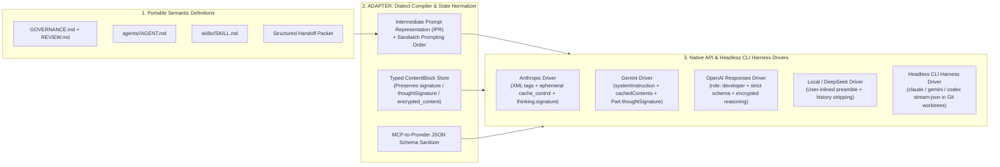
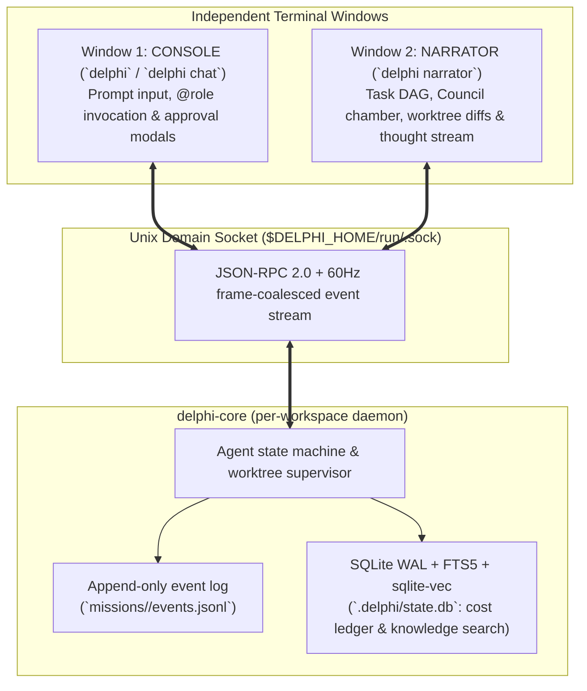

# Delphi: Master System Specification (`SPEC.md`)
> **Status:** Draft v0.4 — Amended by Council 001 (see [`OVERVIEW.md`](OVERVIEW.md) for the one-page summary and [`decisions.md`](missions/2026-10-23-foundational-design/decisions.md) for open operator decisions)  
> **Platforms:** macOS and Linux only (D-15, ratified 2026-10-23)  
> **Governed By:** [GOVERNANCE.md](GOVERNANCE.md) & [REVIEW.md](REVIEW.md)  
> **Role:** Central Architectural & Functional Source of Truth

---

## 1. System Overview

**Delphi** is a terminal-first (CLI/TUI) multi-agent working environment built in **Rust** (`Tokio` + `Ratatui` + `rusqlite`), for software engineering, deep research, architecture, and (later) personal project planning. **v1 scope:** git code repositories only (D-13).

### 1.1 The Four Systemic Layers
1. **Console & Runtime (`delphi`, `delphi-core`):** the operator's window and the deterministic daemon. They have no persona. This is where intent enters, approvals are granted, and processes and worktrees are supervised.
2. **Governance ([GOVERNANCE.md](GOVERNANCE.md) & [REVIEW.md](REVIEW.md)):** behavioral invariants, security gates, anti-poisoning rules and the PR review rubric.
3. **Adapter:** compiles portable agent and skill manifests into provider-native dialects (Claude and Gemini in v1), and owns the federation gateway (deferred).
4. **Agent Team:** nine canonical roles (`orchestrator`, `builder`, `architect`, `investigator`, `scout`, `strategist`, `red-team`, `writer`, `integrator`), each defined in `agents/<role>/AGENT.md` with scopes, blind spots and counterweights.

### 1.2 Canonical Roles & Theme Packs (D-17)
All governance, specs, manifests, configuration, file paths, frontmatter and event logs use **canonical role IDs** only. A per-install **theme pack** maps each role to a display name, epithet and short voice line, and labels the two windows. Greek mythology is the default; its names are defined only in [`themes/greek/theme.md`](themes/greek/theme.md). Themes are rendered only at the display layer and in a bounded persona slot, so two teammates using different themes read the same shared files. Theme schema, research flow and safety rules: [`specs/001`](specs/001-governance-and-manifests.md) §6.

---

## 2. Agent Roster

> **v1 roster (D-07, ratified 2026-10-23):** `orchestrator`, `architect`, `builder`, `red-team`, `strategist`. `scout`, `investigator`, `writer` and `integrator` keep their manifests and are enabled when a mission needs them.

Each role has a manifest in `agents/<role>/AGENT.md`, and skills are cataloged in [`skills/CATALOG.md`](skills/CATALOG.md). The roster with scopes, blind spots and counterweights is in [GOVERNANCE.md](GOVERNANCE.md) §2.

---

## 3. Adapter Layer: Multi-Provider Dialect Compilation & CLI Harness Bridging

As documented in [`multi-provider-and-tui-architecture.md`](context/domains/multi-provider-and-tui-architecture.md), naive "universal prompts" and flat `{role, content: string}` arrays fail in production because frontier models differ fundamentally in instruction delimiters, JSON schema subsets, and **cryptographic thinking signatures** during tool use.

### 3.1 Core Adapter Invariants
1. **Provider-Native Dialect Compilation** *(v1: Claude + Gemini only, D-06)*: Portable manifests compile into XML-tagged blocks with `cache_control` for Anthropic; `role: developer` Markdown + strict schemas for OpenAI `/v1/responses`; `systemInstruction` + `cachedContents` for Gemini; and first-user-turn inlined instructions with `<think>` history stripping for DeepSeek R1.
2. **Cryptographic Reasoning State Preservation (`[H-003]`):** Conversation state is stored as a typed `ContentBlock[]` array that round-trips Claude's `thinking.signature`, Gemini's `Part.thoughtSignature`, and OpenAI's encrypted reasoning items across multi-turn tool calls. On mid-session cross-provider failover, foreign thinking blocks degrade gracefully to read-only text summaries.
3. **Headless CLI Harness Bridging:** External CLI agents (`claude -p --output-format stream-json`, `gemini -p --output-format stream-json`, `codex app-server`) run inside isolated Git worktrees, emit normalized `EventEnvelope` telemetry to the TUI, and route permission prompts back to the **operator** via a local Delphi MCP approval tool.

---

## 4. Dual-Window Terminal Architecture: Console + Narrator

Delphi uses a **client-daemon, event-sourced architecture** over **Unix domain sockets**, so a distraction-free console and a live observability window can attach independently ([`specs/005`](specs/005-console-and-narrator-tui.md)).

### 4.1 Window 1: Console (`delphi` / `delphi chat`)
- Persona-free. Its label comes from the active theme.
- Hosts the conversation with Orchestrator (or `@<role>` / `@<theme-name>` for direct invocation), the command palette (`/council`, `/spec`, `/narrator`, `/retro`, `/theme`), and synchronous approval modals.

### 4.2 Window 2: Narrator (`delphi narrator`)
- Its label also comes from the theme.
- Runs in any second terminal, or opens via `delphi --dual` / `Ctrl+W` (`tmux` in v1), with an inline `Tab` toggle for single-screen sessions.
- Four live views: **[1: Task DAG]**, **[2: Council Chamber]** (Round 1 streams, then Round 2 Red-Team/Strategist cross-examination), **[3: Forge]** (Builder's worktree diffs and test output), **[4: Archives]** (knowledge base search: keywords, meaning and reranking).

---

## 5. GitHub-Native Spec-Driven & Learning Loop Workflow

Per [`github-review-and-learning-loops.md`](context/domains/github-review-and-learning-loops.md):

1. **Two-Stage PR Pipeline:**
   - **Stage 1 (Spec PR):** **Architect** drafts `specs/NNN-<slug>.md` (including `Simpler Alternative Considered`). Reviewed by **Strategist** and **Red-Team**; ratified by the User (`status: approved`).
   - **Stage 2 (Implementation PR):** **Builder** builds inside `.delphi/worktrees/<task-id>/` using TDD and opens a PR with `Implements-Spec: specs/NNN-<slug>.md`.
2. **Adversarial PR Audit (`REVIEW.md`):**
   - **Red-Team** and **Strategist** load [REVIEW.md](REVIEW.md) strictly from `origin/main` (`[REV-SEC-04]`) and post line-anchored `P0`/`P1`/`P2` review findings plus any **Minority Report** before the User merges.
3. **The Four-Channel Coaching & Learning Loop (`Orchestrator`):**
   - Escaped bugs update both `context/heuristics.md` and `REVIEW.md` §4.
   - Human `by-design` overrides add scoped exclusions to `REVIEW.md` §5 (`False-Positive Suppression`).
   - Any rule violated $\ge 2$ times is promoted into a deterministic script in `skills/*/scripts/` (`[H-005]`).
   - Always-loaded heuristic files are capped at **25 active rules** via ExpeL contrastive pruning, and **Orchestrator** coaches individual specialists by updating their `memory/agents/<role>/lessons.md`.

---

## 6. Repository Directory Structure

See the structure map in [README.md](README.md#repository-structure). Runtime state never lives in a repository; it lives in the Delphi home (`specs/006` §3.1).

---

## 7. Modular Sub-Spec Roadmap (`specs/`)

The modular subsystem specifications in `specs/`:

- [x] **[`specs/001-governance-and-manifests.md`](specs/001-governance-and-manifests.md):** Schemas for `AGENT.md`, progressive-disclosure `SKILL.md` packages, `HandoffEnvelope`, and 6-tier YAML provenance/taint frontmatter.
- [x] **[`specs/002-adapter-and-routing.md`](specs/002-adapter-and-routing.md):** The **Adapter** Intermediate Prompt Representation (IPR), provider dialect passes, `ContentBlock` signature preservation, **Orchestrator's** dynamic Claude/Gemini model scaler, and CLI harness JSONL drivers.
- [x] **[`specs/003-collaboration-and-council.md`](specs/003-collaboration-and-council.md):** Complexity escalation ladder, Orchestrator DAG execution, 3-round sparse Council state machine, Heterogeneous Model Routing, and Minority Report synthesis.
- [x] **[`specs/004-memory-and-coaching.md`](specs/004-memory-and-coaching.md):** Dual-tier memory engine, Frozen Boot-Snapshot cache hygiene, Two-Gear Zero-Server Hybrid RAG (`.delphi/state.db` AST breadcrumb chunking + FTS5 BM25 + `sqlite-vec` local embeddings + RRF + a cross-encoder reranker, with preloaded vectors for the shipped documents; Amendments 004-A1 to A3), Two-Strike Context Circuit Breaker, and ExpeL Rule-of-25 coaching loop.
- [x] **[`specs/005-console-and-narrator-tui.md`](specs/005-console-and-narrator-tui.md):** `delphi-core` UDS daemon protocol, 60Hz event bus, `Console` operator deck, `Narrator` 4-view live narrator/telemetry window, and multiplexer auto-spawning.
- [x] **[`specs/006-installer-and-updater.md`](specs/006-installer-and-updater.md):** Single-binary embedded-seed packaging, `delphi init` wizard, Three-Zone `delphi update` (`diff3` merge) & `delphi sync` engine, and 8-point `delphi doctor`.
- [x] **[`specs/007-federated-mesh-and-sync.md`](specs/007-federated-mesh-and-sync.md):** Multi-instance peer federation via **Integrator** (A2A task delegation, `delphi://` Ed25519 UCAN/Biscuit capability pointers, Tailscale/SSH/mDNS transport, and transitive taint lattice firewall).
- [x] **[`specs/008-ambient-watch-and-rewind.md`](specs/008-ambient-watch-and-rewind.md):** Zero-token "No-Agent Mode" ambient watches, coupled `/rewind` time-travel checkpoints (events + Git tree SHAs), 3-tier HITL approval batching.
- [x] **[`specs/009-model-access-and-auth.md`](specs/009-model-access-and-auth.md):** Access paths (direct API, Bedrock/Vertex, enterprise gateways, subscription CLIs), endpoints and failover policy, delegated credential sources, capability probing, harness mode (D-19). *Approved after Council 003.*
- [x] **[`specs/011-xenia-trust-model.md`](specs/011-xenia-trust-model.md)** and **[`specs/012-xenia-record-schema.md`](specs/012-xenia-record-schema.md):** the xenia org-sharing store: roster chain, steward endorsement, freshness statements, signed Markdown records with detached sidecars. *Approved; Phase 1 in build.* Specs 010 and 013–021 are listed in [README.md](README.md#subsystem-specifications-specs).
- [x] **[`specs/022-xenia-sharing-overview.md`](specs/022-xenia-sharing-overview.md):** the sharing-layer set (approved 2026-10-25, unbuilt): org bundles as a Claude Code plugin superset with knowledge, skills, agents, behavior, evals and optional vectors ([`023`](specs/023-org-bundle-standard.md)); optional signing as provenance, adding as the permission, precedence and lifecycle ([`024`](specs/024-bundle-trust-adoption-and-precedence.md)); Claude Code plugin and agent, Agent Skills, MCP (inert-until-mapped servers; read-only `delphi bundle serve`) and `AGENTS.md` compatibility ([`025`](specs/025-plugin-skill-and-tool-compatibility.md)); the org-context slice, Council lenses and the alignment check ([`026`](specs/026-team-alignment-and-strategist-integration.md)); authoring with the `org-bundle-authoring` skill, transports, the verified vector pipeline and three-tier evaluation with pre-registration ([`027`](specs/027-bundle-authoring-distribution-and-evaluation.md)). Build slices B0–B12.
