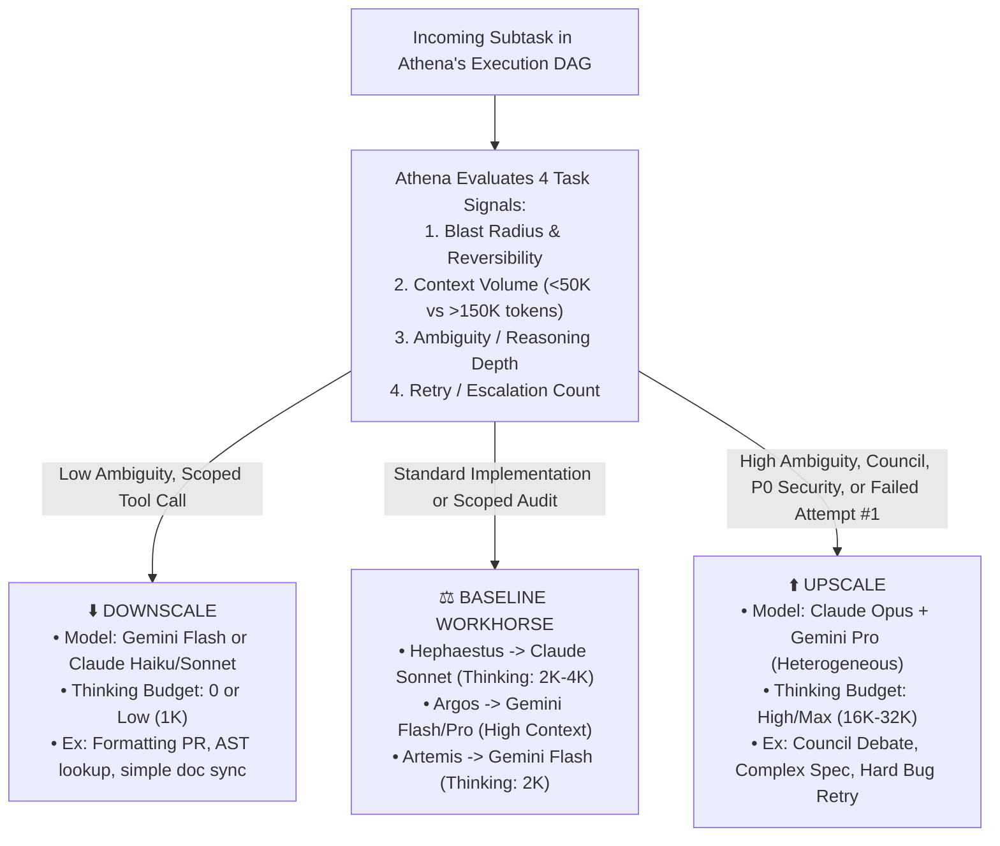

# Model Capability Matrix & Dynamic Cognitive Scaling (`context/model-capabilities.md`)

> **Maintenance Rule:** **Athena** and **Hermes** maintain this live registry of model capabilities, context windows, thinking controls, empirical strengths/blind spots, and cost/latency profiles. When `delphi update` runs or new frontier models release, **Argos**/**Artemis** benchmark the changes and **Athena** updates this matrix.

---

## 1. Why Dynamic Per-Task Model Scaling Matters

Static `Agent -> Model` bindings waste money on routine tasks and under-power critical edge cases:
- **Over-provisioning waste:** Running **Hephaestus** on `Claude Opus` (with max extended thinking) just to rename a CLI flag or scaffold a boilerplate test file burns $10\times$ the latency and cost of `Claude Sonnet` or `Gemini Flash`.
- **Under-provisioning failure:** Running **Artemis** on a `Flash`/`Haiku` tier works 90% of the time for AST searches, but if she is asked to isolate a subtle multi-threaded race condition via `git-bisect-hunt`, she needs to be dynamically **upscaled** to a deep-reasoning model (`Claude Sonnet/Opus` with extended thinking or `Gemini Pro` with a high `thinkingBudget`).

Therefore, each `AGENT.md` defines only a **baseline default tier**, while **Athena dynamically specifies the exact `model_override` and `thinking_budget` in every `HandoffEnvelope`**.

---

## 2. Primary Provider Capability Matrix: Anthropic (Claude) & Google (Gemini)

### 2.1 Anthropic Claude Family
*Dialect Requirements:* XML structural tags (`<governance>`, `<handoff>`), explicit `cache_control: {"type": "ephemeral"}` breakpoints, and cryptographic `thinking.signature` preservation across tool turns.

| Tier / Class | Representative Models | Effective vs. Max Context | Thinking / Reasoning Control | Empirical Strengths (When Athena Selects) | Empirical Blind Spots / Limits |
| :--- | :--- | :--- | :--- | :--- | :--- |
| **Claude Heavy / Frontier (`opus`)** | Claude Opus 4.x | **80K–120K** optimal reasoning (200K–1M max) | `thinking: { type: "enabled", budget_tokens: 4000..32000 }` + interleaved tool thinking | • Ambiguous architectural synthesis (`Daedalus`, `Athena`)<br>• Complex multi-file refactoring & subtle concurrency bugs (`Hephaestus` upscale)<br>• Deep adversarial threat modeling (`Ares`)<br>• High-taste technical prose (`Apollo`) | • High cost & slower time-to-first-token (TTFT).<br>• Over-thinks trivial tasks if `budget_tokens` is not scaled down. |
| **Claude Balanced / Workhorse (`sonnet`)** | Claude Sonnet 4.x | **60K–100K** optimal reasoning (200K–1M max) | `thinking: { type: "enabled", budget_tokens: 1024..16000 }` or `disabled` for fast loops | • **Default Gold Standard for `Hephaestus` TDD & code craft**<br>• Fast multi-step tool calling & CLI harness execution<br>• Standard `Odysseus` PR alignment reviews & `Athena` routing | • Can tunnel-vision on local fixes without `Daedalus` spec constraints.<br>• Context cost scales sharply past 100K without prompt caching. |
| **Claude Fast / Utility (`haiku`)** | Claude Haiku 3.5 / 4.x | **32K–60K** optimal (200K max) | Standard fast generation (or minimal thinking where supported) | • High-speed deterministic tool orchestration (`Hermes` schema checks)<br>• Simple `Artemis` AST/ripgrep lookups<br>• Routine log compaction & frontmatter linting | • Weak on multi-hop architectural trade-offs or adversarial red-teaming (never use for `Ares` or Council debates). |

### 2.2 Google Gemini Family
*Dialect Requirements:* Dedicated `systemInstruction` field, affirmative constraint framing, server-side `cachedContents` for massive repo contexts, and mandatory `Part.thoughtSignature` preservation on `functionCall` parts.

| Tier / Class | Representative Models | Effective vs. Max Context | Thinking / Reasoning Control | Empirical Strengths (When Athena Selects) | Empirical Blind Spots / Limits |
| :--- | :--- | :--- | :--- | :--- | :--- |
| **Gemini Heavy / Frontier (`gemini-pro`)** | Gemini 2.5 / 3.x Pro | **500K–1M+** flat needle-in-haystack recall (1M–2M max) | `thinkingConfig: { thinkingBudget: 1024..24576 }` (or `thinkingLevel: "HIGH"`) | • **Unmatched for `Argos` repo-wide cartography & massive multi-doc synthesis**<br>• **Essential heterogeneous Council counterweight to Claude** (`Daedalus`, `Ares`, `Odysseus`)<br>• Cross-repo dependency & architecture mapping | • Strictly enforces JSON schema subsetting on tool declarations.<br>• Requires `thoughtSignature` round-trip on tool calls. |
| **Gemini Balanced / Fast Reasoning (`gemini-flash`)** | Gemini 2.5 / 3.x Flash | **250K–500K** effective (1M max) | Dynamic `thinkingBudget: 0..8192` (tunable per request!) | • **Ideal for `Artemis` high-speed bug hunting & benchmark profiling**<br>• Fast, large-context literature scanning (`Argos` downscale)<br>• High-throughput `Hermes` GitHub/API syncs | • With `thinkingBudget: 0`, may skip subtle edge cases; upscale `thinkingBudget` to `4096+` when hunting complex bugs. |
| **Gemini Ultra-Light (`gemini-flash-lite`)** | Gemini 2.5 / 3.x Flash-Lite | **64K–128K** effective | Minimal / zero thinking (`thinkingBudget: 0`) | • Sub-second classification, link checking, and simple metadata extraction | • Never use for code mutation, spec writing, or security review. |

---

## 3. Athena's Dynamic Upscaling & Downscaling Protocol

Rather than treating model size as static, **Athena** adjusts **two orthogonal knobs** on every task dispatch:
1. **Model Class:** `fast` (`Haiku` / `Gemini Flash`) $\leftrightarrow$ `workhorse` (`Sonnet` / `Gemini Flash-Thinking`) $\leftrightarrow$ `frontier` (`Opus` / `Gemini Pro`).
2. **Thinking / Reasoning Budget:** `none` ($0$ tokens) $\leftrightarrow$ `low` ($1\text{K}–2\text{K}$) $\leftrightarrow$ `medium` ($4\text{K}–8\text{K}$) $\leftrightarrow$ `max` ($16\text{K}–32\text{K}$).



### 3.1 Concrete Upscaling Triggers (When Athena Must Escalate)
1. **The One-Strike Escalation Rule (Retry Upscaling):**
   - If any agent running on a `fast` or `workhorse` model fails a deterministic verification gate on Attempt #1 (e.g., **Hephaestus** fails a TDD test cycle twice, or **Artemis** cannot reproduce a bug), **Athena must not retry with the same model and budget**. She automatically upscales either the `thinking_budget` (e.g., $2\text{K} \rightarrow 16\text{K}$) or the model tier (`Sonnet` $\rightarrow$ `Opus`, or `Gemini Flash` $\rightarrow$ `Gemini Pro`) on Attempt #2.
2. **Context Volume Crossover (`>120K` Tokens):**
   - When a task requires holding an entire repository or $>120\text{K}$ tokens of literature in active working memory simultaneously, **Athena** routes to **Gemini Pro** (or **Gemini Flash** for initial pass) due to its flat 1M-token needle-in-a-haystack recall curve and server-side `cachedContents` economics.
3. **Adversarial Cross-Provider Pairing (Claude $\leftrightarrow$ Gemini):**
   - **Rule (`[H-007]`):** If **Hephaestus** writes code or **Daedalus** drafts a spec using **Claude** (`Sonnet`/`Opus`), **Athena** should preferentially schedule **Ares** (Red Team) or **Odysseus** (Alignment Review) on **Gemini Pro** (and vice versa). Cross-provider auditing eliminates shared model-family blind spots.
4. **High-Blast-Radius / Architectural Forks:**
   - Any task touching [GOVERNANCE.md](file:///Users/jessevondoom/projects/work/delphi/GOVERNANCE.md), security boundaries, concurrency state machines, or `delphi update` migrations automatically upscales **Daedalus**, **Ares**, and **Odysseus** to `frontier` (`Claude Opus` + `Gemini Pro`) with high thinking budgets.

### 3.2 Concrete Downscaling Triggers (When Athena Saves Cost & Latency)
1. **Deterministic Script Execution:** When an agent is primarily invoking a deterministic script in `skills/*/scripts/` (e.g., `manage_worktree.sh`, `audit_kb_links.py`, `gh_sync.py`) and formatting its output, Athena downscales to `Gemini Flash` or `Claude Haiku` with `thinking_budget: 0`.
2. **Boilerplate & Mechanical Refactors:** When **Daedalus**'s spec leaves zero architectural ambiguity (e.g., adding a typed field across 4 files with existing test patterns), Athena keeps **Hephaestus** on `Claude Sonnet` with `thinking_budget: 0` or `low` rather than burning `Opus` tokens.
3. **Routine Compaction Passes:** Post-mission scratchpad compaction where provenance tags are already clean runs on `Gemini Flash` before **Athena** performs her final high-reasoning coaching review.

---

## 4. Handoff Routing Envelope Schema (`routing_directive`)

Every structured handoff emitted by **Athena** includes an explicit `routing_directive` block that the runtime adapter fulfills:

```yaml
routing_directive:
  target_agent: hephaestus
  provider_preference: anthropic          # anthropic | google | openai | local
  model_tier: frontier                    # fast | workhorse | frontier
  model_id_hint: claude-opus-4-6          # Resolved against .delphi/config.yaml
  thinking_budget_tokens: 16000           # 0 (disabled) up to 32000
  fallback_provider: google               # Cross-provider resilience
  fallback_model_hint: gemini-3-pro
  scaling_rationale: "Upscaled from Sonnet to Opus (16k thinking) because task involves concurrent UDS socket frame coalescing and failed initial race-condition test."
```

---

## 5. Self-Updating Capability Awareness Loop

Models are not static—Anthropic and Google update model weights, context pricing, and thinking parameters frequently, and even within a single model version, empirical performance varies by repository language and domain.

**Athena** maintains live model awareness via two mechanisms:
1. **Mission Telemetry Calibration (`retrospective-facilitation`):**
   - At the end of each mission, `collect_mission_telemetry.py` logs `(agent, provider, model_id, thinking_budget, task_type, first_pass_success, tokens_used, latency_ms)`.
   - If **Athena** observes that a downscaled model (`Gemini Flash` or `Sonnet` with `0` thinking) is consistently requiring retries on a specific task class (e.g., Rust lifetime errors or Mermaid state diagrams), she records a routing heuristic in `memory/agents/athena/lessons.md` (*"Always upscale Daedalus/Hephaestus thinking budget to >=4096 on Rust lifetime tasks"*).
2. **Model Registry Refresh (`model-capability-routing` skill):**
   - When a new Claude or Gemini model is announced or configured in `.delphi/config.yaml`, **Athena** dispatches **Artemis** (`primary-source-verification` + `benchmark-profiling`) to verify its API parameter schema (e.g., max output tokens, thinking budget syntax, context caching rules) and updates `context/model-capabilities.md`.
