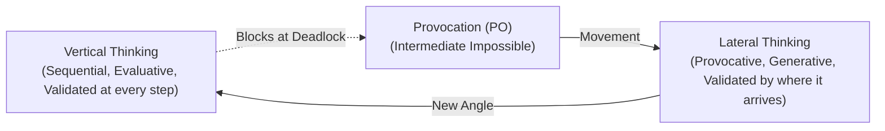

# Oblique Strategies, Lateral Thinking, and Constraint Inversion

This reference compendium equips Delphi's creative and architectural agents (`architect`, `red-team`, `investigator`) with actionable, non-linear heuristics for breaking creative impasses, navigating architectural deadlocks, and escaping local optimization traps.

---

## 1. Cognitive Impasse & Non-Linear Thinking Mechanics

Traditional engineering problem-solving is fundamentally **vertical** (analytical, sequential, and locally convergent). Vertical thinking optimizes along established gradient slopes. However, complex software engineering and strategic formulation frequently encounter failure modes inherent to vertical optimization:

1. **Premature Convergence:** Settling upon a suboptimal architecture because early incremental steps yielded immediate positive feedback.
2. **Cognitive Entrenchment:** High expertise in an established pattern creates psychological blindness to simpler alternative paradigms.
3. **The Sunk Cost Corridor:** Continued investment in a failing subsystem justified by prior engineering hours rather than forward utility.
4. **Framing Traps:** Implicitly accepting arbitrary problem boundaries stated in the initial prompt or ticket.

**Lateral and oblique thinking** introduces deliberate orthogonal perturbations, pseudo-random stimuli, and systematic constraint inversions to jump across cognitive valleys into unvisited solution spaces.

---

## 2. Brian Eno & Peter Schmidt’s Oblique Strategies Catalog

Created in 1975 by musician/producer Brian Eno and multimedia artist Peter Schmidt, *Oblique Strategies (Over One Hundred Worthwhile Dilemmas)* was designed to break creative paralysis during high-pressure studio production (such as David Bowie’s *Berlin Trilogy* and Talking Heads’ *Remain in Light*).

Below is the verified catalog of classic prompts, categorized by operational mechanism for autonomous agents and systems designers:

### 2.1 Perspective Shifts & Decentering
These prompts force the agent to step outside its default ego and system frame:
1. *"What would your closest friend do?"*
2. *"Look closely at the most embarrassing details and amplify them."*
3. *"What to increase? What to reduce?"*
4. *"Ask your body."*
5. *"Put in earplugs."*
6. *"Listen to the quiet voice."*
7. *"What are you really thinking about just now? Incorporate it."*
8. *"Imagine the music as a moving chain or caterpillar."*
9. *"How would you have done it before?"*
10. *"What context would this make sense in?"*
11. *"Look at a very small object, look at its centre."*
12. *"What would make this really successful?"*
13. *"Imagine the piece as a set of disconnected events."*
14. *"Breathe more deeply."*
15. *"Consider different fading systems."*

### 2.2 Structural & Constraint Manipulation
These prompts shatter assumed invariants and architectural scaffolding:
16. *"Discard an axiom."*
17. *"Honor thy error as a hidden intention."*
18. *"Give the game away."*
19. *"Reverse."*
20. *"Use an old idea."*
21. *"Work at a different speed."*
22. *"Change instrument roles."*
23. *"Turn it upside down."*
24. *"Slow movement, fast movement."*
25. *"Use an unacceptable colour."*
26. *"Make a sudden, destructive unpredictable action; incorporate."*
27. *"Only one element of each kind."*
28. *"Repetition is a form of change."*
29. *"Decorate, decorate."*
30. *"Accept advice."*
31. *"Emphasize repetitions."*
32. *"Is the tuning appropriate?"*
33. *"Water."*
34. *"Convert a melodic element into a rhythmic element."*
35. *"Mechanize something idiosyncratic."*

### 2.3 Subtraction, Simplification & Destruction
These prompts attack bloat, unnecessary state, and defensive complexity:
36. *"Remove specifics and convert to ambiguities."*
37. *"Cut a vital connection."*
38. *"Simple subtraction."*
39. *"Destroy: -nothing -the most important thing."*
40. *"Abandon normal instruments."*
41. *"Do nothing for as long as possible."*
42. *"Don't be afraid of things because they're easy to do."*
43. *"Just carry on."*
44. *"Remove ambiguities and convert to specifics."*
45. *"Take away the elements in order of apparent non-importance."*
46. *"Is there something missing?"*
47. *"Don't stress one thing more than another."*
48. *"Disciplined self-indulgence."*
49. *"Short circuit (example: a man eating peas with the idea that they would improve his virility shovels them straight into his lap)."*
50. *"Do the words need changing?"*

### 2.4 Randomness, Divergence & Boundary Escape
These prompts inject entropy to break deterministic loops:
51. *"Consult other sources: -promising -unpromising."*
52. *"Go outside. Shut the door."*
53. *"Trust in the you of now."*
54. *"Take a break."*
55. *"Faced with a choice, do both."*
56. *"State the problem in words as clearly as possible."*
57. *"Use 'unqualified' people."*
58. *"Use filters."*
59. *"Fill every beat with something."*
60. *"The inconsistency principle."*
61. *"Towards the insignificant."*
62. *"Discover the recipes you are using and abandon them."*
63. *"Courage!"*

### 2.5 Operational Protocol for Agents
When an agent (`architect` or `investigator`) receives a deadlock signal or an `orchestrator` tenacity pushback:
1. **Sample:** Select one Oblique Strategy prompt deterministically or pseudo-randomly using the hash of the failing context.
2. **Translate:** Map the metaphor to the immediate software engineering artifact:
   - *"Cut a vital connection"* $\rightarrow$ Temporarily sever an external database dependency and mock it with in-memory static fixtures.
   - *"Honor thy error as a hidden intention"* $\rightarrow$ Treat an unexpected type mismatch or concurrency race as an indication that the underlying domain model is flawed.
   - *"Discard an axiom"* $\rightarrow$ Drop the assumption that requests must be processed synchronously or that state must be stored on disk.
3. **Execute:** Draft one complete radical architectural alternative strictly following the prompt before rejecting it.

---

## 3. Edward de Bono’s Lateral Thinking Framework

Edward de Bono introduced lateral thinking to formalize cognitive operations that deliberately disrupt vertical reasoning patterns.

### 3.1 Vertical vs. Lateral Thinking

| Dimension | Vertical Thinking | Lateral Thinking |
| :--- | :--- | :--- |
| **Primary Goal** | Correctness, precision, refinement. | Novel perspectives, alternative formulations. |
| **Trajectory** | Continuous, sequential step-by-step logic. | Discontinuous jumps; associative links. |
| **Handling Errors** | Negative judgments halt the path immediately. | Errors are stepping stones (*Movement* over judgment). |
| **Selection Criteria** | Selects the most promising pathway. | Generates multiple non-obvious pathways. |
| **Boundary Handling** | Operates strictly within problem definitions. | Deliberately challenges problem boundaries. |

### 3.2 Provocation and Movement (PO)
In lateral thinking, **PO (Provocative Operation)** acts as a semantic escape hatch. When a thinker utters "PO", normal rules of logical contradiction are suspended. The goal of a provocation is not to be correct, but to use the provocation as an **intermediate impossible** to generate "movement":

1. **Reversal:** State the opposite of the normal relationship.
   - *Normal:* "Clients poll the server for state updates."
   - *PO:* "The server crashes every time state updates."
   - *Movement:* Why not invert state ownership so clients write directly to an append-only log without a centralized server?
2. **Exaggeration:** Scale a system parameter to absurd infinity or zero.
   - *PO:* "A single database query takes 10 minutes to return."
   - *Movement:* Design the UI to be 100% offline-first with zero expectation of network connectivity.
3. **Distortion:** Change the sequence or relationship of actions.
   - *PO:* "Users pay after they have forgotten what they purchased."
   - *Movement:* Implement usage-based micro-settlements aggregated at monthly billing epochs.
4. **Escape (Wishful Thinking):** Remove a feature taken for granted.
   - *PO:* "Cars have no wheels."
   - *Movement:* Hovercraft, magnetic levitation, pneumatic tubes.

### 3.3 The Six Thinking Hats
A disciplined protocol for multi-agent councils or human-agent reviews to decouple conflicting cognitive modes:
- **White Hat (Information):** Neutral, objective data. What facts, logs, and telemetry are known? What is missing?
- **Red Hat (Intuition & Gut):** Emotions, hunches, aesthetic reactions without need for justification.
- **Black Hat (Critical Judgment & Caution):** Risk assessment, invariant verification, failure modes, devil's advocacy. Why might this fail?
- **Yellow Hat (Optimism & Value):** Benefits, opportunities, feasibility, upside potential under best-case scenarios.
- **Green Hat (Creativity & Lateral Shifts):** New concepts, provocative alternatives, out-of-the-box variations.
- **Blue Hat (Process & Orchestration):** Meta-governance, agenda control, summary synthesis, selecting the next hat.

---

## 4. TRIZ: Theory of Inventive Problem Solving

Formulated by Genrich Altshuller through the empirical analysis of over 200,000 patents, **TRIZ** establishes that breakthrough engineering innovations emerge not from compromise, but from the **elimination of technical and physical contradictions**.

### 4.1 Physical Contradictions & The 4 Separation Principles
A physical contradiction occurs when a single parameter must simultaneously possess two mutually exclusive states (e.g., an object must be hot to melt solder, but cold to prevent component damage).

1. **Separation in Time:** The parameter is state $A$ at time $T_1$, and state $B$ at time $T_2$.
   - *Software:* JIT compilation (interpreted bytecode during rapid startup, optimized native assembly during hot steady-state).
2. **Separation in Space:** The parameter is state $A$ at location $X$, and state $B$ at location $Y$.
   - *Software:* Dual-plane network architectures (untrusted edge edge-compute workers vs. hardened air-gapped core databases).
3. **Separation upon Condition / State:** The parameter transitions based on environmental state.
   - *Software:* Adaptive concurrency limiters (unbounded work queues under low traffic; strict backpressure/load-shedding under saturation).
4. **Separation between Parts and Whole:** The component parts possess property $A$, but the aggregate system possesses property $B$.
   - *Software:* Raft/Paxos consensus (individual nodes are fallible and crash-prone; the aggregate cluster is resilient and reliable).

### 4.2 Key TRIZ Inventive Principles for Systems Architecture

| Principle # | TRIZ Principle | Physical / Mechanical Definition | Software Engineering Equivalent |
| :--- | :--- | :--- | :--- |
| **01** | **Segmentation** | Divide an object into independent parts; make it modular; increase degree of fragmentation. | Microservices, modular plugins, sharding, AST chunking. |
| **02** | **Taking Out / Extraction** | Separate an interfering part or property from an object, or single out the only necessary part. | Unbundling heavy SDKs into lightweight HTTP clients; headless runtimes. |
| **03** | **Local Quality** | Transition from uniform structure to heterogeneous structure; each part operates in its ideal condition. | Heterogeneous compute (CPU for control plane, GPU for tensor math); tiered storage (RAM $\rightarrow$ NVMe $\rightarrow$ S3). |
| **05** | **Merging / Consolidation** | Bring closer together or merge identical or related objects or operations in time/space. | Batching I/O operations, connection pooling, compiling multiple modules into a single binary. |
| **10** | **Prior Action** | Perform required changes before they are needed; pre-arrange objects for immediate action. | Pre-caching, pre-fetching, pre-allocating memory arenas, statically verified compile-time invariants. |
| **13** | **The Other Way Round (Inversion)** | Invert the action used to solve the problem; make moving parts stationary and stationary parts move. | Inversion of Control (IoC), dependency injection, reactive event loops rather than polling loops. |
| **15** | **Dynamization** | Make characteristics of an object adaptive, flexible, or interchangeable to optimize performance. | Dynamic buffer sizing, auto-scaling, dynamic thread-pool sizing. |
| **24** | **Intermediary / Mediator** | Use an intermediate carrier or process to unite or temporarily merge two incompatible entities. | Message brokers, API gateways, intermediate prompt representations (IPR), bridge adapters. |
| **25** | **Self-Service** | Make an object serve itself by performing auxiliary operations and repairs. | Self-healing clusters, automatic retry with exponential backoff, automated database vacuuming. |
| **28** | **Replacement of Mechanical System** | Replace physical fields/forces with optical, acoustic, or electromagnetic fields. | Software-defined networking (SDN), virtualizing hardware components, hardware emulation. |

---

## 5. Systematic Constraint Inversion

When an engineering system reaches a structural impasse, conventional optimization attempts to loosen existing constraints by 5–10%. **Constraint inversion** systematically negates or flips the core axioms.

### 5.1 The 3-Step Reverse Assumption Analysis
1. **List All Unexamined Assumptions:** Write down every implicit "must" or "cannot" currently governing the design:
   - *"The database must be ACID compliant."*
   - *"The UI must update in real time."*
   - *"Files must be read from the local filesystem."*
2. **Force-Negate Each Assumption:** Explicitly state the exact opposite:
   - *"The database must offer zero ACID guarantees and accept lost updates."*
   - *"The UI must never update in real time; it should update once per day."*
   - *"Files cannot be stored on disk; storage must be ephemeral in memory."*
3. **Constructive Re-Engineering:** Ask: *"Under what conditions does this inverted assertion become a massive architectural superpower?"*
   - *Example:* Zero-ACID guarantees $\rightarrow$ High-throughput append-only analytics ledger or CRDT-based offline collaborative editor.
   - *Example:* Daily UI updates $\rightarrow$ Static site generation (SSG) with instant edge caching and zero attack surface.

### 5.2 Extreme Parameter Induction
Stress-test architectures by simulating mathematically absurd constraints:
- **Zero-Network Regime:** Design the application as if the internet does not exist. How does it bootstrap? How does it resolve conflicts when reconnected? (Leads to Local-First software, CRDTs, and SQLite embedded architectures).
- **Zero-Memory Regime:** Design as if the process has only 8 KB of RAM. (Leads to streaming I/O, zero-copy parsing, and iterator pipelines).
- **Zero-Trust Regime:** Assume every internal microservice is actively malicious and operated by an adversary. (Leads to cryptographic capability tokens, mTLS, and audited sandboxing).

---

## 6. Synthesis: Lateral Creative Heuristics for Delphi

1. **The Schmidt Inversion:** When an agent attempts the same refactoring or query three times without success, halt execution immediately. Utter *PO: Invert the question*, formulate the anti-problem (how to maximize the failure), and inspect the resulting negative space.
2. **The Eno Pruning Rule:** When a subsystem exceeds its cognitive complexity budget, do not add an abstraction layer. Apply *Simple subtraction*: delete the newest 30% of the code and evaluate whether the system functions adequately without it.
3. **The Altshuller Separation Heuristic:** Never compromise on conflicting requirements (e.g., security vs. latency). Separate them in time or space. Run security checks asynchronously or isolate untrusted parsing into lightweight, ephemeral WebAssembly sandboxes.
