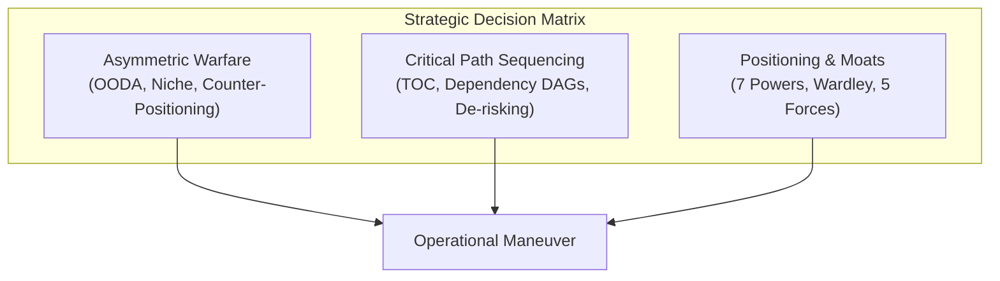

# Strategic Case Studies, Maneuvers, and Tactical Frameworks

This compendium synthesizes operational lessons from classical military strategy and modern technology maneuvers into deterministic, reusable frameworks for agentic systems, systems architects, and technical strategists.

---

## 1. Classical & Ancient Strategic Case Studies

### 1.1 The Trojan Horse (c. 12th–13th Century BCE)
- **Context:** A ten-year futile siege of the fortified city of Troy by the Achaean (Greek) coalition. Direct siege warfare and frontal assault against Troy’s high walls yielded complete strategic stalemate and mounting attrition.
- **The Maneuver:** Conceived by Greek tacticians, the Achaeans constructed an enormous hollow wooden horse ostensibly left as a religious offering for their safe return, concealed an elite strike team inside its belly, burned their tents, and sailed their fleet just out of sight behind the island of Tenedos. The Trojans, interpreting the departure as victory and the horse as a sacred trophy, dragged it inside their fortified citadel, breaking a section of their own defensive wall to accommodate it. Under cover of night, Greek infiltrators emerged from the horse, eliminated the sentries, and opened the city gates to the returning army.
- **Core Mechanism:** Subversion of external perimeters through **cognitive bias exploitation** (hubris, victory euphoria, religious obligation) and the introduction of a Trojan payload disguised as a passive asset.
- **Strategic Lessons:**
  1. *Perimeter Defense Vulnerability:* Hard external walls are useless if an internal execution vector is voluntarily imported.
  2. *Deceptive Concession:* Feigning defeat or withdrawal causes the adversary to drop active posture defenses.
  3. *The Gift as a Vector:* Entities accept high-risk payloads when packaged within familiar, culturally venerated rituals or expectations.
- **Modern Systems Analogy:** Supply-chain poisoning (e.g., SolarWinds, compromised open-source npm/crates packages); prompt injection hidden within seemingly benign documents; trojaned models or datasets.

### 1.2 The Battle of Cannae (216 BCE)
- **Context:** Second Punic War. Roman consuls Lucius Aemilius Paullus and Gaius Terentius Varro commanded approximately 86,000 legionaries and allied troops against Hannibal Barca’s 50,000 Carthaginian, Gallic, and Iberian soldiers. The Romans possessed overwhelming numerical superiority and deployed in deep, dense infantry formations designed for an unstoppable frontal punch.
- **The Maneuver:** Hannibal deployed his infantry in an outward-curving convex crescent, placing his weakest Gallic and Iberian infantry in the center and his veteran African infantry on the flanks, with superior cavalry stationed on both wings. As the dense Roman column pressed forward into the Carthaginian center, Hannibal instructed the center to slowly yield and retreat under pressure. The line transformed from a convex arch to an inward concave pocket. The Romans, sensing an imminent breakthrough, surged into the funnel, losing lateral formation and compressing into an unmaneuverable mass. At the calculated moment, Hannibal ordered his elite African infantry on the flanks to advance and turn inward, while his cavalry swept around the rear after routing the Roman horse, completing the **double envelopment** (pincer movement). Over 67,000 Roman troops were killed in a single day.
- **Core Mechanism:** Convex-to-concave line inversion; **turning adversary mass and momentum into a self-constricting trap**.
- **Strategic Lessons:**
  1. *Yielding as Tactical Control:* Controlled retreat is not loss of ground; it dictates the adversary's advance vector and geometry.
  2. *Density as Vulnerability:* Compressing resources into a narrow corridor destroys mobility, peripheral visibility, and defensive response.
  3. *Flank Envelopment:* An adversary focused solely on their frontal objective is blind to lateral closure.
- **Modern Systems Analogy:** Rate-limiting backpressure traps; honeytoken routing that draws malicious traffic into isolated sandboxes; absorbing brute-force traffic into an elastic compute sink while isolating ingress IP pools.

### 1.3 Sun Tzu’s Stratagems & Foundational Tenets
From *The Art of War* (Sun Wu, c. 5th Century BCE) and the classical *Thirty-Six Stratagems*:

| Stratagem / Principle | Classical Formulation | Tactical Mechanism | Agentic / Engineering Application |
| :--- | :--- | :--- | :--- |
| **All Warfare is Based on Deception** | *"When able to attack, seem unable; when using our forces, seem inactive; when near, make the enemy believe you are far."* | Asymmetry of information and posture ambiguity. | Canary tokens, deceptive honey-routes, unpredictable retry jitter. |
| **Avoid Strength, Strike Void (*Xu* & *Shi*)** | *"Military formation is like water: just as water avoids the high and rushes to the low, an army avoids strength and strikes emptiness."* | Bypassing hardened competitive moats to target unmonitored dependencies or unserved niches. | Building headless tooling where competitors build monolithic GUIs; targeting underserved edge runtimes. |
| **Besiege Wei to Rescue Zhao** | Attack the vulnerable home base of the enemy to relieve pressure on an ally, rather than engaging their main force. | Inducing an emergency context switch in the adversary by threatening their critical asset. | Deprecating a shared legacy protocol to force an entrenched incumbent into defensive re-engineering. |
| **Borrow a Boat to Cross the River** | Exploit the resources, infrastructure, or platform of a partner or competitor to advance your position. | Parasitic growth and ecosystem piggybacking. | Building on top of public LLM APIs or cloud primitives before vertically integrating custom hardware. |
| **Feint East, Strike West** | Create loud diversionary activity in one sector while quietly executing the primary strike elsewhere. | Attentional saturation and context misdirection. | Running loud surface-level refactoring in PRs while silently landing core protocol invariants. |
| **Winning Without Fighting (*Shih*)** | *"Supreme excellence consists in breaking the enemy's resistance without fighting."* | Shaping conditions, network position, and structural dynamics so victory is the only mathematical outcome. | Establishing default open standards (e.g., POSIX, HTTP, OCI) that compel all participants to conform. |

---

## 2. Modern Business & Technology Maneuvers

### 2.1 Intel’s Memory-to-Microprocessor Pivot (1985)
- **Context:** Intel was founded on semiconductor memory (DRAM). By the early 1980s, Japanese manufacturers (NEC, Toshiba, Hitachi) entered the market with superior manufacturing yields, lower cost structures, and relentless quality control. Intel’s market share in DRAM plummeted from over 80% to single digits; the company faced catastrophic financial collapse.
- **The Maneuver:** In a famous exchange, CEO Gordon Moore asked President Andy Grove: *"If we got kicked out and the board brought in a new CEO, what would he do?"* Grove responded without hesitation: *"He would get us out of memories."* Moore replied: *"Why shouldn't you and I walk out the door, come back in, and do it ourselves?"* Intel decisively shuttered its flagship memory fabrication plants, laid off thousands of employees, absorbed massive one-off write-downs, and reallocated all engineering capital to a fledgling, unproven line: microprocessors (specifically the x86 386 family).
- **Core Mechanism:** **Radical psychological distancing** and the abandonment of the founder's sunk-cost identity to align resources with structural high-margin proprietary architecture.
- **Strategic Lessons:**
  1. *Sunk Cost Amputation:* When a commodity market reaches cost parity with lower-cost producers, exit immediately; emotional attachment to the legacy core is fatal.
  2. *The Outsider Lens:* Evaluate internal assets as a hostile incoming executive with zero historical loyalty.
  3. *Architectural Control:* Microprocessors established proprietary instruction set lock-in (x86), escaping the zero-margin trap of commodity DRAM standards.

### 2.2 Apple’s Ecosystem Lock-In & Vertical Integration (2001–Present)
- **Context:** Apple in 2001 was a niche personal computer maker with less than 5% market share in macOS.
- **The Maneuver:** Apple executed a multi-decade compounding lock-in strategy:
  1. *Digital Hub (2001):* Launched the iPod tied exclusively to iTunes and macOS, making Mac hardware the anchor for digital media.
  2. *Two-Sided Platform (2007–2008):* iPhone followed by the App Store. Created strong cross-side network effects: developers built for iOS due to lucrative user demographics; users bought iPhones due to proprietary app catalogs.
  3. *Proprietary Integration Moat (2010–2020):* A-series and M-series Apple Silicon. Vertical hardware/software co-design created performance-per-watt moats that modular competitors (Windows/Intel, Android/Qualcomm) could not match.
  4. *Inter-Device Continuity:* iMessage, AirDrop, Universal Clipboard, and Apple Watch handoffs increased customer switching costs to near-insurmountable levels.
- **Core Mechanism:** **Complementary lock-in and high switching cost moats**. Turning individual hardware devices into nodes of an interdependent, proprietary distributed graph.
- **Strategic Lessons:**
  1. *Hardware-Software Symbiosis:* Owning the full stack from silicon instruction set to application runtime prevents margin extraction by upstream suppliers.
  2. *Switching Friction:* When leaving an ecosystem destroys historical user data, communication graphs, and multi-device continuity, retention ceases to be price-sensitive.

### 2.3 Netflix vs. Blockbuster (2000–2010)
- **Context:** In 2000, Blockbuster was a retail titan with 9,000 storefronts, \$6 billion in revenue, and immense brand dominance. Netflix was a tiny startup offering DVD rentals by mail with a monthly subscription. Blockbuster famously laughed off Netflix’s offer to be acquired for \$50 million.
- **The Maneuver:**
  1. *Asymmetric Business Model:* Netflix eliminated late fees entirely. Blockbuster could not copy this maneuver because late fees generated approximately 16% (\$800M) of its total revenue (**the Innovator’s Dilemma**). Copying Netflix meant self-inflicted financial ruin for Blockbuster’s brick-and-mortar economics.
  2. *Iterative Sequencing:* Netflix used DVD-by-mail to accumulate subscriber data, customer trust, and proprietary recommendation algorithms (Cinematch).
  3. *Platform Jump:* When broadband infrastructure matured, Netflix cannibalized its own DVD-by-mail cash cow to launch on-demand streaming (2007), later transitioning to proprietary original content (2013). Blockbuster went bankrupt in 2010.
- **Core Mechanism:** Counter-positioning against a competitor’s structural revenue dependency, followed by aggressive self-cannibalization.
- **Strategic Lessons:**
  1. *Counter-Positioning:* Attack where the incumbent’s existing revenue model makes an effective defense financially toxic to their public earnings.
  2. *Pacing the Substrate:* Match technological shifts (broadband penetration) exactly when economics cross the viability threshold.

### 2.4 AWS Primitives Strategy (2004–Present)
- **Context:** Prior to 2006, acquiring infrastructure for an internet business required buying physical servers, renting data center racks, negotiating transit contracts, and employing systems administration teams. Infrastructure was a large capital expenditure (CapEx) with lead times of weeks or months.
- **The Maneuver:** Jeff Bezos and Andy Jassy unbundled internet infrastructure into minimal, composable software primitives: storage (S3), messaging (SQS), and compute (EC2).
  - *Primitives over Solutions:* Instead of building turnkey SaaS applications, AWS exposed raw HTTP-addressable infrastructure primitives.
  - *Internal Consumption as First Customer:* Amazon forced its own engineering teams to consume these same primitives, turning internal cost centers into high-margin multi-tenant utility billing.
  - *Cost-Plus Price Cuts:* AWS systematically cut prices dozens of times ahead of competitive threats, using massive scale economies to maintain cost leadership while expanding the total addressable market.
- **Core Mechanism:** **Unbundling into atomic composable primitives** and turning internal operational capabilities into externalized utility platforms.
- **Strategic Lessons:**
  1. *Atomic Composability:* Developers combine primitive lego blocks faster and in more innovative ways than any centralized product team could foresee.
  2. *Operational Externalization:* The most resilient platforms are born from solving an internal organizational bottleneck and hardening it for hostile external multi-tenancy.

---

## 3. Foundational Strategic Frameworks

### 3.1 Asymmetric Warfare & Disruptive Innovation
When facing an adversary or incumbent with overwhelming capital, compute, or organizational mass:
- **Low-End Disruption (Christensen):** Incumbents overshoot mainstream market needs by producing over-engineered, expensive solutions for their highest-margin customers. Asymmetric entrants establish a foothold with simpler, cheaper, "good-enough" solutions at the bottom of the market, then systematically march upmarket as their technology improves.
- **The OODA Loop (John Boyd):**
  - **Observe:** Raw sensor input and empirical telemetry.
  - **Orient:** Mental models, cultural heritage, domain knowledge, and hypothesis generation.
  - **Decide:** Selecting the operational path.
  - **Act:** Rapid execution.
  - *Strategic Tenet:* The entity that consistently cycles through the OODA loop faster compresses the decision timeline of the adversary, forcing the adversary into reactive paralysis and panic.
- **Guerrilla Execution:** Never fight on the incumbent's ground. Refuse direct benchmarking; fight where the incumbent cannot maneuver (e.g., local runtimes vs. cloud lock-in, zero-telemetry privacy vs. surveillance business models).

### 3.2 Critical Path Sequencing & Dependency Optimization
Complex engineering initiatives fail due to misallocated sequential attention:
- **Theory of Constraints (Eliyahu Goldratt):**
  1. *Identify* the system's single limiting constraint (bottleneck).
  2. *Exploit* the constraint (ensure it never sits idle or works on low-value tasks).
  3. *Subordinate* everything else to the constraint (all non-bottlenecks must pace themselves to the bottleneck).
  4. *Elevate* the constraint (invest capital/engineering to expand capacity).
  5. *Repeat* (prevent inertia from becoming the new constraint).
- **Anti-Risk Sequencing (Front-Loading Unknowns):**
  - Conventional teams build easy UI scaffolding first and postpone existential architectural risks until late in the lifecycle.
  - *Rule:* Sequence the highest-uncertainty, highest-blast-radius dependencies first. If a project will fail due to a fundamental protocol incompatibility or performance ceiling, trigger that failure on Day 1 rather than Month 6.

### 3.3 Positioning & Structural Advantage (Hamilton Helmer's 7 Powers)
A company or protocol generates durable, outsized returns only if it establishes at least one of the Seven Powers:

| Power | Definition | Operational Mechanism | Software Architecture Example |
| :--- | :--- | :--- | :--- |
| **Scale Economies** | Per-unit cost decreases as volume increases. | High fixed cost amortized across vast volume. | AWS data center infrastructure; foundation model training runs. |
| **Network Effects** | Value to a user increases as new users join. | Two-sided platform dynamics; protocol ubiquity. | Git/GitHub; Ethereum smart contract liquidity; package registries. |
| **Counter-Positioning** | A newcomer adopts a business model that incumbents cannot copy without destroying their existing core. | Structural dilemma for the incumbent. | SQLite embedded zero-server vs. Oracle client-server; local-first vs. cloud SaaS. |
| **Switching Costs** | Value lost by switching to an alternate supplier exceeds the benefits. | Proprietary data formats; deep API integration; procedural memory. | Salesforce CRM; Apple hardware Continuity; AWS proprietary services. |
| **Branding** | Higher willingness to pay due to historical trust and emotional association. | Durable reputational heuristic under uncertainty. | Stripe ("payments for developers"); Apple; Red Hat enterprise support. |
| **Cornered Resource** | Preferential access to an indispensable asset that cannot be replicated. | Patents, unique talent, regulatory license, proprietary dataset. | ASML extreme ultraviolet (EUV) photolithography; TSMC fabrication patents. |
| **Process Power** | Embedded organizational routines and tacit knowledge that cannot be easily matched. | Decades of compound micro-optimizations. | Toyota Production System; TSMC chip yield tuning; Bell Labs 1960s. |

---

## 4. Synthesis: Strategic Operational Heuristics for Delphi

For autonomous agents (`strategist`, `orchestrator`, `architect`):

1. **The Grove Outsider Heuristic:** When an architecture, spec, or subsystem is deadlocked, discard all historical progress. Ask: *"If an entirely new agent were spawned into this session with zero commitment to previous code, what would it build?"*
2. **The Cannae Pocket Heuristic:** When incoming requirements, telemetry, or edge-case bugs balloon uncontrollably, do not attack them with brute-force conditional branches. Step back, allow the requirements to converge into a single unified data structure, and handle them with a singular, elegant core invariant.
3. **The Counter-Positioning Rule:** Never build a feature that mirrors a competitor's strength on their terms. Invert the constraint: if they rely on heavy server compute, execute with local WebAssembly/Rust; if they require cloud telemetry, operate with strict zero-knowledge local storage.
4. **The Bottleneck Gate:** Never optimize non-critical paths while the system bottleneck is starved. Any minute spent polishing downstream documentation while the upstream data schema is unratified is wasted work.
