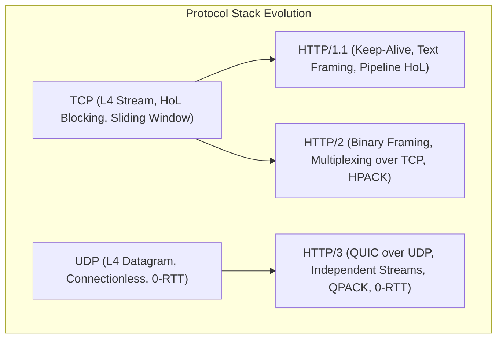
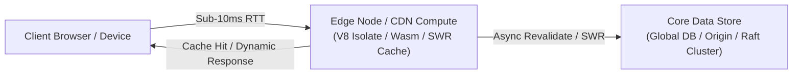
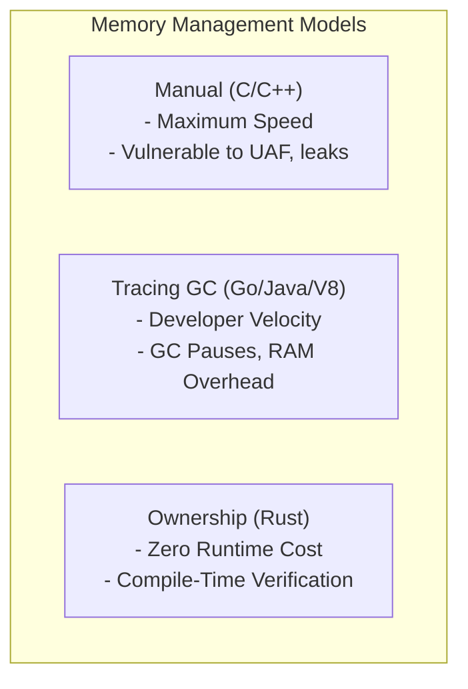
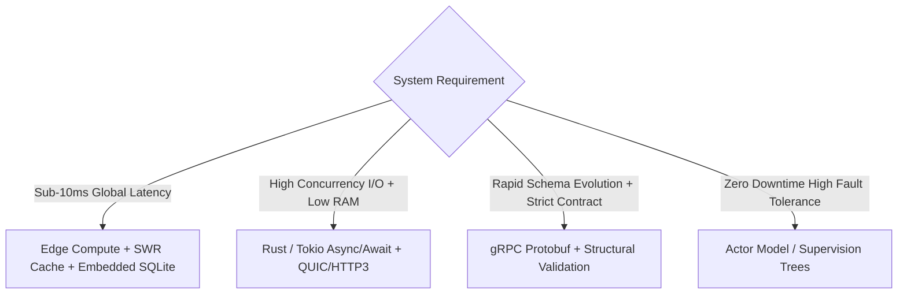

# Internet Protocols, Edge Execution Architectures, and Language Paradigms

This reference document provides Delphi engineers and autonomous systems specialists (`builder`, `architect`, `investigator`) with a comprehensive, low-level technical baseline across internet networking protocols, globally distributed edge runtimes, and core programming language tradeoffs.

---

## 1. The Internet Protocol Stack & Transport Evolution

### 1.1 Layer 4 Transport: TCP vs. UDP & Flow Control Dynamics
- **Transmission Control Protocol (TCP):**
  - *Connection Establishment:* Three-way handshake (`SYN` $\rightarrow$ `SYN-ACK` $\rightarrow$ `ACK`), introducing $1\times$ RTT latency before application data transfer ($2\times$ RTT when negotiating TLS 1.2; $1\times$ RTT with TLS 1.3).
  - *Reliability & Byte-Stream Semantics:* Guaranteed, in-order packet delivery via sequence numbers and cumulative acknowledgments (`ACK`).
  - *Head-of-Line (HoL) Blocking at Layer 4:* Because TCP presents a single contiguous byte stream, a single dropped packet stalls the delivery of all subsequent packets in the OS receive buffer until retransmitted and acknowledged.
  - *Flow Control:* Implemented via the receive window (`rwnd`) field in the TCP header, preventing a fast sender from overwhelming a slow receiver's buffer space.
  - *Congestion Control Algorithms:*
    - *Loss-Based (Tahoe, Reno, Cubic):* Interprets packet loss as the primary signal of network buffer saturation. Doubles window size during Slow Start ($2^n$), increases linearly during Congestion Avoidance, and sharply halves the congestion window (`cwnd`) upon packet drop (Multiplicative Decrease). Cubic uses a cubic function for window growth to optimize high-bandwidth, high-latency (long fat) networks.
    - *Model-Based (BBR - Bottleneck Bandwidth and RTT):* Developed by Google; measures maximum delivery rate (bandwidth) and minimum round-trip time (`min_rtt`) independently. Maintains pacing at the estimated BtlBw (bottleneck bandwidth) to prevent "bufferbloat" (queuing delay in intermediate routers) without relying on packet loss.

- **User Datagram Protocol (UDP):**
  - *Characteristics:* Unreliable, connectionless, unordered datagrams. Zero connection handshake overhead; 8-byte minimal header (Source Port, Destination Port, Length, Checksum).
  - *Utility:* Real-time multimedia streaming, DNS queries, telemetry, and foundational substrate for user-space reliable protocols (QUIC, WebRTC).

### 1.2 HTTP Evolution: HTTP/1.1 vs. HTTP/2 vs. HTTP/3 (QUIC)

| Dimension | HTTP/1.1 (RFC 2616 / 9112) | HTTP/2 (RFC 7540 / 9113) | HTTP/3 (RFC 9114 / QUIC RFC 9000) |
| :--- | :--- | :--- | :--- |
| **Transport Layer** | TCP | TCP | QUIC (over UDP) |
| **Framing Format** | Plain text ASCII | Binary Framing Layer (Frames & Streams) | Binary Framing (QUIC Streams) |
| **Multiplexing** | No (Sequential; Pipelining is flawed and disabled) | Yes (Multiple streams over a single TCP socket) | Yes (Multiple independent streams over UDP) |
| **Head-of-Line Blocking** | At Application layer (request queue stalls) | Solved at L7; **Vulnerable at L4** (TCP packet drop stalls all streams) | **Fully Solved** (Packet drop only stalls the affected stream) |
| **Header Compression** | None (Redundant headers retransmitted per request) | HPACK (Static/Dynamic Huffman-encoded tables) | QPACK (Non-blocking, stream-independent header compression) |
| **Connection Setup Latency** | 2 RTT (1 TCP + 1 TLS 1.3) | 2 RTT (1 TCP + 1 TLS 1.3) | **1 RTT** (Combined Transport + TLS 1.3); **0-RTT** with session resumption |
| **Connection Migration** | Impossible (Socket bound to 4-tuple: `src_ip, src_port, dst_ip, dst_port`) | Impossible (Socket bound to 4-tuple) | **Supported via Connection IDs (CID)**; seamless IP/WiFi-to-Cellular transitions |

### 1.3 Bidirectional & RPC Protocols: WebSockets vs. gRPC
- **WebSockets (RFC 6455):**
  - *Mechanism:* Initiated via HTTP/1.1 Upgrade header (`Upgrade: websocket; Connection: Upgrade`). Once established, the underlying TCP connection transitions to full-duplex framing.
  - *Framing:* Minimal overhead (2 to 10 bytes framing per frame, including FIN bit, opcode, payload length, and 4-byte client masking key).
  - *Strengths:* Universally supported by browsers; low message framing overhead for high-frequency small payloads (e.g., live chat, cursor tracking, financial ticks).
  - *Tradeoffs:* Stateful, long-lived connections break standard stateless L7 load balancer auto-scaling; lacks native schema enforcement, multiplexing, stream prioritization, or RPC semantic contracts; prone to proxy timeouts.

- **gRPC (Google Remote Procedure Call):**
  - *Mechanism:* Built natively on HTTP/2 (and HTTP/3). Uses Protocol Buffers (Protobuf) as its Interface Definition Language (IDL) and binary wire serialization format.
  - *Call Semantics:*
    1. *Unary:* Single request $\rightarrow$ Single response.
    2. *Server Streaming:* Single request $\rightarrow$ Stream of response messages.
    3. *Client Streaming:* Stream of request messages $\rightarrow$ Single response.
    4. *Bidirectional Streaming:* Independent, full-duplex interleaved streams.
  - *Strengths:* Strongly typed contract guarantees; efficient compact binary serialization; native deadline/timeout propagation; cancellation cascades; built-in flow control.
  - *Tradeoffs:* Browser support requires an intermediary translation proxy (`grpc-web` / Connect); binary payloads resist human-readable debugging without reflection tooling.

---

## 2. Modern Edge Execution Architectures & Distributed Data

### 2.1 Edge Compute Paradigms
- **Containers vs. V8 Isolates vs. WebAssembly (Wasm):**
  - *Traditional Containerized Edge (Docker, Firecracker microVMs):* Spin up an entire Linux guest kernel or lightweight process tree. Memory footprint: 100MB–500MB per instance. Cold start latency: 150ms–2000ms.
  - *V8 Isolates (Cloudflare Workers, Deno Deploy):* Multi-tenant sandboxing within a single host process. Thousands of isolated JavaScript/TypeScript execution contexts share a single V8 engine instance. Memory overhead: ~3MB per isolate. Cold start latency: **< 5ms**.
  - *WebAssembly (Fastly Compute, Wasmtime):* Compiles systems languages (Rust, C++, Go) to compact bytecode executed within a memory-safe, capability-based Wasm sandbox. Memory isolation enforced by linear memory bounds. Cold start latency: **< 1ms**.
- **Execution Constraints:** Hard CPU time limits (e.g., 50ms Wall/CPU limits); no raw filesystem access; asynchronous streaming primitives via standard Web APIs (`Request`, `Response`, `TransformStream`, `ReadableStream`).

### 2.2 Globally Distributed Data Layers
When distributed across dozens of geographic edge points of presence (PoPs):
- **Consistency vs. Latency (The PACELC Theorem):**
  - *Post-CAP formulation:* If there is a **P**artition, how does your system trade **A**vailability vs. **C**onsistency? **E**lse (normal operations), how does your system trade **L**atency vs. **C**onsistency?
  - *Edge Reality:* Forcing strong linearizable consistency across global PoPs requires multi-datacenter consensus (e.g., Spanner, CockroachDB Paxos/Raft groups), imposing speed-of-light cross-continental latency penalties ($150\text{ms}–300\text{ms}$ per write).
- **Edge Data Storage Topologies:**
  1. *Edge Key-Value Stores (Cloudflare KV, Fastly KV):* Eventually consistent, read-optimized. Writes replicate asynchronously across hundreds of PoPs over several seconds; reads are served locally from memory or NVMe cache.
  2. *Embedded SQLite with Asynchronous Replication (Turso, LibSQL, LiteFS):* Primary database node receives writes; read-replicas run embedded in edge workers, syncing via SQLite WAL (Write-Ahead Log) streaming.
  3. *Conflict-Free Replicated Data Types (CRDTs):* Mathematical data structures (state-based or operation-based) that guarantee convergent states across distributed nodes without requiring centralized coordination or locking.
  4. *Actor Coordination (Cloudflare Durable Objects):* Guarantees single-point-of-coordination by routing requests for a specific ID to a unique, stateful in-memory actor instance anywhere in the world, with strongly consistent storage backed by transactional logs.

### 2.3 Advanced Caching Strategies & Invalidation
- **Cache-Control Directives:**
  - `max-age=N`: Seconds the client/browser may reuse the cached response without revalidation.
  - `s-maxage=N`: Overrides `max-age` specifically for public shared caches (CDNs, reverse proxies).
  - `stale-while-revalidate=N` (SWR): Instructs the edge cache to instantly return an expired/stale response to the client while asynchronously dispatching a background fetch to origin to refresh the cache.
  - `stale-if-error=N`: Authorizes the edge cache to serve stale content if origin returns a `5xx` error or times out.
  - `immutable`: Declares the resource payload will never change during its valid lifetime, instructing browsers not to send conditional `If-None-Match` requests on page refreshes.

- **Cache Tagging & Surrogate Keys:**
  - Modern CDNs associate responses with arbitrary metadata tags (`Surrogate-Key` or `Cache-Tag: article-104 user-42`).
  - *Targeted Invalidation:* Origin triggers an atomic purge across all global PoPs for a single tag (`POST /purge { "tags": ["article-104"] }`), eliminating stale content within milliseconds without requiring full-site cache flushes.

- **Cache Stampede (Thundering Herd) Defenses:**
  - *Request Collapsing (Coalescing):* When a popular cache entry expires simultaneously for thousands of concurrent users, the CDN forwards exactly one origin request while keeping remaining requests queued, populating the cache and resolving all pending requests at once.
  - *Probabilistic Early Expiration (XFetch Algorithm):* Computes whether to trigger background revalidation probabilistically before the TTL expires: $\Delta \cdot \beta \cdot \ln(\text{rand}()) > \text{TTL} - \text{age}$.

---

## 3. Programming Language Paradigms & Tradeoffs

### 3.1 Memory Management Models

| Paradigm | Exemplars | Allocation / Deallocation Mechanism | Strengths | Operational Failure Modes |
| :--- | :--- | :--- | :--- | :--- |
| **Manual Memory Management** | C, C++, Zig | Explicit developer invocation (`malloc`, `free`, `new`, `delete`, allocators). | Deterministic execution time, zero runtime overhead, minimal memory footprint. | Use-After-Free (UAF), double free, memory corruption, spatial/temporal buffer overflows, memory leaks. |
| **Tracing Garbage Collection** | Go, Java, C#, V8 (JS) | Runtime monitors heap allocation graphs; periodically pauses/traces reachable objects via Mark-Sweep-Compact or generational collectors. | High developer velocity, complete elimination of manual memory deallocation bugs. | Non-deterministic latency spikes (Stop-the-World pauses), elevated memory consumption ($1.5\times–3\times$ working set), cache eviction. |
| **Compile-Time Ownership & RAII** | Rust | Single ownership hierarchy enforced at compile time via borrow checker; deterministic destruction when owner goes out of scope (RAII). | Memory safety without a garbage collector; deterministic resource cleanup; fearless concurrency. | Steep learning curve, increased compile times, self-referential graph structures require explicit indices or `Rc`/`Arc`. |

### 3.2 Concurrency & Asynchronous Execution Models
- **1. Kernel Threads & Preemptive Scheduling (OS Threads):**
  - Managed directly by the OS kernel (POSIX pthreads, Windows threads).
  - *Cost:* Each thread allocates a large static stack (typically 2MB to 8MB); context switching requires a kernel privilege transition (`ring 3` $\rightarrow$ `ring 0`), register saving, and CPU cache/TLB invalidation (taking hundreds of nanoseconds to microseconds). Scaling limited to thousands of threads.

- **2. Green Threads & M:N Scheduling (Go Goroutines, Erlang Processes):**
  - User-space runtime multiplexes $M$ green threads onto $N$ OS kernel threads.
  - *Mechanism:* Goroutines initialize with a tiny dynamic stack (starting at 2 KB, expanding dynamically). Runtime cooperative preemption occurs at function call prologues and compiler-injected safepoints.
  - *Throughput:* Millions of concurrent routines on a single commodity server.

- **3. Async/Await & Event-Driven I/O (Rust Tokio, Node.js, Python asyncio):**
  - Cooperative concurrency built over OS non-blocking I/O event demultiplexers (`epoll` on Linux, `kqueue` on macOS/BSD, `io_uring`).
  - *Mechanism:* Compilers desugar `async fn` into discrete state machines implementing a `Poll`/`Future` interface. When an I/O operation returns `EWOULDBLOCK`, the task yields control to the runtime reactor and event loop.
  - *Zero-Cost:* No per-task thread stack allocations; memory overhead is strictly the size of the generated state machine enum.
  - *Pitfall:* Blocking the reactor thread with compute-heavy loops freezes the entire event loop.

- **4. Communicating Sequential Processes (CSP):**
  - Exemplified by Go (`chan`) and Clojure (`core.async`).
  - *Philosophy:* *"Do not communicate by sharing memory; instead, share memory by communicating."*
  - Tasks communicate strictly through typed, bounded, or unbounded channels. Channel backpressure prevents memory exhaustion when producers outpace consumers.

- **5. The Actor Model:**
  - Exemplified by Erlang/OTP, Elixir, and Akka.
  - *Characteristics:* Actors are completely isolated entities with private mutable state and a sequential mailbox. Actors share zero memory and communicate solely via asynchronous message passing.
  - *Fault Tolerance:* Supervised trees implement the *"Let it crash"* philosophy: when an unhandled exception occurs, the supervisor terminates and cleanly restarts the actor from a known clean state.

### 3.3 Type Systems & Soundness Tradeoffs
- **Static vs. Dynamic Typing:**
  - *Static (Rust, TypeScript, Go, Haskell):* Types checked at compile time. Catches contract mismatches and null pointer dereferences before runtime; enables compiler optimizations.
  - *Dynamic (Python, Ruby, JavaScript):* Types verified at runtime. Enables rapid interactive prototyping; relies heavily on automated test suites to catch type errors.

- **Nominal vs. Structural Typing:**
  - *Nominal (Rust, Java, C++):* Compatibility determined strictly by explicit name declaration (`struct User` does not equal `struct Customer`, even if fields are identical). Prevents domain mix-ups (e.g., treating `AccountId` as `UserId`).
  - *Structural (TypeScript, Go interfaces):* Compatibility determined solely by shape and members. If type $A$ implements all methods defined in interface $B$, it satisfies $B$ automatically without explicit declaration. Facilitates loose coupling and rapid mocking.

- **Algebraic Data Types (ADTs) & Pattern Matching:**
  - *Product Types:* Tuples, structs (property $A$ **AND** property $B$).
  - *Sum Types:* Enums / tagged unions (property $A$ **OR** property $B$).
  - *Architectural Power:* Sum types allow expressing exhaustive states (e.g., `Result<T, E>`, `Option<T>`) without null references, with compilers forcing developers to handle every variant.

---

## 4. Synthesis: Systems Engineering Decision Matrix for Delphi

### Core Architecture Rules for `builder`:
1. **The Transport Selection Rule:** Use HTTP/3 (QUIC) for mobile or lossy wireless networks to eliminate head-of-line blocking and leverage connection migration. Use HTTP/2 gRPC for internal low-latency microservice meshes requiring strict RPC contracts. Use WebSockets only for browser-facing interactive bidirectional streams where gRPC-web is impractical.
2. **The Edge Data Placement Heuristic:** Never route a read request to a centralized origin database if the data can be represented with an edge-replicated store or cached via `stale-while-revalidate`. Push reads to the geographic perimeter; isolate writes to atomic transactional cores.
3. **The Memory Model Tradeoff:** Default to Rust's ownership model for core daemons, security boundaries, and high-throughput pipelines where unpredictable GC pauses or memory amplification are unacceptable.
4. **The Non-Blocking Invariant:** Inside any async event loop, never execute blocking synchronous file I/O, cryptographic hashing, or CPU-intensive serialization on a reactor thread. Always offload blocking work to dedicated worker thread pools.
