# Delphi Phased Build Plan & Critical Path (`ROADMAP.md`)

> *"Bind me hard to the upright of the mast, with ropes fastened around it..."* — *Odyssey* 12.178  
> **Purpose:** Sequences the 8 subsystem specifications (`specs/001`–`008`) into a deterministic, dependency-ordered build plan where every phase produces a testable, standalone milestone before the next phase begins.

---

## 1. Critical-Path Dependency Graph

```mermaid
flowchart TD
    Dec0["Decision Gate 0: Ratify Core Language & TUI Stack\n(Rust + Ratatui + Tokio vs. Go + BubbleTea)"] --> Phase1
    
    subgraph Phase1 ["Phase 1: The Foundation (Themis + Manifests + Doctor)"]
        P1A["Spec 001: YAML/JSON Schema Validator\n(AGENT.md, SKILL.md, HandoffEnvelope, Provenance)"]
        P1B["Spec 006 (Part A): Workspace Init & delphi doctor\n(.delphi/ layout, Three-Zone boundary checks)"]
    end

    Phase1 --> Phase2

    subgraph Phase2 ["Phase 2: Hermes Engine & Single-Agent Loop"]
        P2A["Spec 002 (Part A): Hermes IPR Dialect Compiler\n(Claude XML/Cache + Gemini systemInstruction/thoughtSignature)"]
        P2B["Spec 002 (Part B): Typed ContentBlock[] Store +\nAthena Dynamic Model Scaler (resolve_model_route)"]
    end

    Phase2 --> Phase3

    subgraph Phase3 ["Phase 3: Dual-Tier Memory & Zero-Server Hybrid RAG"]
        P3A["Spec 004 (Part A): Frozen Boot-Snapshot Loader +\nRule of 25 (6 KB) & 5-Tier IFC Taint Gate"]
        P3B["Spec 004 (Part B): .delphi/state.db Hybrid RAG\n(AST Breadcrumb Chunker + FTS5 BM25 + sqlite-vec + RRF)"]
    end

    Phase3 --> Phase4

    subgraph Phase4 ["Phase 4: Orchestrator DAG, Council & Worktree Forge"]
        P4A["Spec 003: Athena Orchestrator DAG + 3-Round Sparse Council\n(Blind Round 1 Barrier + Heterogeneous Routing + Minority Report)"]
        P4B["Spec 002 (Part C): Isolated Git Worktrees +\nHeadless CLI Harness Drivers (claude / gemini / codex)"]
    end

    Phase4 --> Phase5

    subgraph Phase5 ["Phase 5: Dual-Window TUI Daemon (Chaos + Homer)"]
        P5A["Spec 005 (Part A): delphi-core UDS Daemon\n(60Hz Frame Coalescer + events.jsonl + SQLite WAL)"]
        P5B["Spec 005 (Part B): Window 1 (Chaos Operator Deck) +\nWindow 2 (Homer Live Narrator) + Multiplexer Auto-Spawn"]
    end

    Phase5 --> Phase6

    subgraph Phase6 ["Phase 6: Distribution, Federation & Ambient Autonomy"]
        P6A["Spec 006 (Part B): Embedded Seed Packaging +\ndelphi update (Diff3 3-Way Merge) & delphi sync"]
        P6B["Spec 007: Hermes 3-Plane Federation\n(A2A Delegation + delphi:// UCAN/Biscuit Pointers)"]
        P6C["Spec 008: Zero-Token Ambient Watches,\nCoupled /rewind & DPO Trajectory Export"]
    end
```

---

## 2. Open Pre-Build Decisions (For Second-Opinion Review)

Before **Hephaestus** writes line 1 of production code in Phase 1, the following three architectural choices should be explicitly stress-tested during your Claude review tomorrow:

1. **Decision Gate 0 — Implementation Language & TUI Stack ([`specs/005`](file:///Users/jessevondoom/projects/work/delphi/specs/005-chaos-and-homer-tui.md)):**
   - **Option A: Rust (`Tokio` + `Ratatui` + `rusqlite` + `sqlite-vec` + `pulldown-cmark`).**
     - *Pros:* Unmatched 60fps cell-buffer DAG/Council rendering (`Homer`), native single-binary compilation with C-extension `sqlite-vec`, zero GC pauses during 5-agent parallel streaming.
     - *Cons:* Slower initial UI component boilerplate than Go/Charmbracelet.
   - **Option B: Go (`BubbleTea v2` + `Lipgloss v2` + `Huh` + `goldmark`).**
     - *Pros:* Fastest development velocity for TUI forms (`delphi init`), clean goroutine UDS daemon orchestration.
     - *Cons:* Requires CGo for `sqlite-vec`/`fts5` (slightly complicating cross-compilation) and requires a Committed-Block Markdown Cache to avoid `Glamour` re-render lag.
2. **Decision Gate 1 — Local Embedding Model for `sqlite-vec` ([`specs/004`](file:///Users/jessevondoom/projects/work/delphi/specs/004-athena-memory-and-coaching.md)):**
   - Should `.delphi/state.db` generate 384-dim vectors via an **embedded local ONNX/GGUF model** (e.g., `bge-small-en-v1.5` or `nomic-embed-text`, ~30–80MB downloaded on `delphi init` for 100% offline zero-cost indexing) OR default to **FTS5 BM25-only** until a local/API embedding model is enabled?
3. **Decision Gate 2 — Phase 1 Scripting Language for `skills/*/scripts/`:**
   - Should deterministic skill helper scripts (`validate_dag.py`, `council_barrier.py`, `load_base_review_rubric.sh`) be implemented as **subcommands inside the single `delphi` binary** (`delphi internal verify-dag`, `delphi internal council-barrier`) so operators don't even need a Python environment on their machine? *(Highly recommended by Odysseus & Hephaestus for zero-dependency distribution).*

---

## 3. Phase-by-Phase Deliverables & Verification Gates

| Phase | Specs Covered | Deliverable Milestone | Verification Gate (`Definition of Done`) |
| :--- | :--- | :--- | :--- |
| **Phase 1: Foundation** | `001`, `006-A` | `delphi init`, `delphi doctor`, and manifest/frontmatter validator. | `delphi doctor` validates all 9 `agents/*/AGENT.md`, `REVIEW.md`, and `GOVERNANCE.md` with exit code `0`. |
| **Phase 2: Hermes Core** | `002-A`, `002-B` | Native Anthropic Claude & Google Gemini drivers, IPR compiler, `ContentBlock[]` signature round-tripping, and `Athena` model scaler. | Multi-turn tool call test preserves `thinking.signature` (Claude) and `thoughtSignature` (Gemini) and survives simulated mid-task provider failover. |
| **Phase 3: Memory & RAG** | `004` | Frozen boot snapshots, `.delphi/state.db` AST breadcrumb chunker + FTS5 + `sqlite-vec` + RRF, and 5-tier IFC taint gate. | `delphi kb search "[REV-SEC-04]"` ranks the exact rule #1 in `<10ms`; untrusted taint promotion test is blocked with exit code `1`. |
| **Phase 4: Pantheon & Council** | `003`, `002-C` | **Athena** DAG orchestrator, 3-round Council state machine (blind Round 1 barrier), isolated Git worktrees, and CLI harness bridge. | Full 3-round Council with Claude + Gemini produces a validated Verdict + Minority Report; `Hephaestus` executes TDD in an isolated worktree. |
| **Phase 5: Chaos & Homer TUI** | `005` | Auto-spawned `delphi-core` UDS daemon, 60Hz coalescer, Window 1 (`Chaos`), and Window 2 (`Homer`). | `delphi --dual` launches both windows; `Homer` survives `SIGKILL` and replays state from UDS socket in `<10ms`. |
| **Phase 6: Scale & Federation** | `006-B`, `007`, `008` | `delphi update` (`diff3` 3-way merge), `delphi://` UCAN/Biscuit pointers, A2A delegation, `/rewind`, and zero-token watches. | Two local `delphi-core` instances exchange a line-scoped `delphi://` pointer with transitive taint preservation and zero Zone 3 leakage. |
