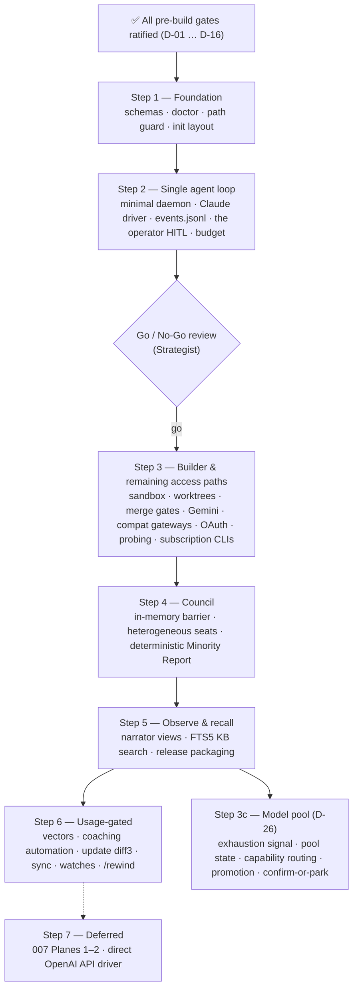

# Delphi Phased Build Plan & Critical Path (`ROADMAP.md`)

> **Revised 2026-10-23 per Council 001 and ratified decision D-12.** Every step ends in something usable and testable. Steps 6–7 are gated on real usage, not on the calendar. All decisions are recorded in [`decisions.md`](decisions.md), and the findings behind them in [`councils/001-spec-suite-red-team.md`](councils/001-spec-suite-red-team.md).

---

## 1. Critical Path

Step 3c builds on the endpoint, Gemini and Council work of Steps 3–4 and does not gate Step 6. Plan: [`step-3c-model-pool-plan.md`](step-3c-model-pool-plan.md).

## 2. Ratified Pre-Build Gates

| Gate | Decision | Ratified choice |
| :--- | :--- | :--- |
| 0 | Language/stack | Rust (Tokio, Ratatui, rusqlite + FTS5, pulldown-cmark, serde, include_dir!). `sqlite-vec` linked only after D-01 reopens. |
| 1 | Embeddings (D-01) | BM25-only; vectors behind an `Embedder` trait after >50 missions **and** a logged miss |
| 2 | Deterministic helpers (D-02) | Compiled into the runtime as state-machine code; user scripts sandboxed at Amber |
| 3 | Workspace layout (D-03) | Installed tool; all state in `$DELPHI_HOME/workspaces/<name>/`; project repos stay clean (spec 006 §3.1) |
| 4 | Sandbox (D-04) | `sandbox-exec` / `bubblewrap`; no sandbox → execution is Amber |
| 5 | Runtime topology (D-05) | Minimal UDS daemon in Step 2; live Narrator streaming |
| 6 | Taint lattice (D-08) | Six tiers, adding `internal_generated` ($L_3$) |

Scope (D-06, D-07, D-13, D-14, D-15), budgets (D-10), learning autonomy (D-11), heuristic caps (D-09) and reasoning retention (D-16) are recorded in `decisions.md`.

## 3. Steps, Deliverables & Definition of Done

| Step | Specs | Deliverable | Definition of Done |
| :--- | :--- | :--- | :--- |
| **1. Foundation** | 001, 006 (init/doctor), GOV §5 | `delphi init` (workspace home, seeded from the binary), `delphi doctor` (daemon checks report `not running`), manifest/frontmatter validator, logical path guard, `ratified.lock` | `doctor` exits `0` on a fresh init; spec 001 tests 1, 6, 7 pass; this repo passes the validator, link and absolute-path checks; a registered project repo stays clean |
| **2. Single agent loop** | 002 (Claude), 005 Step 2 rows, 009 Step 2 rows, 003 §3.2 (budget), 001 §5, 004 §5 Step 2 rows | Endpoint layer with `keychain`/`env`/`command`/`aws`/`gcloud-adc` credentials and Claude via direct API, Bedrock, Vertex and native gateways; minimal `delphi-core` daemon (UDS, handshake, coalescer, spawn lock, backpressure); the operator REPL; Orchestrator on Claude; `events.jsonl` (single writer, fsync, redaction); approval broker (Red/Amber, deny on timeout); usage ledger (`specs/005` §2.4), `/usage` and budget; span taint accounting | Claude signature round-trip on replay fixtures; taint laundering test and taint-gated tool test pass; budget reservation and halt tests pass; spawn-race and crash-durability tests pass; **Go/No-Go:** an operator completes 3 real L1 or read-only L2 tasks (discovery, planning, spec drafting, review) on a real project, read through `@project/**`. Worktree-mutating work starts in Step 3 (`specs/003` §1.2). |
| **3. Builder & access** | 002 (Gemini, §2.2 compat, rate limits), 003 §3, 008 §4, 009 Step 3 rows, 005 Step 3 rows | Gemini (direct API, Vertex), compat gateways, `oauth2` login, endpoint probing; then, on the new sandbox, subscription CLIs (egress proxy, per-span approval bridge); Builder in sandboxed worktrees outside the repo (`.git/` write-denied, host-exec badge); unified retry ladder; 5 merge gates; local and GitHub merge-back | Gemini signature replay; hook-planting test fails safely; retry ladder test passes; a spec-linked change goes from approved spec to merged branch |
| **4. Council** | 003 §4 | `/council` with in-memory barrier, heterogeneous seats, daemon-filled Minority Report, deterministic escalation | Barrier, fabricated-dissent and heterogeneous-assignment tests pass; one real decision taken through a Council |
| **5. Observe & recall** | 005 §4, 004 (FTS5), 006 §2 | `delphi narrator` agents pane (models, tokens, spend) + 4 views (Epic, Council, Forge, Archives); `delphi kb search` (two FTS tables + triggers); signed release + Homebrew; simplified `update` (`.upstream` files) | `kb search "[REV-SEC-04]"` ranks #1; FTS sync and rebuild tests pass; tampered-binary and constitution-gate tests pass |
| **3c. Model pool (D-26)** (built 2026-10-24) | 002 §3.1 r5, §4.1; 003 §3.2, §4; 005 §2.3–2.5 | `[routing.pool]` and `[routing.targets]`; exhaustion distinguished from rate limits; pool state with re-probe; capability-based route resolution; mid-span promotion across families; confirm-or-park for weaker substitutes; Council and retry ladder read the pool; `delphi models` | Spec 002 §4.1 tests 1–7 and 6a pass; an unchanged config routes as before; a real two-family run finishes on the substitute with `model.promoted` in the log. Eight milestones, about 72 h: [`step-3c-model-pool-plan.md`](step-3c-model-pool-plan.md) |
| **6. Usage-gated** | 004 vectors + coaching, 006 diff3, 007 Plane 3, 008 §2–3 | Each item starts only when a recorded usage need justifies it | The relevant spec's verification plan |
| **7. Deferred** | 007 Planes 1–2; direct OpenAI API and local drivers | Not scheduled | Revisit at a future roadmap review |

## 4. Remaining Work by Estimated Effort

Hours are focused build time including tests (the unit `specs/005c` uses). The **Basis** column says how far to trust each number: *plan* is a milestone estimate from a written plan (±30%), *stated* repeats a figure already in the repo, and *rough* is a size guess from the roadmap review with no analysis behind it (expect it to move by a factor of two). Steps 1–5 are built (see [`roadmap-review-2026-10-24.md`](roadmap-review-2026-10-24.md)); this lists what is left or proposed.

| Effort | Item | Gate | Basis |
| ---: | :--- | :--- | :--- |
| 60+ h | Federation planes 1–2 (`specs/007`) | Deferred; needs a second operator or machine | rough |
| ~30 h | First live connector run and what it shows, formatters, promotion card, harness bridge (`specs/010`) | Needs the operator's Google OAuth client | rough |
| ~30 h each | Step 6: `sync`, watches, `/rewind` | Each starts only when `delphi needs` says so | rough |
| ~15 h | Console half of `specs/005b` (decks, inbox, header states) | After the Narrator trial | stated (`005c`) |
| ~14 h each | Slack connector, Zoom connector | Need admin steps from the operator | rough |
| ~14 h | Open red-team sweep findings (`oauth2.rs`, `credential.rs`, `harness.rs`, `finalize.rs`, `setup.rs`) | None | rough |
| ~14 h | Fixes from the Narrator trial, then the group-chat Council view | Needs the operator to try the Narrator | rough |
| ~12 h each | Step 6: vectors, coaching automation, diff3 update | Each gated by `delphi needs` | rough |
| ~8 h | Direct OpenAI API driver | Deferred; needs a key to test | stated (review: "roughly a day") |
| not sized | Harness session resumption (deferred); Gemini Builder (blocked on `gemini --acp`) | Deferred / blocked outside Delphi | n/a |

**Step 3c (the model pool, D-26) is built** (M1 to M8, 2026-10-24, about 72 h of planned work): see [`step-3c-model-pool-plan.md`](step-3c-model-pool-plan.md) for what each milestone did and what is left. What remains of it: ratify spec 005 amendment 005-A6, `/models` in the full-screen console (`ui/`), the Narrator's target-versus-actual strip, and live samples for the Anthropic API, the Gemini API and Bedrock exhaustion signals.
