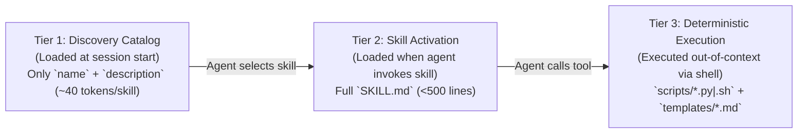

# Spec 001: Governance Enforcement, Agent/Skill Manifests & Handoff Schemas

## 1. Scope & Objectives
This specification defines the machine-validated schemas and runtime contracts that enforce [GOVERNANCE.md](file:///Users/jessevondoom/projects/work/delphi/GOVERNANCE.md) (*Themis*):
1. Declarative **Agent Manifest Schema** (`agents/<god>/AGENT.md`).
2. Progressive-Disclosure **Skill Package Schema** (`skills/<skill>/SKILL.md` + `scripts/`).
3. Inter-Agent **Structured Handoff Envelope** (`HandoffEnvelope`).
4. Knowledge Base & Memory **Provenance / Information Flow Control (IFC) Frontmatter**.

### 1.1 Non-Goals
- Model provider wire translation and dialect compilation (covered in [`specs/002-hermes-adapter-and-routing.md`](file:///Users/jessevondoom/projects/work/delphi/specs/002-hermes-adapter-and-routing.md)).
- Multi-round Council state machine transitions (covered in [`specs/003-collaboration-and-council.md`](file:///Users/jessevondoom/projects/work/delphi/specs/003-collaboration-and-council.md)).

### 1.2 Simpler Alternative Considered (*The Icarus Middle-Course Rule*)
- **Alternative:** Hardcode agent prompts and tool permissions directly in Go/Rust source code structs.
- **Why Rejected:** Violates [GOVERNANCE.md](file:///Users/jessevondoom/projects/work/delphi/GOVERNANCE.md) §1.2 and prevents **Athena** or human operators from inspecting, auditing, or extending skills and agent rules via Git-tracked Markdown files. Keeping manifests as YAML-frontmatter Markdown files preserves human readability while enabling strict JSON-Schema validation at load time.

---

## 2. Declarative Agent Manifest Schema (`agents/<god>/AGENT.md`)

Every specialist in the Pantheon is loaded from `agents/<id>/AGENT.md` (with optional user overrides in `.delphi/agents/custom/<id>/AGENT.md`).

### 2.1 YAML Frontmatter Contract
```yaml
id: athena | hephaestus | daedalus | artemis | argos | odysseus | ares | apollo | hermes
title: string                           # Mythological title and epithet
role: string                            # Operational role summary
cognitive_profile: deep-reasoning | code-craft | high-context-discovery | fast-triage
preferred_diversity_group: orchestrator | builder | architect | hunter | scout | strategist | critic | communicator | integrator
default_access_scope:
  read: ["*"]                           # Glob patterns relative to workspace root
  write: ["missions/**"]                # Strictly scoped per Principle of Least Privilege (GOVERNANCE.md §5.1)
  execute: ["agent-dispatch", "..."]    # Named capability gates enforced by delphi-core
authorized_skills:                      # Whitelist of skills/<name>/ this agent may invoke
  - task-decomposition
  - dynamic-model-scaling
memory_scope: "memory/agents/<id>/"     # Private episodic memory path (isolated from peers)
max_turn_budget: 25                     # Hard loop guard (prevents MAST FM-1.3 Step Repetition)
```

### 2.2 Runtime Enforcement Invariants
1. **Path & Tool Sandboxing (`[REV-SEC-02]`):** Before executing any file write or tool call requested by an agent, `delphi-core` validates the target path against `default_access_scope.write` and the tool name against `default_access_scope.execute`. Violations immediately abort the tool call and return a structured permission error to the agent.
2. **Length Cap (`[REV-ARCH-03]`):** `AGENT.md` body content must not exceed **500 lines** (`<2,500` tokens) so persona instructions never crowd out task context.

---

## 3. Progressive-Disclosure Skill Package Schema (`skills/<skill-name>/`)

Skills follow a strict 3-tier **Progressive Disclosure** loading protocol to minimize context window overhead:



### 3.1 `SKILL.md` Frontmatter Schema
```yaml
name: string                            # Kebab-case identifier matching directory name
description: string                     # <= 200 chars: what it does and exact trigger conditions
authorized_agents:                      # List of Pantheon agent IDs allowed to load this skill
  - hephaestus
input_schema:                           # JSON Schema Draft 2020-12
  type: object
  required: [...]
  properties: {...}
output_schema:                          # JSON Schema Draft 2020-12
  type: object
  required: [...]
  properties: {...}
required_permissions:
  - read:all
  - write:worktree
  - shell:scoped_scripts
deterministic_scripts:
  - path: "scripts/run_tdd_gate.py"
    timeout_ms: 60000
    sandbox_mode: "worktree-isolated"   # readonly | worktree-isolated | outbound-gated
```

---

## 4. Structured Handoff Envelope (`HandoffEnvelope`)

Per [GOVERNANCE.md](file:///Users/jessevondoom/projects/work/delphi/GOVERNANCE.md) §3.1, agents never pass raw chat transcripts to one another. Every dispatch from **Athena** (or cross-agent request) is serialized as a `HandoffEnvelope` validated against the following schema:

```yaml
handoff_id: "ho_20261023_0042"
mission_id: "2026-10-23-auth-refactor"
parent_span_id: "sp_athena_01"
caller_agent: "athena"
target_agent: "hephaestus"

# 1. Objective & Spec Linkage
objective: "Implement the UDS frame coalescer in src/bus/coalesce.rs per approved spec."
implements_spec: "specs/005-chaos-and-homer-tui.md#L80-L135"

# 2. Pointer-Based Context (No raw file dumps; max 2,000 tokens in envelope)
context_pointers:
  - uri: "file:///specs/005-chaos-and-homer-tui.md#L80-L135"
    reason: "Data model and 16ms frame coalescing state machine."
  - uri: "file:///missions/2026-10-23-auth-refactor/councils/01-ipc-verdict.md#L45-L70"
    reason: "Ares' Minority Report warning regarding socket backpressure."

# 3. Constraints & Invariants
constraints:
  - "Must operate strictly inside isolated worktree .delphi/worktrees/ho_0042"
  - "Must write failing backpressure unit test before implementation (tdd-execution)"

# 4. Expected Output Contract
expected_output:
  artifact_type: "git-branch-and-test-report"
  required_fields: ["worktree_branch", "commit_sha", "test_summary", "spec_drift_detected"]

# 5. Athena's Dynamic Model Scaling Directive (per context/model-capabilities.md)
routing_directive:
  provider_preference: "anthropic"
  model_tier: "workhorse"
  model_id_hint: "claude-sonnet-4-6"
  thinking_budget_tokens: 4096
  fallback_provider: "google"
  fallback_model_hint: "gemini-3-pro"
  attempt_number: 1
  scaling_rationale: "Standard TDD implementation with clear spec contract; 4k thinking budget for async channel safety."
```

---

## 5. Provenance & Information Flow Control (IFC) Frontmatter Schema

Every Markdown artifact written to `context/`, `missions/`, `specs/`, or `memory/agents/` must begin with a machine-validated YAML frontmatter block:

```yaml
---
id: string
title: string
author: athena | hephaestus | daedalus | artemis | argos | odysseus | ares | apollo | hermes | chaos
timestamp: "2026-10-23T07:48:00Z"       # ISO-8601 UTC
source_type: external_untrusted | federated_peer | internal_empirical | user_ratified
confidence: low | medium | high | verified
status: draft | debating | approved | active | superseded
superseded_by: string | null            # Required when status == superseded
source_mission: string
ttl_missions: 10                        # Used for stale heuristic garbage collection
tags: [string]
---
```

### 5.1 Taint Propagation Invariant (`[H-004]` / `[REV-SEC-01]`)
- Any artifact created by **Argos**, **Artemis**, or **Hermes** that incorporates data from external web searches, third-party repositories, external APIs, or federated peer instances **automatically inherits** `source_type: external_untrusted` (or `federated_peer`).
- The runtime validator (`verify_provenance.py`) **blocks** any write to `context/heuristics.md`, `REVIEW.md`, `GOVERNANCE.md`, `memory/agents/*/lessons.md`, or `skills/**` if the input provenance chain contains unverified `external_untrusted` data.

---

## 6. Verification Plan
1. **Schema Linter (`lint_manifests.py`):** Validates all 9 `agents/*/AGENT.md` and all `skills/*/SKILL.md` files against JSON Schema Draft 2020-12 on every CI run and `delphi doctor` check.
2. **Handoff Budget Test:** Unit test confirming that any `HandoffEnvelope` exceeding 2,000 inline tokens or lacking valid `file://` pointers is rejected by the runtime router.
3. **Taint Gate Test:** Adversarial test attempting to promote a research note tagged `source_type: external_untrusted` into `context/heuristics.md` without User ratification or `Hephaestus` test verification; must fail with exit code `1`.
