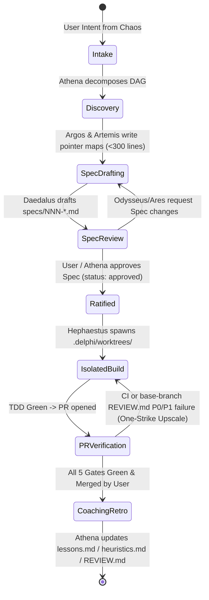
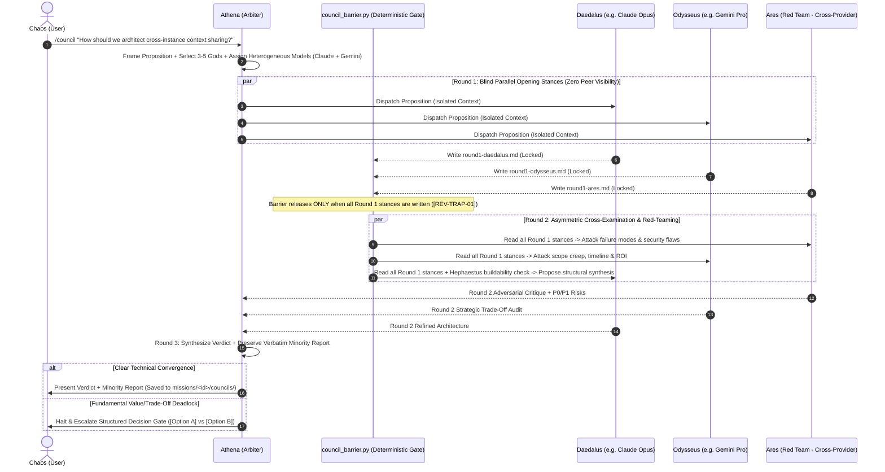

# Spec 003: Orchestrator DAG Execution & 3-Round Sparse Council State Machine

## 1. Scope & Objectives
This specification defines how the 9 Pantheon specialists collaborate under **Athena's** orchestration:
1. **Complexity Escalation & Mode Selection:** Choosing between Single-Specialist Dispatch, Orchestrator DAG Mode, and Council Mode.
2. **Orchestrator Mode (Directed Acyclic Graph Execution):** Parallel/sequential specialist execution with Git worktree isolation and deterministic verification gates.
3. **Council Mode (3-Round Sparse Adversarial Deliberation):** State machine enforcing blind parallel Round 1, heterogeneous model routing (`Claude` + `Gemini`), Round 2 cross-examination, and Round 3 Verdict + verbatim **Minority Report**.

### 1.1 Simpler Alternative Considered (*The Icarus Middle-Course Rule*)
- **Alternative:** A flat peer-to-peer group chat where all 9 agents read a shared transcript and an LLM speaker-selector decides who talks next (e.g., legacy AutoGen `GroupChat`).
- **Why Rejected:** Empirical MAS studies ([`mas-architecture-and-failure-modes.md`](file:///Users/jessevondoom/projects/work/delphi/context/domains/mas-architecture-and-failure-modes.md)) prove flat dense group chats suffer from $O(N^2 \cdot R)$ token explosion, first-speaker anchoring cascades, and 41%–86% failure rates. A hub-and-spoke Orchestrator DAG combined with a bounded 3-round sparse Council cuts token usage by ~50% while dramatically improving accuracy.

---

## 2. Athena's Complexity Escalation Ladder

Per Anthropic's *Building Effective Agents* taxonomy, **Athena** never spawns a multi-agent swarm when a simpler path suffices:

| Level | Pattern | Trigger Criteria | Active Agents |
| :--- | :--- | :--- | :--- |
| **L1: Direct Hunt** | Single-specialist lookup | Fact-check, AST symbol search, quick doc question, or `git status`/PR sync. | `Athena` $\rightarrow$ `Artemis` or `Hermes` (`fast` tier) |
| **L2: Scoped Pipeline** | 2–3 node linear chain | Small bug fix, documentation update, or isolated refactor against an existing spec. | `Artemis` $\rightarrow$ `Hephaestus` $\rightarrow$ `Ares` (PR check) |
| **L3: Full Spec-First DAG** | Parallel discovery $\rightarrow$ Spec $\rightarrow$ Build $\rightarrow$ Audit | New feature, subsystem build, deep research synthesis, or multi-phase personal project. | `Argos` + `Artemis` $\rightarrow$ `Daedalus` $\rightarrow$ `Odysseus` + `Ares` $\rightarrow$ `Hephaestus` $\rightarrow$ `Apollo` |
| **L4: Council Mode** | 3-Round Sparse Debate | High architectural ambiguity, major trade-off fork, security-critical design, or explicit `/council` command from **Chaos**. | `Athena` + 3–5 heterogeneous specialists (always including `Ares` and/or `Odysseus`) |

---

## 3. Orchestrator Mode: Task DAG & Worktree Lifecycle

### 3.1 Hard Orchestration Invariants
1. **No Raw Context Bleed:** Workers in the DAG never receive another worker's raw tool trace. They receive only a `HandoffEnvelope` (`specs/001`) pointing to committed Markdown artifacts in `missions/<id>/` or `specs/`.
2. **Spec-Gate Enforcement:** `delphi-core` deterministically blocks **Hephaestus** from transitioning to `IsolatedBuild` on non-trivial tasks unless the linked `specs/NNN-*.md` file has `status: approved`.
3. **Drift Halt (`GOVERNANCE.md` §1.4):** If **Hephaestus** sets `spec_drift_detected: true` in his output contract, **Athena** halts the build node and routes back to **Daedalus** for a Spec Amendment.

---

## 4. Council Mode: 3-Round Sparse Debate Protocol

When **Council Mode** is triggered, `delphi-core` executes a deterministic 3-round state machine:

### 4.1 Council Protocol Invariants
1. **The Blind Barrier (`[REV-TRAP-01]`):** During Round 1, `delphi-core` writes each specialist's output to an isolated buffer (`missions/<id>/councils/.barrier/r1-<agent>.md`). No agent is allowed to read any peer's Round 1 stance until **all** Round 1 participants have finished generating. This eliminates First-Speaker Anchoring Bias.
2. **Heterogeneous Provider Assignment (`[H-001]` & `[H-007]`):** When both Anthropic (`Claude Opus/Sonnet`) and Google (`Gemini Pro`) credentials are active, `delphi-core`'s Council router automatically alternates model families across Council seats (e.g., `Daedalus` on Claude Opus, `Ares` on Gemini Pro, `Odysseus` on Claude Sonnet) so the Council never suffers from single-model sycophancy.
3. **Athena's Boundary Stone (`R \le 3` Cap):** Councils are strictly capped at 3 rounds. Agents cannot enter an uncountably long polite argument loop.
4. **Mandatory Minority Report Section:** The final Council artifact (`missions/<id>/councils/NNN-<slug>.md`) is rejected by `lint_spec.py` unless it contains a populated `## Accepted Risks & Minority Report (Ares / Dissent)` section.

---

## 5. Verification Plan
1. **Anti-Anchoring Barrier Test:** Verify that during Round 1 execution, attempting to read another agent's Round 1 file path returns `ENOENT` / `EACCES` until the barrier state transitions to `ROUND_2`.
2. **Heterogeneous Assignment Test:** Given a mock config with both `anthropic` and `google` keys, verify that a 4-seat Council assigns at least one seat to each provider family.
3. **Minority Report Linter Test:** Verify that a Council Verdict missing the `Minority Report` heading or omitting an unresolved `P0`/`P1` objection from **Ares** fails validation.
