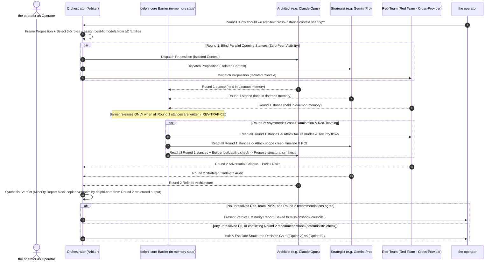

# Spec 003: Orchestrator DAG Execution & 3-Round Sparse Council State Machine

## 1. Scope & Objectives
This specification defines how the 9 agent specialists collaborate under **Orchestrator's** orchestration:
1. **Complexity Escalation & Mode Selection:** Choosing between Single-Specialist Dispatch, Orchestrator DAG Mode, and Council Mode.
2. **Orchestrator Mode (Directed Acyclic Graph Execution):** Parallel/sequential specialist execution with Git worktree isolation and deterministic verification gates.
3. **Council Mode (3-Round Sparse Adversarial Deliberation):** State machine enforcing blind parallel Round 1, heterogeneous model routing (seats on ≥2 model families, each chosen for task fit), Round 2 cross-examination, and Round 3 Verdict + verbatim **Minority Report**.

### 1.1 Simpler Alternative Considered
- **Alternative:** A flat peer-to-peer group chat where all 9 agents read a shared transcript and an LLM speaker-selector decides who talks next (e.g., legacy AutoGen `GroupChat`).
- **Why Rejected:** Empirical MAS studies ([`mas-architecture-and-failure-modes.md`](../context/domains/mas-architecture-and-failure-modes.md)) prove flat dense group chats suffer from $O(N^2 \cdot R)$ token explosion, first-speaker anchoring cascades, and 41%–86% failure rates. A hub-and-spoke Orchestrator DAG combined with a bounded 3-round sparse Council cuts token usage by ~50% while dramatically improving accuracy.

### 1.2 Phase Mapping
| Roadmap step | Delivers |
| :--- | :--- |
| **2** | **L1 and read-only L2** (§2.1): Orchestrator, Architect, Red-Team and Strategist doing lookup, discovery, planning, spec drafting and review over the project (read-only via `@project/**`, `specs/001` §2.2) and Delphi's own zones. Writes go only to `missions/**` and draft `specs/**`. No worktrees, no code execution. §3.1 invariants 1 and 4; §3.2 attempt 1 with pre-dispatch reservation and halt on budget; the operator-only spec approval rule (§3.1.2) |
| **3** | Worktree-mutating L2 and L3, Builder, the sandbox, the 5 merge gates, merge-back, §3.1 invariants 2–3, §3.2 attempts 2–3; test 4 |
| **4** | §4 Council Mode; tests 1–3, 5 |
---

## 2. Orchestrator's Complexity Escalation Ladder

> **v1 roster (D-07, ratified 2026-10-23):** Orchestrator, Architect, Builder, Red-Team, Strategist. Until Scout, Investigator, Writer and Integrator are enabled, their rows below are filled by the nearest enabled role: discovery by Architect (read-only), audits by Red-Team, docs by Builder (in a worktree, through the normal merge gates).

Per Anthropic's *Building Effective Agents* taxonomy, **Orchestrator** never spawns a multi-agent swarm when a simpler path suffices:

| Level | Pattern | Trigger Criteria | Active Agents |
| :--- | :--- | :--- | :--- |
| **L1: Direct Hunt** | Single-specialist lookup | Fact-check, code search, quick doc question, or status lookup. | `Orchestrator` $\rightarrow$ `Investigator` or `Integrator` (`fast` tier); in v1, `Architect` (read-only discovery) |
| **L2: Scoped Pipeline** | 2–3 node linear chain | **Read-only** (Step 2): discovery, plan, spec draft, or audit. **Mutating** (Step 3): a small bug fix, doc update or refactor, against an approved spec or under the bounded exemption (§3.1.2). | Read-only: `Architect` → `Red-Team` or `Strategist`. Mutating: `Investigator`/`Architect` → `Builder` → `Red-Team` |
| **L3: Full Spec-First DAG** | Parallel discovery $\rightarrow$ Spec $\rightarrow$ Build $\rightarrow$ Audit | New feature, subsystem build, deep research synthesis, or multi-phase personal project. | `Scout` + `Investigator` $\rightarrow$ `Architect` $\rightarrow$ `Strategist` + `Red-Team` $\rightarrow$ `Builder` $\rightarrow$ `Writer` |
| **L4: Council Mode** | 3-Round Sparse Debate | High architectural ambiguity, major trade-off fork, security-critical design, or explicit `/council` command from the **operator**. | `Orchestrator` + 3–5 heterogeneous specialists (always including `Red-Team` and/or `Strategist`) |

---

## 3. Orchestrator Mode: Task DAG & Worktree Lifecycle

```mermaid
stateDiagram-v2
    [*] --> Intake: User Intent from the operator
    Intake --> Discovery: Orchestrator decomposes DAG
    Discovery --> SpecDrafting: Scout & Investigator write pointer maps (<300 lines)
    SpecDrafting --> SpecReview: Architect drafts specs/NNN-*.md
    SpecReview --> SpecDrafting: Strategist/Red-Team request Spec changes
    SpecReview --> Ratified: Operator ratifies the spec (its exact hash pinned)
    Ratified --> IsolatedBuild: Builder spawns .delphi/worktrees/<task-id>
    IsolatedBuild --> PRVerification: TDD Green -> PR opened
    PRVerification --> IsolatedBuild: CI or base-branch REVIEW.md P0/P1 failure (retry ladder §3.2)
    PRVerification --> Escalated: Retry ladder exhausted or mission budget hit
    Escalated --> [*]: The operator decides (amend spec, raise budget, or abandon)
    PRVerification --> CoachingRetro: All 5 Merge Gates Green & Merged by User
    CoachingRetro --> [*]: Orchestrator stages proposals; the operator ratifies at /retro
```

**The 5 Merge Gates:**
1. Tests green in the sandboxed worktree.
2. Deterministic CI/lint checks pass (including `lint_manifests`, `verify_provenance`).
3. `Implements-Spec:` points to a spec **ratified by the operator** (its exact content hash is in `ratified.lock`), or the change qualifies for the bounded exemption (§3.1.2).
4. No open `P0`/`P1` findings from the base-branch `REVIEW.md` audit.
5. The **operator** approves the merge (Red gate).

**Bound to a commit:** gates 1–5 are evaluated against one exact worktree `commit_sha`. A new commit re-runs them. The Red-Team audit for gate 4 is recorded as an event naming that SHA, and gate 5 shows the same SHA.

**Merge-back:** **Builder** never merges. Approving gate 5 either opens a PR (GitHub mode), or merges the worktree branch into the operator's current branch (local mode). If the operator's working tree has uncommitted changes that touch the same files, the daemon refuses the merge and shows the conflict.

### 3.1 Hard Orchestration Invariants
1. **No Raw Context Bleed:** Workers in the DAG never receive another worker's raw tool trace. They receive only a `HandoffEnvelope` (`specs/001`) pointing to committed Markdown artifacts in `missions/<id>/` or `specs/`.
2. **Spec-Gate Enforcement (operator-only approval):**
   - **Only the operator approves specs.** `delphi-core` rejects any agent write that sets or changes `status: approved` or `approved_sections` in a spec. Approval records the spec's `(zone, path, blake3)` in `local/ratified.lock` with tier $L_5$ (`specs/001` §5.1, `specs/006` §3.1). Any later edit changes the hash and voids the approval until it is ratified again.
   - **The gate:** `delphi-core` blocks **Builder** from entering `IsolatedBuild`, and blocks merge gate 3, unless the linked spec's current hash is ratified. The frontmatter `status` field alone proves nothing.
   - **Bounded exemption (no spec):** an L2 change may proceed without a spec only if it is **deterministically bounded**. All of these must hold:
     - at most 2 files and 100 changed lines;
     - no `host_exec_paths` files, dependency manifests or lockfiles;
     - nothing under `GOVERNANCE.md`, `REVIEW.md`, `agents/**` or `skills/**`;
     - the operator approves it at worktree creation and again at merge gate 5.

     "Non-trivial" is never an agent's judgment call.
3. **Drift Halt (`GOVERNANCE.md` §1.4):** If **Builder** sets `spec_drift_detected: true` in its output contract, **Orchestrator** halts the build node and routes back to **Architect** for a Spec Amendment.
4. **Concurrency Cap:** At most `max_parallel_agents` (config, default 4) model calls run at once per workspace; further DAG nodes queue.

### 3.2 Unified Retry Ladder & Budget (replaces the separate one-strike, two-strike, and PR-loop policies)
| Attempt | Trigger | Action |
| :--- | :--- | :--- |
| 1 | Dispatch | Tier chosen by the scaler (`specs/002` §4). |
| 2 | Attempt 1 failed verification | **Upscale** tier and thinking budget ≥2× (`[H-007]`). History kept. |
| 3 | Attempt 2 failed | **Context Circuit Breaker** (`specs/004` §4.1): fresh context, a deterministic diagnostic, and a different model family. With only one family configured or allowed, a different model of the same family is used, recorded as `homogeneous_retry: true` (`[H-008]`). The span's `external_ceiling` carries over from attempts 1–2. |
| — | Attempt 3 failed, **or** `mission_budget_usd` reached | **Halt node → `Escalated`**; the **operator** decides. No further automatic attempts. |

- "Failed verification" means a deterministic check failed. Only tests that existed before the task and that the task did not modify may be rerun once for flake detection; a pass on rerun is recorded as `flaky` and does not count as a strike. A failure of any test the task added or modified always counts. Intermittent failures are exactly how races show up.
- The budget ceiling is enforced by `delphi-core` from the usage ledger (`specs/005` §2.4), not by an agent. Before each model call the daemon **reserves** that call's worst-case cost against the remaining budget, priced per token class at the resolved `(endpoint_id, model_id)` rates (`specs/002` §4 catalog, `specs/009` §8). The worst case is: estimated input `ceil(utf8_bytes / 4) × 1.5` at the input rate (with cache-write pricing where a breakpoint is written), plus `max_tokens` at the output rate. Thinking is billed at the output rate, inside `max_tokens` on Claude and additive on Gemini. A failover re-reserves at the new endpoint's rates before dispatch. Subscription endpoints reserve against `subscription_budget_tokens` (`specs/009` §7.10) instead of dollars. The call is refused if the reservation doesn't fit, and the reservation is reconciled to actual cost when the stream ends. Parallel calls therefore cannot jointly overshoot the cap. Defaults (D-10, ratified 2026-10-23): `mission_budget_usd = 5`, `council_budget_usd = 20`, `max_parallel_agents = 4`. `council_budget_usd` is a separate per-Council ceiling. An escalation to Council Mode that the operator didn't request with `/council` needs operator approval before that budget unlocks. Hitting a ceiling halts the node and escalates; it never silently downscales.
- `max_turn_budget` (`specs/001`) bounds the tool-use turns *within* one attempt.

---

## 4. Council Mode: 3-Round Sparse Debate Protocol

When **Council Mode** is triggered, `delphi-core` executes a deterministic 3-round state machine:

### 4.1 Council Protocol Invariants
1. **The Blind Barrier (`[REV-TRAP-01]`):** During Round 1, `delphi-core` holds each specialist's output **in daemon memory**. Nothing is written to any path an agent can read or write, `events.jsonl` included: Round 1 block events are buffered and appended only after the barrier releases (`specs/005` §2.3), and agents can never read the event log (`specs/001` §2.2). No agent can read any peer's Round 1 stance until **all** Round 1 participants have finished, or have timed out (a timed-out seat is recorded as `abstained`). This eliminates First-Speaker Anchoring Bias. The barrier is daemon state-machine code, not a script or subcommand an agent chooses to call.
   - **Framing hygiene:** Round 1 seats get only the proposition and pointers. They don't get Orchestrator's preferred answer, and they don't get prior council verdicts on the same topic unless the **operator** attaches them.
2. **Heterogeneous Family Assignment (`[H-001]` & `[H-007]`):** when models from two or more families are configured, the Council router assigns each seat the best-fit model for its role from the capability matrix (`specs/002` §4), subject to one constraint: seats must span at least two families, and Red-Team is never on the same family as the proposal's author (Architect). Families are training lineages, not vendors (GOVERNANCE §3.2).
3. **Round Cap ($R \le 3$):** Councils are strictly capped at 3 rounds: two deliberation rounds plus synthesis. Agents cannot enter an endless polite argument loop. With only one model family configured, the verdict is labeled `homogeneous` so the **operator** knows the `[H-001]` diversity guarantee did not hold.
   - **Author-family rule (`[H-008]`):** when the material under review was drafted by a model family, at least two critic seats (Red-Team and Strategist by default) are assigned from *other* families whenever those are configured. If they aren't, the Council still runs and is **never blocked**. As best practice, the critic seats then use a **different model from the same family** than the one that drafted the material: another tier or version, chosen from the capability matrix. Only if no other model is configured do they share the author's model. Its verdict is labeled `homogeneous`, the Minority Report notes that the author's family reviewed its own work, and the operator may choose to wait for a second family before approving.
4. **Mandatory Minority Report Section:** The final Council artifact (`missions/<id>/councils/NNN-<slug>.md`) is rejected by `lint_spec.py` unless it contains a `## Accepted Risks & Minority Report (Red-Team / Dissent)` section.
   - The section is filled by `delphi-core`, which copies every unresolved `P0`/`P1` item verbatim from the critics' structured Round 2 output. Orchestrator can add context but cannot edit or drop those items.
   - If critics raised no unresolved items, the section must read exactly `Unanimous — no unresolved P0/P1 (Red-Team concurs).`, which requires Red-Team's explicit `concur: true`. This removes the incentive to invent dissent just to satisfy the linter.
5. **Deterministic Escalation:** Orchestrator does not decide whether there is a deadlock. Any unresolved `P0`, or conflicting `recommendation` fields among Round 2 outputs, escalates to the **operator** as a structured decision gate.

---

## 5. Verification Plan
1. **Anti-Anchoring Barrier Test:** During Round 1, verify that no Round 1 content exists on disk or in any agent-reachable tool result. An agent with `read: ["*"]` and write access to `missions/**/councils/**` cannot observe or alter a peer stance before the state machine reaches `ROUND_2`.
4. **Retry Ladder Test:** Three consecutive verification failures on one node produce exactly two automatic retries (upscale, then reset) followed by an `Escalated` state. A mission whose budget is exhausted halts before its next model call.
5. **Fabricated-Dissent Test:** A verdict with an empty Minority Report and no Red-Team `concur: true` fails lint; a verdict whose Minority Report differs from Red-Team's Round 2 P0 text fails lint.
2. **Heterogeneous Assignment Test:** given a mock capability matrix with three families (including two models of the same family served by different providers), verify that a 4-seat Council spans at least two *families*, never counts one family twice because it has two providers, and never puts Red-Team on Architect's family.
3. **Minority Report Linter Test:** Verify that a Council Verdict missing the `Minority Report` heading or omitting an unresolved `P0`/`P1` objection from **Red-Team** fails validation.
