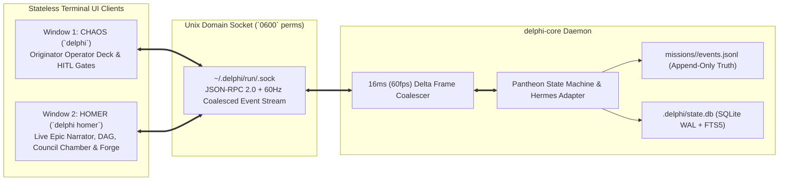

# Spec 005: Chaos Operator Deck, Homer Live Narrator Window & UDS Event-Bus Daemon

## 1. Scope & Objectives
This specification defines the dual-window terminal interface and local client-daemon architecture of Delphi (implemented in **Rust** using `Tokio`, `Ratatui`, and `Crossterm`):
1. **`delphi-core` Local Daemon & Unix Domain Socket (UDS) Bus:** Event-sourced runtime engine with 60Hz frame coalescing, append-only `events.jsonl` replay, and SQLite WAL state indexing.
2. **Window 1 — `Chaos` (`delphi` / `delphi chat`):** The sovereign operator interface, prompt input, slash-command palette, and synchronous Human-in-the-Loop (HITL) permission modals.
3. **Window 2 — `Homer` (`delphi homer`):** Attach-anywhere secondary live narrative and telemetry window—the epic storyteller chronicling the Pantheon's actions in real time (Execution DAG, 3-column Council Chamber, Hephaestus Forge diffs, and Model Scaling telemetry).
4. **Multiplexer & OS Window Auto-Spawning:** Seamless dual-window launching across `tmux`, `zellij`, `WezTerm`, `Kitty`, and macOS windows, plus single-screen `Tab` toggle fallback.

### 1.1 Simpler Alternative Considered (*The Icarus Middle-Course Rule*)
- **Alternative:** A monolithic single-process TUI where the agent runtime and terminal UI run in the same process without a Unix Domain Socket daemon, using log file tailing (`tail -f`) for a second window.
- **Why Rejected:** One-way log tailing cannot support interactive multi-window control (such as pausing a runaway agent from `Homer`, inspecting live collapsible DAG nodes, or surviving an accidental terminal window closure without killing active `Hephaestus` builds). Auto-spawning a per-workspace UDS daemon (`~/.delphi/run/<workspace-hash>.sock` — the exact pattern used by `tmux` and `rust-analyzer`) adds minimal code while unlocking sub-15µs bidirectional multi-window sync and crash resilience.

---

## 2. Client-Daemon Architecture (`delphi-core` over UDS)



### 2.1 Daemon Auto-Spawn & Socket Security Invariants
1. **Zero-Config Auto-Spawn:** Running `delphi` checks `~/.delphi/run/<workspace-hash>.sock`. If absent or stale, it automatically spawns `delphi-core --daemon --workspace <path>` in the background, waits `<20ms` for socket bind, and attaches the `Chaos` UI.
2. **File Permissions:** The socket directory `~/.delphi/run/` is created with mode `0700` and socket files with `0600` so no other OS user or browser process can connect.
3. **60Hz Frame Coalescing (`[REV-TRAP-03]`):** When 3–5 Council specialists stream tokens concurrently (emitting 300+ token deltas/sec), `delphi-core` buffers `agent.thinking.delta` and `agent.text.delta` events per span and flushes coalesced frames every **16ms (60Hz)** to connected TUI clients, preventing terminal stdout saturation and layout thrashing.

### 2.2 Canonical `EventEnvelope` Wire Schema
Every state transition, token delta, tool call, model upscale, and approval request is serialized as an `EventEnvelope`:
```json
{
  "seq": 2048,
  "timestamp": "2026-10-23T07:51:10.120Z",
  "mission_id": "2026-10-23-federated-sync",
  "trace_id": "tr_0192b",
  "span_id": "sp_ares_r2",
  "parent_span_id": "sp_athena_council_01",
  "agent": "ares",
  "provider": "google",
  "model_id": "gemini-3-pro",
  "thinking_budget": 16384,
  "mode": "council",
  "round": 2,
  "type": "agent.thinking.delta",
  "payload": {
    "delta": "Inspecting Hermes capability token expiry under clock skew..."
  }
}
```

---

## 3. Window 1: `Chaos` (`delphi` / `delphi chat`) — The Operator Deck

Per [GOVERNANCE.md](file:///Users/jessevondoom/projects/work/delphi/GOVERNANCE.md) §1.1, the primary operator window identifies as **Chaos** (the primordial origin point and seat of human sovereignty).

### 3.1 Core Operator Capabilities
- **Conversational Stream:** Displays **Athena's** high-signal syntheses, Council Verdicts (with collapsible **Minority Reports**), and clickable `file:///path#L10-L20` artifact links.
- **Direct Specialist Invocation:** Prefixing a prompt with `@<god>` (e.g., `@artemis benchmark the SQLite FTS5 query latency` or `@apollo clean up README.md`) routes directly to that specialist while logging the interaction in the mission trace.
- **Slash Command Palette:**
  - `/council "<topic>"`: Convenes a 3-round Council debate.
  - `/homer`: Spawns or focuses Window 2 (`Homer`).
  - `/scale <agent> <tier|model>`: Manually overrides **Athena's** dynamic model selection for an agent.
  - `/retro`: Triggers **Athena's** 4-channel coaching & `REVIEW.md` distillation pass.
  - `/permissions`: Cycles approval mode (`default`, `accept-edits`, `mission-auto`).
- **Synchronous HITL Approval Modal:** Whenever **Hephaestus** or **Hermes** hits a Destructive/Outbound Action Gate (`GOVERNANCE.md` §5.4), `Chaos` renders an inline keyboard-driven approval card (`[y] Approve Once`, `[a] Allow for Mission`, `[n] Reject & Redirect`, `[d] View Diff`).

---

## 4. Window 2: `Homer` (`delphi homer`) — The Live Epic Narrator & Telemetry Window

Just as **Homer** chronicled the deliberations of Olympus and the feats of the heroes in the *Iliad* and *Odyssey*, **Homer** attaches to the workspace UDS socket from any second terminal window or monitor to narrate and visualize what the Pantheon is doing in real time across 4 switchable views (`1`–`4` hotkeys):

1. **`[1: The Epic & Pantheon DAG]`:**
   - Live topological graph and real-time narrative stream of active and completed subtasks.
   - Displays each active agent's current **Provider + Model Tier + Thinking Budget** badge (e.g., `🔨 Hephaestus [claude-sonnet-4-6 • think:4k]` or `⬆️ Upscaled -> claude-opus-4-6 [think:16k]`), live token/cost burn rate, and worktree path.
2. **`[2: The Council Chamber]`:**
   - Multi-column live split view during **Council Mode**.
   - **Round 1:** Shows parallel progress bars + live blind generation streams for each summoned specialist.
   - **Round 2:** Side-by-side view of **Ares'** adversarial attacks, **Odysseus'** scope/ROI critique, and **Daedalus'** structural refinements.
   - **Round 3:** **Athena's** Verdict synthesis alongside the highlighted **Minority Report** box.
3. **`[3: The Forge (Worktrees & Diffs)]`:**
   - Live `git diff` viewer and test-runner output stream for **Hephaestus'** isolated worktrees (`.delphi/worktrees/<task-id>/`), plus line-anchored `REVIEW.md` audit comments from **Ares** and **Odysseus**.
4. **`[4: The Archives (Knowledge Base & Coaching Ledger)]`:**
   - Instant fuzzy/FTS5 browser over `context/`, `specs/`, `REVIEW.md`, and each agent's private `memory/agents/<god>/lessons.md`.

---

## 5. Dual-Window Spawning & Single-Screen Fallback

| Launch Method / Environment | Behavior |
| :--- | :--- |
| **Manual Attach (`delphi homer` in Terminal 2)** | Connects to `~/.delphi/run/<workspace-hash>.sock`, fetches `SessionSnapshot` in `<5ms`, and streams live events. Works in **every** terminal emulator or SSH session. |
| **Auto-Dual Flag (`delphi --dual` or `/homer` / `Ctrl+W`)** | Auto-detects environment in order:<br>1. `$TMUX` $\rightarrow$ `tmux split-window -h -p 45 "delphi homer"`<br>2. `$ZELLIJ` $\rightarrow$ `zellij action new-pane --direction right -- delphi homer`<br>3. `WezTerm` $\rightarrow$ `wezterm cli spawn --new-window -- delphi homer`<br>4. `Kitty` $\rightarrow$ `kitty @ launch --type=os-window delphi homer`<br>5. macOS fallback $\rightarrow$ spawns second terminal window via `osascript`. |
| **Single-Window Toggle (`Tab` inside `Chaos`)** | Toggles an in-place `Homer` drawer/tab inside Window 1 so laptop/single-screen users have full observability without a second window. |

---

## 6. Verification Plan
1. **60Hz Backpressure Benchmark:** Simulate 5 concurrent agents streaming 500 token deltas/sec over UDS; verify `delphi-core` coalesces deltas into $\le 60$ frames/sec per client with `<1%` CPU usage and zero dropped sequence numbers.
2. **Client Reconnect / State Replay Test:** Kill `delphi homer` (`SIGKILL`) mid-Council Round 2, relaunch `delphi homer`, and verify it reconstructs the exact Round 1 + Round 2 state from `SessionSnapshot` + ring buffer within `10ms`.
