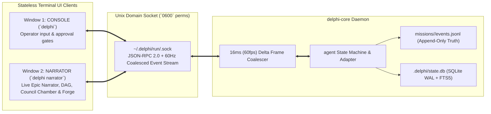

# Spec 005: Console, Narrator Window & UDS Event-Bus Daemon

## 1. Scope & Objectives
This specification defines the dual-window terminal interface and local client-daemon architecture of Delphi (implemented in **Rust** using `Tokio`, `Ratatui`, and `Crossterm`):
1. **`delphi-core` Local Daemon & Unix Domain Socket (UDS) Bus:** Event-sourced runtime engine with 60Hz frame coalescing, append-only `events.jsonl` replay, and SQLite WAL state indexing.
2. **Window 1 — `Console` (`delphi` / `delphi chat`):** The sovereign operator interface, prompt input, slash-command palette, and synchronous Human-in-the-Loop (HITL) permission modals.
3. **Window 2 — `Narrator` (`delphi narrator`):** Attach-anywhere secondary live narrative and telemetry window—the epic storyteller chronicling the team's actions in real time (agents pane with models and token spend, the Epic task graph, the Council chamber, and Builder's Forge diffs).
4. **Multiplexer & OS Window Auto-Spawning:** Seamless dual-window launching across `tmux`, `zellij`, `WezTerm`, `Kitty`, and macOS windows, plus single-screen `Tab` toggle fallback.

### 1.1 Phase Mapping
| Roadmap step | Delivers |
| :--- | :--- |
| **2** | §2.1–§2.4 (daemon, token-authenticated socket, versioned events, segmented durable log, usage ledger); §3 console (root handoff, `/usage`, `/budget`, `/permissions`, `/ratify`, approval cards); §2.5 core recovery (log replay, whole-turn retry, re-raised approvals, `status.md`, budget reconciliation); tests 1, 3–8, 13, 15 (single agent) |
| **3** | §2.5 recovery for worktree checkpoints, `action.intent`/`action.result` reconciliation, and harness subprocesses; tests 11, 12 |
| **4** | §2.5 Council recovery (Round 1 and Round 2 rows) |
| **5** | §4 narrator agents pane and the four views; §5 `tmux` and manual attach; `delphi gc` compaction; tests 2, 9, 10 (full recovery matrix) |

### 1.2 Simpler Alternative Considered
- **Alternative:** A monolithic single-process TUI where the agent runtime and terminal UI run in the same process without a Unix Domain Socket daemon, using log file tailing (`tail -f`) for a second window.
- **Why Rejected:** One-way log tailing cannot support interactive multi-window control (such as pausing a runaway agent from `Narrator`, inspecting live collapsible DAG nodes, or surviving an accidental terminal window closure without killing active `Builder` builds). Auto-spawning a per-workspace UDS daemon (`~/.delphi/run/<workspace-hash>.sock` — the exact pattern used by `tmux` and `rust-analyzer`) adds minimal code while unlocking sub-15µs bidirectional multi-window sync and crash resilience.
- **Decision D-05 (revised 2026-10-23 after the Gemini review): a minimal daemon ships in roadmap Step 2.** A single process would have broken live token streaming in Narrator (deltas aren't persisted) and meant building the runtime twice. Step 2 therefore ships `delphi-core` with the Unix socket, JSON-RPC handshake, coalescer, race-free spawn and slow-client backpressure from §2.1, plus the durability rules from §2.3. It does **not** ship multi-workspace management or remote attach. Narrator gets live control actions (pause, inspect) in Step 5.

---

## 2. Client-Daemon Architecture (`delphi-core` over UDS)



### 2.1 Daemon Auto-Spawn & Socket Security Invariants
1. **Zero-Config Auto-Spawn (race-free):** Running `delphi` computes `<workspace-hash>` from the *canonical* workspace path (`realpath`) and connects to `$DELPHI_HOME/run/<workspace-hash>.sock`. If the connect fails, the client:
   1. Takes an exclusive `flock` on `$DELPHI_HOME/run/<workspace-hash>.lock`, which serializes concurrent launches.
   2. Retries the connect; a daemon may have started while it waited.
   3. Since it now holds the lock *and* the connect failed, no live daemon exists, because a live daemon holds that lock. It unlinks any stale socket. PID files are informational only and never trusted, so a recycled PID can't wedge startup.
   4. Spawns `delphi-core --daemon --workspace <path> --ready-fd N --lock-fd M`, **passing the locked file descriptor across `exec`**. The daemon inherits the lock and never re-locks by path, so it can't deadlock against its parent. The client closes its own copy and blocks until the daemon writes one byte to the readiness pipe (after bind, migrations and manifest load). Timeout is 5 s, after which the daemon's stderr log is shown.
   The daemon holds the inherited lock for its lifetime, so a second daemon can never start for the same workspace.
2. **File Permissions:** The socket directory `$DELPHI_HOME/run/` is created with mode `0700` and socket files with `0600` so no other OS user or browser process can connect. The daemon also verifies `SO_PEERCRED` / `getpeereid` equals its own UID.
   - **Same UID is not enough.** Unsandboxed test runs, scripts and harnesses also run as the operator, so a UID check can't separate the operator from their own processes. Three further layers apply:
     - Every sandbox profile denies `$DELPHI_HOME/run/**` entirely: no read, no write, no Unix-socket connect (`specs/008` §4, `specs/009` §7).
     - **Every connection needs a capability token**; the daemon closes any connection that presents none. Tokens are issued only to clients attached to an interactive TTY, over the spawn pipe or a TTY challenge, never through the environment or a file. There are two scopes:
       - `console` scope: privileged RPCs (`approval.resolve`, `/budget`, `/permissions`, ratification, `/rewind`) plus reading.
       - `narrator` scope: read-only, plus pause and inspect from Step 5.
       - **The socket fixes the scope (D-25).** The daemon listens on two sockets, `<workspace-hash>.sock` (console) and `<workspace-hash>.narrator.sock` (narrator), both `0600`. The scope is whatever the listener says, never what a client claims: a narrator token presented on the console socket, or a console token on the narrator socket, closes the connection without an answer, and `auth.issue` on a socket issues only that socket's kind of token. The narrator socket's dispatcher answers a fixed list of read methods (`session.ping`, `events.subscribe`, `session.snapshot`, `observe.snapshot`, `observe.state`, `observe.diff`, `kb.search`, `usage.get`, `budget.get`, `approval.list`, `permissions.get`, `ratify.list`) and refuses every other name with `FORBIDDEN`, so a new mutating method is unreachable from it until someone adds it to the list on purpose; a test names the list and tries every mutating method.
       - **What this does not stop.** It stops accidental and UI-level escalation (a bug or a keybinding in a watching window cannot approve or start anything). It does not stop a hostile process running as the same OS user: such a process can read the operator's files and reach both sockets, and the token check plus the TTY rule are what make that hard, not the scope split.
       - **What the narrator sees.** Exactly what the console sees: events leave the daemon already redacted of registered secrets, and the Narrator shows model text only after stripping terminal control sequences. It also sees live reasoning (`observe thinking`, spec 005c §3), which exists only in memory.
     - No token means no events, no snapshot and no Round 1 streams: an untrusted local process learns nothing.
     - New narrator attachments, like new console attachments, need confirmation from an attached console while an unsandboxed (Amber) command runs.
   - After a daemon restart, the token is re-issued when the console reattaches through the TTY, so recovered approvals remain answerable (§2.5).
3. **Protocol Handshake:** The first JSON-RPC call is `hello {protocol_version, binary_version}`. If the major versions differ, the client refuses to attach and tells the operator to run `delphi daemon restart`. This happens, for example, after `delphi update` swaps the binary under a running daemon.
4. **60Hz Frame Coalescing (`[REV-TRAP-03]`):** When 3–5 Council specialists stream tokens concurrently (emitting 300+ token deltas/sec), `delphi-core` buffers `agent.thinking.delta` and `agent.text.delta` events per span and flushes coalesced frames every **16ms (60Hz)** to connected TUI clients, preventing terminal stdout saturation and layout thrashing. Live delta frames carry their own per-client `frame_seq` (`frame_from`..`frame_to`), which is never persisted. The durable `seq` is assigned only when an event is appended to the log (§2.3), so the two numbering systems can't interleave or reorder.
5. **Slow-Client Backpressure:** Each client has a bounded outbound queue (default 1,024 frames). On overflow, the daemon drops that client's queued frames and sends `resync_required`; the client then re-fetches `SessionSnapshot`. A stalled `Narrator`, for example over a laggy SSH link, never grows daemon memory or slows other clients.

### 2.2 Canonical `EventEnvelope` Wire Schema
Every persisted event is an `EventEnvelope`. Live delta frames (§2.1) are not envelopes and are never persisted.
```json
{
  "v": 1,
  "seq": 2048,
  "timestamp": "2026-10-23T07:51:10.120Z",
  "mission_id": "2026-10-23-federated-sync",
  "task_id": "t_0042",
  "trace_id": "tr_0192b",
  "span_id": "sp_red_team_r2",
  "parent_span_id": "sp_orchestrator_council_01",
  "agent": "red-team",
  "endpoint_id": "bedrock-us",
  "access_path": "cloud",
  "model_tier": "frontier",
  "model_id": "<resolved model id>",
  "attempt": 1,
  "mode": "council",
  "round": 2,
  "type": "agent.block.complete",
  "payload": { "block": { "type": "text", "text": "…" } }
}
```
- **Versioning:** `v` is the schema major version. Readers ignore unknown fields and **refuse unknown majors**, which is what makes rollback's newer-schema check (`specs/006` §4) possible.
- **Required fields:** `v`, `seq`, `timestamp`, `mission_id`, `type` and `payload` on every event. `agent`, `span_id`, `task_id`, `endpoint_id`, `access_path`, `model_tier`, `model_id` and `attempt` are also required on `agent.*` events. `endpoint_id`, `model_id` and `agent` always carry canonical IDs and resolved values, never theme names.
- **Step 2 event types** (added during implementation, `specs/005` amendment 005-A5): `task.created` (with `prompt`), `task.output`, `task.completed`, `span.taint` (`ceiling`, `cause`), `turn.interrupted`, `mission.recovered`, `endpoint.throttled`, `endpoint.reauth_required`, `ratify.applied`, `ratify.rejected`, `budget.cap`; `dag.node.added` also carries the persisted section-tag `nonce`; `provenance.stamp` carries `zone`, `path`, `blake3`, `tier`.
- **Model-pool event types** (amendment 005-A6, `specs/002` §4.1, D-26; **ratified by the operator 2026-10-24**): `model.exhausted {endpoint_id, model_id, reason, reset_at?, raw}` (a pair ran out of quota; `raw` is the redacted provider text), `model.recovered {endpoint_id, model_id, by?}` (back, by reset time or probe), `model.promoted {from, to, reason}` (a span runs on a substitute; `from` and `to` are `{endpoint_id, model_id}`), `model.degraded_confirm {state: asked | confirmed | declined | timed_out, substitute, detail?}` (the weaker-model question and its answers), `model.homogeneous {avoided, used}` (a critic could not leave the author's family), `task.blocked {reason: no_model, back_at, why}` and `task.unblocked {resumed, waited_secs?}` (a task waiting for a model, and its end). `status.md` shows the pairs that are out, the latest substitutions and confirmations, and a task waiting for a model.
- **Payload schemas (v1):**
  - `agent.block.complete {block: ContentBlock}`: `specs/002` §3, including `provider_meta` and the `replayable` flag.
  - `agent.usage {provider, input_tokens, cache_read_tokens, cache_write_tokens, output_tokens, thinking_tokens, cost_usd, reserved_usd, usage_source, cost_model, outcome, reservation_id?}`: everything §2.4 needs, so the ledger rebuilds from the log alone. The log rejects an `agent.usage` event whose payload is missing a field or has an out-of-range `usage_source`, `cost_model` or `outcome`.
  - `budget.reserve {reservation_id, amount}` and `budget.release {reservation_id}`: amounts are micro-USD (metered) or tokens (subscription). `agent.usage.reservation_id` settles a reservation. The budget is rebuilt from these three event types alone (`specs/003` §3.2).
  - `SessionSnapshot` is not an event. It is an RPC response (`session.snapshot`) built from `state.db` (Epic state, open approvals, the agents pane) and is never persisted.

### 2.3 Durability & Single Source of Truth
- **The log is the only source of truth.** It's split into **segments**: `local/missions/<id>/events/NNNNNN.jsonl`, rotated at 64 MB, with `missions/<id>/events.jsonl` meaning the whole segmented log. `local/state.db` is a derived index that can be rebuilt (`specs/004` §3.1). The daemon is the **single writer** of both.
- **Write order:** assign `seq`, append, `fsync`, *then* update SQLite or act on the event. Every event is fsync'd before anything depends on it. Only events that nothing depends on until mission close (narration text) may be batched within 250 ms. `agent.block.complete`, `agent.usage`, approvals and `action.*` are always fsync'd immediately. A new segment also fsyncs its directory. On startup the daemon truncates a torn final line and replays events past SQLite's `last_applied_seq`.
- **What is persisted:** per-token deltas are *not* persisted. Each completed block (text, thinking, tool call, tool result) is persisted once as `agent.block.complete`. Live deltas exist only in the coalescer and a per-span in-memory ring buffer for reconnects.
- **Council Round 1 buffering:** during Round 1, each seat's `agent.block.complete` events are held in daemon memory and appended only when the barrier releases (`specs/003` §4.1). They get `seq` values at that point, in one fsync'd batch. Live Round 1 streams go only to clients holding a token (§2.1), never to agents. Agents can't read the log at all (`specs/001` §2.2).
- **Redaction:** before any event reaches disk or a client, a deterministic redactor masks known secret formats (provider API keys, `gh` tokens, PEM blocks, `.env`-style `KEY=value` pairs for configured names) **and every runtime-resolved credential literal** registered by `specs/009` §4.2. Literals are matched in raw, base64 and URL-encoded forms; literals shorter than 12 characters are matched only in key/value context, to avoid false positives.
- **Redaction and signed reasoning (`[H-003]`):** a signed reasoning block is never altered while keeping its signature. Three cases:
  - **Live tool loop:** the daemon keeps the **exact** signed blocks of the open loop in memory and replays only those.
  - **Persisted copy:** if redaction changes a signed block, the persisted copy drops its signature, gets `replayable: false` and `signature_dropped_reason: "redacted"`, and is only ever replayed as an unsigned `<prior_reasoning_note>` (`specs/002` §3.1). Recovery restarts any open tool loop whose persisted signed blocks aren't replayable from the user turn that opened it (§2.5).
  - **Provider-redacted reasoning** (opaque `data`) contains no plaintext and is persisted and echoed byte-for-byte.
- **Reasoning retention (D-16):** `delphi gc` (Step 5) touches **closed** missions only. After 30 days it writes a *new* segment in which reasoning blocks become `{compacted: true, thought_blake3}`, without text or signature. It then appends `log.compacted {replaced_segments, digest}` and only after that deletes the old segments. `seq` values never change.

### 2.4 Usage Ledger (D-18)
Every model call produces one `agent.usage` event. It is a lifecycle event, so it is fsync'd immediately. The daemon derives the `usage_ledger` table in `state.db` from these events, which makes the ledger rebuildable like the rest of `state.db`. The budget enforcer (`specs/003` §3.2), the narrator's agents pane (§4.1), `/usage`, and future efficiency tooling all read this one ledger.

```sql
CREATE TABLE IF NOT EXISTS usage_ledger (
    mission_id        TEXT NOT NULL,
    seq               INTEGER NOT NULL,      -- seq of the agent.usage event in that mission's log (seq is per mission)
    ts                TEXT NOT NULL,
    task_id           TEXT NOT NULL,         -- Epic node (§4, view 1)
    span_id           TEXT NOT NULL,
    role              TEXT NOT NULL,         -- canonical role ID, never a theme name
    mode              TEXT NOT NULL,         -- direct | dag | council
    provider          TEXT NOT NULL,
    model_tier        TEXT NOT NULL,         -- fast | workhorse | frontier
    model_id          TEXT NOT NULL,         -- concrete model as resolved from config at call time
    attempt           INTEGER NOT NULL,      -- retry-ladder attempt (1..3)
    input_tokens      INTEGER NOT NULL,      -- uncached input
    cache_read_tokens INTEGER NOT NULL DEFAULT 0,
    cache_write_tokens INTEGER NOT NULL DEFAULT 0,
    output_tokens     INTEGER NOT NULL,
    thinking_tokens   INTEGER NOT NULL DEFAULT 0,
    cost_usd          REAL NOT NULL,         -- priced from the config price table at call time
    reserved_usd      REAL NOT NULL,         -- pre-dispatch reservation (specs/003 §3.2), for overshoot analysis
    endpoint_id       TEXT NOT NULL,         -- specs/009 §5
    access_path       TEXT NOT NULL,         -- api | cloud | gateway-native | gateway-compat | harness
    usage_source      TEXT NOT NULL,         -- reported | estimated (specs/009 §8)
    cost_model        TEXT NOT NULL,         -- metered | subscription
    outcome           TEXT NOT NULL,         -- ok | failed_verification | rate_limited | error | cancelled
    PRIMARY KEY (mission_id, seq)
);
-- Highest seq applied per mission; apply is idempotent and strictly in order.
CREATE TABLE IF NOT EXISTS applied (mission_id TEXT PRIMARY KEY, last_seq INTEGER NOT NULL);
CREATE INDEX IF NOT EXISTS usage_by_mission ON usage_ledger(mission_id, role, task_id);
```

- **Where token counts come from:**
  - For `api`, `cloud` and `gateway-native` paths, from the provider's usage report (`usage_source = reported`). A completed stream on those paths with no usage report is recorded with `outcome = error`, `cost_usd = reserved_usd`, and tokens estimated as `ceil(utf8_bytes / 4)`.
  - For `harness` and `gateway-compat` paths that omit usage, tokens are estimated the same way (`usage_source = estimated`, `outcome = ok`; `specs/009` §7.10).
  - An **interrupted** call (crash or kill) whose usage can't be known is charged its full reservation (`usage_source = estimated`, `outcome = cancelled`; §2.5).
- **v1 scope:** record everything above, and expose totals through the agents pane and `/usage`. Efficiency analysis and optimization are **post-v1**, but they can be computed from this table without schema changes: tokens per task, cache-hit ratio, the cost of retries, and cost per verified task by tier.


### 2.5 Crash Recovery & Mission Resumption
**Goal:** after any interruption, Delphi rebuilds the mission from durable state, continues every node that can safely continue, and asks the operator about anything it cannot know. Interruptions include a closed terminal, a daemon crash, `SIGKILL`, a reboot or power loss. Recovery never redoes an external side effect blindly, and never loses an approved result.

**1. Everything needed to resume is an event.** The daemon persists these lifecycle events (fsync'd immediately, §2.3):

| Event | Carries |
| :--- | :--- |
| `mission.created`, `dag.node.added`, `dag.node.state` | Epic structure and each node's state, attempt number and ladder step |
| `handoff.sent` | The full `HandoffEnvelope` (pointers, constraints, routing directive) |
| `agent.block.complete` | Each completed `ContentBlock` (§2.3), enough to rebuild an agent's turn history, signatures included |
| `budget.reserve` / `budget.release` / `agent.usage` | Reservations and actual usage (§2.4) |
| `approval.requested` / `approval.resolved` | Every approval and its answer |
| `action.intent` → `action.result` | **Write-ahead pair** around every side effect outside the daemon's own files: outbound calls, `gh` operations, merges, dependency installs, harness launches |
| `worktree.checkpoint` | The worktree tree SHA after each tool step (`specs/008` §3) |
| `council.round` | Round boundaries. Round 1 content is held in memory until the barrier releases (`specs/003` §4.1). |
| `provenance.stamp`, `ratify.*` | Taint and ratification state (`specs/001` §5.1, `specs/006` §3.1) |

**2. Restart procedure** (`delphi-core` start, or `delphi resume [<mission>]`):
1. Truncate any torn final log line. Rebuild `state.db` past `last_applied_seq`.
2. Rebuild each open mission's Epic and every node's last durable state.
3. Reconcile each node using the table below.
4. Write a `mission.recovered` event, then show the operator a **recovery summary** in the console before any node resumes. The summary lists what will resume, rerun or wait, and anything needing a decision. Resumption is automatic only for nodes with nothing to decide (`[r]esume all`, `[s]elect`, `[p]ause mission`).

**3. Reconciliation by state at the moment of interruption:**

| Node was… | On recovery |
| :--- | :--- |
| `pending`, `done`, `failed`, `escalated` | Unchanged |
| Mid model call (stream not completed) | The **entire interrupted turn** is discarded, including any blocks of that turn that had completed, and the turn is retried from the last *completed turn* with the same routing directive. Reasoning providers reject partial assistant turns. The interrupted call is charged its **full reservation** (`outcome = cancelled`, `estimated`), because providers can't report usage for it afterwards. It does not count as a retry-ladder strike, but after **2 consecutive interruptions of the same turn** the node escalates instead of retrying. |
| Mid tool step in a worktree | Changes made after the last `worktree.checkpoint` are shown as a **recovered-changes diff**. *Keep* runs every changed path through the `specs/001` §2.2 path guard (no `.git`, links or protected inodes), stamps the files `min(L3, external_ceiling)` (unverified), and writes a new `worktree.checkpoint`. *Discard* rewinds to the last checkpoint. |
| Waiting on an approval | Approval **re-raised**: never assumed granted, and the original timeout restarts |
| Red approval **granted** but no `action.intent` yet | The grant **expires**. The approval is raised again, so a stale grant can never be acted on after a restart. |
| Council Round 1 (no `council.round {round: 1, state: released}` event yet) | All buffered Round 1 blocks are discarded and Round 1 is **rerun** for all seats; safe because no seat saw another. Before Round 2 dispatch, the release event and the Round 1 blocks are written atomically in one fsync'd batch. |
| Council Round 2 (Round 1 released) | Round 1 is kept. Completed Round 2 outputs are kept. **Only unfinished Round 2 seats rerun**, against the same released Round 1, so Round 2 never critiques stances that were discarded. |
| `action.intent` without `action.result` | **Outcome unknown.** The daemon runs the action's idempotency check where one exists: look up the PR by branch, the webhook by idempotency key, the merge by commit SHA. If the check confirms the action happened, the daemon appends and fsyncs a synthetic `action.result {verified_by: check}`, so `/rewind` and the audit trail see the side effect. If it can't verify, the node waits for the operator ("did this happen?"). It is **never** retried blindly. |
| Harness subprocess (`specs/009` §7) | The process is gone. The task restarts from the last worktree checkpoint with a fresh harness session; recovered changes are handled as above. |
| Retry ladder or budget mid-flight | Ladder step and budget come from the log. Open reservations belonging to interrupted calls are charged in full, as above. Reservations for calls that never started are released. |

Every outbound action must declare an **idempotency key** or a **post-hoc check** in its tool definition. An action that has neither is Red-tier on *every* attempt, including recovery.

**4. Human-readable progress.** After every node state change, the daemon regenerates `missions/<id>/status.md` from the log: goal, Epic progress, current nodes, open approvals, decisions pending, spend against budget, and the last recovery summary. The operator or a teammate can read where a mission stands without a running daemon. It's a projection: Delphi never reads it back as truth.

**5. Session context isn't the only memory.** An agent resumes from its persisted blocks, `HandoffEnvelope`, worktree and mission artifacts, never from a model-side session. For a long-running node whose history exceeds the context budget, the context circuit breaker's fresh-start path (`specs/004` §4.1) is used, with the 5-line diagnostic built from the log.

---

## 3. Window 1: `Console` (`delphi` / `delphi chat`) — The Operator Deck

Per [GOVERNANCE.md](../GOVERNANCE.md) §1.1, the console is persona-free: it is the operator's instrument, not an agent. Its window label comes from the active theme.

### 3.1 Core Operator Capabilities
- **Conversational Stream:** Displays **Orchestrator's** syntheses, Council verdicts (with collapsible **Minority Reports**), and clickable workspace-relative `path#L10-L20` artifact links.
- **Root handoff:** each console prompt becomes a root `HandoffEnvelope` with `caller_agent: "operator"` (`specs/002` §2), so every task, even a direct one, has a contract, pointers and taint accounting.
- **Direct Specialist Invocation:** `@<role>` or `@<theme-name>` (e.g. `@architect draft a spec for the retry ladder`, `@red-team review specs/007`) routes directly to that role, if it's enabled (D-07), and logs the interaction.
- **Slash Command Palette** (roadmap step in brackets):
  - `/usage [mission|task|role]` [2]: token and cost totals from the usage ledger (§2.4).
  - `/budget` [2]: shows and adjusts the mission cost ceiling (`specs/003` §3.2).
  - `/permissions` [2]: sets the approval mode. **No mode ever auto-approves a Red-tier action, a command run outside the sandbox, or an unbridged harness diff** (a ratified `allow` rule, the built-in read-only list and "allow similar" for the task are the only ways a command skips its card, D-24):
    - `default`: every Amber action asks.
    - `accept-edits`: auto-approves Amber *worktree file and branch edits* only.
    - `mission-auto`: additionally auto-approves dependency installs pinned in a committed lockfile.
  - `/ratify` [2]: reviews pending proposals from `ratified.lock` drift (config endpoint and access changes, manifests, constitution, specs, theme). Each one shows its diff and is ratified or rejected individually (Red-tier, `specs/006` §3.1, `specs/009` §5). The console announces new pending proposals on attach.
  - `/scale <role> <tier>` [2]: overrides the scaler's choice for a role. It can't leave `allowed_endpoints`.
  - `/council "<topic>"` [4]: convenes a Council.
  - `/build [--optimistic] <request>` [3]: a Builder task. `--optimistic` (`specs/015`) lets an approver decide the build's worktree edits provisionally and logs each; the merge waits for the operator's review of all of them. The console shows each decision as it is made.
  - `/decisions [list|show <id>|ratify <id…|all-routine>|reject <id> [why]]` and `/merge <task>` (`specs/015` §6): review the provisional decisions of an optimistic build, then run the gates and the merge card again for a kept branch. Bulk ratify covers routine decisions only; a review names the payload hash it was shown.
  - `/narrator` [5]: spawns or focuses Window 2.
  - `/retro` [6]: the coaching pass, then one batched ratification list.
- **Approval Cards (every role, every gate):** taint-gated dispatches, Amber and Red actions, and ratifications all use the same keyboard-driven card: `[y]` approve once, `[a]` allow similar, `[n]` reject and redirect, `[d]` view diff.
  - **Focus guard:** a card never captures keystrokes typed into the prompt. Answering requires an explicit focus switch (`Tab` or `Alt+Y`), and keys are ignored for 300 ms after a card renders.
  - **Bound answers:** `approval.resolve` carries `(approval_id, payload_blake3)` for the exact payload shown. A changed payload is a new approval.
  - **`[a]` "allow similar" is narrow:** it covers only `(task_id, tool, the normalized argument pattern shown on the card, worktree)` for the rest of that **task**. It is never mission-wide, never covers Red-tier actions or unsandboxed execution, and is listed by `/permissions`.
  - **First answer wins** by `approval_id`. Other attached consoles see who answered and how.
  - **Timeout always denies:** after `approval_timeout` (default 10 min) the request resolves to **deny**, whether or not a console is attached. The agent receives a structured denial and doesn't hang.
---

## 4. Window 2: `Narrator` (`delphi narrator`) — Live Narration & Telemetry Window

The **Narrator** attaches to the workspace UDS socket from any second terminal window or monitor and shows what the agent team is doing in real time. Its screen has two parts: a persistent **agents pane** (§4.1) and one of four switchable **views** (§4.2, hotkeys `1`–`4`). The pane is always visible, and `a` toggles it to give a view the full width.

### 4.1 Agents Pane (always visible; D-18)
**Running now (amendment 005-A7, ratified by the operator 2026-10-25).** In the agents view, above the per-role rows, the Narrator lists **every agent that is running, one row per live span** (two agents of one role, a Council's seats and dispatched children each get their own row, children indented under their parent): its display name, task, the model its latest call went to as `<model> via <endpoint> (<tier>)` (or `no call yet`), and what it is waiting for if anything (`waiting on you`, or `waiting for a model: <why>`). The model follows the agent's latest call (`budget.reserve`, `harness.started`, `agent.usage`), so a substitution shows at once; a finished agent leaves the list. The inline console shows the same list with `/agents`. `observe.state` carries `endpoint`, `model`, `tier` and `waiting` on each node.

Below it, one row per enabled role, rendered with the viewer's theme display name for that role:

| Column | Content |
| :--- | :--- |
| Agent | Role display name and status: `idle`, `running`, `waiting on you`, `retrying (n/3)`, `escalated` |
| Working on | The current Epic node (task title) and its worktree, if any |
| Model | Provider, tier and the **concrete model ID resolved at call time** (for example `anthropic · workhorse · <model>`), plus the thinking budget. An upscale on the retry ladder is highlighted (`⬆`). |
| Tokens | For the current task: input, cache-read, output and thinking tokens. Cache-read is shown separately so prompt-cache efficiency is visible. |
| Spend | Cost for the current task and the mission total, as a bar against `mission_budget_usd` that turns amber at 75% and red at 90% |

A footer row shows mission totals: tokens by type, total cost against budget, the cache-hit ratio, and the number of retries. All figures come from the usage ledger (§2.4), and the pane redraws on each `agent.usage` event.

### 4.2 Views

1. **`[1: Epic]`:** the mission as an **epic**: Orchestrator's task DAG, laid out as a dependency graph of stories and tasks.
   - Each node shows its role, its state (`pending`, `running`, `waiting on you`, `retrying (n/3)`, `escalated`, `halted: spec drift`, `done`, `failed`), and its token and cost total.
   - Edges are dependencies. The critical path is highlighted, and completed branches collapse.
   - A narrative stream beside the graph logs each state change in plain language. It is generated from events, not by a model.
   - Selecting a node (`Enter`) shows its `HandoffEnvelope` (objective, pointers, constraints), linked spec, attempt history with the model used for each attempt, and per-attempt usage from the ledger.
   - Large epics: nodes are grouped by phase, the view follows the active node, and `/` filters by role or state.
2. **`[2: Council Chamber]`:**
   - Multi-column live split view during **Council Mode**.
   - **Round 1:** parallel progress bars and live blind generation streams for each seat. Only operator clients ever see these; agents can't.
   - **Round 2:** side-by-side view of **Red-Team's** attacks, **Strategist's** scope/ROI critique, and **Architect's** structural refinements.
   - **Synthesis:** **Orchestrator's** verdict, with the daemon-filled **Minority Report** highlighted.
3. **`[3: Forge (Worktrees & Diffs)]`:**
   - Live `git diff` viewer and test-runner output stream for **Builder's** isolated worktrees (`.delphi/worktrees/<task-id>/`), plus line-anchored `REVIEW.md` audit comments from **Red-Team** and **Strategist**.
4. **`[4: Archives (Knowledge Base & Coaching Ledger)]`:**
   - Instant fuzzy/FTS5 browser over `context/`, `specs/`, `REVIEW.md`, and each role's private `memory/agents/<role>/lessons.md`.

**Build order:** the usage ledger and `/usage` ship in roadmap Step 2, because budget enforcement already needs them. The agents pane and the Epic view ship with the narrator views in Step 5. Control actions (pause or inspect a node) come later.
---

## 5. Dual-Window Spawning & Single-Screen Fallback

| Launch Method / Environment | Behavior |
| :--- | :--- |
| **Manual Attach (`delphi narrator` in Terminal 2)** | Connects to `~/.delphi/run/<workspace-hash>.sock`, fetches `SessionSnapshot` in `<5ms`, and streams live events. Works in **every** terminal emulator or SSH session. |
| **Auto-Dual Flag (`delphi --dual` or `/narrator` / `Ctrl+W`)** | *(v1, D-06 ratified 2026-10-23: `tmux` + manual attach only; the rest is deferred.)* Auto-detects environment in order:<br>1. `$TMUX` $\rightarrow$ `tmux split-window -h -p 45 "delphi narrator"`<br>2. `$ZELLIJ` $\rightarrow$ `zellij action new-pane --direction right -- delphi narrator`<br>3. `WezTerm` $\rightarrow$ `wezterm cli spawn --new-window -- delphi narrator`<br>4. `Kitty` $\rightarrow$ `kitty @ launch --type=os-window delphi narrator`<br>5. macOS fallback $\rightarrow$ spawns second terminal window via `osascript`. |
| **Single-Window Toggle (`Tab` inside `Console`)** | Toggles an in-place `Narrator` drawer/tab inside Window 1 so laptop/single-screen users have full observability without a second window. |

---

## 6. Verification Plan
1. **60Hz Backpressure Benchmark:** Simulate 5 concurrent agents streaming 500 token deltas/sec over UDS; verify `delphi-core` coalesces deltas into $\le 60$ frames/sec per client with `<1%` CPU usage and zero dropped sequence numbers.
2. **Client Reconnect / State Replay Test:** Kill `delphi narrator` (`SIGKILL`) mid-Council Round 2, relaunch `delphi narrator`, and verify it reconstructs the exact Round 1 + Round 2 state from `SessionSnapshot` + ring buffer within `10ms`.
3. **Spawn Race Test:** Launch 10 `delphi` clients simultaneously against a cold workspace; exactly one daemon starts and all 10 attach.
4. **Approval Race & Orphan Test:** Two `Console` clients answer the same approval with `y` and `n` at once; exactly one answer is applied. With zero clients attached, an approval resolves to deny at the timeout.
5. **Slow Client Test:** Pause a `Narrator` client (`SIGSTOP`) for 60 s during a 5-agent Council; daemon RSS stays bounded, other clients are unaffected, and the resumed client resyncs.
6. **Crash Durability Test:** `SIGKILL` the daemon mid-write 100 times; every restart yields a valid log (torn line truncated) and a `state.db` consistent with it.
7. **Version Skew Test:** A client at protocol major N+1 refuses to attach to a daemon at major N and shows the restart hint.
8. **Usage Ledger Rebuild Test:** Delete `state.db`, replay `events.jsonl`, and verify that `usage_ledger` totals per mission, role and task match the pre-delete values exactly.
9. **Agents Pane Accuracy Test:** In a recorded 3-agent mission, the pane's per-agent token columns and mission totals equal `SELECT SUM(...)` over the ledger at every redraw, and an upscale on attempt 2 shows the new model ID within one frame.
10. **Recovery Matrix Test:** for each row of the §2.5 reconciliation table, `SIGKILL` the daemon at that point in a recorded mission, restart it, and verify the prescribed outcome:
    - no duplicate `gh pr create`;
    - re-raised approvals are not auto-granted;
    - Round 1 reruns with zero peer leakage;
    - discarded partial calls don't count as strikes;
    - the recovered-changes diff equals the post-checkpoint worktree delta.
11. **Power-Loss Test:** cut power (VM hard reset) during a 3-node DAG with a pending approval. After reboot, `delphi resume` rebuilds the Epic and the console summary lists the approval, and `status.md` matches the log.
12. **Unknown-Outcome Test:** kill the daemon between `action.intent` and `action.result` for an action with no idempotency check. The node waits for the operator and is never retried automatically.
13. **Socket Self-Approval Test:** an unsandboxed process running as the operator's UID connects to the socket and sends `approval.resolve` for a pending Red action. It is refused (no console token), and no state changes.
14. **Council Chimera Test:** kill the daemon (a) before Round 1 release, (b) mid-Round 2. In (a), Round 1 reruns and no Round 2 output survives. In (b), Round 1 is kept and only unfinished Round 2 seats rerun.
15. **Crash-Loop Test:** a deterministic mid-stream crash on the same turn is interrupted twice in a row and then escalates (§2.5: the second consecutive interruption escalates; the first is retried). Each interrupted call is charged its reservation.
16. **Unauthenticated Attach Test:** a same-UID process that connects without a token gets its connection closed before any event, snapshot or Round 1 stream is sent.
17. **Signed-Redaction Test:** a thinking block containing a registered credential literal is persisted redacted, `replayable: false` and without a signature. The live loop still replays the exact in-memory block. After a crash, the persisted redacted block is replayed only as a read-only `<prior_reasoning_note>` and that continuation is sent with thinking disabled (specs/002 §3.1 rule 2), so no signature is ever sent with altered text.
18. **Approval Binding Test:** an `approval.resolve` whose `payload_blake3` doesn't match the shown payload is rejected. Keys typed into the prompt while a card renders don't answer it. `[a]` doesn't cover a second command that differs from the shown pattern.
19. **Segment Test:** rotation at the size limit keeps `seq` contiguous, and an unknown `v` major is refused on replay.
