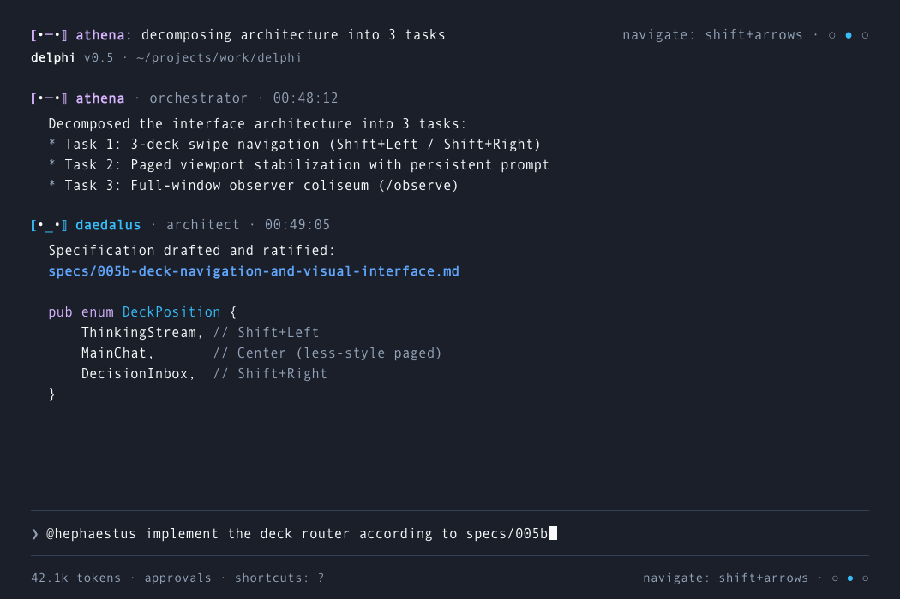
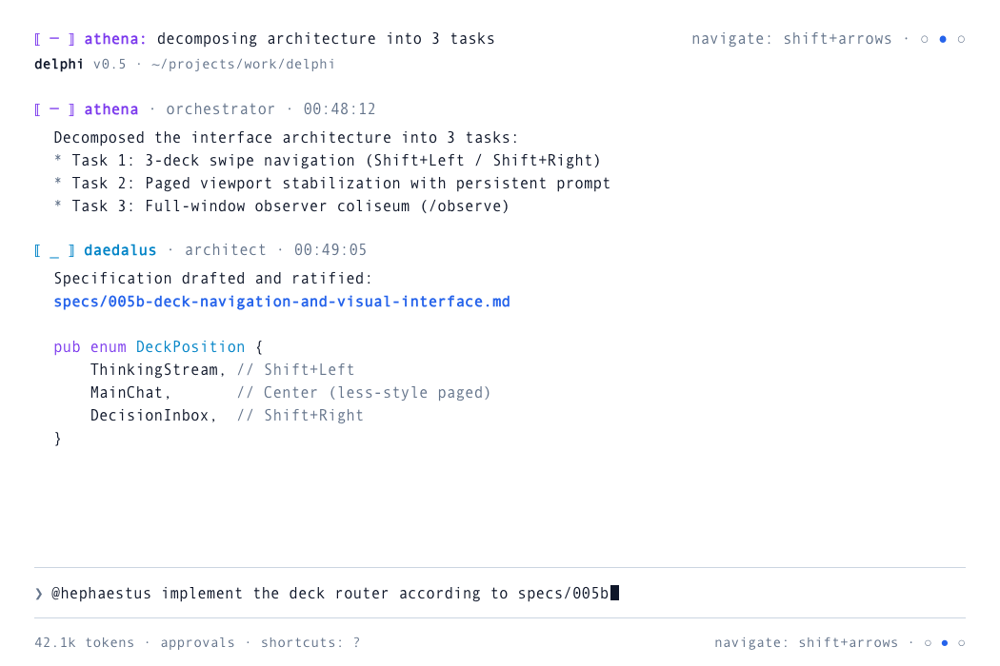
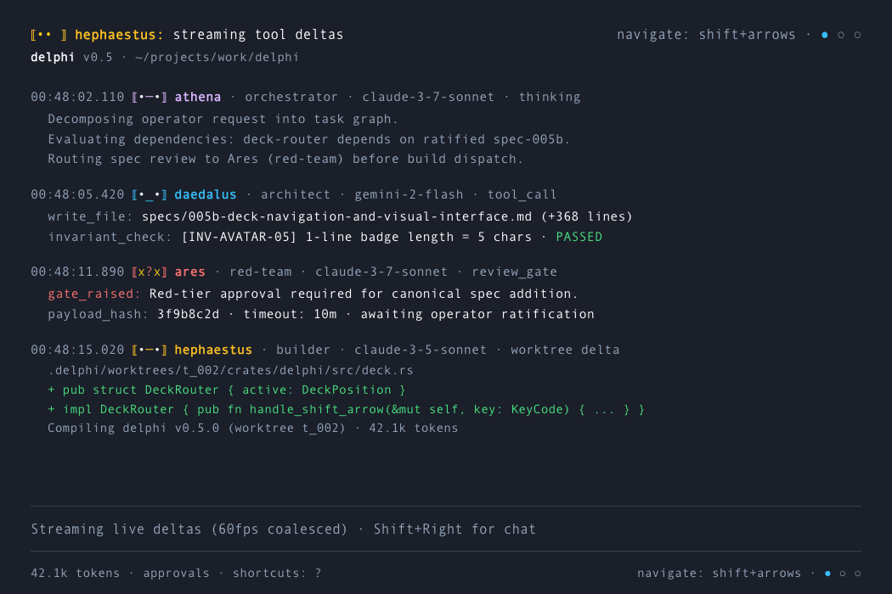
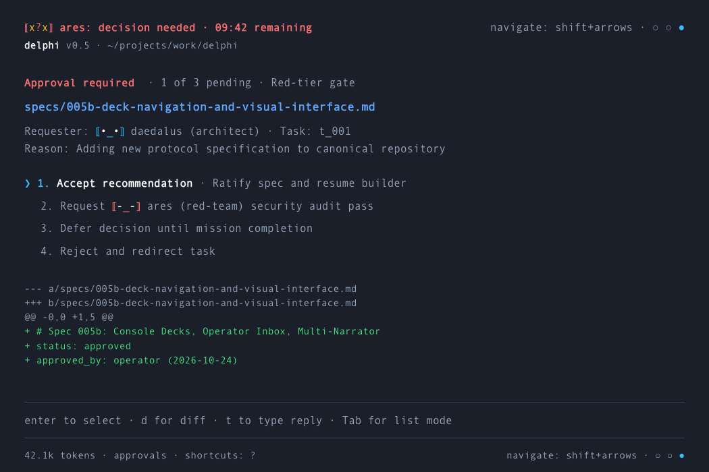
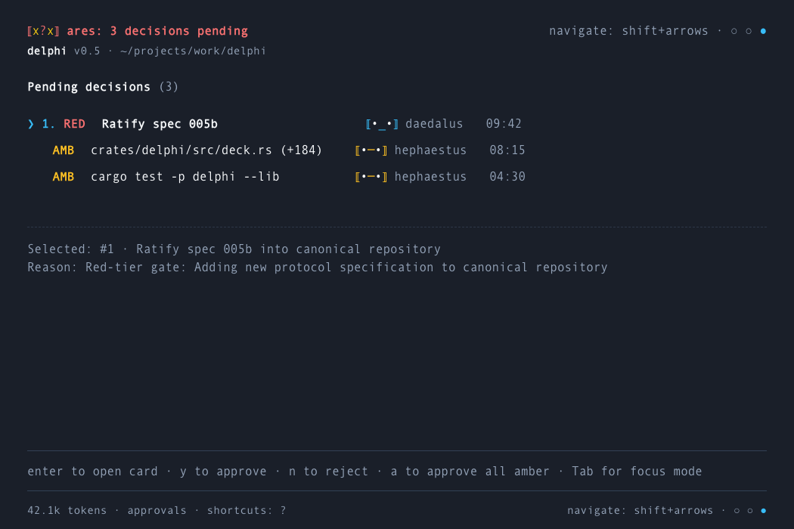
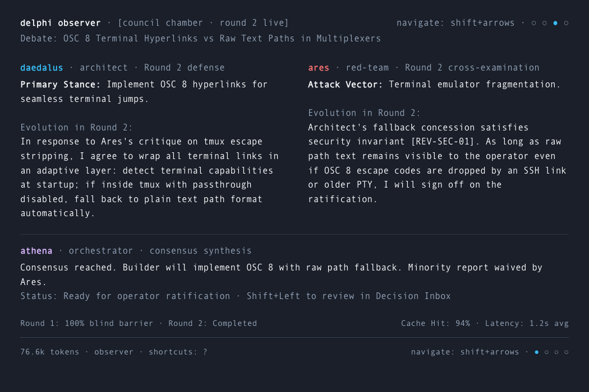
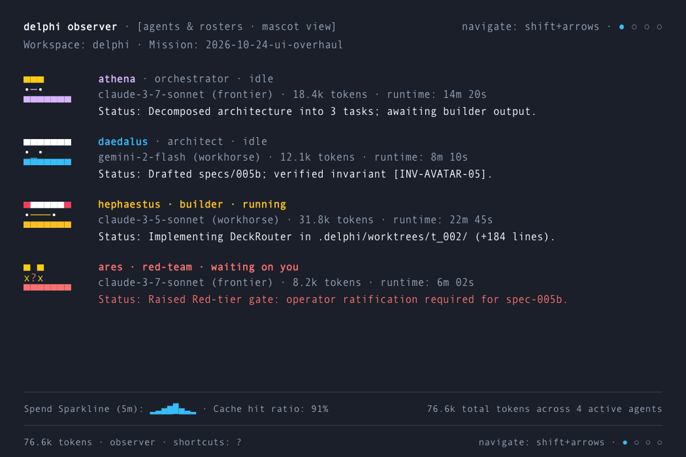

# Spec 005b: Console Decks, Operator Inbox, Multi-Narrator & Chromeless Viewer

## 1. Scope & Objectives
This specification builds upon [Spec 005](005-console-and-narrator-tui.md) and [Spec 005a](005a-terminal-avatar-system.md), formalizing the high-craftsmanship user interface and interaction architecture for Delphi:

1. **3-Deck Console Navigation (`Shift+Left` $\leftrightarrow$ `Center` $\leftrightarrow$ `Shift+Right`):**
   - **Left Deck (Thinking Stream):** Unthrottled, continuous 60Hz live agent stream; keeps verbose model reasoning out of the primary dialog.
   - **Center Deck (Main Chat):** Viewport-stabilized, `less`-style paged output with sticky bottom prompt input. Prevents rapid token flushes from shooting content off-screen.
   - **Right Deck (Decision Inbox / Operator):** Unified Human-in-the-Loop triage deck supporting Focus Mode (1-by-1 card review) and List Mode (bird's-eye triage). Accessible via `Shift+Right` or `/operator`.
2. **Streamlined Reactive Header (Single-Agent vs. Multi-Badge State Machine):**
   - **Active Turn State:** Shows a **single active agent badge + status line** (biased toward `orchestrator`), cycling as sub-agents hand off or complete steps.
   - **Quiet / Steady State (30s timeout):** Switches back to the compact **multi-badge strip** showing only badges (no stale text), with animated thinking faces active only for agents currently working. Exactly 1 badge per agent type regardless of concurrency.
   - **Decision Needed State:** Collapses all other badges to display **only the Red-Team badge** (`⟦x?x⟧` $\leftrightarrow$ `⟦●_●⟧`) and the prominent operator callout.
3. **Simplified Footer & Ergonomics:**
   - Left-aligned session telemetry: token usage (`42.1k tokens`), autonomy mode (`approvals` or `auto`), and shortcuts hint (`shortcuts: ?`). Distracting financial spend figures are eliminated from the primary console footer and reserved for `delphi observe spend`.
   - Right-aligned deck swipe indicator: `navigate: shift+arrows · ○ ● ○` with unbracketed colored navigation dots to prevent visual collision with agent avatar badges (`⟦...⟧`).
4. **Narrator Window Architecture (Full-Screen Panes, No Internal Tiling):**
   - Every Narrator window is strictly a **single full-pane view** that auto-resizes to 100% of the window geometry. No auto-splitting or multi-pane tiling within a single window.
   - Navigated via the same `Shift+Left` / `Shift+Right` keybindings in its footer (`[Council Chamber]`, `[Epic DAG]`, `[Forge Diffs]`, `[Archives/Telemetry]`).
   - Launched via `/observe [view]` or `/visualize [view]` (or CLI `delphi observe <view>`), allowing the operator to open multiple windows and arrange them as they see fit.
5. **Chromeless Minimalist Artifact Viewer & OSC 8 Bridge:**
   - Embedded local HTTP daemon (`127.0.0.1:4242`) serving Markdown specs, HTML diffs, and SVG/PNG renders into a chromeless app-mode window.
   - Terminal OSC 8 hyperlinks making every file path and artifact reference directly clickable.
   - Live WebSocket reload updating the viewer instantaneously on file mutations.

---

## 2. Console 3-Deck Architecture

```
                    ┌───────────────────────────┐
                    │       TOP HEADER          │
                    │  [Badges] [Alert Banner]  │
                    └─────────────┬─────────────┘
                                  │
         Shift+Left               │                Shift+Right
    ◄───────────────────          │          ───────────────────►
┌───────────────────────┐ ┌───────┴───────────────┐ ┌───────────────────────┐
│      LEFT DECK        │ │      CENTER DECK      │ │      RIGHT DECK       │
│    Thinking Stream    │ │       Main Chat       │ │    Decision Inbox     │
│                       │ │                       │ │                       │
│ • Uncapped live feed  │ │ • `less`-style paged  │ │ • Focus Mode (1-by-1) │
│ • 60Hz coalesced deltas││ • Viewport-stabilized │ │ • List Mode (Triage)  │
│ • Non-blocking        │ │ • OSC 8 links         │ │ • Diff viewer         │
│ • Raw reasoning trace │ │ • Pinned prompt bar   │ │ • Recommendation pick │
└───────────────────────┘ └───────┬───────────────┘ └───────────────────────┘
                                  │
                    ┌─────────────┴─────────────┐
                    │       BOTTOM FOOTER       │
                    │ [Deck Pip] [Shift+Tab] [$]│
                    └───────────────────────────┘
```

### 2.1 Keyboard Navigation Map
- `Shift + Left`: Slide viewport to **Left Deck** (Thinking Stream).
- `Shift + Right`: Slide viewport to **Right Deck** (Decision Inbox).
- `Shift + Tab`: Toggle approval tier mode (`default: high-approvals` $\leftrightarrow$ `accept-edits: auto`).
- `PageUp` / `PageDown` / `Space` / `Enter`: Page through stabilized chat content in Center Deck when in `less`-mode.
- `Esc`: Clear prompt, dismiss modal peek, or return focus to prompt from an active card.
- `/operator` or `/decide`: Immediately opens the **Right Deck** (Decision Inbox).

### 2.2 Amendment 005b-A1: Arrow Keys on an Empty Prompt (approved by the operator 2026-10-24)
> This amendment is part of the approved spec. Where §2.1 and the `navigate:` hint in §1.3 and §3 differ from it, this amendment governs.

**Rule.** In the full-screen console, `←` and `→` with **nothing typed in the prompt** move one deck, left to right: Left Deck, Center Deck, Right Deck. They stop at the ends (no wrap-around). With **any text in the prompt** they move the cursor, as in any line editor.

1. `Shift+Left` and `Shift+Right` (§2.1) are unchanged: they move one deck whatever the prompt holds, and a half-written message stays in the prompt while the operator looks at another deck.
2. `Alt` and `Ctrl` combinations with the arrow keys are not deck keys; they are left to the line editor.
3. **Right Deck.** The deck owns the keyboard (005, "a card never captures keystrokes typed into the prompt"), so the rule applies as follows: in List Mode `←` returns to the Center Deck and `→` does nothing; in Focus Mode `←` and `→` move to the previous and next card (card review takes precedence over deck navigation), and `Esc` or `Tab` leaves Focus Mode. `Shift+Left` returns to the Center Deck from either mode.
4. **Footer hint.** The right-aligned indicator reads `navigate: arrows · ○ ● ○` (it was `navigate: shift+arrows · ○ ● ○`). It is shown at 64 columns and wider; below that only the dots are shown. The wireframes in §1.3 and §3 that show `shift+arrows` are illustrative of layout only.
5. **Unchanged.** Observer windows (§4) have no prompt and keep `Shift+Left` / `Shift+Right` between views. The inline console (005c) is not a deck console and is not affected.

**Why.** Some terminals send nothing distinct for a shifted arrow, and an operator should not have to hunt for a modifier to look at the Thinking Stream or the Inbox. An arrow in an empty prompt had no other meaning, so nothing is taken away.

**Verification** (extends §6, test 1). With an empty prompt `←` and `→` switch decks and stop at the ends. With text typed, `←` moves the cursor and the deck does not change. `Shift+Left` and `Shift+Right` switch decks with text typed, and the draft is intact on return. `Alt+←` does not switch decks. In the Right Deck, List Mode `←` returns to the chat and Focus Mode `←` `→` change card. These are covered by `ui/test/decknav.test.ts` and the scripted session in `crates/delphi/tests/e2e.rs`.

### 2.3 Amendment 005b-A2: Header and Footer Tidy (approved by the operator 2026-10-25)
> This amendment is part of the approved spec. Where §1.3, §3 and A1 item 4 differ from it, this amendment governs. It applies to the full-screen console only.

1. **Header line 1** carries the agent strip or the status/alert text only. The deck dots are no longer shown in the header, and the idle strip has no `all agents idle` label.
2. **Header line 2** is separated from line 1 by one blank row, and reads `delphi v<version> · <working directory> · <pane>` where `<pane>` is `activity` (Left Deck), `chat` (Center Deck) or `decisions` (Right Deck).
3. **Footer, right.** The only deck indicator reads `← / ? → · ○ ● ○`; it is the single place with navigation hints (`←` `→` move between decks, `?` opens help). Shown at 64 columns and wider; below that only the dots. The `shortcuts: ?` item is gone.
4. **Footer, left.** `<tokens> tokens`, then the approval mode only when it is not the default (`accept edits`, `auto`), then `N waiting` when decisions are pending. The word `approvals` is no longer shown for the default mode.

---

## 3. High-Fidelity Text Wireframes

### 3.1 Two-Line Stacked Header Architecture

To balance priority telemetry with calm typography, the header uses a **stacked two-line hierarchy**:

#### Line 1 (Top Priority Line):
- **Active Turn:** Displays the single active agent status top-left with immediate context, and deck swipe navigation top-right:
  ```text
  ⟦•─•⟧ orchestrator: decomposing architecture into 3 tasks navigate: shift+arrows · ○ ● ○
  ```
- **Decision Alert:** Prioritizes the blocker immediately in crimson:
  ```text
  ⟦x?x⟧ red-team: decision needed · 09:42 remaining         navigate: shift+arrows · ○ ○ ●
  ```
- **Idle / Steady State (30s timeout):** Reverts to the full strip of 1-line agent badges in their canonical colors:
  ```text
  ⟦•─•⟧ ⟦•_•⟧ ⟦•─•⟧ ⟦-_-⟧ ⟦•_•⟧ ⟦•••⟧  all agents idle      navigate: shift+arrows · ○ ● ○
  ```

#### Line 2 (Sub-Header Branding):
```text
delphi v0.5 · ~/projects/work/delphi
```

#### Avatar Badge Eye Contrast Rule:
Every agent avatar badge displays chassis brackets and mouth in the agent's chassis color, with **contrasting eyes**:
- Standard agents: Bright white eyes (`#FFFFFF`) on dark mode / deep navy (`#0F172A`) on light mode.
- Alert / Security agent (`red-team`): Bright gold alert eyes (`#FACC15`) with crimson brackets (`⟦x?x⟧`).

#### Inline Agent Badges in Chat:
Agent messages in the chat stream display their 1-line badge directly beside their name:
```text
⟦•─•⟧ orchestrator · 00:48:12
⟦•_•⟧ architect · 00:49:05
⟦•─•⟧ builder · 00:51:20
⟦x?x⟧ red-team · 00:52:00
```

#### Footer Global Anatomy
The Console footer is intentionally minimal, removing cost and financial telemetry to prevent developer distraction (cost metrics are reserved for `delphi observe spend`):
```text
───────────────────────────────────────────────────────────────────────────────────────
42.1k tokens · approvals · shortcuts: ?                 navigate: shift+arrows · ○ ● ○
```
- **Left:** Contextual token usage (`42.1k tokens`), autonomy mode indicator (`auto` or `approvals`), and key shortcut hint (`shortcuts: ?`).
- **Right:** Navigation directive (`navigate: shift+arrows`) and unbracketed 3-dot visual indicator (`○ ● ○`) with the active deck colored (`●`). Unbracketed dots eliminate visual confusion with agent robot badges (`⟦•─•⟧`).

---

### 3.2 Center Deck: Main Chat (`less`-Style Viewport Stabilization)

#### Visual Mockups (Dark & Light Mode Responsiveness):

*Figure 1: Center Deck Main Chat in Dark Mode (`#0F172A`) with open unboxed layout, syntax highlighting, and hairline dividers.*


*Figure 2: Center Deck Main Chat in Light Mode (`#F8FAFC`) demonstrating dynamic ANSI palette adaptation.*

```text
⟦•─•⟧ orchestrator: decomposing architecture into 3 tasks navigate: shift+arrows · ○ ● ○
delphi v0.5 · ~/projects/work/delphi
───────────────────────────────────────────────────────────────────────────────────────

⟦•─•⟧ orchestrator · 00:48:12
  I have decomposed the interface work into 3 parallel tasks:
  1. Ratatui 3-deck layout engine in `delphi`
  2. Chromeless artifact viewer bridge in `delphi-core`
  3. Multiplexer tiling script for tmux and zellij

⟦•_•⟧ architect · 00:49:05
  Specification drafted and verified against governance:
  specs/005b-deck-navigation-and-visual-interface.md

  Key Architectural Decisions:
  • OSC 8 hyperlink routing for specs and artifacts
  • WebSocket broadcast on file touch at 127.0.0.1:4242
  • Dedicated Decision Inbox preserving chat prompt focus

───────────────────────────────────────────────────────────────────────────────────────
> @builder implement the deck router according to specs/005b
───────────────────────────────────────────────────────────────────────────────────────
42.1k tokens · approvals · shortcuts: ?                 navigate: shift+arrows · ○ ● ○
```

#### `less`-Style Mechanics:
1. When incoming assistant text exceeds the current terminal viewport height, Delphi does **not** auto-scroll past the top of the block.
2. The viewport pins at the start of the message, and an unobtrusive divider `[MORE: Space/PageDown to scroll · Enter for bottom]` appears.
3. The prompt bar at the bottom remains interactive and fixed; keyboard focus stays on the prompt unless navigation keys (`PageUp`, `PageDown`, `Space`) are pressed.

---

### 3.3 Left Deck: Thinking Stream (Unfiltered 60Hz Telemetry)

#### Visual Mockup:

*Figure 2b: Left Deck Thinking & Activity Stream showing granular token deltas, tool calls, and code diff previews.*

```text
⟦•─•⟧ orchestrator: telemetry stream active (60hz)        navigate: shift+arrows · ● ○ ○
delphi v0.5 · ~/projects/work/delphi
───────────────────────────────────────────────────────────────────────────────────────

00:48:02.110  orchestrator · frontier · claude-3-7-sonnet
  thinking (round 1) · 842 tokens
  Analyzing user requirements for 3-deck navigation...
  User specified open layout with zero boxes and macOS Andale Mono 12.
  Evaluating Ratatui layout split options: open gutters with subtle hairline rules.
  Frame coalescer keeps delta tokens in memory ring buffer.

00:48:05.420  orchestrator · tool_call · read_file
  Path: "specs/005a-terminal-avatar-system.md"

00:48:06.012  architect · workhorse · gemini-2-flash
  thinking · 310 tokens
  Formatting spec 005b sections for review rubric alignment.

───────────────────────────────────────────────────────────────────────────────────────
42.1k tokens · approvals · shortcuts: ?                 navigate: shift+arrows · ● ○ ○
```

#### Thinking Stream Mechanics:
1. Continuously tails (`tail -f`) live token deltas and tool calls across all active spans.
2. Formatted with compact rounded borders and agent color tags.
3. Completely separated from the Center Deck dialog, preventing chat clutter.

---

### 3.4 Right Deck: Decision Inbox (Focus Mode & List Mode)

#### Visual Mockups (Rendered Artifacts):

*Figure 3: Focus Mode (1-by-1 Approval Card) on borderless deep slate canvas with animated Red-Team attention badge.*


*Figure 4: List Mode (Pending Approvals Triage Table) with cursor selection and quick action keybindings.*

#### Focus Mode (1-by-1 Review):

```text
⟦x?x⟧ red-team: decision required · 09:42 remaining       navigate: shift+arrows · ○ ○ ●
delphi v0.5 · ~/projects/work/delphi
───────────────────────────────────────────────────────────────────────────────────────

APPROVAL REQUIRED [1 of 3] · red-tier gate
  Requester : architect
  Task      : t_001 (UI Specification & Router Architecture)
  Target    : specs/005b-deck-navigation-and-visual-interface.md
  Reason    : Adding new protocol specification to canonical repository

Recommendation:
  ● [Accept] Ratify spec draft and stage for builder execution

Options:
  1. Accept recommendation (Ratify spec)
  2. Request Red-Team security review pass
  3. Defer decision until mission completion
  4. Reject and abort task

Actions: [d] view diff   [t] type reply   [Tab] list mode   [Esc] dismiss
───────────────────────────────────────────────────────────────────────────────────────
decision 1/3: press [1..4], [d]iff, [t]ype, or [Tab]
───────────────────────────────────────────────────────────────────────────────────────
42.1k tokens · approvals · shortcuts: ?                 navigate: shift+arrows · ○ ○ ●
```

#### List Mode (Bird's-Eye Triage View):

```text
⟦x?x⟧ red-team: 3 pending decisions                       navigate: shift+arrows · ○ ○ ●
delphi v0.5 · ~/projects/work/delphi
───────────────────────────────────────────────────────────────────────────────────────

DECISION INBOX · 3 PENDING

  #  TIER   ROLE        TASK   DESCRIPTION                                  ACTION
  ─  ────   ────        ────   ───────────                                  ──────
► 1  RED    architect   t_001  Ratify spec 005b into canonical repository    [review]
  2  AMB    builder     t_002  Write crates/delphi/src/deck.rs (+184)       [approve]
  3  AMB    builder     t_003  Execute `cargo test -p delphi --lib`         [approve]

Keys: [↑/↓] select   [Enter] inspect / focus mode   [a] approve all amber   [Esc] chat
───────────────────────────────────────────────────────────────────────────────────────
navigate items with arrows · press Enter to inspect
───────────────────────────────────────────────────────────────────────────────────────
42.1k tokens · approvals · shortcuts: ?                 navigate: shift+arrows · ○ ○ ●
```

---

## 4. Observer / Narrator Architecture (`/observe` or `/visualize`)

Per the operator's design principle, **Delphi never tiles panes internally inside a window**. Every Observer/Narrator window is strictly a **single full-pane view** that expands dynamically to 100% of the terminal geometry (reacting seamlessly to OS window resizing and `SIGWINCH`).

The operator may launch multiple separate windows concurrently and arrange them however they wish across their monitors, desktops, or terminal multiplexer panes.

### 4.1 Launch Commands & Hot-Targeting
- **Slash Commands in Console:** `/observe [view]` or `/visualize [view]` (e.g. `/observe council`, `/observe epic`, `/observe forge`).
- **CLI Subcommand:** `delphi observe [view]` or `delphi narrator [view]`.
- If no view argument is passed, it opens to the active mission's primary context (`Epic DAG` during planning, `Council Chamber` during debates, or `Forge` during builds).

### 4.2 Window Navigation & Footer Map
Inside each Observer window, the footer provides identical `Shift+Left` and `Shift+Right` shortcuts to cycle through full-window panels:
```text
[Shift+Left] ◄── [Council Chamber] ◄──► [Epic DAG] ◄──► [Forge Diffs] ◄──► [Archives & Spend] ──► [Shift+Right]
```

### 4.3 Full-Window View Wireframe (Council Chamber Example)

#### Visual Mockup (Observer Council Chamber):

*Figure 5: Full-Window Observer Council Chamber coliseum view with side-by-side stance columns, orchestrator synthesis, and spend sparklines.*

```text
┌─ DELPHI OBSERVER ── [COUNCIL CHAMBER] ──────────────────────────────────────── [Shift+Arrows: Switch] ─┐
│ Mission: 2026-10-24-ui-overhaul · Council 005: Deck Navigation & Webview Protocols                     │
├────────────────────────────────────────────────────────────────────────────────────────────────────────┤
│                                                                                                        │
│  ┌─ 📐 architect (gemini-2-flash) ──────────────────┬─ ⚔️ red-team (claude-3-7-sonnet) ──────────────┐  │
│  │ Stance: Adopt OSC 8 terminal hyperlinks with     │ Stance: Terminal emulator compatibility gaps   │  │
│  │ internal localhost (127.0.0.1:4242) listener.    │ Attack: Older terminals don't parse OSC 8.     │  │
│  │                                                  │ We must ensure paths remain visible as plain   │  │
│  │ Advantages:                                      │ strings if escape codes are stripped.          │  │
│  │ • Clickable directly in Ghostty/Kitty/iTerm2     │                                                │  │
│  │ • Auto-opens chromeless native app-mode canvas   │ Mitigation:                                    │  │
│  │ • Zero file-path truncation                      │ Fall back to standard `specs/path#L10` format. │  │
│  └──────────────────────────────────────────────────┴────────────────────────────────────────────────┘  │
│                                                                                                        │
│  ┌─ 🏛️ orchestrator: Council Synthesis & Verdict ───────────────────────────────────────────────────┐  │
│  │ Verdict: Approved. Implement OSC 8 with raw text path fallbacks.                                   │  │
│  │ Action  : Builder to implement HTTP daemon in `delphi-core` and OSC 8 emitter in `delphi`.         │  │
│  └────────────────────────────────────────────────────────────────────────────────────────────────────┘  │
│                                                                                                        │
├────────────────────────────────────────────────────────────────────────────────────────────────────────┤
│ [● ○ ○ ○] · Panel 1/4: Council · Shift+Right: [Epic DAG] · Auto-Following Round 2 · /help              │
└────────────────────────────────────────────────────────────────────────────────────────────────────────┘
```

### 4.5 Alternate Agents Panel (3-Line Mascot Cards View)

Launched via `delphi observe agents` or `delphi observe mascots`:

#### Visual Mockup:

*Figure 6: Observer Mascot Roster View displaying 3-line ASCII block mascots with crowns, 3 grouped lines of metadata (name/role, model/tokens, runtime), and expanded task status.*

Each active agent is represented by their 3-line ASCII mascot (from `specs/005a`) paired with three lines of data:
1. `name · role · status`
2. `model (provider/id) · tokens ($spend) · runtime`
3. `Status: <expanded summary of active step>`

```text
  ▄▄▄      orchestrator · idle
  •─•      claude-3-7-sonnet (frontier) · 18.4k tokens ($0.42) · runtime: 14m 20s
▀▀▀▀▀▀▀    Status: Decomposed architecture into 3 tasks; awaiting builder output.

▄▄▄▄▄▄▄    architect · idle
  •_•      gemini-2-flash (workhorse) · 12.1k tokens ($0.18) · runtime: 8m 10s
▀▀▀▀▀▀▀    Status: Drafted specs/005b; verified invariant [INV-AVATAR-05].

▄▄▄▄▄▄▄    builder · running
 •───•     claude-3-5-sonnet (workhorse) · 31.8k tokens ($0.64) · runtime: 22m 45s
▀▀▀▀▀▀▀    Status: Implementing DeckRouter in .delphi/worktrees/t_002/ (+184 lines).

▄     ▄    red-team · waiting on you
  x?x      claude-3-7-sonnet (frontier) · 8.2k tokens ($0.18) · runtime: 6m 02s
▀▀▀▀▀▀▀    Status: Raised Red-tier gate: operator ratification required for spec-005b.
```

```text
┌─ DELPHI OBSERVER ── [EPIC DAG & TASK GRAPH] ────────────────────────────────── [Shift+Arrows: Switch] ─┐
│ Mission: 2026-10-24-ui-overhaul · Active Node: t_002 (Builder)                                         │
├────────────────────────────────────────────────────────────────────────────────────────────────────────┤
│                                                                                                        │
│   ┌────────────────────┐          ┌────────────────────┐          ┌────────────────────┐               │
│   │ t_001: spec-005b   │ ───────► │ t_002: deck-router │ ───────► │ t_003: unit-tests  │               │
│   │ [✓] DONE (arch)    │          │ [●] RUNNING (bld)  │          │ [○] PENDING        │               │
│   │ Cost: $0.18        │          │ Cost: $0.42        │          │ Cost: $0.00        │               │
│   └────────────────────┘          └────────────────────┘          └────────────────────┘               │
│             ▲                               │                                                          │
│             │                               ▼                                                          │
│   ┌────────────────────┐          ┌────────────────────┐                                               │
│   │ Council 005        │ ────────►│ t_004: webview-http│                                               │
│   │ [✓] RATIFIED       │          │ [○] PENDING (core) │                                               │
│   └────────────────────┘          └────────────────────┘                                               │
│                                                                                                        │
│ ────────────────────────────────────────────────────────────────────────────────────────────────────── │
│ Node Telemetry (t_002): Builder working in `.delphi/worktrees/t_002/` · 14.2k tokens · Attempt 1/3     │
├────────────────────────────────────────────────────────────────────────────────────────────────────────┤
│ [○ ● ○ ○] · Panel 2/4: Epic DAG · Shift+Left: [Council] · Shift+Right: [Forge] · /help                 │
└────────────────────────────────────────────────────────────────────────────────────────────────────────┘
```

---

## 5. Chromeless Minimalist Artifact Viewer & OSC 8 Bridge

### 5.1 Local HTTP Daemon & App-Mode Window Launch
`delphi-core` maintains a lightweight internal Tokio-HTTP daemon bound strictly to localhost:
- **Port:** `127.0.0.1:4242` (with fallback to an ephemeral port if occupied).
- **Socket Security:** Restricted to loopback interface; cross-origin requests rejected.
- **Launch Command (macOS):**
  ```bash
  # Chromium / Chrome / Brave App Mode (Chromeless native window)
  /Applications/Google\ Chrome.app/Contents/MacOS/Google\ Chrome \
    --app=http://127.0.0.1:4242/specs/005b-deck-navigation-and-visual-interface.md \
    --window-size=980,1050 \
    --user-data-dir=/tmp/delphi-viewer-profile &
  ```
- **Styling Invariants:**
  - Background: `#0F172A` (matches terminal dark background).
  - Fonts: Monospace priority (`JetBrains Mono`, `SF Mono`, `Fira Code`).
  - No navigation bar, no tab bar, no extension bar, no bookmarks.

### 5.2 Terminal OSC 8 Hyperlink Format
Console writes file references using the terminal standard OSC 8 escape sequence:
```text
\x1b]8;;http://127.0.0.1:4242/specs/005b-deck-navigation-and-visual-interface.md\x1b\\specs/005b-deck-navigation-and-visual-interface.md\x1b]8;;\x1b\\
```
- In OSC 8 compliant terminals (Ghostty, WezTerm, Kitty, iTerm2), the path renders as clean, clickable text.
- Clicking or `Cmd+Click` launches or focuses the chromeless viewer directly at the linked document.

### 5.3 Live WebSocket Hot-Reload
The viewer client connects to `ws://127.0.0.1:4242/ws/events`.
When `delphi-core` logs an `action.result` mutating a file or when `Builder` saves an edit in the worktree:
1. Daemon broadcasts `{ "event": "reload", "path": "specs/005b-deck-navigation-and-visual-interface.md" }`.
2. The chromeless window updates DOM content in `<15ms` without full-page flickering or loss of scroll position.

---

## 6. Verification & Test Plan
1. **Deck Navigation Transition Test:** Verify `Shift+Left` and `Shift+Right` switch active deck frames with zero input lag and zero text loss in the prompt buffer.
2. **`less`-Style Paging Invariant Test:** Stream 2,000 tokens of simulated agent output into Center Deck; verify top of message remains anchored in viewport until explicit `PageDown`/`Space` key event.
3. **Approval Card Focus Test:** Verify that when a Red-tier approval enters the Decision Inbox, the header Red-Team badge animates `⟦x?x⟧` $\leftrightarrow$ `⟦●_●⟧` without stealing focus from typing in the prompt.
4. **Multiplexer Layout Test:** Execute `/narrator tile` inside `tmux` and `zellij` environments; verify all 4 panes spawn and bind to the local workspace daemon socket within 500ms.
5. **Chromeless Hot-Reload Test:** Mutate a spec file; verify the connected browser window updates via WebSocket in $<50$ms.
