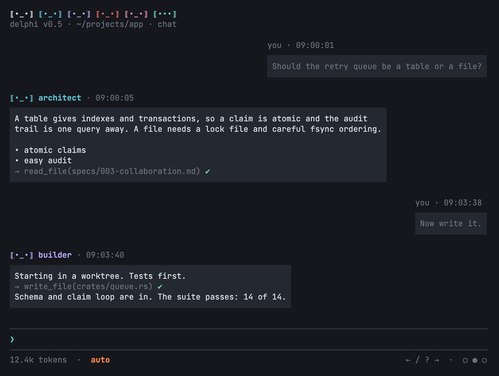
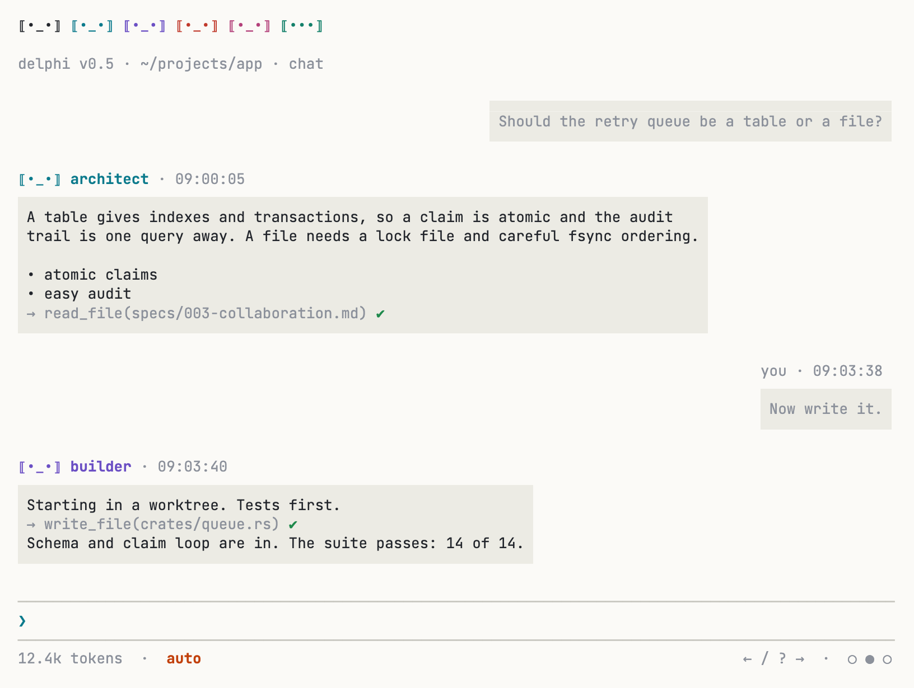
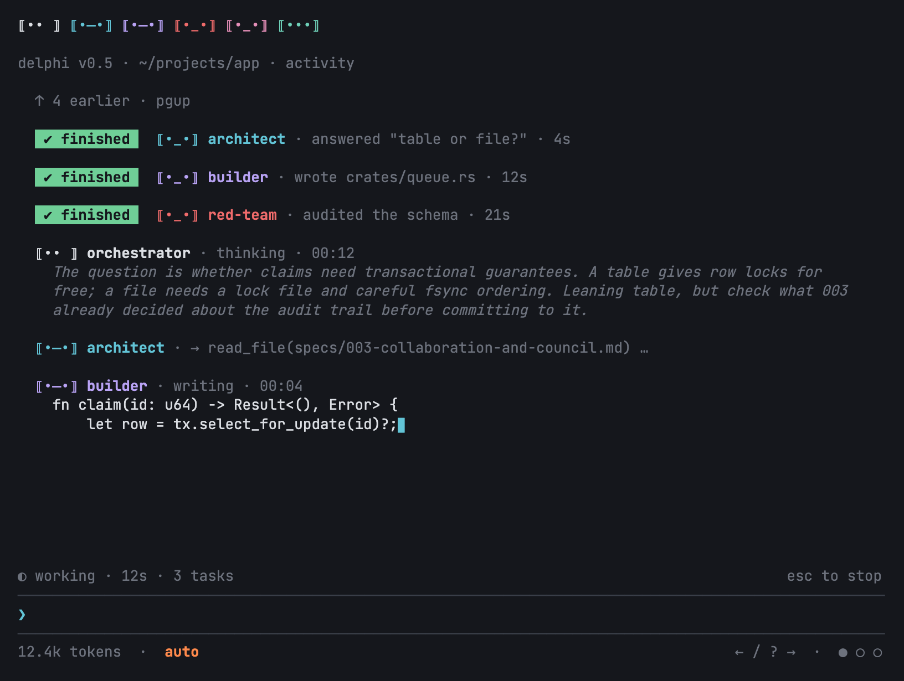
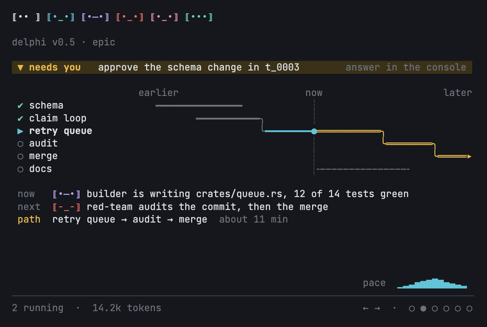
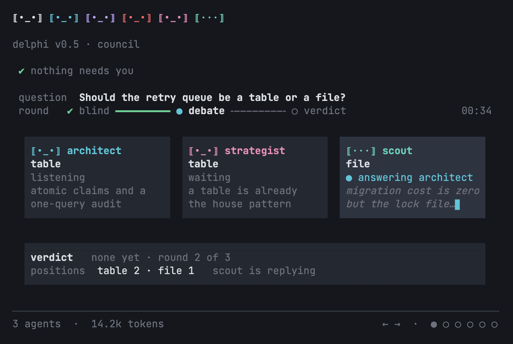

# Spec 005e: Console UX Review and Redesign

**Status.** Approved by the operator on 2026-10-25. Part I (§§2-4) is a critical review of the interface as built under D-28 ([`005d`](005d-full-screen-console.md)), with evidence. Part II (§§5-17) is the buildable specification for the changes it recommends, **as decided by the operator on 2026-10-25 after reviewing rendered mockups** (`specs/assets/005e/`): chat as tinted square blocks with the speaker above, an activity *ticker* with finished history, the narrator window (the former Observer) as an epic rail and a live council weave, animated badge strip, colours derived from the terminal. The decisions are recorded in §16. The ordered build plan for an implementing model is [`005f`](005f-console-redesign-build-plan.md). Where this spec and [`005b`](005b-deck-navigation-and-visual-interface.md) or `005d` differ, this spec governs once approved; the amendments it needs are listed in §12.

## 1. Scope

**Reviewed.** The full-screen console (`ui/src`, originally Ink and now OpenTUI under D-33), the Observer window (`ui/src/observe-screen.ts`, `observer.tsx`), the inline and plain Rust consoles (`crates/delphi/src/console.rs`, `chat.rs`), the classic Rust Observer (`observer.rs`), the first run (`main.rs`, `start.rs`, `setup.rs`) and the CLI surface (`main.rs` usage text, `doctor`, `models`, `needs`).

**Changed by this spec.** Visual language and palette (§5), first run and the no-model state (§6), the chat deck (§7), the activity deck (§8), the narrator window (§9), discoverability and keyboard flow (§10), degradation at narrow widths and without colour (§11). The renderer choice is OpenTUI under approved spec 060 and D-33; the UI model and authority boundary are unchanged. Rust fallbacks (inline and plain consoles) adopt only the copy and state changes (§6, §10.5); their layout is out of scope.

**Not changed.** The daemon protocol, approval semantics (payload-hash binding, the 300 ms guard, one approval per option, Red never auto-approved), the Decision Inbox's rules, the deck model, the badge and mascot invariants of [`005a`](005a-terminal-avatar-system.md). Windows is not supported. The chromeless viewer of `005b` §5 stays later work.

### 1.1 Simpler Alternative Considered

Keep the current look and fix only the P0/P1 defects (§3). That removes the dead ends but leaves the three things the operator named: the chat reads as a log rather than a conversation, the activity deck repeats the chat, and the Observer looks like a different product. The redesign below reuses the existing pure `frame(model, w, h)` architecture (`ui/src/screen.ts`) and changes renderers, not state or protocol, so its cost is bounded (§13: about 71 hours in total, 18 for the P0/P1 set alone) and every screen stays snapshot-testable.

## 2. Method and evidence

Everything below was observed on 2026-10-25 in this repository at commit `fa89e4b`:

- The Ink console from source (`ui/src/main.tsx`) in a pseudo-terminal replayed through `pyte`, at 80x24, 100x30, 120x40 and resized to 40x12, against `ui/dev/fake-daemon.mjs` and against the **real daemon** of a scratch home (`--home <tmp>`, no model configured) via `$DELPHI_UI` pointing at a source wrapper.
- `delphi` (bare, first run), `delphi chat --inline`, `delphi chat --plain` (piped), `delphi observe --classic`, `delphi init`, `delphi doctor`, `delphi setup --check`, `delphi models`, `delphi needs`, `delphi bogus`, all with `--home <tmp>`.
- The golden screens in `ui/test/snapshots` and `ui/test/snapshots-screens` for states the fake daemon cannot produce (approval cards, councils, builds).
- Code reading with `file:line` references to `ui/src/*.ts` and `crates/delphi/src/*.rs`.

Nothing was seen in a real terminal emulator; that gap (`ui/TERMINALS.md`) stands and is called out where it matters.

## 3. Findings, prioritised

P0 blocks a new operator or misleads them about safety; P1 costs every session; P2 is polish.

### P0

1. **The first run ends in a dead end with a misleading error.** Bare `delphi` with no model access asks "Run the guided setup now?"; decline, and it asks the **same question again** (`start.rs:203-212`: `apply(Setup)` runs, then the doctor's remedies offer `Setup` a second time). Decline again and the console opens as if ready. The first prompt then produces, as an ordinary reply from the orchestrator: `[escalated to the operator: every allowed endpoint is throttled or unavailable: no configured model can serve this request (check [[endpoints]], [access] and the role's family with delphi models); waiting would not help right now]`. "Throttled" is false, the bracketed wrapper is internal, and nothing on screen says *no model is configured* or what to do. Observed in the Ink console (real daemon), the inline console and the plain console alike. Evidence: `start.rs:203-212`, the escalation text comes from the engine's router and is printed verbatim by `fold.ts` (reply block) and `chat.rs:329`.
2. **Escalations look like answers.** An escalated task is rendered as a normal reply with an `x_x` badge (`screen.ts:80`) and the raw `[escalated to the operator: …]` text. The only difference from a successful reply is the face. Operators will read it as the agent's opinion. Same in the inline console (`console.rs:414`: `! t_0003 needs you` after the text).
3. **The approval mode cycles silently.** `Shift+Tab` moves `default → accept-edits → mission-auto` with no confirmation and no explanation; the footer changes from nothing to `accept edits` to `auto` (`app.tsx:213-218`, `screen.ts:49-55`). One stray key puts the session in `auto` (Amber actions run without asking). Observed: two presses, two footer changes, no note in the transcript.

### P1

4. **The footer promises a key that does nothing.** `          ← / ? →  ·  ○ ● ○
5. **The pane name is lost at 80 columns.** Header line 2 clips from the right (`screen.ts:44-45`, `T.clip`), so with a path longer than about 55 columns the pane name (`chat`, `activity`, `decisions`), the one piece of that line that changes, disappears. Observed at 80 and 100 columns in this repository's worktree path.
6. **Streaming shoots the start of a reply off screen.** `005b` §3.2 and `skills/tui-design` §1.1 require `less`-style anchoring (the view pins at the top of a new reply). The console follows the tail (`screen.ts:231-234`); after a 40-paragraph answer the operator sees paragraphs 33-39 and must `PgUp` to find the beginning. Observed with the fake daemon at 80x24 and 120x40. The "new output waits here" marker only appears once the operator has scrolled up.
7. **The two consoles disagree on commands.** `/models` and `/agents` exist in the Rust console (`chat.rs:68-69`, `HELP` lines 140-141) and are "unknown command" in the Ink console (`commands.ts` lacks them; observed). `/narrator` opens tmux splits in Rust (`chat.rs:736-744`) and prints a command to copy in Ink (`run.ts:85-88`). `Ctrl+C` quits at once in Ink (`app.tsx:254`) and needs two presses within two seconds in the inline console (`console.rs:570-579`). `Esc` clears the prompt in both but stops a task only in Ink.
8. **`NO_COLOR` is not honoured by the Ink console.** `ui/README.md` says colour "follows the terminal (`NO_COLOR` …)". With `NO_COLOR=1` the console still emits 24-bit SGR sequences (observed: `\x1b[38;2;…` in the pty output). Nothing in `ui/src` reads `NO_COLOR` or sets chalk's level. Every colour is a hard-coded hex (`theme.ts:34-40`, `observe-screen.ts` state colours, `markdown.ts` heading/code colours); the terminal's own palette is never used.
9. **Empty states say nothing about what to do.** A fresh mission is a blank screen between header and prompt (observed, and `chat-empty-start.txt`). The activity deck and inbox have good empty copy; the chat has none. The `/models` output with no endpoints is an empty table header followed by `no [routing.pool]: every configured tier, family by family, highest tier first` (observed), which does not say "no model is configured".
10. **The activity deck duplicates the chat.** It shows every agent's text as it streams and keeps it after the reply lands (`screen.ts:158-173`, `fold.ts` `activity`), so after one answer the left deck is a second copy of the reply. The operator asked for in-progress text and thinking only (§8).
11. **The Observer is a different product.** Upper-case titles (`DELPHI OBSERVER · EPIC DAG`), a hairline directly under a dense badge-and-label strip, `navigate: shift+arrows`, a three-line footer with money, no shared chrome with the console (`observe-screen.ts:244-262`). Plain arrows scroll; `Shift+←/→`, `Tab` and digits change views (`observer.tsx:59-62`). The console moved to plain arrows for decks (005b-A1); the Observer did not follow.

### P2

12. The header's idle strip keeps a stale `x_x` for a role whose task escalated until the next task starts (observed after the no-model escalation; `fold.ts:112`).
13. Scroll offset (`m.back`) is shared between the chat and activity decks (`screen.ts:179-180`, `231`): `PgUp` in the chat also scrolls the activity deck.
14. The slash menu shows five items with no "N more" cue and no description wrapping; at 80 columns descriptions clip mid-word (`screen.ts:236-244`; observed).
15. Notes from commands (`/budget`, `/y`, errors) are dim grey lines with no mark; a failed `could not send:` looks like a budget line.
16. `delphi observe --once` fails when piped ("tokens are issued only to a client attached to an interactive terminal") although the usage text offers it as a text frame; the inline console prints a full absolute executable path and a double space (`observe  --workspace`) for `/narrator` (`chat.rs:735`).
17. The start banner in the Rust consoles shows the daemon pid (`chat.rs:612`); the `doctor` report numbers checks out of order (`11 model pool` before `9 sandbox`).
18. `Ctrl+C` in the Ink console exits with text in the prompt and with a queue pending (`app.tsx:254`); the inline console clears the prompt first.

### What is good and must survive

The badge system and role colours; the two-line header's state machine; hairlines instead of boxes; approval cards with explicit `/y /a /n /d` answers and the payload-hash binding; the inbox's list and focus modes with keyboard ownership; `Esc` to stop with queue semantics; terminal restore on every exit path; the pure `frame()` design that makes every screen a snapshot test; the research panels' copy ("Nothing yet. Files the agents read…" is the right tone).

## 4. Design principles for the changes

1. **The terminal's theme is the palette.** Delphi draws with the terminal's default foreground and background, the 16 ANSI colours and the attributes bold, dim, italic, reverse and underline. The only true colour on screen is a role's chassis colour (from the ratified theme pack), and it has an ANSI-16 fallback. So a Solarized, a Dracula and a stock Terminal.app each get a console that looks native to them.
2. **Structure survives without colour.** Every state is also carried by a glyph, a position or an attribute (`○ ● ► ❯ ✔ ✖`, indentation, bold), so `NO_COLOR` and monochrome terminals lose nothing but emphasis.
3. **Conversation reads as conversation.** The operator is on the right, agents on the left, each message a tinted block with its speaker above it. Agent text is the highest-contrast text on screen; chrome and the operator's own words step back.
4. **The activity deck is a ticker, not a log.** It shows only what is happening now and empties when it is done.
5. **One chrome for every window.** The console and the narrator share the header, footer, navigation keys and the pane-name convention.
6. **Degrade in steps, never overflow.** Rules for 64, 48 and 40 columns and for 16 and 12 rows are written down (§11) and tested.

## 5. The palette (every window)

| Role in the UI | How it is drawn | Fallback (16 colours) | `NO_COLOR` / mono |
| :-- | :-- | :-- | :-- |
| body text (agent replies) | default foreground, normal weight | same | same |
| operator's text | default foreground, `dim` | same | `dim`, or plain if `dim` is unsupported |
| muted (timestamps, hints, rules, notes, tool lines) | `dim` | same | `dim` |
| emphasis (names, headings) | `bold` + role colour or default fg | `bold` | `bold` |
| accent (selection `❯`, the active dot, links) | ANSI 6 (cyan); links `underline` | same | `underline` for links, `❯` carries selection |
| success `✔` | ANSI 2 (green) | same | glyph only |
| warning, Amber tier, countdowns under 60 s | ANSI 3 (yellow) | same | `bold` |
| alert, Red tier, errors `✖`, escalations | ANSI 1 (red) + `bold` | same | `bold` + `reverse` on the one word that matters (`RED`, `needs you`) |
| role chassis (badges, names) | the theme's RGB when `COLORTERM` is `truecolor`/`24bit` | an ANSI colour per role, written in the avatar library (`avatar::ROLES`, `chassis_ansi`, carried by `ui_spec`; theme packs carry names only) (`orchestrator` 13, `architect` 14, `builder` 11, `red-team` 9, `strategist` 10, `scout` 3) | badges keep their glyphs; names `bold` |
| badge eyes | default foreground, `bold`; under true colour the library's eyes instead (white on a dark terminal, deep slate on a light one, `005a` §2.1; the red-team's alert eyes gold), see §12 | same (the red-team's alert eyes ANSI 3 `bold`) | `bold` |
| message tint (§7.2) | background moved 8 % toward white (dark) or 6 % toward black (light) under true colour; grey-ramp entry in 256 colours; ANSI 8 (dark) or 7 (light) in 16 | same, else the rail fallback | none: rail fallback (`│` at the left of each row) |
| approval mode `auto` in the footer | the warning-red colour: ANSI 9 `bold` (theme RGB orange under true colour); never reverse video | same | `bold` |

Rules:
- `NO_COLOR` set (any value) or `TERM=dumb`: no SGR colour codes at all; attributes stay unless `TERM=dumb`. Checked once at start (`ui/src/theme.ts` gains `capabilities(env, term)`), and the same decision is made by the Rust consoles (`observer::Pal`).
- Dark or light is still asked of the terminal (OSC 11) but only decides the *tint* and the eye colour; nothing else depends on it.
- Each role's ANSI fallback lives with its chassis colour in the avatar library (`chassis_ansi` in `avatar::ROLES`; `ui_spec` carries it to the UI as `ansi`). Theme packs carry names, epithets and personas only and never colours (decided 2026-10-25: a pack could otherwise recolour roles and break the badge invariants of `005a`).
- `theme.ts` exports semantic functions only (`body`, `operator`, `muted`, `accent`, `ok`, `warn`, `alert`, `role(role)`); no hex literal outside `theme.ts`, enforced by a unit test that greps `ui/src`.

## 6. First run and the no-model state

### 6.1 Problem
Findings 1, 2 and 9: the operator can decline setup twice, land in a console that cannot answer, and be told endpoints are throttled.

### 6.2 Behaviour
1. **Ask once.** `start::preflight` offers the guided setup once. A decline is remembered for the session (`apply` is given the remedies minus `Setup`); the doctor's own `Setup` remedy is skipped when the operator declined in the same run.
2. **The console knows there is no model.** On attach the console calls `models.get` (already exists; `chat.rs:672`). If the pool is empty it shows the *no model* screen (§6.3) instead of a blank body, puts `no model` in the footer, and keeps doing so until `models.get` says otherwise (re-checked when a task is submitted and when a `model.recovered` event arrives).
3. **The daemon says "no model configured".** `task.submit` with an empty pool fails with a distinct error, `no_model_configured`, and the escalation text for that case reads `Stopped: no model is configured for this workspace.` The router's "throttled or unavailable" wording is reserved for a pool that exists and is all down.
4. **Escalations are cards, not replies.** A `task.output` with `status: escalated` (and `task.failed`) renders as an *attention card*: role badge in the escalated face, title `<name> · <role> · needs you`, the reason without its `[escalated to the operator: …]` wrapper, and when the reason is one the console recognises (`no_model_configured`, `budget`, `reauth_required`, `all endpoints exhausted`) a two-line "what you can do" block. The header strip drops the role's `x_x` once the card has been on screen for 10 s or a new task starts (finding 12).

### 6.3 Layout, 80x24 (no model yet, nothing typed)

```text
⟦•_•⟧ ⟦•_•⟧ ⟦•_•⟧ ⟦•_•⟧ ⟦•_•⟧ ⟦•••⟧                                             
delphi v0.5 · ~/projects/app · chat                                             
                                                                                
  delphi · no model configured                                                  
  ▄▄▄▄▄▄▄▄▄▄▄▄▄▄▄▄▄▄▄▄▄▄▄▄▄▄▄▄▄▄▄▄▄▄▄▄▄▄▄▄▄▄▄▄▄▄▄▄▄▄▄▄▄▄▄▄▄▄▄▄▄▄▄▄▄▄▄▄▄▄▄▄▄▄▄▄  
                                                                                
   Welcome. This workspace has no model access yet, so nothing can answer.      
                                                                                
     delphi setup      connect Claude Code, agy or an API key (guided)          
     delphi models     what is configured, and what is usable right now         
                                                                                
   When a model is connected: type a request below, @architect … sends it       
   to one role, / lists commands and ? shows the keys.                          
                                                                                
  ▀▀▀▀▀▀▀▀▀▀▀▀▀▀▀▀▀▀▀▀▀▀▀▀▀▀▀▀▀▀▀▀▀▀▀▀▀▀▀▀▀▀▀▀▀▀▀▀▀▀▀▀▀▀▀▀▀▀▀▀▀▀▀▀▀▀▀▀▀▀▀▀▀▀▀▀  
                                                                                
                                                                                
                                                                                
                                                                                
                                                                                
────────────────────────────────────────────────────────────────────────────────
❯                                                                               
────────────────────────────────────────────────────────────────────────────────
0 tokens  ·  default  ·  no model                              ← / ? →  ·  ○ ● ○
```

The same card at 120 columns is the same card: it is at most 76 columns wide with a two-column margin at the left, never stretched. The `▄` and `▀` rows stand for the tinted half-block caps of §7.2 (the tint itself cannot be shown in text).

### 6.4 Layout: an escalation card after a prompt (soft-fill block, §7)

```text
⟦•_•⟧ ⟦•_•⟧ ⟦•_•⟧ ⟦•_•⟧ ⟦•_•⟧ ⟦•••⟧                                             
delphi v0.5 · ~/projects/app · chat                                             
                                                                                
                                                                   you · 09:10:02
                                                                   ▄▄▄▄▄▄▄▄▄▄▄▄▄
                                                                    hello there 
                                                                   ▀▀▀▀▀▀▀▀▀▀▀▀▀
                                                                                
⟦x_x⟧ orchestrator · needs you                                                  
▄▄▄▄▄▄▄▄▄▄▄▄▄▄▄▄▄▄▄▄▄▄▄▄▄▄▄▄▄▄▄▄▄▄▄▄▄▄▄▄▄▄▄▄▄▄▄▄▄▄▄▄▄▄▄▄▄▄▄▄▄▄                  
                                                                                
 Stopped: no model is configured for this workspace.                            
                                                                                
   delphi setup     connects one                                                
   /models          shows the pool and what is usable                           
                                                                                
▀▀▀▀▀▀▀▀▀▀▀▀▀▀▀▀▀▀▀▀▀▀▀▀▀▀▀▀▀▀▀▀▀▀▀▀▀▀▀▀▀▀▀▀▀▀▀▀▀▀▀▀▀▀▀▀▀▀▀▀▀▀                  
                                                                                
                                                                                
                                                                                
────────────────────────────────────────────────────────────────────────────────
❯                                                                               
────────────────────────────────────────────────────────────────────────────────
0 tokens  ·  default  ·  no model                              ← / ? →  ·  ○ ● ○
```

### 6.5 Layout: a ready console with nothing said yet (replaces the blank screen)

```text
⟦•─•⟧ ⟦•_•⟧ ⟦•─•⟧ ⟦-_-⟧ ⟦•_•⟧ ⟦•••⟧                                             
delphi v0.5 · ~/projects/app · chat                                             
                                                                                
                                                                                
  Ask anything about ~/projects/app, or hand out work:                          
                                                                                
    @architect draft a spec for …      one role answers                         
    /build implement @specs/011-x.md    a Builder task: worktree, tests, audit  
    /council Should we …?               three seats argue it out blind          
                                                                                
  / lists commands · ? shows the keys · ← → move between decks                  
                                                                                
                                                                                
                                                                                
                                                                                
                                                                                
                                                                                
                                                                                
                                                                                
                                                                                
────────────────────────────────────────────────────────────────────────────────
❯                                                                               
────────────────────────────────────────────────────────────────────────────────
0 tokens  ·  default                                           ← / ? →  ·  ○ ● ○
```

The welcome text disappears at the first message and never comes back for that mission.

### 6.6 Copy
- Footer state: `no model` (muted, after the token count).
- No-model card title: `delphi · no model configured`.
- Escalation reasons (replace the engine's bracketed strings in the console; the engine still logs its own):
  - `no_model_configured` → `Stopped: no model is configured for this workspace.` + `delphi setup     connects one` / `/models          shows the pool and what is usable`
  - `budget` → `Stopped: this mission's ceiling of $N is reached.` + `/budget <dollars>   raises it` / `/usage              shows where it went`
  - `reauth_required` → `Stopped: <endpoint> needs you to sign in again.` + `aws sso login (or the provider's command), then send again`
  - all endpoints exhausted → `Stopped: every usable model is out of quota or down.` + `/models shows when each is back`
  - anything else → `Stopped: <reason>` + `/resume to try again · /models · /usage`
- `/models` with an empty pool prints `no model is configured for this workspace — run delphi setup` instead of an empty table.

### 6.7 Acceptance criteria
- Declining setup once leads to the console with the no-model card; the question is asked exactly once per run (pty test on `delphi --home <tmp>`).
- Sending a prompt with no model yields an attention card whose first line is `Stopped: no model is configured for this workspace.`; the words "throttled" and "[escalated" do not appear on screen.
- The footer reads `0 tokens · no model` until a model is configured.
- `delphi doctor` and `/models` agree on the wording.

### 6.8 Affected files
`crates/delphi/src/start.rs` (ask once), `crates/delphi-engine` router error kind (`no_model_configured`) and `models_cli` wording, `ui/src/fold.ts` (escalation → card block with `reason` and `kind`), `ui/src/screen.ts` (attention card, welcome and no-model bodies), `ui/src/app.tsx` (`models.get` on attach), `crates/delphi/src/chat.rs` (`render_card`-style escalation text for the Rust consoles).

## 7. The chat deck

### 7.1 Problem
Findings 6 and 9 and the operator's request: the chat reads as a log; replies and the operator's own text look the same; streaming moves what is being read.

### 7.2 Decided design: soft-fill bubbles

The operator chose this from four studies (hairline, tail, soft fill, seam) on 2026-10-25. The rejected studies are summarised in §7.6. Rendered mockups: [`chat-dark-100x34.png`](assets/005e/chat-dark-100x34.png), [`chat-light-100x34.png`](assets/005e/chat-light-100x34.png), [`chat-dark-80x24.png`](assets/005e/chat-dark-80x24.png), [`chat-streaming-dark-100x34.png`](assets/005e/chat-streaming-dark-100x34.png).





**Geometry** (all numbers are terminal cells; `w` is the window width):

- **A message is a tinted block with square edges.** No frame, no corners. The block's background is the *tint* (§5). Above the first text row sits a *top cap* row and below the last a *bottom cap* row. The caps are drawn with `▄` (top) and `▀` (bottom) in the tint colour over the terminal background across the **full width of the block, including both end cells**, so the corners are square and each cap reads as half a row of padding.
- **Padding.** One column of tint on each side of the text. The two caps are the vertical padding.
- **Width.** The block hugs its longest line, at least 12 text columns, at most `floor(w * 4 / 5)` columns including padding. Text wraps at `maxText = floor(w * 4 / 5) - 2`. The width is never padded out to the maximum.
- **Alignment.** The operator's block is flush right; an agent's block is flush left.
- **Label.** One row directly above the block, starting at the block's left edge, carries the speaker and the time. An agent: its badge, its theme name in `bold` + role colour, `·`, the time in `dim` (`⟦•_•⟧ architect · 09:00:05`). The operator: `you · 09:03:38`, all `dim`. The label is never inside the block. While a reply streams the time reads `writing` and becomes the clock time when the task ends.
- **Rhythm.** One blank row between messages. The first message follows the one blank row under the header (§10.2).
- **Contrast.** Agent text: default foreground, normal weight (the brightest text on screen). Operator text: `dim`. Tool lines (`→ read_file(…) ✔`) are `dim` with a green `✔` and live inside the agent's block; `Ctrl+O` expands them as today. The agent's block is **not** role-coloured: the role colour lives in the label only.
- **Streaming.** The block grows as text arrives and ends in an accent `▊`. The status row above the prompt shows `⠹ <name> · writing <what>`. There is no open or dashed frame.
- **Anchoring (`less`-style, 005b §3.2).** Unchanged from the earlier draft: when a new reply begins and the operator is at the bottom, the viewport pins the *top* of that reply's label row at the top of the body. A yellow marker on the last body row reads `↓ N more lines · pgdn or space · enter jumps to the end` while lines wait below. `Space`/`PgDn` page; `Enter` with an empty prompt jumps to the end and resumes following; typing resumes following. Replies shorter than the body need no anchor.
- **Finished markers are not shown in the chat.** The `✔ finished` chip lives in the activity deck only (§8).
- **Notes** (command output, system notes) are not blocks: two-space-indented `dim` lines with a leading mark (`·` information, `✖` in the alert colour for an error).
- **Attention cards** (§6.2) use the same block, with the label `⟦x_x⟧ <name> · needs you` in the alert colour; the block's text is default foreground.
- **Approval cards** keep their unboxed form in the chat; the inbox is the place to decide.
- **Density.** Below 16 rows the blank row between messages is dropped; the caps stay.

**The tint** (palette row in §5): with true colour and a known terminal background (OSC 11, `DELPHI_THEME`, `COLORFGBG`, in that order, else dark), the tint is the background moved 8 % toward white on a dark terminal and 6 % toward black on a light one. With 256 colours it is the grey-ramp entry (232-255) two to three steps from the background. With 16 colours it is ANSI 8 on dark and ANSI 7 on light when that differs from the background, else the *rail fallback*. **Rail fallback** (also used under `NO_COLOR` and `TERM=dumb`): no fill and no caps; every text row starts with a `dim` `│` at the block's left edge and the text follows after one column. The label row is unchanged. This keeps structure without colour and never uses vertical half blocks that 005a [INV-AVATAR-01] bans for frames.

**Mode in the footer.** The footer's left cluster reads `<tokens>  ·  <mode>`: the token count in `dim`, then the approval mode: `default` in `dim`, `accept-edits` in default foreground, `auto` in the **warning-red** colour (ANSI 9, `bold`; the theme may supply an orange RGB, `#ff8a4c` on dark, `#c2410c` on light). It is coloured text, never reverse video. Separators between footer clusters are `  ·  ` (two spaces, a middle dot, two spaces) on both sides of the footer, in every pane.

80x24, idle (mid-scroll; the tint and the half-block caps are drawn as `▄` and `▀` here):

```text
⟦•_•⟧ ⟦•_•⟧ ⟦•_•⟧ ⟦•_•⟧ ⟦•_•⟧ ⟦•••⟧                                             
delphi v0.5 · ~/projects/app · chat                                             
                                                                                
 • atomic claims                                                                
 • easy audit                                                                   
 → read_file(specs/003-collaboration.md) ✔                                      
▀▀▀▀▀▀▀▀▀▀▀▀▀▀▀▀▀▀▀▀▀▀▀▀▀▀▀▀▀▀▀▀▀▀▀▀▀▀▀▀▀▀▀▀▀▀▀▀▀▀▀▀▀▀▀▀▀▀▀▀▀▀                  
                                                                                
                                                                 you · 09:03:38 
                                                                 ▄▄▄▄▄▄▄▄▄▄▄▄▄▄▄
                                                                  Now write it. 
                                                                 ▀▀▀▀▀▀▀▀▀▀▀▀▀▀▀
                                                                                
⟦•_•⟧ builder · 09:03:40                                                        
▄▄▄▄▄▄▄▄▄▄▄▄▄▄▄▄▄▄▄▄▄▄▄▄▄▄▄▄▄▄▄▄▄▄▄▄▄▄▄▄▄▄▄▄▄▄▄▄▄▄▄▄▄▄▄▄▄▄▄                     
 Starting in a worktree. Tests first.                                           
 → write_file(crates/queue.rs) ✔                                                
 Schema and claim loop are in. The suite passes: 14 of 14.                      
▀▀▀▀▀▀▀▀▀▀▀▀▀▀▀▀▀▀▀▀▀▀▀▀▀▀▀▀▀▀▀▀▀▀▀▀▀▀▀▀▀▀▀▀▀▀▀▀▀▀▀▀▀▀▀▀▀▀▀                     
                                                                                
────────────────────────────────────────────────────────────────────────────────
❯                                                                               
────────────────────────────────────────────────────────────────────────────────
12.4k tokens  ·  auto                                          ← / ? →  ·  ○ ● ○
```

100x34, idle:

```text
⟦•_•⟧ ⟦•_•⟧ ⟦•_•⟧ ⟦•_•⟧ ⟦•_•⟧ ⟦•••⟧                                                                 
delphi v0.5 · ~/projects/app · chat                                                                 
                                                                                                    
                                                      you · 09:00:01                                
                                                      ▄▄▄▄▄▄▄▄▄▄▄▄▄▄▄▄▄▄▄▄▄▄▄▄▄▄▄▄▄▄▄▄▄▄▄▄▄▄▄▄▄▄▄▄▄▄
                                                       Should the retry queue be a table or a file? 
                                                      ▀▀▀▀▀▀▀▀▀▀▀▀▀▀▀▀▀▀▀▀▀▀▀▀▀▀▀▀▀▀▀▀▀▀▀▀▀▀▀▀▀▀▀▀▀▀
                                                                                                    
⟦•_•⟧ architect · 09:00:05                                                                          
▄▄▄▄▄▄▄▄▄▄▄▄▄▄▄▄▄▄▄▄▄▄▄▄▄▄▄▄▄▄▄▄▄▄▄▄▄▄▄▄▄▄▄▄▄▄▄▄▄▄▄▄▄▄▄▄▄▄▄▄▄▄▄▄▄▄▄▄▄▄▄▄▄▄▄▄▄▄▄                     
 A table gives indexes and transactions, so a claim is atomic and the audit                         
 trail is one query away. A file needs a lock file and careful fsync ordering.                      
                                                                                                    
 • atomic claims                                                                                    
 • easy audit                                                                                       
 → read_file(specs/003-collaboration.md) ✔                                                          
▀▀▀▀▀▀▀▀▀▀▀▀▀▀▀▀▀▀▀▀▀▀▀▀▀▀▀▀▀▀▀▀▀▀▀▀▀▀▀▀▀▀▀▀▀▀▀▀▀▀▀▀▀▀▀▀▀▀▀▀▀▀▀▀▀▀▀▀▀▀▀▀▀▀▀▀▀▀▀                     
                                                                                                    
                                                                                     you · 09:03:38 
                                                                                     ▄▄▄▄▄▄▄▄▄▄▄▄▄▄▄
                                                                                      Now write it. 
                                                                                     ▀▀▀▀▀▀▀▀▀▀▀▀▀▀▀
                                                                                                    
⟦•_•⟧ builder · 09:03:40                                                                            
▄▄▄▄▄▄▄▄▄▄▄▄▄▄▄▄▄▄▄▄▄▄▄▄▄▄▄▄▄▄▄▄▄▄▄▄▄▄▄▄▄▄▄▄▄▄▄▄▄▄▄▄▄▄▄▄▄▄▄                                         
 Starting in a worktree. Tests first.                                                               
 → write_file(crates/queue.rs) ✔                                                                    
 Schema and claim loop are in. The suite passes: 14 of 14.                                          
▀▀▀▀▀▀▀▀▀▀▀▀▀▀▀▀▀▀▀▀▀▀▀▀▀▀▀▀▀▀▀▀▀▀▀▀▀▀▀▀▀▀▀▀▀▀▀▀▀▀▀▀▀▀▀▀▀▀▀                                         
                                                                                                    
────────────────────────────────────────────────────────────────────────────────────────────────────
❯                                                                                                   
────────────────────────────────────────────────────────────────────────────────────────────────────
12.4k tokens  ·  auto                                                              ← / ? →  ·  ○ ● ○
```

80x24, a reply streaming:

```text
⟦•_•⟧ ⟦•_•⟧ ⟦•─•⟧ ⟦•_•⟧ ⟦•_•⟧ ⟦•••⟧                                             
delphi v0.5 · ~/projects/app · chat                                             
                                                                                
 • atomic claims                                                                
 • easy audit                                                                   
 → read_file(specs/003-collaboration.md) ✔                                      
▀▀▀▀▀▀▀▀▀▀▀▀▀▀▀▀▀▀▀▀▀▀▀▀▀▀▀▀▀▀▀▀▀▀▀▀▀▀▀▀▀▀▀▀▀▀▀▀▀▀▀▀▀▀▀▀▀▀▀▀▀▀                  
                                                                                
                                                                 you · 09:03:38 
                                                                 ▄▄▄▄▄▄▄▄▄▄▄▄▄▄▄
                                                                  Now write it. 
                                                                 ▀▀▀▀▀▀▀▀▀▀▀▀▀▀▀
                                                                                
⟦•_•⟧ builder · 09:03:40                                                        
▄▄▄▄▄▄▄▄▄▄▄▄▄▄▄▄▄▄▄▄▄▄▄▄▄▄▄▄▄▄▄▄▄▄▄▄▄▄▄▄▄▄▄▄▄▄▄                                 
 Starting in a worktree. Tests first.                                           
 → write_file(crates/queue.rs) …                                                
 Schema and claim loop are in, running the su▊                                  
▀▀▀▀▀▀▀▀▀▀▀▀▀▀▀▀▀▀▀▀▀▀▀▀▀▀▀▀▀▀▀▀▀▀▀▀▀▀▀▀▀▀▀▀▀▀▀                                 
⠹ builder · writing crates/queue.rs                                             
────────────────────────────────────────────────────────────────────────────────
❯                                                                               
────────────────────────────────────────────────────────────────────────────────
12.4k tokens  ·  auto                                          ← / ? →  ·  ○ ● ○
```

### 7.3 Key bindings (chat deck)
Unchanged from 005d except: `Space` pages down while a reply waits below and the prompt is empty; `Enter` on an empty prompt jumps to the end; `?` on an empty prompt opens the help overlay (§10.1).

### 7.4 Acceptance criteria
- At 80, 100 and 120 columns no block is wider than `floor(w * 4 / 5)` and none is wider than its text plus two columns (unless a label is longer, then the label sets the width).
- Every cap row is exactly the block's width and consists only of `▄` (top) or `▀` (bottom) cells, including the end cells.
- The label's first cell is in the same column as the block's first cell, for both speakers.
- With `NO_COLOR=1` the output contains no SGR colour codes, no `▄ ▀` caps, and each text row starts with `│`.
- A reply longer than the body: after it starts, the first body row is its label row; the marker appears; `Space` pages; `Enter` jumps.
- The `✔ finished` text never appears in the chat deck.
- `delphi check tui ui/src` reports nothing new.

### 7.5 Affected files
`ui/src/screen.ts` (block rendering, labels, anchoring), `ui/src/theme.ts` (tint, rail fallback, semantic colours), `ui/src/markdown.ts` (wrap width), `ui/src/app.tsx` (`Space`/`Enter` keys), `ui/test/screen.test.ts` and new goldens.

### 7.6 Studies not chosen
- **Hairline** (`╭╮╰╯` frame with the title in the top edge): safest on any terminal, busiest, least like a chat.
- **Tail** (hairline frame with the speaker's bottom corner as `◢`/`◣`): the cheapest iMessage cue, but the triangles are missing from some fonts.
- **Seam** (hairline frame with time and tokens in the bottom edge, no padding rows): densest; kept as a possible `/density compact` look, not built.
- **Shelves** and **Margins** (earlier options B and C): superseded by the tinted block.

### 7.7 The typing bubble (amendment, ratified by the operator, 2026-10-28)
After the operator sends a prompt and until the reply begins, the chat shows an agent bubble holding three dots, like a messaging app's typing indicator. It appears after a random 500-850 ms wait (a pure function of the prompt's id, so a repaint never changes it), labelled `· typing`, and the dots are the page-indicator `●`/`○`, one lit at a time every 300 ms with a rest beat. The first streamed text or the finished reply replaces it in place. Reduced motion (`DELPHI_REDUCE_MOTION=1`, `NO_COLOR`, `TERM=dumb`) keeps the wait and shows all three dots lit and still. Code: `typingOf` and `typingBlock` in `ui/src/screen.ts`, `typingFrame` in `ui/src/motion.ts`; tests in `ui/test/typing.test.ts`.

## 8. The activity deck: a ticker with finished history

### 8.1 Problem
Finding 10: the left deck is a second copy of the chat.

### 8.2 Decided design
Rendered mockups: [`activity-dark-100x34.png`](assets/005e/activity-dark-100x34.png), [`activity-light-100x34.png`](assets/005e/activity-light-100x34.png), [`activity-dark-80x24.png`](assets/005e/activity-dark-80x24.png).



- **Two zones, one scroll.** History (finished spans) above, running spans below. The running zone is always the last thing in the body; new history entries are inserted between the two zones.
- **Running spans.** One block per running span: a title row `<badge> <name> · <what> · <elapsed>` where `<what>` is `thinking`, `writing` or the tool call in progress (`→ read_file(…) …`), then up to six lines of the *tail* of the live text. Thinking text is `dim italic`, prose is default foreground, code is as typed. Text **wraps to the full window width** minus six columns (never a fixed narrow measure).
- **Finished spans.** When a span ends, its running block is removed and one history entry is added: a `✔ finished` chip, the badge and name, then a `dim` one-line summary `· <what> · <elapsed>` (`answered "table or file?" · 4s`, `wrote crates/queue.rs · 12s`). The chip is the only place the green fill appears: background ANSI 2 (or the theme's success RGB), text in the terminal background colour, `bold`. Under `NO_COLOR` it is `[✔ finished]` in `bold`. Entries are separated by one blank row.
- **History is kept** (up to the newest 500 entries, in memory, as the running spans are today) and scrolls: `PgUp` freezes the view and shows `↓ N lines below · pgdn`; a row `↑ N earlier · pgup` tops the body when older entries exist. The offset belongs to this deck alone (finding 13).
- **The chip never appears in the chat deck** (§7.2).
- **Empty.** Nothing running and no history: the empty copy of the earlier draft (`nothing running` and the one-paragraph explanation).
- **A council's blind round stays blind** (unchanged): its spans show `thinking` with no text until every seat has answered.
- **Header strip** shows the animated badges of §10.2; the spinner row above the prompt reads `◐ working · 12s · 3 tasks` with `esc to stop` at the right.

80x24:

```text
⟦•• ⟧ ⟦•─•⟧ ⟦•─•⟧ ⟦•_•⟧ ⟦•_•⟧ ⟦•••⟧                                             
delphi v0.5 · ~/projects/app · activity                                         
                                                                                
                                                                                
   ✔ finished   ⟦•_•⟧ builder · wrote crates/queue.rs · 12s                     
                                                                                
   ✔ finished   ⟦•_•⟧ red-team · audited the schema · 21s                       
                                                                                
  ⟦•• ⟧ orchestrator · thinking · 00:12                                         
    The question is whether claims need transactional guarantees. A table       
    gives row locks for free; a file needs a lock file and careful fsync        
    ordering. Leaning table, but check what 003 already decided about the       
    audit trail before committing to it.                                        
                                                                                
  ⟦•─•⟧ architect · → read_file(specs/003-collaboration-and-council.md) …       
                                                                                
  ⟦•─•⟧ builder · writing · 00:04                                               
    fn claim(id: u64) -> Result<(), Error> {                                    
        let row = tx.select_for_update(id)?;▊                                   
◐ working · 12s · 3 tasks                                            esc to stop
────────────────────────────────────────────────────────────────────────────────
❯                                                                               
────────────────────────────────────────────────────────────────────────────────
12.4k tokens  ·  auto                                          ← / ? →  ·  ● ○ ○
```

### 8.3 Acceptance criteria
- A completed span leaves the running zone within one frame and a history entry with the chip appears in the same frame.
- History survives scrolling and resize; the running zone is never scrolled out of reach when the view is following.
- A running span shows at most six lines, the last six, wrapped to `w - 6`.
- With `NO_COLOR=1` the chip is `[✔ finished]`.

### 8.4 Affected files
`ui/src/fold.ts` (`activity` keeps finished entries with `summary` and `elapsed`; prunes only running text), `ui/src/screen.ts` (`deckBody` for deck 0, chip rendering, own scroll offset), `ui/test/fold.test.ts`, `ui/test/screen.test.ts`.

## 9. The narrator window (formerly the Observer)

### 9.1 Problem
Finding 11 and the operator's requests: adopt the console's header, drop the working directory, keep the lowercase pane name, navigate with plain arrows, drop money and unneeded data, show the epic as a rail and the council as live cards.

### 9.2 Decided design
Chosen from three directions (Rail, Strata, Weave) on 2026-10-25: **Rail** for `epic`, **Weave** for `council`. Gemini 3.8 Flash contributed the waterline ("Slipway"), the attention band ("Horizon Visor") and the sealed blind-round shutter ("Blind-Hash Shutter"); its braille threads were left out because braille glyphs usually come from a fallback font and break column alignment. Rendered mockups: [`epic-dark.png`](assets/005e/epic-dark.png), [`epic-light.png`](assets/005e/epic-light.png), [`council-blind-dark.png`](assets/005e/council-blind-dark.png), [`council-debate-dark.png`](assets/005e/council-debate-dark.png), [`council-verdict-dark.png`](assets/005e/council-verdict-dark.png), [`council-debate-light.png`](assets/005e/council-debate-light.png).





**Views and names.** Six views, in this order: `council`, `epic`, `forge`, `agents`, `archives`, `thinking`. The seventh, `spend`, is removed (the narrator shows no money). The view is named in lowercase on the title row (`epic`, not `epic dag`). `delphi observe [view]` keeps working; `spend`, `dag`, `telemetry` and the digit aliases are dropped from `parseView`.

**Chrome (identical on every view).**
1. Row 1: the agent strip, **badges only** (no names, no state words). Each badge animates according to its agent's state (§10.2). Details of who is doing what live in the `agents` view.
2. Row 2: `delphi v<version> · <view>`, `dim`, directly under the strip (no blank row), no working directory, no mission id.
3. Row 3: blank.
4. Body.
5. Hairline, then one footer row: left `<N> running  ·  <tokens> tokens` (`dim`; `3 agents` on the council view), right `← →  ·  ○ ● ○ ○ ○ ○` with the active view's dot filled. **No `/` and no `?`**: the narrator has no commands.

**Keys.** `←` and `→` change view (no wrap, no other way: `Shift+arrows`, `Tab` and digits are removed). `↑` `↓` `PgUp` `PgDn` scroll or move the selection in views that scroll (`forge`, `agents`, `archives`, `thinking`). `Ctrl+C` leaves. Nothing else is bound and nothing else is advertised. The archives view's in-window search is removed (search stays in the console, `Ctrl+K`); this is listed as an open question in §16.

**The attention slot.** Body row 1 of every view is reserved. With nothing pending it reads `✔ nothing needs you` (green mark, `dim` text). When the Decision Inbox holds a pending decision or a council needs ratification it becomes an amber band across the full width: `▼ needs you   <what>` at the left and `answer in the console` at the right, in the warning colour on a warning-tinted background (tint: 18 % of the warning colour over the terminal background; under `NO_COLOR` the band is `bold` with a `reverse` `▼ needs you`). The slot is never removed, so the body never jumps.

> **Superseded in draft by [005g](005g-epic-threads.md):** the epic pane becomes the highlights of all work, grouped into threads the orchestrator names, with the critical path drawn through them; `forge` is removed and the live diff dropped. Read the rail and forge text below as history.

**epic (Rail).** One row per task, time left to right. The label column is 22 cells (` ✔ schema` plus the name padded to 19); the rail takes the rest (58 cells at 80 columns, `w - 22` wider). A row is built from cells:
- **Window.** The rail spans from `earlier` (the start of the oldest visible task, or 20 minutes before now if that is nearer) to `later` (the estimated end of the last task). `now` is the waterline: a dim `┆` in the same column on every row, with the label `now` above it. At 80 columns the waterline is at rail cell 30 (about 52 % of the rail); it is `round(0.52 * railWidth)` at any width.
- **Done:** dim `━` from the task's start to its end. **Running:** accent `━` from its start to the waterline, ending in an accent `●` on the waterline; the estimated remainder after the waterline is `═` in the critical-path colour when the task is on the critical path, else `╌`. **Queued:** `═` (critical) or `╌` (not) from the end of its predecessor.
- **Dependencies** are elbows in the predecessor's colour: `╮` at the column where the predecessor ends, `╰` on the dependent's row at the same column, then the dependent's own bar. The last queued task ends in `▸`.
- **Critical path.** The longest chain, by actual duration for finished tasks and estimated duration for the rest, from the running or first queued task to the epic's end. Estimated duration of a task that has not run is the median duration of finished tasks with the same role in this mission, else 3 minutes. Critical tasks are drawn in the warning colour with `═`.
- **Narrative lines** under the rows: `now` (the running task and one fact: `builder is writing crates/queue.rs, 12 of 14 tests green`), `next` (what starts when it ends), `path` (the critical chain and its total: `retry queue → audit → merge  about 11 min`).
- **Pace** is anchored to the **bottom right of the body**, on its last row: `pace  ▁▂▃▅▆▇█▇▅▄▃▂`, tokens per minute over the last twelve minutes (one cell per minute), accent colour.
- Rows scroll with `↑ ↓` when there are more tasks than the body holds (the `now`, `next`, `path` lines and the pace row stay).
- Narrower than 72 columns the rail is dropped and each task is a single row `glyph name  status  elapsed` (the list view); at 72 columns and wider the rail returns.

```text
⟦•• ⟧ ⟦•_•⟧ ⟦•─•⟧ ⟦•_•⟧ ⟦•_•⟧ ⟦•••⟧                                             
delphi v0.5 · epic                                                              
                                                                                
 ▼ needs you   approve the schema change in t_0003        answer in the console 
                                                                                
                      earlier                      now                     later
 ✔ schema                ━━━━━━━━━━━━━━━            ┆                           
 ✔ claim loop                   ━━━━━━━━━━━╮        ┆                           
 ▶ retry queue                             ╰━━━━━━━━●═══════════╮               
 ○ audit                                            ┆           ╰════════╮      
 ○ merge                                            ┆                    ╰═════▸
 ○ docs                                             ┆╌╌╌╌╌╌╌╌╌╌╌╌╌╌╌╌           
                                                                                
 now   ⟦•─•⟧ builder is writing crates/queue.rs, 12 of 14 tests green           
 next  ⟦-_-⟧ red-team audits the commit, then the merge                         
 path  retry queue → audit → merge  about 11 min                                
                                                                                
                                                                                
                                                                                
                                                                                
                                                                                
                                                             pace  ▁▂▃▅▆▇█▇▅▄▃▂ 
────────────────────────────────────────────────────────────────────────────────
2 running  ·  14.2k tokens                                   ← →  ·  ○ ● ○ ○ ○ ○
```

**council (Weave).** The question, a progress track, three role cards, and a verdict card. The cards are tinted blocks exactly as in §7.2 (square, half-block caps), 24 cells wide with two cells between them at 80 columns; the verdict card is 76 cells wide. Seats beyond three wrap onto a second row of cards; below 72 columns cards stack one per row.
- **Track.** `round   ● blind ╌╌╌╌╌╌╌╌╌ ○ debate ╌╌╌╌╌╌╌╌╌ ○ verdict   <elapsed>`: finished steps are `✔` with an `ok` `━` connector, the current step is an accent `●` that pulses (alternates `●`/`○` every 600 ms) and a `bold` name, later steps are `○` with a `dim` `╌` connector. On verdict the right side reads `done <elapsed>`.
- **Blind round** (`phase = "round 1"`). Each card shows the badge and name, `sealed`, then the seat's status: `✔ answered 00:09` (`ok`) or `● thinking 00:19` (accent, pulsing), then a two-row **shutter**: `▓` repeated for an answered seat (`dim`), alternating `░▒` for a seat still thinking (accent). No stance text exists on screen. The seat still thinking has the brighter tint. The verdict card reads `sealed until all three answer` and `2 of 3 answered` with a ten-cell `▰▱` meter.
- **Debate** (`phase = "round 2"`). Stances are revealed: the card shows the stance word in `bold`, a status line (`listening`, `waiting`, or `● answering <name>` for the seat now writing), and either its two-line reason (`dim`) or, for the speaking seat, the live tail of its critique (`dim italic`) ending in an accent `▊`. The speaking seat's card has the brighter tint. The verdict card reads `none yet · round 2 of 3` and `positions  table 2 · file 1   scout is replying`.
- **Verdict** (any later phase, or a `synthesis`). The strip badges show the success face (`⟦^─^⟧`). Each card shows the stance, `✔ agreed` (`ok`) or `✔ dissent noted` (`warn`), and its reason. The verdict card reads `verdict   table   2 of 3 · one round` and `agreement  ▰▰▰▰▰▰▰▰▰▰   minority: scout, noted`; the track is all `✔` with `done 00:48`.
- **Escalated or ratification pending.** The attention slot becomes the amber band and the verdict card reads `needs you`.
- Mapping: the daemon's `Council.phase` strings (`"round 1"`, `"round 2"`, then closed) map to blind, debate, verdict; `stances[].answered` and `critiques[]` supply the card states.

```text
⟦•_•⟧ ⟦•_•⟧ ⟦•_•⟧ ⟦•_•⟧ ⟦•_•⟧ ⟦…  ⟧                                             
delphi v0.5 · council                                                           
                                                                                
 ✔ nothing needs you                                                            
                                                                                
 question  Should the retry queue be a table or a file?                         
 round   ● blind ╌╌╌╌╌╌╌╌╌ ○ debate ╌╌╌╌╌╌╌╌╌ ○ verdict                   00:19 
                                                                                
  ▄▄▄▄▄▄▄▄▄▄▄▄▄▄▄▄▄▄▄▄▄▄▄▄  ▄▄▄▄▄▄▄▄▄▄▄▄▄▄▄▄▄▄▄▄▄▄▄▄  ▄▄▄▄▄▄▄▄▄▄▄▄▄▄▄▄▄▄▄▄▄▄▄▄  
   ⟦•_•⟧ architect           ⟦•_•⟧ strategist          ⟦…  ⟧ scout              
   sealed                    sealed                    sealed                   
   ✔ answered 00:09          ✔ answered 00:11          ● thinking 00:19         
   ▓▓▓▓▓▓▓▓▓▓▓▓▓▓▓▓▓▓▓▓      ▓▓▓▓▓▓▓▓▓▓▓▓▓▓▓▓▓▓▓▓      ░▒░▒░▒░▒░▒░▒░▒░▒░▒░▒     
   ▓▓▓▓▓▓▓▓▓▓▓▓▓▓            ▓▓▓▓▓▓▓▓▓▓▓▓▓▓            ░▒░▒░▒░▒░▒░▒░▒           
  ▀▀▀▀▀▀▀▀▀▀▀▀▀▀▀▀▀▀▀▀▀▀▀▀  ▀▀▀▀▀▀▀▀▀▀▀▀▀▀▀▀▀▀▀▀▀▀▀▀  ▀▀▀▀▀▀▀▀▀▀▀▀▀▀▀▀▀▀▀▀▀▀▀▀  
                                                                                
  ▄▄▄▄▄▄▄▄▄▄▄▄▄▄▄▄▄▄▄▄▄▄▄▄▄▄▄▄▄▄▄▄▄▄▄▄▄▄▄▄▄▄▄▄▄▄▄▄▄▄▄▄▄▄▄▄▄▄▄▄▄▄▄▄▄▄▄▄▄▄▄▄▄▄▄▄  
   verdict   sealed until all three answer                                      
   2 of 3 answered  ▰▰▰▰▰▰▰▱▱▱                                                  
  ▀▀▀▀▀▀▀▀▀▀▀▀▀▀▀▀▀▀▀▀▀▀▀▀▀▀▀▀▀▀▀▀▀▀▀▀▀▀▀▀▀▀▀▀▀▀▀▀▀▀▀▀▀▀▀▀▀▀▀▀▀▀▀▀▀▀▀▀▀▀▀▀▀▀▀▀  
                                                                                
                                                                                
────────────────────────────────────────────────────────────────────────────────
3 agents  ·  14.2k tokens                                    ← →  ·  ● ○ ○ ○ ○ ○
```

```text
⟦•_•⟧ ⟦•_•⟧ ⟦•_•⟧ ⟦•_•⟧ ⟦•_•⟧ ⟦···⟧                                             
delphi v0.5 · council                                                           
                                                                                
 ✔ nothing needs you                                                            
                                                                                
 question  Should the retry queue be a table or a file?                         
 round   ✔ blind ━━━━━━━━━ ● debate ╌╌╌╌╌╌╌╌╌ ○ verdict                   00:34 
                                                                                
  ▄▄▄▄▄▄▄▄▄▄▄▄▄▄▄▄▄▄▄▄▄▄▄▄  ▄▄▄▄▄▄▄▄▄▄▄▄▄▄▄▄▄▄▄▄▄▄▄▄  ▄▄▄▄▄▄▄▄▄▄▄▄▄▄▄▄▄▄▄▄▄▄▄▄  
   ⟦•_•⟧ architect           ⟦•_•⟧ strategist          ⟦···⟧ scout              
   table                     table                     file                     
   listening                 waiting                   ● answering architect    
   atomic claims and a       a table is already        migration cost is zero   
   one-query audit           the house pattern         but the lock file…▊      
  ▀▀▀▀▀▀▀▀▀▀▀▀▀▀▀▀▀▀▀▀▀▀▀▀  ▀▀▀▀▀▀▀▀▀▀▀▀▀▀▀▀▀▀▀▀▀▀▀▀  ▀▀▀▀▀▀▀▀▀▀▀▀▀▀▀▀▀▀▀▀▀▀▀▀  
                                                                                
  ▄▄▄▄▄▄▄▄▄▄▄▄▄▄▄▄▄▄▄▄▄▄▄▄▄▄▄▄▄▄▄▄▄▄▄▄▄▄▄▄▄▄▄▄▄▄▄▄▄▄▄▄▄▄▄▄▄▄▄▄▄▄▄▄▄▄▄▄▄▄▄▄▄▄▄▄  
   verdict   none yet · round 2 of 3                                            
   positions  table 2 · file 1   scout is replying                              
  ▀▀▀▀▀▀▀▀▀▀▀▀▀▀▀▀▀▀▀▀▀▀▀▀▀▀▀▀▀▀▀▀▀▀▀▀▀▀▀▀▀▀▀▀▀▀▀▀▀▀▀▀▀▀▀▀▀▀▀▀▀▀▀▀▀▀▀▀▀▀▀▀▀▀▀▀  
                                                                                
                                                                                
────────────────────────────────────────────────────────────────────────────────
3 agents  ·  14.2k tokens                                    ← →  ·  ● ○ ○ ○ ○ ○
```

```text
⟦•_•⟧ ⟦^─^⟧ ⟦•_•⟧ ⟦•_•⟧ ⟦^─^⟧ ⟦^^^⟧                                             
delphi v0.5 · council                                                           
                                                                                
 ✔ nothing needs you                                                            
                                                                                
 question  Should the retry queue be a table or a file?                         
 round   ✔ blind ━━━━━━━━━ ✔ debate ━━━━━━━━━ ✔ verdict              done 00:48 
                                                                                
  ▄▄▄▄▄▄▄▄▄▄▄▄▄▄▄▄▄▄▄▄▄▄▄▄  ▄▄▄▄▄▄▄▄▄▄▄▄▄▄▄▄▄▄▄▄▄▄▄▄  ▄▄▄▄▄▄▄▄▄▄▄▄▄▄▄▄▄▄▄▄▄▄▄▄  
   ⟦^─^⟧ architect           ⟦^─^⟧ strategist          ⟦^^^⟧ scout              
   table                     table                     file                     
   ✔ agreed                  ✔ agreed                  ✔ dissent noted          
   atomic claims and a       a table is already        a file needs no          
   one-query audit           the house pattern         migration                
  ▀▀▀▀▀▀▀▀▀▀▀▀▀▀▀▀▀▀▀▀▀▀▀▀  ▀▀▀▀▀▀▀▀▀▀▀▀▀▀▀▀▀▀▀▀▀▀▀▀  ▀▀▀▀▀▀▀▀▀▀▀▀▀▀▀▀▀▀▀▀▀▀▀▀  
                                                                                
  ▄▄▄▄▄▄▄▄▄▄▄▄▄▄▄▄▄▄▄▄▄▄▄▄▄▄▄▄▄▄▄▄▄▄▄▄▄▄▄▄▄▄▄▄▄▄▄▄▄▄▄▄▄▄▄▄▄▄▄▄▄▄▄▄▄▄▄▄▄▄▄▄▄▄▄▄  
   verdict   table   2 of 3 · one round                                         
   agreement  ▰▰▰▰▰▰▰▰▰▰   minority: scout, noted                               
  ▀▀▀▀▀▀▀▀▀▀▀▀▀▀▀▀▀▀▀▀▀▀▀▀▀▀▀▀▀▀▀▀▀▀▀▀▀▀▀▀▀▀▀▀▀▀▀▀▀▀▀▀▀▀▀▀▀▀▀▀▀▀▀▀▀▀▀▀▀▀▀▀▀▀▀▀  
                                                                                
                                                                                
────────────────────────────────────────────────────────────────────────────────
3 agents  ·  14.2k tokens                                    ← →  ·  ● ○ ○ ○ ○ ○
```

**forge, agents, archives, thinking** adopt the chrome and the palette (§5) and drop money columns and any column the operator does not act on. `agents` becomes the home of per-agent detail the strip no longer carries: role, state in words, task, model, tokens. These four views keep their current content otherwise; their redesign is a later pass (§13, slice 10).

**The classic Rust Observer is retired** (operator decision). `delphi observe --classic` and `observer.rs`'s interactive loop are removed; the Ink window is the only narrator. `delphi observe --once` keeps printing one text frame, produced by the same pure `observeFrame` renderer, and works without a terminal (finding 16).

### 9.3 Data the narrator needs that the daemon does not send yet
`observe.state` (`crates/delphi-engine/src/observe.rs`) carries nodes, tasks, councils, builds and a cost `series`, but **no start or end times, no dependency edges, no estimates and no tokens-per-minute series**. The rail and the pace row need: per node `started_ms`, `ended_ms` (absent while running), `after: [node id]` (predecessors, from the plan; if the plan's edges are not in the event log, derive them from `parent` and creation order and say so in the build notes), and a `pace` array of twelve per-minute token counts. The engine's `Council.phase` is already enough for the council. See the build plan, slice 7.

### 9.4 Acceptance criteria
- Every view's header is exactly: strip, `delphi v<version> · <view>`, blank (no blank row between the strip and the title); the title has no path and no mission id.
- The footer has no `/` and no `?`, and no money anywhere in the window.
- `←` `→` change view and stop at the ends; `Shift+←`, `Tab` and digits do nothing.
- The attention slot exists on every view and is the first body row.
- Epic at 80x24 matches the reference frame above row for row (golden test); pace is on the last body row, right-aligned with one trailing space.
- Council in each of the three phases matches its reference frame; the blind-round frame contains no stance text.
- `delphi observe --once` prints a frame without a terminal; `delphi observe --classic` is an unknown flag.
- `parseView('spend')` returns `null`.

### 9.5 Affected files
`ui/src/observe-screen.ts` (header, footer, slot, epic, council, `VIEWS`, `parseView`), `ui/src/observer.tsx` (keys), `ui/src/theme.ts` (badge frames), `crates/delphi-engine/src/observe.rs` (node times, edges, pace), `crates/delphi/src/main.rs` and `chat.rs` (remove `--classic`, keep `--once` through the UI), `crates/delphi/src/observer.rs` (retired), `ui/test/observe.test.ts`, goldens.

## 10. Discoverability and keyboard flow

### 10.1 `?` opens help (finding 4)
With an empty prompt, `?` toggles a help overlay: a tinted card (§7.2, square), up to 76 columns wide, centred, with the label `keys · esc closes` above it. Any key other than `?`/`Esc`/`PgUp`/`PgDn` closes it and is then handled normally. `/help` opens the same overlay. The overlay never scrolls the transcript. The narrator has no overlay (it has no commands).

```text
⟦•_•⟧ ⟦•_•⟧ ⟦•_•⟧ ⟦•_•⟧ ⟦•_•⟧ ⟦•••⟧                                             
delphi v0.5 · ~/projects/app · chat                                             
                                                                                
  keys · esc closes                                                             
  ▄▄▄▄▄▄▄▄▄▄▄▄▄▄▄▄▄▄▄▄▄▄▄▄▄▄▄▄▄▄▄▄▄▄▄▄▄▄▄▄▄▄▄▄▄▄▄▄▄▄▄▄▄▄▄▄▄▄▄▄▄▄▄▄▄▄▄▄▄▄▄▄▄▄▄▄  
                                                                                
   enter  send                alt+enter / ctrl+j  new line                      
   esc    clear the prompt; with it empty, stop what is running                 
   ↑ ↓    history             ctrl+r  search history      tab  complete         
   ← →    decks (empty prompt) · shift+← →  decks any time                      
   pgup pgdn / wheel  scroll  ctrl+o  tool details        ctrl+l  to end        
   /  commands   @role …  one role   @specs/…  a file   ?  this help            
   shift+tab  approval mode (default → accept edits → auto)                     
   inbox:  y approve · n reject · a all amber · d payload · tab list/focus      
   ctrl+k  search knowledge  ctrl+s  sources  ctrl+c  leave (daemon stays)      
                                                                                
  ▀▀▀▀▀▀▀▀▀▀▀▀▀▀▀▀▀▀▀▀▀▀▀▀▀▀▀▀▀▀▀▀▀▀▀▀▀▀▀▀▀▀▀▀▀▀▀▀▀▀▀▀▀▀▀▀▀▀▀▀▀▀▀▀▀▀▀▀▀▀▀▀▀▀▀▀  
                                                                                
                                                                                
                                                                                
────────────────────────────────────────────────────────────────────────────────
❯                                                                               
────────────────────────────────────────────────────────────────────────────────
12.4k tokens  ·  default                                       ← / ? →  ·  ○ ● ○
```

### 10.2 The header: animated badges, one blank row (finding 5)
- **Rows.** Console and narrator share the first rows: the agent strip, then **the title row directly beneath it with no blank row between them** (the operator asked for a half-row gap; a terminal draws whole rows only, so the nearest equivalent is zero: the two rows then sit one text line apart, the tightest the grid allows), then one blank row, then the body. In the console the title row is `delphi v<version> · <path> · <pane>`; in the narrator it is `delphi v<version> · <view>`. (The current console emits a blank row between the strip and the title, and another after the title twice, once in `frame` and once as the first block's leading blank; the build removes the first and the duplicate of the second.)
- **The strip shows badges only**, in the fixed role order (orchestrator, architect, builder, red-team, strategist, scout), with no names and no state words, in the console and in the narrator. The state of an agent is carried by its badge's *animation*, drawn from the 005a §4 state machine:

  | State | Trigger | Frames (5 cells) | Cadence |
  | :-- | :-- | :-- | :-- |
  | idle | resting | `⟦•_•⟧` (scout `⟦•••⟧`) | blinks to `⟦-_-⟧` (scout `⟦---⟧`) for 150 ms at random, 7-30 s apart |
  | thinking | reasoning deltas in the last 1.5 s | `⟦•• ⟧` ↔ `⟦ ••⟧` (scout `⟦…  ⟧` ↔ `⟦  …⟧`) | swap every 600 ms |
  | working | a tool call or build is running | `⟦•─•⟧` (scout `⟦···⟧`) | static |
  | waiting on you | `approval.requested` | `⟦x?x⟧` | static; the alert banner in the console header (005b) is unchanged |
  | escalated | task escalated | `⟦x_x⟧` | static until the attention card has been on screen 10 s or a new task starts (finding 12) |
  | success | task completed or council verdict | `⟦^─^⟧` (scout `⟦^^^⟧`) | shown for 3 s, then idle |

- **One timer** drives all badge animation (every 150 ms it computes each badge's frame; the frame is redrawn only when it changed, so an idle window does not repaint). `DELPHI_REDUCE_MOTION=1`, `NO_COLOR` and `TERM=dumb` pin every badge to its static frame (thinking shows `⟦•• ⟧`, idle never blinks).
- **The pane name survives clipping** (finding 5). The title row clips the *path* from the left (`…/worktrees/agent-a42560a2ca3e1fc4b`) and never the pane name; at < 48 columns the title row is `delphi · <pane>`.
- **The footer always names the mode** (`default` dim, `accept edits` plain, `auto` in the warning colour), directly after the token count; `no model` and `N waiting` follow it. (Decided 2026-10-25, after the first mockups, which showed no mode in the default state; the frames of §6.3 and §6.5 now agree.)
- **Footer spacing.** Clusters are separated by `  ·  ` (two spaces, middle dot, two spaces) inside the left cluster, inside the right cluster, and between them the remainder is spaces. Console footer: `12.4k tokens  ·  auto` at the left, `← / ? →  ·  ○ ● ○` at the right. Narrator footer: `2 running  ·  14.2k tokens` and `← →  ·  ○ ● ○ ○ ○ ○`.

### 10.3 Approval mode (finding 3, decision of 2026-10-25)
**Amendment 005e-A1 (council 013 D3 b, S4): entering `auto` takes one more press.** `Shift+Tab` cycles `default → accept-edits → auto → default` (there is no `optimistic` stop; optimistic is chosen per build, `specs/015` §7). The press that would enter `auto` instead posts `· auto runs Amber actions without asking this mission — press Shift+Tab again to confirm, any other key cancels`; a second `Shift+Tab` enters it. The other changes stay immediate. The text below is the original decision and applies to every change except entering `auto`.

**No confirmation step (original).** `Shift+Tab` cycles `default → accept-edits → auto` at once. The safeguards are visibility and a note: the mode is shown next to the token count in the footer at all times, `auto` in the warning-red colour (§7.2), and each change posts one `dim` note: `· approval mode: auto — Amber actions run without asking this mission; Red actions always ask`, `· approval mode: accept edits — file edits run without asking; commands and Red actions still ask`, `· approval mode: default`. The residual risk, recorded honestly: one stray `Shift+Tab` pair reaches `auto` with no pause. Red actions are never auto-approved in any mode (005b), which bounds the damage.

### 10.4 One command set (finding 7)
`COMMANDS` in `ui/src/commands.ts` becomes the single list, generated into the Rust `HELP` at build time (or the Rust list is exported as JSON and read by the UI; either way one source). `/models` and `/agents` are added to the Ink console (`run.ts`: `models.get` → text; `/agents` from the fold's `agents` map). `/observe` (alias `/narrator`) in the Ink console opens one narrator window: a tmux window when `$TMUX` is set, else a new terminal window (amended 2026-10-25, §16.1; this said tmux splits). The slash menu shows up to 8 items and a `· N more` line when truncated; descriptions wrap to a second dim line at < 100 columns rather than clipping mid-word (finding 14).

### 10.5 Consistent leave and stop (findings 7, 18)
`Ctrl+C`: both consoles need it twice within two seconds to leave, whatever is on screen (changed 2026-10-28, as in Claude Code); the first press crosses the eyes of the strip's badges until the window lapses. `Esc`: both clear the prompt first; with it empty, both stop the running task (the inline console gains `task.cancel`). `Ctrl+D` on an empty prompt leaves in both. The narrator leaves on `Ctrl+C` only.

### 10.6 Notes have marks (finding 15)
Information notes start with `·`, errors with `✖` in the alert colour, successes (exported, pinned) with `✔` in the success colour. The text stays `dim` except the mark.

### 10.7 Acceptance criteria
- `?` on an empty prompt shows the overlay; `?` inside text types `?`.
- At 80 columns with a 70-column path, the title row ends in `· chat`.
- A strip frame contains only badges separated by single spaces; no letters other than those inside badges. The title row is the row immediately below it.
- With a thinking agent the strip changes between two frames across 600 ms and does not repaint otherwise (a test drives a fake clock).
- `Shift+Tab` once changes the mode and posts the note; the footer shows the mode; `auto` is the only mode drawn in the warning-red colour.
- `COMMANDS` and `chat::HELP` list the same names (a test diffs them).

## 11. Degradation: width, height, colour

| Condition | Behaviour |
| :-- | :-- |
| w ≥ 100 | everything; epic rail widens to `w - 22`; blocks hug text up to 80 % |
| 72 ≤ w < 100 | as designed at 80 columns |
| 64 ≤ w < 72 | narrator: epic becomes the list view, council cards stack one per row |
| 48 ≤ w < 64 | footer shows the dots only; labels drop the time |
| 40 ≤ w < 48 | blocks are at most `w - 6` wide; title row is `delphi · <pane>`; labels are badge and name only |
| 28 ≤ w < 40 | blocks are full width minus two; no footer hint |
| w < 28 or h < 9 | the too-small message (unchanged) |
| h < 20 | the narrator drops its narrative lines before the rows |
| h < 16 | the blank row between messages is dropped; the blank row under the title is dropped |
| `NO_COLOR`, `TERM=dumb`, 8/16-colour terminals | §5 and the rail fallback of §7.2; every golden screen also pinned in its stripped form |
| `DELPHI_REDUCE_MOTION=1` | badges and the pulsing dot are static |

## 12. Amendments this spec needs elsewhere (ratified by the operator, 2026-10-25)
Applied in the same change as this spec:
- **`skills/tui-design/SKILL.md`**: messages are tinted square blocks with a label row (§1.2, no frames around messages; the ban on frames around decks, windows and screens stands); header and footer wording (§3.2, §3.3); the Observer is the narrator with six views (§4); two new checklist items (§5). Still to do in that file when the build lands: the anchoring marker's copy becomes `↓ N more lines · pgdn or space · enter jumps to the end`, and §2.1's eye colours become "the terminal's default foreground, bold" with the theme's RGB eyes only under true colour (both are slice 2/4 work, not wording).
- **`005b` Amendment 005b-A3** (§2.4): the header strip, footer, chat blocks, ticker and narrator of this spec supersede the conflicting parts of §1.3, §3, §4, A1 and A2. `Shift+Tab` stays an immediate cycle.
- **`005a` Amendment 005a-A1** (§7): badge animation cadence for the header strip.
- **`005d` Amendment 005d-A1** (§12): §3 and §7 are superseded by §§5-10 here.
- **`ui/README.md`** claims `NO_COLOR` support; it becomes true with slice 2 and needs no wording change.

## 13. Implementation plan

The ordered, self-contained build plan for another model is [`005f-console-redesign-build-plan.md`](005f-console-redesign-build-plan.md). Summary:

| # | Slice | Sizing |
| :-- | :-- | :-- |
| 1 | First run, no-model state, attention cards (§6) | 6 h |
| 2 | Palette and capabilities: `theme.ts` semantic colours, tint, `NO_COLOR`, no-hex test (§5) | 4 h |
| 3 | Header and footer: one blank row, animated badges, footer spacing, pane name clipping, `?` overlay, mode in the footer (§10) | 8 h |
| 4 | Chat soft-fill blocks, labels, anchoring (§7) | 10 h |
| 5 | Activity ticker with finished history (§8) | 5 h |
| 6 | One command set and parity (§10.4-10.6) | 4 h |
| 7 | Daemon data for the narrator: node times, edges, pace (§9.3) | 5 h |
| 8 | Narrator chrome, six views, attention slot, arrows only, retire the classic Observer (§9) | 8 h |
| 9 | Epic rail and council weave (§9.2) | 12 h |
| 10 | Restyle forge, agents, archives, thinking | 6 h |
| 11 | Real-terminal pass of `ui/TERMINALS.md` (operator) | 3 h |

About 71 h in all; slices 1-3 (18 h) remove every P0 and the misleading P1s.

## 14. Verification Plan

- **Unit (`ui/test`).** `screen.test.ts`: block geometry at 80, 100, 120, 48, 40 and 28 columns; cap rows full width; label alignment; anchoring (offset pinned, marker text, `Space` pages, typing resumes); rail fallback under `NO_COLOR`; footer text and spacing; the strip (badges only; animation frames with a fake clock). `fold.test.ts`: ticker keeps finished entries with summary and elapsed, prunes running text only; escalation → attention card with `kind`. `observe.test.ts`: header and footer at three widths; `←`/`→` change view and stop at the ends; attention slot always row 1; epic and council goldens; `parseView`. `theme.test.ts`: no hex outside `theme.ts`; `capabilities()` for `NO_COLOR`, `TERM=dumb`, `COLORTERM`; tint derivation; ANSI fallback table. `commands.test.ts`: the Ink and Rust command names match.
- **Golden screens.** New `snapshots-screens` for: welcome, no-model, escalation card, chat idle/streaming/anchored at 80x24 and 100x34, chat at 40x12, activity running/empty/with history, help overlay, narrator six views at 80x24/100x34/40x12 (epic and council in each phase); each also in stripped (`NO_COLOR`) form. The reference frames in this spec are the goldens for the views they show.
- **Fuzz.** The existing size-and-hostile-text fuzz runs against the new renderers; the invariant "exactly h rows of ≤ w columns" is unchanged.
- **Real daemon pty (`crates/delphi/tests/e2e.rs`).** First run with a declined setup: the question appears once; the no-model card is on screen; a prompt yields the attention card with `Stopped: no model is configured`. `Shift+Tab` changes the mode and the note appears. `?` shows the overlay. `NO_COLOR=1` session: no colour SGR in the capture. `delphi observe --once` works without a terminal.
- **Rust.** `start.rs` test: `remedies()` after a declined `Setup` does not offer `Setup` again. `chat.rs`: escalation text has no `[escalated` wrapper. `observe.rs`: nodes carry `started_ms`, `ended_ms`, `after`, and `pace` has twelve entries.
- **Hand checklist** (`ui/TERMINALS.md`, extended): the tint on light and dark themes in each target terminal (Terminal.app, iTerm2, Ghostty, tmux); the half-block caps join without a seam; badge animation does not flicker; the pulsing dot with `DELPHI_REDUCE_MOTION`.

## 15. Rendered mockups

**Precedence.** A decision the operator gives after a mockup was drawn overrides the mockup, and the spec text and frames are updated to match; the PNGs and `mockups.html` are not redrawn for every such change. Known differences from the PNGs today: the footer names the mode in every state (above); the pending-decision alert is not drawn in the header (the `⟦x?x⟧` badge, the footer's `N waiting` and the approval card carry it).

All rendered by `specs/assets/005e/render.sh` from `specs/assets/005e/mockups.html` (headless Chrome, JetBrains Mono; open the HTML in a browser to compare states with controls). They are mockups, not screenshots of the product; a real terminal draws the half-block caps and glyphs per cell and may differ by a pixel.

| Screen | Dark | Light |
| :-- | :-- | :-- |
| Chat, idle, 100x34 | `chat-dark-100x34.png` | `chat-light-100x34.png` |
| Chat, idle, 80x24 | `chat-dark-80x24.png` | |
| Chat, streaming | `chat-streaming-dark-100x34.png` | `chat-streaming-light-100x34.png` |
| Activity, 100x34 | `activity-dark-100x34.png` | `activity-light-100x34.png` |
| Activity, 80x24 | `activity-dark-80x24.png` | |
| Narrator epic | `epic-dark.png` | `epic-light.png` |
| Council, blind round | `council-blind-dark.png` | |
| Council, debating | `council-debate-dark.png` | `council-debate-light.png` |
| Council, verdict | `council-verdict-dark.png` | |

Not yet mocked: the no-model and welcome screens (§6, described there), the narrator's `forge`, `agents`, `archives` and `thinking` views, and the `NO_COLOR` renderings.

## 16. Decisions and open questions

Decided by the operator on 2026-10-25 (from the questions of the earlier draft and the mockup reviews):

1. **Message frames.** No frames: messages are tinted square blocks (§7.2), so the amendment of the earlier draft is not needed. (The operator's answer was "TBD"; the chosen design makes the question moot, and `skills/tui-design` §1.2 stands.)
2. **Operator text and shape.** Dim text and a dim frame/tint; agent text full contrast (§7.2).
3. **Finished marker.** A `✔ finished` chip that stands out, kept in a scrollable history, in the activity deck only (§8).
4. **Approval mode.** (Superseded for entering `auto` by 005e-A1.) No two-press confirm; the mode is shown beside the token count, `auto` in the warning-red colour (§10.3).
5. **Narrator content.** No money and no unneeded data; the pane stays on its goal (§9).
6. **Classic Rust Observer.** Retired; the Ink window is the narrator (§9.2).
7. Chat: tinted square blocks up to 80 % width, name and time above the block. Header: faces only, animated, one blank row. Narrator: plain arrows only, no `/ ?` in the footer, epic is the rail and is named `epic`, pace anchored bottom right, council is the weave with live states.

Still open (and how each was built meanwhile, 2026-10-25; the operator can reopen any):

- **Archives search.** The narrator has no keyboard commands, so the archives view loses its in-window search. Is browsing plus the console's `Ctrl+K` enough? *Built as specified: no in-window search.*
- **Epic edges.** If the plan's dependency edges are not recorded in the event log, the rail will draw edges derived from parent and order (§9.3). Is approximate acceptable until the plan records them? *Built that way: the daemon sends `after` per node, taken from the event when the plan records it and otherwise derived from parent and creation order (slice 7).*
- **Tint on unknown backgrounds.** A terminal that answers neither OSC 11 nor `COLORFGBG` is assumed dark; on a light terminal the tint would be nearly invisible. Is `DELPHI_THEME` guidance enough (it is for badge eyes, 005a)? *Built more strictly: the tint needs the terminal's own `OSC 11` colour; without it (or under `NO_COLOR`) messages get a dim `│` rail instead of a fill, so nothing is ever invisible. `DELPHI_THEME` fixes dark or light but cannot supply the colour (`ui/TERMINALS.md`).*
- **Reduced motion default.** Animation is on by default. Should it start off over SSH or in tmux, where redraw cost matters more? *Built as on by default everywhere; one 150 ms timer repaints only when a frame changed, and `DELPHI_REDUCE_MOTION=1`, `NO_COLOR` and `TERM=dumb` pin the static frames.*

### 16.1 As built (slices 1-9 merged 2026-10-25; slice 10 in progress, slice 11 a person's)

Differences between this spec's mockups and the product, each decided while building (details in the pull requests):
- **No alert line in the header** (the earlier build replaced the whole first row with one): a waiting decision is the `⟦x?x⟧` badge, the footer's `N waiting` and the approval card in the chat; the countdown lives in the inbox.
- **The footer always names the mode** (`0 tokens  ·  default`), and `no model` follows it. The frames of §6.3 and §6.5 were corrected; the PNGs were not redrawn (a later decision overrides an older mockup).
- **`/observe` opens one narrator window**, not tmux splits (§12 and finding 7 said splits; `/observe tile` is gone): a new tmux window inside tmux, a new terminal window in the Ink console elsewhere, the command to run in the Rust inline console. The views switch inside the narrator. `/narrator` is an unlisted alias.
- **Tool lines** sit at the end of the agent block that follows them, not between its paragraphs (the event log cannot recover the interleaving of a finished reply).
- **The activity deck's entries end on the node's `done`/`escalated` event**, not on every tool result, so the history is a list of work, not of calls; a stopped span shows a red `✖ stopped` chip.
- **Council:** the agreement meter is proportional (a 2-1 split fills seven of ten cells); seats that have not yet spoken in the debate read `waiting`; the old open-column view with findings, minority report and saved path is gone (the record file keeps them).
- **Command list:** `ui/src/commands.json` is the single list; the Rust consoles generate their help from it, and `/exit`, `/narrator` (unlisted) and `/perm` are aliases of `/quit`, `/observe` and `/permissions`.
- **forge, agents, archives, thinking (slice 10):** lowercase section rules; a tinted band (bold without a tint) marks the running gate, agent or thought; the `agents` roster shows name, role, state in words, model, task and one token total (the endpoint, call count and the input/cache/output split are gone); `archives` points to `Ctrl+K` and `Ctrl+S` in the console.
- **Inline console:** `Esc` clears the prompt, then stops the running task; `Ctrl+C` must be pressed twice within two seconds to leave.

## 17. Notes from the external seat (Gemini 3.8 Flash through `agy`, plan mode, 2026-10-25)

**Round 1.** Asked for three chat options, three Observer options and a ticker under the constraints of §4-5, the seat returned "Rounded Cartouche" (the same construction as the hairline study, independently), "Inverted Plinth", "Tabbed Dossier" (time and tokens in the bottom edge, which became the *seam* study); for the Observer a boxed circuit DAG, a tree ledger with a *critical path* line, and swimlanes; for the ticker a header with `N working · 142 tok/s ▅▆▇`. Rejected: square frames with inverted ribbons, nested frames inside a reply, full-height `│` swimlanes. Its column counts were off by one in two wide mockups.

**Round 2 (narrator panes).** Asked for three creative concepts for the whole narrator, it returned **Slipway** (a vertical `┆` waterline for "now", a double-rail critical path that thickens with zero slack, braille dependency threads), **Weft** (braille looms, a margin tab `a margin tab drawn with vertical half blocks`, a blind-hash shutter that dissolves when a council converges) and **Stratum** (horizontal strata, a critical-depth ruler, an amber "visor" that drops in from the top and pushes the layout down when the operator is needed). Taken: the waterline and the double critical rail (epic), the shutter (council blind round), the amber attention band (the reserved slot of §9.2, which does not push layout). Left out: braille threads (glyphs often come from a fallback font and break column alignment), the margin tab (vertical half blocks, banned by 005a [INV-AVATAR-01]), money-like telemetry, and the seat's lone-`delphi · narrator` label on the strip row. The mockups here were generated and width-checked by script, not copied.
