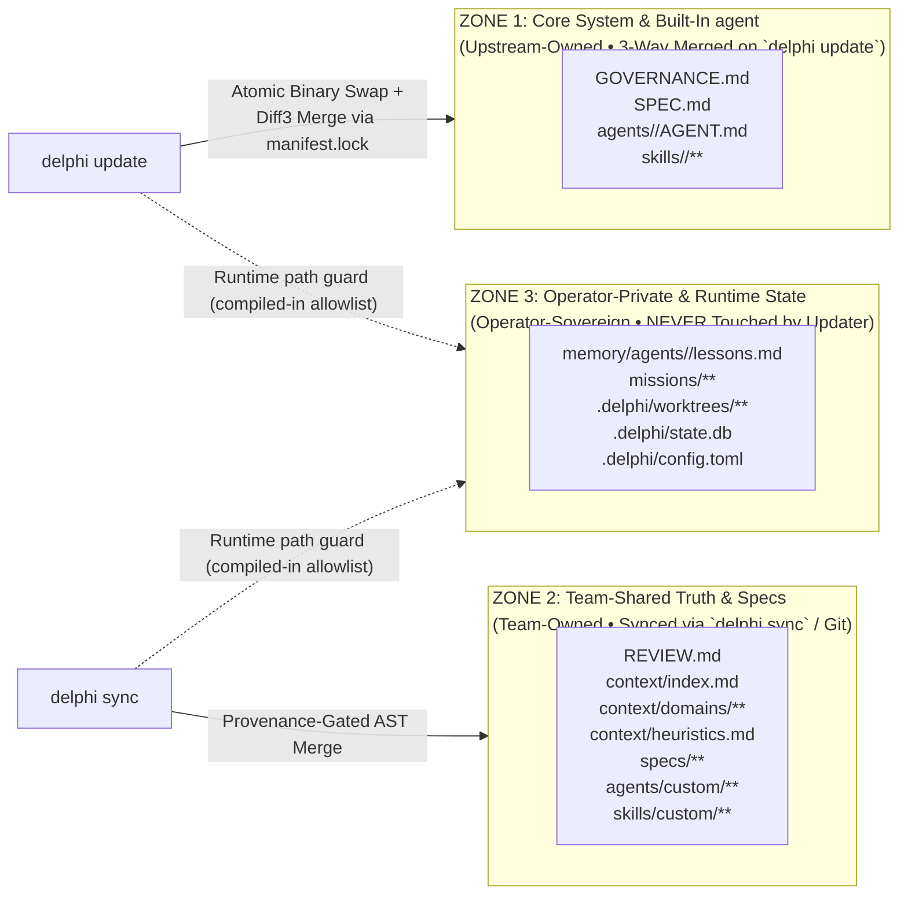

# Spec 006: Multi-Operator Distribution, Installer & Three-Zone Updater Engine

## 1. Scope & Objectives
This specification defines how Delphi is packaged, distributed to multiple operators, initialized, and updated without ever corrupting operator-private memory or active worktrees:
1. **Single-Binary Embedded Seed Packaging (`delphi` / `delphi-core`):** Shipping the compiled runtime with an embedded, hash-verified snapshot of built-in `GOVERNANCE.md`, `SPEC.md`, `agents/`, and `skills/`.
2. **Multi-Operator Distribution Channels:** Signed binary installer (`curl -fsSL ... | sh`), Homebrew Tap, and GitHub Releases with Ed25519 / Minisign signature verification.
3. **The Three-Zone Ownership Model:** Strict separation between **Zone 1 (Core Upstream)**, **Zone 2 (Team-Shared Context & Specs)**, and **Zone 3 (Operator-Private Memory & Worktrees)**.
4. **Atomic Updater (`delphi update`), Team Sync (`delphi sync`), and Health Validator (`delphi doctor`).**

### 1.1 Simpler Alternative Considered
- **Alternative:** Distribute Delphi as a `git clone` repository where operators run `git pull` to update both the engine code and their local memory/context.
- **Why Rejected:** Mixing upstream engine updates with an operator's personal `memory/agents/*/lessons.md`, active `missions/`, and `.delphi/config.toml` causes constant Git merge conflicts and risks accidentally pushing private personal plans or local lessons to a public upstream repo. Separating the **Single Binary + Embedded Seed** (`delphi update`) from **Team Knowledge Sync** (`delphi sync`) and **Operator-Private State** guarantees zero merge friction across dozens of operators.

---

## 2. Multi-Operator Packaging & Bootstrap Installer

### 2.1 Embedded Core Seed (`core-manifest.json`)
The compiled `delphi` binary embeds the canonical read-only snapshot of all Zone 1 files alongside `core-manifest.json` (containing `blake3` hashes of every file in the release).
- **Benefit 1:** `delphi init` works 100% offline with zero network calls. No embedding model is downloaded (D-01, ratified 2026-10-23).
- **Benefit 2:** `delphi update` has the pristine ancestor needed for deterministic **Three-Way Merges** if an operator customized a built-in agent manifest. diff3 needs the ancestor's *content*, not just its hash. So `delphi init` and every `delphi update` write the installed release's Zone 1 files to `base/` in the workspace home (§3.1; read-only). `manifest.lock` records their `blake3` hashes so `doctor` can verify them.

### 2.2 Distribution Channels & Cryptographic Verification
1. **Bootstrap Script (`curl -fsSL https://delphi.sh/install | sh` or GitHub raw release script):**
   - Detects OS (`darwin` / `linux`) and architecture (`arm64` / `x86_64`).
   - Downloads `delphi-<version>-<target>.tar.gz`, `.sha256`, and `.minisig` from GitHub Releases.
   - Verifies both SHA-256 and the **Ed25519 Minisign signature** before installing to `~/.local/bin/delphi`.
2. **Homebrew Tap (`brew install <org>/tap/delphi`):** Installs the binary, shell completions (`zsh`, `bash`, `fish`), and manpages. If the binary lives under a Homebrew prefix, `delphi update` does not swap it. It runs the Zone 1 merge only and tells the operator to run `brew upgrade`.
- **Platforms:** macOS and Linux only (`darwin`/`linux` × `arm64`/`x86_64`). Windows is unsupported, because Unix sockets, `flock`, and the sandbox are POSIX-specific (D-15, ratified 2026-10-23).
3. **Interactive Onboarding Wizard (`delphi init`):**
   - Creates the workspace home (§3.1), seeds Zones 1–3 from the binary, and registers one or more project repos by path. It writes **nothing** into any project repo.
   - Generates the operator's Ed25519 federation identity keypair (stored in macOS Keychain / Linux Secret Service; public DID written to `.delphi/identity.json`).
   - Offers the built-in theme packs (Greek by default) or `delphi theme new <name>` (`specs/001` §6.5), and records the choice in `config.toml` `[theme]`.
   - Prompts for **Anthropic Claude** and **Google Gemini** API keys (or detects installed `claude` / `gemini` CLI harnesses) and runs an initial capability verification pass. Keys are stored in macOS Keychain or Linux Secret Service (falling back to `ANTHROPIC_API_KEY` / `GEMINI_API_KEY` environment variables), **never** in `.delphi/config.toml` or any workspace file.

---

## 3. The Three-Zone File Ownership Architecture (`[REV-SEC-03]`)



| Zone | Paths | Owner | Updated By | Merge & Protection Invariant |
| :--- | :--- | :--- | :--- | :--- |
| **Zone 1 (Core)** | `GOVERNANCE.md`, `SPEC.md`, `agents/<role>/AGENT.md`, `skills/<builtin>/**` | Upstream Release | `delphi update` | **3-Way Diff3 Merge** against the ancestor content in `.delphi/base/`. Never writes raw `<<<<<<<` markers into active prompts. **Exception:** `GOVERNANCE.md` never fast-forwards silently. Even when the local copy is unmodified, the upstream diff is shown as a Red-tier approval (GOVERNANCE §5.7). |
| **Zone 2 (Team)** | `REVIEW.md`, `context/**`, `specs/**`, `agents/custom/**`, `skills/custom/**` | Team / Repo Maintainers | `delphi sync` / `git` | **AST Rule-ID Merge + IFC Taint Gate (`[H-004]`)**. Preserved untouched during binary upgrades. Incoming changes to `REVIEW.md` and `heuristics.md` arrive as proposals ([`specs/007`](007-federated-mesh-and-sync.md) §4). Custom agents override built-ins of the same `id`, and only from `agents/custom/<id>/AGENT.md` (the single override path). |
| **Zone 3 (Operator)** | `memory/agents/**`, `missions/**`, `.delphi/worktrees/**`, `.delphi/state.db`, `.delphi/config.toml` | Local Operator (the **operator**) | Local **Orchestrator** / the **operator** only | **Strict Non-Interference (`[REV-SEC-03]`):** `delphi update` and `delphi sync` are forbidden from overwriting or deleting Zone 3 files. |

### 3.1 Physical Layout: Delphi Is an Installed Tool (D-03, revised 2026-10-23)
Delphi is installed and run as a tool. Its entire working state lives together in a **Delphi home**, outside every project repo. Project repos, including the Delphi source repo, contain **no Delphi files**.

```text
$DELPHI_HOME/                     # default ~/.delphi (override with DELPHI_HOME)
├── bin/delphi-prev               # previous binary, for `delphi rollback`
├── run/                          # sockets, PID and lock files
├── themes/<name>/                # user theme packs (built-ins ship in the binary; specs/001 §6)
└── workspaces/<name>/            # one per workspace; `.delphi/` in every spec means this directory
    ├── config.toml               # projects = ["/path/to/repo", …], providers, budgets
    ├── core/                     # Zone 1: operator customizations of built-ins (GOVERNANCE.md, agents/, skills/)
    ├── base/                     # Zone 1 ancestor content for update merges (read-only)
    ├── team/                     # Zone 2: REVIEW.md, context/, specs/, agents/custom/, skills/custom/
    │                             #   (optionally a git clone of a team registry, synced via `delphi sync`)
    ├── local/                    # Zone 3: memory/, missions/ (incl. events.jsonl), state.db, proposals/, ratified.lock
    └── worktrees/<task-id>/      # git worktrees of the project repo, outside the project checkout
```

- **Spec shorthand:** throughout the specs, `.delphi/…` denotes the workspace home above, never a directory in the project. Agent manifests use **logical paths**, resolved by `delphi-core` (`specs/001` §2.2): `missions/**` and `memory/**` resolve to `local/`; `context/**`, `specs/**` and `REVIEW.md` to `team/`; `@worktree/**` to the task's worktree.
- **Built-ins:** Zone 1 files with no local customization are read straight from the binary. A copy appears in `core/` only when the operator customizes one.
- **Constitution pinning:** `local/ratified.lock` records the `blake3` of the last ratified `GOVERNANCE.md`, `REVIEW.md` and `context/heuristics.md`. At startup the daemon compares the files on disk against it. If they differ, for example after a raw `git pull` in `team/` or a hand edit, the daemon keeps loading the last ratified version (kept in `local/ratified/`) and stages the difference as a Red-tier proposal. No path, `delphi sync` included, can change active constitutional files without ratification.
- **Footprint in the project's `.git/`:** worktree metadata (`.git/worktrees/`) and checkpoint refs (`refs/delphi/checkpoints/*`, which are never pushed by default) are the only traces. `delphi gc` removes both when a task's worktree is pruned.
- **Specs for project work** live in `team/specs/`. Implementation PRs cite them as `Implements-Spec: <workspace>/specs/NNN-<slug>.md`, and the PR body links the spec text.
- **This repository is the install source.** Its `GOVERNANCE.md`, `SPEC.md`, `agents/`, `skills/`, `templates/`, seed `context/`, and `memory/` templates are embedded in the binary at build time. `delphi init` seeds a workspace home from them, and `delphi update` merges new releases. Its `missions/` and `specs/` are Delphi's own design records and are not seeded. Building Delphi with Delphi works like any other project: an installed binary, with a workspace whose `projects` entry points at this repo.

---

## 4. `delphi update` State Machine

1. **Pre-Flight Drain & Stop:** Queries `~/.delphi/run/<workspace-hash>.sock`. If any task or `.delphi/worktrees/*` build is running, it pauses and prompts the operator. Once there is no active work, it asks the daemon to drain (finish the current turn, persist, release locks) and **stops it**, so no old daemon keeps running against the new schema. The next `delphi` invocation spawns the new daemon.
2. **Atomic Binary Replacement (`POSIX rename()`):**
   - Downloads and verifies the new binary's Ed25519 signature.
   - Copies the current binary to `~/.delphi/bin/delphi-prev` (enabling instant `delphi rollback`).
   - Writes `.delphi-update.tmp` in the target directory and executes an atomic `rename()`.
3. **Zone 1 Three-Way Manifest Merge:**
   - For each Zone 1 file, compares `blake3(local)`, `blake3(base_lock)`, and `blake3(new_release)`:
     - If `local == base_lock` $\rightarrow$ silently fast-forwards to `new_release`.
     - If `local != base_lock` and `new_release == base_lock` $\rightarrow$ preserves operator's local customization untouched.
     - **v1 (D-06, ratified 2026-10-23):** if both changed, write `<file>.upstream-vX.Y` next to the local file and prompt the **operator** (`[A]ccept upstream / [K]eep local / [M]erge in $EDITOR`); no automatic diff3. The full merge below is the post-v1 design.
     - If both changed $\rightarrow$ runs in-memory 3-way merge. Clean merges apply automatically; overlapping line conflicts stage `.upstream-vX.Y` and prompt the **operator** (`[A]ccept upstream / [K]eep local / [M]erge in $EDITOR`).
4. **SQLite Schema Migration & Re-Index:** Copies `state.db` to `state.db.bak-<version>` first, then runs migrations in a single transaction and incrementally re-indexes modified Markdown files. Because `state.db` is derived (`specs/004` §3.1), a failed migration falls back to a full `delphi kb reindex`.

---

## 5. `delphi doctor`: 8-Point Deterministic Health Check

Running `delphi doctor` executes an instant read-only verification suite (exit code `0` = healthy, `1` = action required):
1. **Binary $\leftrightarrow$ Daemon Version Match** over `$DELPHI_HOME/run/<workspace-hash>.sock`. If no daemon is running, this check is skipped and reported as `not running`, not as a failure.
2. **Zone 1 Manifest Lock Integrity** (checks `blake3` hashes and flags unresolved `.upstream-*` files).
3. **6-Tier Taint Audit (`[H-004]`):** Verifies no entry below `internal_empirical` ($L_4$) exists inside `context/heuristics.md`, `REVIEW.md`, `memory/agents/*/lessons.md`, or `skills/`.
4. **Rule of 25 & 6 KB Cap Audit:** Verifies `context/heuristics.md` and all 9 `memory/agents/<role>/lessons.md` files have $\le 25$ rules and $\le 6,144$ bytes.
5. **Pointer & Link Validator:** Verifies all `path#Lstart-Lend` pointers and Markdown links across `context/`, `specs/`, `SPEC.md`, `GOVERNANCE.md`, and `REVIEW.md` resolve to existing files and line ranges. It also flags absolute local paths (`/Users/…`, `/home/…`), which violate `[REV-SEC-05]`.
6. **Hybrid RAG Index Health:** Verifies `.delphi/state.db` WAL integrity, `fts5`, and `sqlite-vec` tables.
7. **Provider & CLI Harness Reachability:** Verifies configured Anthropic Claude and Google Gemini credentials and optional local CLI harnesses (`claude`, `gemini`, `gh`).
8. **Worktree, Socket & Clean-Repo Hygiene:** Checks `.delphi/worktrees/` for orphaned locks and stale `.git/worktrees/` entries. Verifies `0600` socket permissions (when a daemon runs). Confirms each registered project repo contains no Delphi files, and that the active constitution matches `ratified.lock`.

---

## 6. Verification Plan
1. **Zone 3 Non-Interference Fuzz Test:** Populate `memory/agents/orchestrator/lessons.md` and `missions/001/` with canary data, run `delphi update` across a simulated major version bump, and verify byte-for-byte identity of all Zone 3 files.
2. **3-Way Manifest Merge Test:** Modify `authorized_skills` in `agents/orchestrator/AGENT.md` locally while modifying `## 3. Known Blind Spots` in the simulated upstream release; verify `delphi update` cleanly merges both changes without conflict markers.
3. **Tampered Binary Rejection Test:** Corrupt 1 byte of a downloaded release archive or signature and verify `delphi update` aborts with a cryptographic verification error before touching `~/.local/bin/delphi`.
4. **Constitution Gate Test:** With an unmodified local `GOVERNANCE.md` and a changed upstream version, `delphi update` must stop at a Red approval showing the diff rather than fast-forwarding.
5. **Running-Daemon Update Test:** Run `delphi update` while an idle daemon is attached; the old daemon is stopped before migration, and the next client attaches to the new version.
