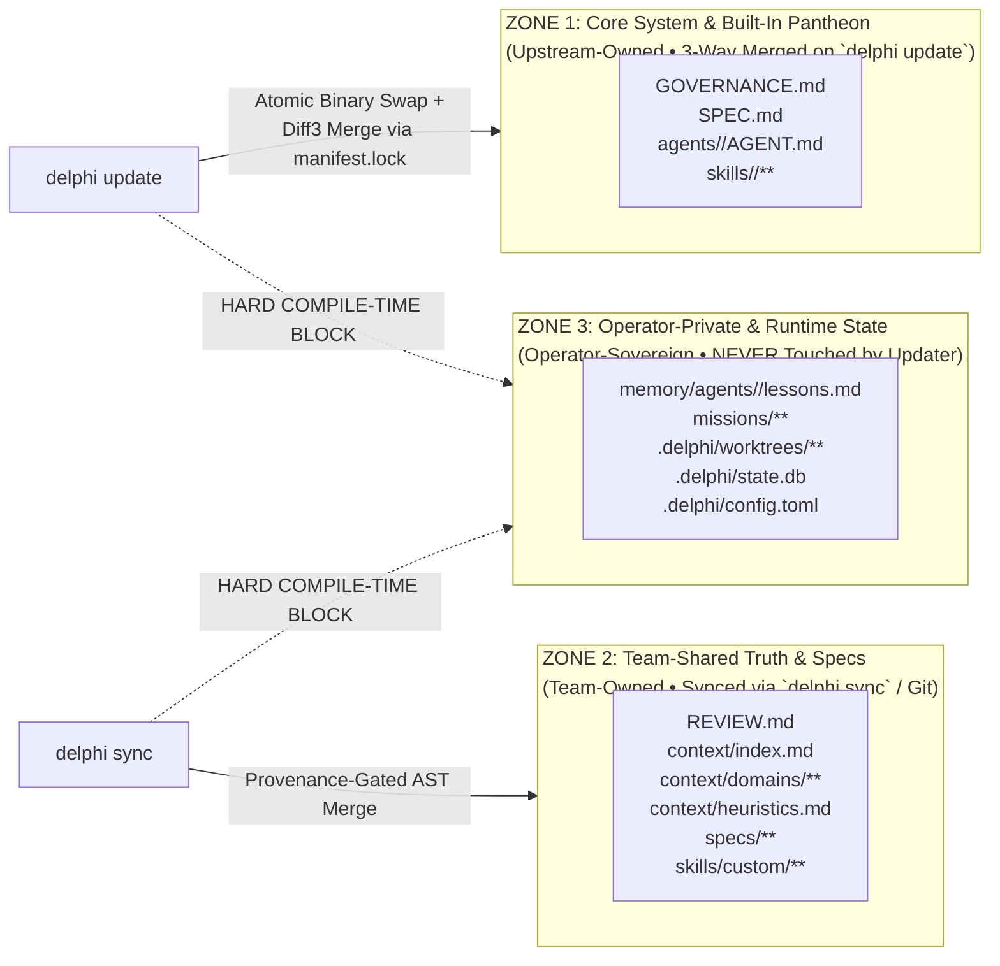

# Spec 006: Multi-Operator Distribution, Installer & Three-Zone Updater Engine

## 1. Scope & Objectives
This specification defines how Delphi is packaged, distributed to multiple operators, initialized, and updated without ever corrupting operator-private memory or active worktrees:
1. **Single-Binary Embedded Seed Packaging (`delphi` / `delphi-core`):** Shipping the compiled runtime with an embedded, hash-verified snapshot of built-in `GOVERNANCE.md`, `SPEC.md`, `agents/`, and `skills/`.
2. **Multi-Operator Distribution Channels:** Signed binary installer (`curl -fsSL ... | sh`), Homebrew Tap, and GitHub Releases with Ed25519 / Minisign signature verification.
3. **The Three-Zone Ownership Model:** Strict separation between **Zone 1 (Core Upstream)**, **Zone 2 (Team-Shared Context & Specs)**, and **Zone 3 (Operator-Private Memory & Worktrees)**.
4. **Atomic Updater (`delphi update`), Team Sync (`delphi sync`), and Health Validator (`delphi doctor`).**

### 1.1 Simpler Alternative Considered (*The Icarus Middle-Course Rule*)
- **Alternative:** Distribute Delphi as a `git clone` repository where operators run `git pull` to update both the engine code and their local memory/context.
- **Why Rejected:** Mixing upstream engine updates with an operator's personal `memory/agents/*/lessons.md`, active `missions/`, and `.delphi/config.toml` causes constant Git merge conflicts and risks accidentally pushing private personal plans or local lessons to a public upstream repo. Separating the **Single Binary + Embedded Seed** (`delphi update`) from **Team Knowledge Sync** (`delphi sync`) and **Operator-Private State** guarantees zero merge friction across dozens of operators.

---

## 2. Multi-Operator Packaging & Bootstrap Installer

### 2.1 Embedded Core Seed (`core-manifest.json`)
The compiled `delphi` binary embeds the canonical read-only snapshot of all Zone 1 files alongside `core-manifest.json` (containing `blake3` hashes of every file in the release).
- **Benefit 1:** `delphi init` works 100% offline with zero network calls.
- **Benefit 2:** `delphi update` always has the exact pristine ancestor snapshot (`.delphi/manifest.lock`) required to perform deterministic **Three-Way Merges** if an operator customized a built-in agent manifest.

### 2.2 Distribution Channels & Cryptographic Verification
1. **Bootstrap Script (`curl -fsSL https://delphi.sh/install | sh` or GitHub raw release script):**
   - Detects OS (`darwin` / `linux`) and architecture (`arm64` / `x86_64`).
   - Downloads `delphi-<version>-<target>.tar.gz`, `.sha256`, and `.minisig` from GitHub Releases.
   - Verifies both SHA-256 and the **Ed25519 Minisign signature** before installing to `~/.local/bin/delphi`.
2. **Homebrew Tap (`brew install <org>/tap/delphi`):** Installs the binary, shell completions (`zsh`, `bash`, `fish`), and manpages.
3. **Interactive Onboarding Wizard (`delphi init`):**
   - Scaffolds the Three-Zone directory hierarchy.
   - Generates the operator's Ed25519 federation identity keypair (stored in macOS Keychain / Linux Secret Service; public DID written to `.delphi/identity.json`).
   - Prompts for **Anthropic Claude** and **Google Gemini** API keys (or detects installed `claude` / `gemini` CLI harnesses) and runs an initial capability verification pass.

---

## 3. The Three-Zone File Ownership Architecture (`[REV-SEC-03]`)

| Zone | Paths | Owner | Updated By | Merge & Protection Invariant |
| :--- | :--- | :--- | :--- | :--- |
| **Zone 1 (Core)** | `GOVERNANCE.md`, `SPEC.md`, `agents/<god>/AGENT.md`, `skills/<builtin>/**` | Upstream Release | `delphi update` | **3-Way Diff3 Merge** using `.delphi/manifest.lock` ancestor hashes. Never writes raw `<<<<<<<` markers into active prompts. |
| **Zone 2 (Team)** | `REVIEW.md`, `context/**`, `specs/**`, `skills/custom/**` | Team / Repo Maintainers | `delphi sync` / `git` | **AST Rule-ID Merge + IFC Taint Gate (`[H-004]`)**. Preserved untouched during binary upgrades. |
| **Zone 3 (Operator)** | `memory/agents/**`, `missions/**`, `.delphi/worktrees/**`, `.delphi/state.db`, `.delphi/config.toml` | Local Operator (**Chaos**) | Local **Athena** / **Chaos** only | **Strict Non-Interference (`[REV-SEC-03]`):** `delphi update` and `delphi sync` are forbidden from overwriting or deleting Zone 3 files. |

---

## 4. `delphi update` State Machine

1. **Pre-Flight Active Worktree Guard:** Queries `~/.delphi/run/<workspace>.sock`. If any task or `.delphi/worktrees/*` build is actively running a tool call, pauses and prompts the operator before proceeding.
2. **Atomic Binary Replacement (`POSIX rename()`):**
   - Downloads and verifies the new binary's Ed25519 signature.
   - Copies the current binary to `~/.delphi/bin/delphi-prev` (enabling instant `delphi rollback`).
   - Writes `.delphi-update.tmp` in the target directory and executes an atomic `rename()`.
3. **Zone 1 Three-Way Manifest Merge:**
   - For each Zone 1 file, compares `blake3(local)`, `blake3(base_lock)`, and `blake3(new_release)`:
     - If `local == base_lock` $\rightarrow$ silently fast-forwards to `new_release`.
     - If `local != base_lock` and `new_release == base_lock` $\rightarrow$ preserves operator's local customization untouched.
     - If both changed $\rightarrow$ runs in-memory 3-way merge. Clean merges apply automatically; overlapping line conflicts stage `.upstream-vX.Y` and prompt **Chaos** (`[A]ccept upstream / [K]eep local / [M]erge in $EDITOR`).
4. **SQLite Schema Migration & Re-Index:** Runs non-destructive `ALTER TABLE` migrations on `.delphi/state.db` and incrementally re-indexes modified Markdown files.

---

## 5. `delphi doctor`: 8-Point Deterministic Health Check

Running `delphi doctor` executes an instant read-only verification suite (exit code `0` = healthy, `1` = action required):
1. **Binary $\leftrightarrow$ Daemon Version Match** over `~/.delphi/run/<workspace>.sock`.
2. **Zone 1 Manifest Lock Integrity** (checks `blake3` hashes and flags unresolved `.upstream-*` files).
3. **5-Tier Taint Audit (`[H-004]`):** Verifies zero `external_untrusted` or `federated_peer` entries exist inside `context/heuristics.md`, `REVIEW.md`, `memory/agents/*/lessons.md`, or `skills/`.
4. **Rule of 25 & 6 KB Cap Audit:** Verifies `context/heuristics.md` and all 9 `memory/agents/<god>/lessons.md` files have $\le 25$ rules and $\le 6,144$ bytes.
5. **Pointer & Link Validator:** Verifies all `file:///...#Lstart-Lend` pointers in `context/index.md` and `SPEC.md` resolve to valid files and line numbers.
6. **Hybrid RAG Index Health:** Verifies `.delphi/state.db` WAL integrity, `fts5`, and `sqlite-vec` tables.
7. **Provider & CLI Harness Reachability:** Verifies configured Anthropic Claude and Google Gemini credentials and optional local CLI harnesses (`claude`, `gemini`, `gh`).
8. **Worktree & Socket Hygiene:** Checks `.delphi/worktrees/` for orphaned locks and verifies `0600` socket permissions.

---

## 6. Verification Plan
1. **Zone 3 Non-Interference Fuzz Test:** Populate `memory/agents/athena/lessons.md` and `missions/001/` with canary data, run `delphi update` across a simulated major version bump, and verify byte-for-byte identity of all Zone 3 files.
2. **3-Way Manifest Merge Test:** Modify `authorized_skills` in `agents/athena/AGENT.md` locally while modifying `## 3. Known Blind Spots` in the simulated upstream release; verify `delphi update` cleanly merges both changes without conflict markers.
3. **Tampered Binary Rejection Test:** Corrupt 1 byte of a downloaded release archive or signature and verify `delphi update` aborts with a cryptographic verification error before touching `~/.local/bin/delphi`.
