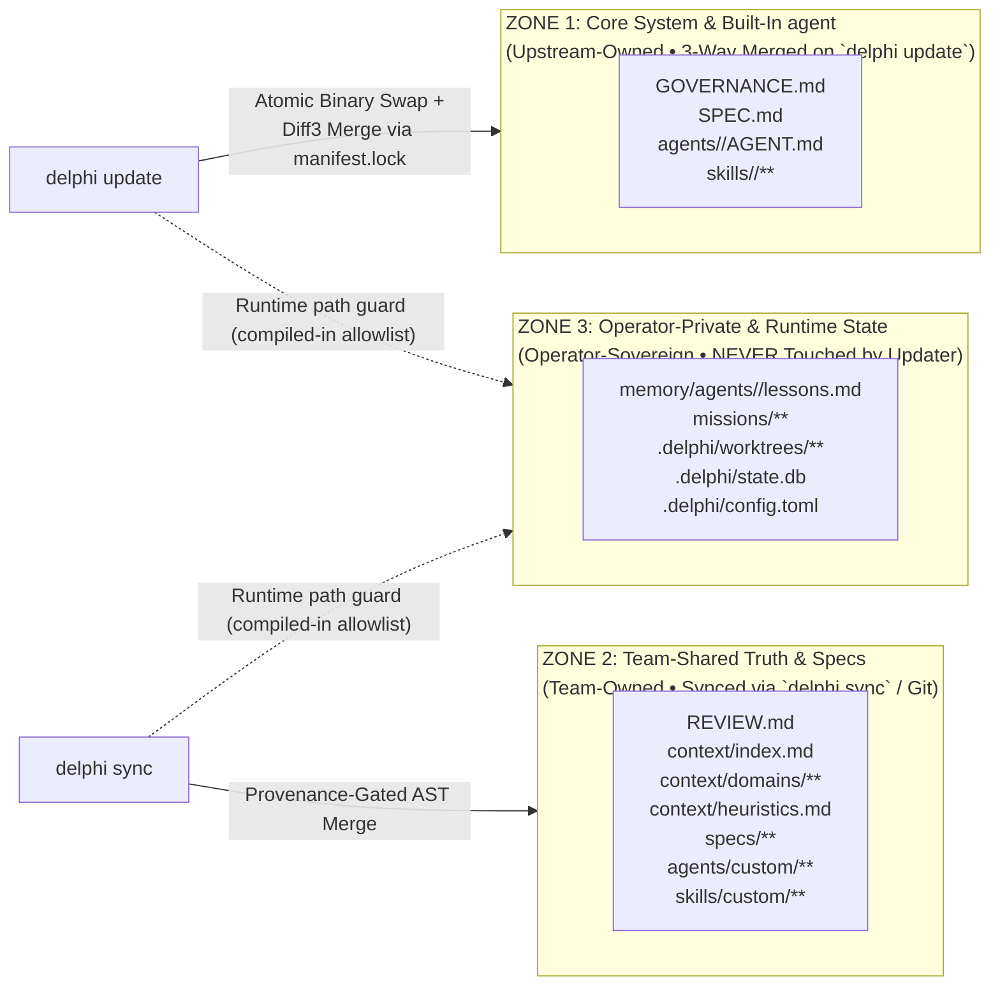

# Spec 006: Multi-Operator Distribution, Installer & Three-Zone Updater Engine

## 1. Scope & Objectives
This specification defines how Delphi is packaged, distributed to multiple operators, initialized, and updated without ever corrupting operator-private memory or active worktrees:
1. **Single-Binary Embedded Seed Packaging (`delphi` / `delphi-core`):** Shipping the compiled runtime with an embedded, hash-verified snapshot of built-in `GOVERNANCE.md`, `SPEC.md`, `REVIEW.md`, `agents/`, `skills/`, `themes/`, `templates/`, seed `context/` and `memory/` templates.
2. **Multi-Operator Distribution Channels:** Signed binary installer (`curl -fsSL ... | sh`), Homebrew Tap, and GitHub Releases with Ed25519 / Minisign signature verification.
3. **The Three-Zone Ownership Model:** Strict separation between **Zone 1 (Core Upstream)**, **Zone 2 (Team-Shared Context & Specs)**, and **Zone 3 (Operator-Private Memory & Worktrees)**.
4. **Atomic Updater (`delphi update`), Team Sync (`delphi sync`), and Health Validator (`delphi doctor`).**

### 1.1 Phase Mapping (what approval of this spec authorizes)
| Roadmap step | Sections built and tested |
| :--- | :--- |
| **Step 1** | §2.1 embedded seed and `core-manifest.json` (unsigned dev builds; signing is Step 5, amendment 006-A3); §2.2 item 3 `delphi init` (offline, `--non-interactive`, no federation keys); §3 zones, §3.1 layout, `ratified.lock` bootstrap and pinning, workspace resolution, clean-repo rule; §5 `doctor` and `delphi lint --repo`; tests 6–10 |
| **Step 2** | `doctor` checks that need the daemon or `state.db` start reporting (checks 1, 6) |
| **Step 5** | §2.2 items 1–2 (bootstrap script, Homebrew); §4 `delphi update` in v1 `.upstream` mode, and `rollback`; tests 1, 3, 4, 5 |
| **Step 6** | §4 in-memory diff3 merge; test 2; `delphi sync` (`specs/007` §4) |
| **Step 7 / deferred** | Federation identity keypair (`specs/007`) |

### 1.2 Simpler Alternative Considered
- **Alternative:** Distribute Delphi as a `git clone` repository where operators run `git pull` to update both the engine code and their local memory/context.
- **Why Rejected:** Mixing upstream engine updates with an operator's personal `memory/agents/*/lessons.md`, active `missions/`, and `.delphi/config.toml` causes constant Git merge conflicts and risks accidentally pushing private personal plans or local lessons to a public upstream repo. Separating the **Single Binary + Embedded Seed** (`delphi update`) from **Team Knowledge Sync** (`delphi sync`) and **Operator-Private State** guarantees zero merge friction across dozens of operators.

---

## 2. Multi-Operator Packaging & Bootstrap Installer

### 2.1 Embedded Core Seed (`core-manifest.json`)
The compiled `delphi` binary embeds the canonical read-only snapshot of all seed files alongside `core-manifest.json`. That manifest is signed with the release key and records each file's `blake3` hash and its provenance tier. Release files are tier $L_5$ by **release ratification**: the operator ratifies the release by installing a signature-verified build.
- **Benefit 1:** `delphi init` works 100% offline with zero network calls. No embedding model is downloaded: the one that powers semantic search is compiled into the binary (Amendment 004-A1, 2026-10-24, which raised the binary from about 20 MB to about 130 to 160 MB depending on the model, a size the operator chose). The model is part of the binary, so the release's signed checksums and build attestation cover it; the model's own origin (repository, revision, quantization) is recorded in the package header and shown by `delphi kb model info`.
- **Benefit 2:** `delphi update` has the pristine ancestor needed for deterministic **Three-Way Merges** if an operator customized a built-in agent manifest. diff3 needs the ancestor's *content*, not just its hash. So `delphi init` and every `delphi update` write the installed release's Zone 1 files to `base/` in the workspace home (§3.1; read-only). `manifest.lock` records their `blake3` hashes so `doctor` can verify them.

### 2.2 Distribution Channels & Cryptographic Verification
1. **Bootstrap Script (`curl -fsSL https://delphi.sh/install | sh` or GitHub raw release script):**
   - Detects OS (`darwin` / `linux`) and architecture (`arm64` / `x86_64`).
   - Downloads `delphi-<version>-<target>.tar.gz`, `.sha256`, and `.minisig` from GitHub Releases.
   - Verifies both SHA-256 and the **Ed25519 Minisign signature** before installing to `~/.local/bin/delphi`.
2. **Homebrew Tap (`brew install <org>/tap/delphi`):** Installs the binary, shell completions (`zsh`, `bash`, `fish`), and manpages. If the binary lives under a Homebrew prefix, `delphi update` does not swap it. It runs the Zone 1 merge only and tells the operator to run `brew upgrade`.
- **Platforms:** macOS and Linux only (`darwin`/`linux` × `arm64`/`x86_64`). Windows is unsupported, because Unix sockets, `flock`, and the sandbox are POSIX-specific (D-15, ratified 2026-10-23).
3. **Onboarding (`delphi init [--non-interactive] [--workspace <name>] [--project <path>]`):**
   - Creates the workspace home (§3.1), seeds it from the binary, and registers one or more project repos by path. It writes **nothing** into any project repo, and needs **no network**.
   - **Bootstraps ratification:** writes `base/` and `base/manifest.lock` from the release, and writes `local/ratified.lock` plus `local/ratified/` from the signed `core-manifest.json`. From then on, anything that diverges from those hashes needs operator ratification.
   - Offers the built-in theme packs (Greek by default) and records the choice in `config.toml` `[theme]`. Creating a new theme is post-v1 (`specs/001` §6.5).
   - Configures model access per [`specs/009`](009-model-access-and-auth.md): endpoints and credential sources (cloud platform credentials, gateway SSO, credential helpers, subscription CLIs, or API keys). Access can also be configured later (`delphi endpoints add`, `delphi auth login`). `--non-interactive` skips it, and `doctor` then reports `warn: no endpoints configured`.
   - *(Deferred to federation, Step 7: generating the Ed25519 identity keypair. It is not part of v1 `init`.)*
---

## 3. The Three-Zone File Ownership Architecture (`[REV-SEC-03]`)



| Zone | Paths | Owner | Updated By | Merge & Protection Invariant |
| :--- | :--- | :--- | :--- | :--- |
| **Zone 1 (Core)** | `GOVERNANCE.md`, `SPEC.md`, `agents/<role>/AGENT.md`, `skills/<builtin>/**` | Upstream Release | `delphi update` | **3-Way Diff3 Merge** against the ancestor content in `.delphi/base/`. Never writes raw `<<<<<<<` markers into active prompts. **Exception:** `GOVERNANCE.md` never fast-forwards silently. Even when the local copy is unmodified, the upstream diff is shown as a Red-tier approval (GOVERNANCE §5.7). |
| **Zone 2 (Team)** | `REVIEW.md`, `context/**`, `specs/**`, `agents/custom/**`, `skills/custom/**` | Team / Repo Maintainers | `delphi sync` / `git` | **AST Rule-ID Merge + IFC Taint Gate (`[H-004]`)**. Preserved untouched during binary upgrades. Incoming changes to `REVIEW.md` and `heuristics.md` arrive as proposals ([`specs/007`](007-federated-mesh-and-sync.md) §4). Team overrides live in `team/agents/custom/<id>/AGENT.md`. Precedence is operator `core/` > team > built-in, and any override may only narrow the built-in role's scope (`specs/001` §2.3). |
| **Zone 3 (Operator)** | `memory/agents/**`, `missions/**`, `.delphi/worktrees/**`, `.delphi/state.db`, `.delphi/config.toml` | Local Operator (the **operator**) | Local **Orchestrator** / the **operator** only | **Strict Non-Interference (`[REV-SEC-03]`):** `delphi update` and `delphi sync` are forbidden from overwriting or deleting Zone 3 files. |

### 3.1 Physical Layout: Delphi Is an Installed Tool (D-03, revised 2026-10-23)
Delphi is installed and run as a tool. Its entire working state lives together in a **Delphi home**, outside every project repo. Project repos, including the Delphi source repo, contain **no Delphi files**.

```text
$DELPHI_HOME/                     # default ~/.delphi (override with DELPHI_HOME)
├── bin/delphi-prev               # previous binary, for `delphi rollback`
├── run/                          # sockets, PID and lock files
├── themes/<name>/                # user theme packs (built-ins ship in the binary; specs/001 §6)
└── workspaces/<name>/            # one per workspace; `.delphi/` in every spec means this directory
    ├── config.toml               # projects = ["/path/to/repo", …], providers, budgets
    ├── core/                     # Zone 1: operator customizations of built-ins (GOVERNANCE.md, agents/, skills/)
    ├── base/                     # Zone 1 release snapshot (read-only): ancestor for merges, source for uncustomized built-ins
    │   └── manifest.lock         # blake3 of every file in base/
    ├── team/                     # Zone 2: REVIEW.md, context/, specs/, agents/custom/, skills/custom/
    │                             #   (optionally a git clone of a team registry, synced via `delphi sync`)
    ├── local/                    # Zone 3: memory/, missions/ (incl. events.jsonl), state.db
    │   ├── ratified.lock         # hashes of every ratified constitutional file, manifest, skill, custom script and theme
    │   ├── ratified/             # copies of the ratified versions (what the daemon actually loads)
    │   └── proposals/<mission>/  # staged proposals, daemon-written only (specs/001 §2.2)
    └── worktrees/<task-id>/      # git worktrees of the project repo, outside the project checkout
```

- **Spec shorthand:** throughout the specs, `.delphi/…` denotes the workspace home above, never a directory in the project. Agent manifests use **logical paths**, resolved by `delphi-core` (`specs/001` §2.2): `missions/**` and `memory/**` resolve to `local/`; `context/**`, `specs/**` and `REVIEW.md` to `team/`; `@worktree/**` to the task's worktree.
- **Built-ins:** Zone 1 files with no local customization are read from `base/` (the release snapshot written at init or update). A copy appears in `core/` only when the operator customizes one.
- **Ratification pinning:** `local/ratified.lock` records the `blake3` of every ratified `GOVERNANCE.md`, `REVIEW.md`, `context/heuristics.md`, every `AGENT.md` and `SKILL.md` in use (built-in, `core/` or `team/`), every file under `skills/custom/**/scripts/**`, and the active theme pack. The daemon **only ever loads the copies in `local/ratified/`**. At startup it compares the live files against the lock. If they differ, for example after a raw `git pull` in `team/`, a hand edit, or a new release, it keeps loading the last ratified copy and stages the difference as a Red-tier proposal. No path, `delphi sync` and `delphi update` included, can change what agents run under without ratification.
- **Workspace resolution:** `delphi` (and `doctor`) find the workspace by walking up from the current directory to its git root, then looking for workspaces whose `config.toml` `projects` contains that root. Exactly one match is used. With several matches, `--workspace <name>` is required (or `DELPHI_WORKSPACE`). With none, bare `delphi` creates one (amendment 006-A4; other commands say to run `delphi` or `delphi init --project <root>`). Outside any git repo, the `default` workspace is used if it exists (006-A4); otherwise `--workspace` is required.
- **Clean-repo rule (defined by provenance, not content):** a registered project is clean when it has no `.delphi/` directory, and no file in its working tree was created or modified by Delphi except through a merge the operator approved. Delphi's own source repo is therefore clean even though it contains `GOVERNANCE.md` and `agents/`.
- **Footprint in the project's `.git/`:** worktree metadata (`.git/worktrees/`) and checkpoint refs (`refs/delphi/checkpoints/*`, which are never pushed by default) are the only traces. `delphi gc` removes both when a task's worktree is pruned.
- **Specs for project work** live in `team/specs/`. Implementation PRs cite them as `Implements-Spec: <workspace>/specs/NNN-<slug>.md`, and the PR body links the spec text.
- **This repository is the install source.** Its `GOVERNANCE.md`, `SPEC.md`, `agents/`, `skills/`, `templates/`, seed `context/`, and `memory/` templates are embedded in the binary at build time. `delphi init` seeds a workspace home from them, and `delphi update` merges new releases. Its `missions/` and `specs/` are Delphi's own design records and are not seeded. Building Delphi with Delphi works like any other project: an installed binary, with a workspace whose `projects` entry points at this repo.


### 3.2 Amendment 006-A1: Operator Home (D-20; approved by the operator 2026-10-23 after Council 003)
> `$DELPHI_HOME` has a per-operator, cross-workspace directory (`specs/004` §5):
> ```text
> $DELPHI_HOME/operator/
> ├── profile.md                 # operator preferences (operator-authored or ratified)
> ├── heuristics.md              # [O-…] personal rules (Rule of 25 caps)
> ├── memory/agents/<role>/lessons.md
> ├── core/agents/<role>/        # personal overrides of built-ins (all workspaces)
> ├── skills/                    # personal skills (scripts pinned)
> ├── base/                      # release ancestor for merging operator/core/
> ├── ratified.lock + ratified/  # pinned, as in local/
> ├── proposals/                 # daemon-only
> └── locks/                     # CAS locks for operator files (specs/004 §2.1)
> ```
> - **Step 1:** `delphi init` creates this directory if absent: empty `profile.md` and `heuristics.md`, `ratified.lock` and `ratified/` seeded from the release, and `base/`. `doctor` checks 3, 4 and 8 and `delphi lint` validate it from Step 1 on, which keeps the Step 1 definition of done passable.
> - **Updates:** `delphi update` merges `operator/core/` against `operator/base/` (§4 step 4), and its ratify-before-swap step covers operator files. `delphi rollback` restores `operator/base/` and `operator/ratified/` too.
> - **Post-v1:** `delphi operator export|import` moves this directory between machines as an encrypted bundle.

### 3.3 Amendment 006-A2: Scope Files & Ratified Specs (Council 004; approved under the operator's pre-authorization 2026-10-23)
> This amendment is part of the approved spec.
> - **Heuristics by scope** (`specs/004` §2.1): the release heuristics `context/heuristics.md` move to **Zone 1** (`base/context/heuristics.md`, release-ratified). `init` creates an empty team file `team/context/team-heuristics.md` and an empty workspace file `local/heuristics.md`, each with frontmatter and `active_rules: 0`.
> - **`ratified.lock` also pins:** every `memory/agents/*/lessons.md`, both new heuristics files, and **every operator-approved spec** (`team/specs/**` or, for Delphi's own design repo, `specs/**`), keyed by the spec's exact content hash. An approved spec whose hash no longer matches is reported by `doctor` check 3 as needing re-approval.

### 3.4 Amendment 006-A3: Release Signing Moves to Step 5 (approved by the operator 2026-10-23)
> This amendment is part of the approved spec. It resolves drift found while building Step 1 (Council 004, Builder seat).
> - Release signing needs release keys and a CI release pipeline, which arrive with Step 5 packaging (roadmap Step 5: "signed release + Homebrew"). Step 1 therefore builds `core-manifest.json` / `base/manifest.lock` with every file hash but **no signature**, and records `signature: "unsigned-dev-build"`.
> - `doctor` check 2 reports an unsigned build as `warn`, never `ok`. Hash verification of `base/` is unchanged and still `fail`s on any mismatch.
> - Until Step 5, release ratification means the operator built or installed the binary from a commit they trust. From Step 5 on, `init` and `update` refuse unsigned builds unless `--allow-unsigned-dev-build` is passed, and test 3 (tampered binary) applies.

### 3.5 Amendment 006-A4: One-Command Onboarding (approved by the operator 2026-10-24)
> This amendment is part of the approved spec. It replaces the "run `init`, then `setup`, then `doctor`, then `chat`" sequence with a single command, and supersedes the "offered `delphi init`" and "`--workspace` is required" clauses of workspace resolution (§3.1).
> - **Bare `delphi`** (no subcommand; `delphi chat` is its explicit alias) runs a **preflight**, then opens the console. The preflight, in order: (1) resolve the workspace per §3.1; (2) if none registers the project, **create it automatically** and print one line saying so and where (never a prompt; nothing is written into the project); (3) if the workspace has no endpoints, run the guided model setup (`specs/009`); (4) if this install has not passed the doctor for this release, run the doctor and offer its fixes (below). A workspace name is the project directory name, suffixed `-2`, `-3`… if taken.
> - **Outside any git repository** the `default` workspace is used (created on first use, with no registered projects). It holds only the built-in memories, context and agents. Commands that resolve a workspace (`doctor`, `chat`, `kb`…) fall back to it when it exists; otherwise they still require `--workspace`.
> - **`--workspace` naming a workspace that does not exist is an error**, never a creation. Several workspaces registering one project is still an error asking for `--workspace`.
> - **Non-interactive use** (stdin or stdout not a terminal, `--no-onboard`, or `DELPHI_NO_ONBOARD`): the workspace is still created, but nothing is asked. The user-facing commands keep their scripted forms (`init --non-interactive`, `setup --yes`).
> - **A healthy install pays no cost:** the doctor result is remembered per workspace and release in `local/onboarded`; it is cleared by a new release and never written while any check `fail`s.
> - **`delphi doctor --fix`** (terminal only) prints the report, then offers one remedy per fixable finding, asking before each: run the guided setup (no endpoints); sign in to Claude Code (installed, signed out); probe the endpoints (no or stale probe results); and review a changed endpoint/access block, showing its diff (Red tier, never defaulted or implied by `--yes`). It then reports again. It **never ratifies files in bulk**: changed or new protected files stay pending proposals and are reviewed one at a time with `/ratify`, and the doctor says so. Plain `delphi doctor` stays read-only and offline.
> - **The full-screen console ships with the binary** (`delphi-ui`, a standalone executable built per target). The release tarball contains both files; `install.sh`, the Homebrew formula and `delphi self-update` install and replace them together, and `self-update --rollback` restores both. A release without it leaves the installed console alone, and with none installed `delphi` uses the inline console.


### 3.6 Amendment 006-A5: The Development Channel (approved by the operator 2026-10-25)
> This amendment is part of the approved spec. It adds a second update channel that follows `main`, beside the stable releases. Nothing about the stable channel changes.
> - **Rolling build.** Every push to `main` builds the release matrix and publishes it as the GitHub prerelease `dev` (`.github/workflows/dev.yml`), replacing the previous one. Each tarball is named for the exact version it reports, `delphi-v<crate version>-dev.g<commit>-<target>.tar.gz`, with its `.sha256` and a build-provenance attestation, and contains `delphi` and `delphi-ui` as a release does. The version is stamped into the build (`dev/stamp-version.sh`), so the daemon's and the console's version checks treat each dev build as a different release. A build of an older push never replaces a newer one. `install.sh` and Homebrew do not follow it.
> - **`delphi self-update --dev`** installs that build. It runs the same checks as a stable update (checksum before unpacking, the new binary must run and report the version it claims, old files kept as `.prev`, `delphi-ui` replaced with it, `--rollback` restores both) and `--check` works with it. It installs whenever the published build differs from the running one (not only when newer), and cannot be combined with `--version`. The stable channel is unchanged: it never offers a prerelease, and a dev build moves to the stable release of its version (or any later one) with a plain `delphi self-update`.
> - **Trust.** A dev build is whatever is on `main` at that moment, merged after review and CI, but it is not a release: it is not tagged and the formula and installer do not move. The checksum and attestation protect against a damaged download, as for releases, not against a compromised repository.

---

## 4. `delphi update` State Machine

1. **Download & Verify:** downloads the release and verifies its Ed25519 signature and `core-manifest.json`. It refuses a version lower than the installed one unless `--allow-downgrade` is passed, which defends against downgrade attacks.
2. **Pre-Flight Drain & Stop (all workspaces):** finds every daemon under `$DELPHI_HOME/run/*.sock`. If any task or worktree build is running, it pauses and prompts the operator. Otherwise it asks each daemon to drain (finish the current turn, persist, release locks) and **stops it**.
3. **Ratify Before Swap:** for every workspace, it stages the new release's diffs against `local/ratified/` for constitutional files, manifests, skills and the built-in theme, and shows them as one Red-tier approval. `GOVERNANCE.md` diffs are always shown, even when unmodified locally. If the operator declines, nothing changes. If approved, `ratified.lock` and `local/ratified/` are updated. Because the daemon loads only ratified copies, swapping the binary can never change active rules by itself.
4. **Zone 1 Merge into `base/` and `core/`:**
   - For each Zone 1 file, it compares `blake3(local)`, `blake3(base_lock)` and `blake3(new_release)`:
     - If `local == base_lock` → `base/` takes `new_release` (its active use was already ratified in step 3).
     - If `local != base_lock` and `new_release == base_lock` → the operator's customization is kept untouched.
     - **v1 (D-06):** if both changed, it writes `<file>.upstream-vX.Y` beside the local file and prompts the operator (`[A]ccept upstream / [K]eep local / [M]erge in $EDITOR`). There is no automatic diff3. The full merge below is the post-v1 design.
     - If both changed (post-v1) → in-memory 3-way merge. Clean merges are staged for ratification; overlapping conflicts stage `.upstream-vX.Y` and prompt the operator.
5. **Atomic Binary Replacement (`POSIX rename()`):** copies the current binary to `$DELPHI_HOME/bin/delphi-prev`, writes `.delphi-update.tmp` in the target directory, and renames it into place atomically.
6. **SQLite Schema Migration & Re-Index:** Copies `state.db` to `state.db.bak-<version>` first, then runs migrations in a single transaction and incrementally re-indexes modified Markdown files. Because `state.db` is derived (`specs/004` §3.1), a failed migration falls back to a full `delphi kb reindex`.
7. **Rollback (`delphi rollback`, Step 5):** restores `delphi-prev`, `state.db.bak-<version>`, and the previous `base/` and `local/ratified/` snapshots. It refuses if `events.jsonl` has gained events in a newer schema since the update.

---

## 5. `delphi doctor`: 8-Point Deterministic Health Check

Running `delphi doctor` executes a fast, read-only, offline verification suite. Each check reports `ok`, `warn` or `fail`, and only `fail` makes the exit code `1`. Checks that depend on something not yet present (no daemon, no `state.db`) report `skipped`. `delphi doctor --fix` adds interactive remedies to the same checks and never ratifies files in bulk (amendment 006-A4).

`delphi lint --repo <path>` runs the file-level checks (schema and canonical roles per `specs/001` §7 test 1, and checks 3–5 below) against a **source repository** in the flat layout, such as this repo. CI uses it.
1. **Binary $\leftrightarrow$ Daemon Version Match** over `$DELPHI_HOME/run/<workspace-hash>.sock`. If no daemon is running, this check is skipped and reported as `not running`, not as a failure.
2. **Zone 1 Manifest Lock Integrity** (checks `blake3` hashes and flags unresolved `.upstream-*` files).
3. **6-Tier Taint Audit (`[H-004]`):** every protected file (`context/heuristics.md`, `REVIEW.md`, `memory/agents/*/lessons.md`, manifests, skills, the theme) either matches `ratified.lock` ($L_5$ by ratification) or has a provenance-index tier ≥ $L_4$. Anything else is `fail`.
4. **Rule of 25 & Caps Audit:** in `context/heuristics.md` and each `memory/agents/<role>/lessons.md`, every `### ` heading is one rule. Each rule must have `T`, `D` and `F` lines totaling ≤ 350 characters. Each file must have ≤ 25 rules (matching its `active_rules` frontmatter) and ≤ 6,144 bytes.
5. **Pointer & Link Validator:** parses Markdown (excluding fenced code blocks, which hold illustrative examples) and verifies that links and `path#Lstart-Lend` pointers resolve. In workspace mode they resolve through the logical overlay (`specs/001` §2.2), and links to design records that are never seeded (`specs/`, `missions/`, `OVERVIEW.md`, `README.md` of the source repo) are `skipped`. It flags absolute home paths matching `/(Users|home)/[A-Za-z0-9._-]+/` (`[REV-SEC-05]`).
6. **Retrieval Index Health:** verifies `state.db` WAL integrity and the FTS5 tables (`skipped` before the first daemon run). When an embedding model is available (compiled in, or named by `DELPHI_EMBED_MODEL`, or at `$DELPHI_HOME/models/embed.dlphmdl`) it also reports the model id, whether the vector table was made by that model, and how many chunks still have no vector (`warn` above zero, with `delphi kb index` as the fix). A build with no model, or `DELPHI_EMBED_MODEL=off`, reports `skipped`: search is lexical only.
7. **Model Access (`specs/009` §6):** probes each configured endpoint (authentication, features), and checks that each subscription CLI is installed and signed in. Missing or unreachable endpoints are `warn`, never `fail`, so an offline fresh install passes. `--require-providers` makes them `fail`.
8. **Worktree, Socket & Clean-Repo Hygiene:** orphaned worktree locks and stale `.git/worktrees/` entries; `0600` socket permissions (when a daemon runs); the clean-repo rule for every registered project (§3.1); and live files compared with `ratified.lock`, where drift is reported as a pending proposal, not silently loaded.

---

## 6. Verification Plan
1. **Zone 3 Non-Interference Fuzz Test:** Populate `memory/agents/orchestrator/lessons.md` and `missions/001/` with canary data, run `delphi update` across a simulated major version bump, and verify byte-for-byte identity of all Zone 3 files.
2. **3-Way Manifest Merge Test:** Modify `authorized_skills` in `agents/orchestrator/AGENT.md` locally while modifying `## 3. Known Blind Spots` in the simulated upstream release; verify `delphi update` cleanly merges both changes without conflict markers.
3. **Tampered Binary Rejection Test:** Corrupt 1 byte of a downloaded release archive or signature and verify `delphi update` aborts with a cryptographic verification error before touching `~/.local/bin/delphi`.
4. **Constitution Gate Test:** With an unmodified local `GOVERNANCE.md` and a changed upstream version, `delphi update` must stop at a Red approval showing the diff rather than fast-forwarding.
5. **Running-Daemon Update Test:** Run `delphi update` while an idle daemon is attached; the old daemon is stopped before migration, and the next client attaches to the new version.
6. **Fresh Offline Init Test:** with networking disabled, `delphi init --non-interactive --project <repo>` creates `base/`, `base/manifest.lock`, `team/`, `local/ratified.lock`, `local/ratified/` and `config.toml`. `delphi doctor` then exits `0` (warnings allowed), and `<repo>` has zero new, modified or untracked files.
7. **Drift Detection Test:** edit `team/REVIEW.md`, then `core/agents/builder/AGENT.md`, without ratifying. `doctor` reports both as pending proposals, and a daemon start keeps loading the ratified copies.
8. **Source-Repo Lint Test:** `delphi lint --repo .` exits `0` on this repository.
9. **Workspace Resolution Test:** with two workspaces registering the same project, `delphi` in that project refuses to guess and asks for `--workspace`. With one, it attaches. With none, it creates one (006-A4).
10. **Clean-Repo Test:** register this Delphi source repo as a project. `doctor` check 8 passes even though the repo contains `GOVERNANCE.md` and `agents/`. Creating `.delphi/` in it makes check 8 `fail`.
11. **Bare-Launch Test (006-A4):** in a fresh `$DELPHI_HOME`, bare `delphi` in a git repo with no workspace creates one named for the directory, prints one line saying so, opens the console, and leaves the repo with zero new files; run again, it prints no creation line. In a directory outside any repo it creates and uses `default`. `--workspace <missing>` exits `2` and creates nothing.
12. **Doctor-Fix Test (006-A4):** remedies are chosen from findings once each (no endpoints → setup; signed-out Claude → sign-in; stale probes → probe; changed access block → diff review, omitted when setup is offered). Changed protected files produce only the `/ratify` hint. Without a terminal, `doctor --fix` refuses with exit `2`.
13. **Console-Packaging Test (006-A4):** `self-update` installs `delphi-ui` beside `delphi` and keeps `delphi-ui.prev`; `--rollback` restores both; a release without `delphi-ui` leaves the installed one untouched.
14. **Dev-Channel Test (006-A5):** with a fake release server, `self-update --dev` installs the `dev` build named for the version it reports, keeps `.prev`, and does nothing when that build is already installed; it refuses a `dev` release with no build for this machine, or one that is not a dev version; `--dev` with `--version` is an error; the stable channel still skips prereleases. `dev/stamp-version.sh` yields a version `cargo build --locked` accepts, also for a commit starting with `0`.
