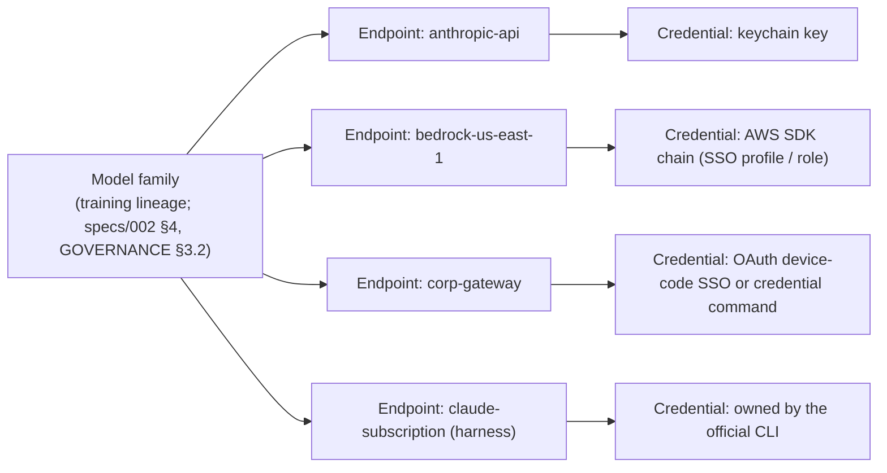

# Spec 009: Model Access Paths, Endpoints & Authentication

## 1. Scope & Objectives
How Delphi reaches a model and proves it is allowed to. Decision **D-19**: every setup below is required in v1, and direct API keys are treated as the *least* common configuration, not the default.

1. **Access paths:** direct API, cloud platform (AWS Bedrock, Google Vertex AI), enterprise gateway, and subscription CLI (harness).
2. **Endpoints:** named, configured ways of reaching a model family, each with its own credential source and capabilities.
3. **Credential sources:** delegated wherever possible, so Delphi rarely holds a secret at all.
4. **Capability probing, endpoint selection and failover,** including data-residency pinning.
5. **Harness mode** for subscription users, and the security conditions it runs under.

### 1.1 Non-Goals
- Dialect compilation and signature handling (`specs/002`). This spec decides *where* a request goes and *how it authenticates*. 002 decides *what* is sent.
- Running a local model server.

### 1.2 Simpler Alternative Considered
- **Alternative A: API keys only.** Rejected by the operator. Most real setups are cloud platforms, corporate gateways with SSO, or subscriptions.
- **Alternative B: route everything through one proxy** (for example LiteLLM in OpenAI format). Rejected as the *only* path: translating to a lowest-common-denominator format drops reasoning signatures and explicit prompt caching (`[H-003]`, `specs/002` §1.1) and adds a server to run. Kept as one supported option (§3.3 compat mode).

---

## 2. Model: Family → Endpoint → Credential



- A **model family** is reached through one or more **endpoints**. Diversity rules (`[H-001]`) count families, never endpoints: Claude through Bedrock and through Anthropic's API is one family.
- Routing (`specs/002` §4) chooses a *model* by fit. This spec then chooses the *endpoint* for that model by policy (§5).

---

## 3. Access Paths

| Path | Examples | Transport & dialect | Fidelity | Credential sources (§4) |
| :--- | :--- | :--- | :--- | :--- |
| **Direct API** | Anthropic API, Google AI (Gemini API) | Native HTTPS, native dialect | Full | keychain, env |
| **Cloud platform** | AWS Bedrock (Claude and other families), Google Vertex AI (Gemini, Claude) | Platform SDK/HTTPS; native model dialect inside the platform envelope | Full, subject to what the platform supports (probed, §6) | AWS SDK default chain (SSO profiles, assumed roles, instance/IRSA roles); Google ADC (gcloud user login, service account, workload identity) |
| **Enterprise gateway, native passthrough** | Corporate LLM gateways and proxies that forward Anthropic- or Gemini-format requests unchanged | HTTPS to a custom `base_url` plus custom headers; native dialect | Full, if the probe confirms passthrough | static header (keychain), OAuth2 (device-code SSO or client credentials), credential command |
| **Enterprise gateway, compat** | Gateways exposing only an OpenAI-compatible API | HTTPS, OpenAI-compatible dialect (`specs/002` compat pass) | **Degraded:** tool use works; reasoning signatures don't carry across turns and explicit cache breakpoints may be ignored. Shown in the agents pane. | same as above |
| **Subscription CLI (harness)** | `claude`, `gemini` and `codex` CLIs signed in to the operator's subscription | Subprocess, the CLI's own protocol (stream-JSON) | **Delegated:** the CLI owns its prompt, caching and model calls (§7) | owned by the CLI; Delphi never sees it |

### 3.1 v1 support matrix
| Family (v1) | Direct API | Bedrock | Vertex | Gateway (native) | Gateway (compat) | Harness |
| :--- | :---: | :---: | :---: | :---: | :---: | :---: |
| Claude | ✅ | ✅ | ✅ | ✅ | ✅ | ✅ `claude` |
| Gemini | ✅ | — | ✅ | ✅ | ✅ | ✅ `gemini` |
| OpenAI (GPT/Codex) | — (deferred) | — | — | — | ✅ | ✅ `codex` |

Bringing the OpenAI family in through compat and harness pulls the OpenAI-compatible dialect pass into v1. The direct OpenAI API driver stays deferred (D-06).

---

## 4. Credential Sources

| `credential` | What Delphi stores | Notes |
| :--- | :--- | :--- |
| `keychain:<name>` | A static key or header value in macOS Keychain / Linux Secret Service | Static API keys and gateway tokens |
| `env:<VAR>` | Nothing | Read at call time |
| `aws:<profile>` | Nothing | AWS SDK default credential chain: SSO (`aws sso login`), assumed roles, instance or IRSA roles. Refresh is handled by the SDK. |
| `gcloud-adc` / `gcloud-sa:<path-or-keychain>` | Nothing (ADC), or a keychain reference | Google Application Default Credentials, user login or workload identity |
| `oauth2:<provider>` | The refresh token, in the keychain only | Device-code flow for SSO (`delphi auth login <endpoint>` prints a URL and code), or client credentials for service use. Access tokens live only in memory and are refreshed before expiry. |
| `command:<argv>` | Nothing | Exec credential helper (like git or kubectl helpers). It prints `{"token": "...", "expires_at": "..."}`. It is how corporate SSO tooling plugs in without Delphi implementing every IdP. |
| `harness-login` | Nothing | The official CLI authenticates itself (`claude login`, and so on). |

**Credential invariants:**
1. Delphi **never writes a credential to any file**: not `config.toml`, not logs, not `events.jsonl`. The only exceptions are keychain entries it created. The event redactor (`specs/005` §2.3) masks `Authorization` headers, bearer tokens and helper output.
2. Delphi **never reads, copies or reuses another tool's stored credentials** (CLI session files, browser cookies, SDK caches), and never sends a subscription's credentials to anything except that subscription's official CLI.
3. Credentials are resolved by the daemon at call time and never enter an agent's context, tool results or `HandoffEnvelope`.
4. **Expiry mid-task:** the call pauses, and the console shows `re-authenticate <endpoint>` (for example after an SSO session expires). It never silently fails over to an endpoint the policy disallows (§5).

---

## 5. Endpoint Configuration, Selection & Failover

```toml
[[endpoints]]
id = "bedrock-us"
family = "claude"
path = "cloud"                    # api | cloud | gateway-native | gateway-compat | harness
platform = "bedrock"
region = "us-east-1"
credential = "aws:work-sso"
models = { workhorse = "<bedrock model id>", frontier = "<bedrock model id>" }

[[endpoints]]
id = "corp-gateway"
family = "claude"
path = "gateway-native"
base_url = "https://llm-gateway.example.internal/anthropic"
credential = "oauth2:corp-okta"
headers = { "X-Cost-Center" = "eng-123" }

[[endpoints]]
id = "claude-sub"
family = "claude"
path = "harness"
harness = "claude"
credential = "harness-login"
cost_model = "subscription"      # budget in tokens/turns, not dollars (§8)

[access]
order = { claude = ["corp-gateway", "bedrock-us", "claude-sub"], gemini = ["vertex-eu"] }
allowed_endpoints = ["corp-gateway", "bedrock-us", "vertex-eu", "claude-sub"]   # compliance pin: nothing else, ever
```

- **Selection:** for the chosen model, the daemon uses the first healthy endpoint in `access.order` that serves the needed tier and features (§6).
- **Failover:** only to the next endpoint in that same ordered list, and only among `allowed_endpoints`. This is how data residency and approved vendors are enforced, and it holds even when every allowed endpoint is down: the task then waits or escalates rather than leaving the allowed set.
- **Signatures across endpoints:** a switch to a different endpoint, even for the same family, is treated as foreign for reasoning-signature purposes (`specs/002` §3.1). Probing (§6) may relax this per endpoint pair.
- **Per-role overrides** (for example keeping Red-Team on a different endpoint for cost) are allowed. Family diversity rules still apply.

---

## 6. Capability Probing
`delphi endpoints test [id]` (also run by `doctor` and at `init`) sends minimal requests to each endpoint and records into `context/model-capabilities.md`'s machine-readable table, per endpoint × model:
- authentication OK (and expiry, where known);
- tool calling;
- extended thinking or reasoning, and whether signatures round-trip;
- explicit prompt caching (whether cache-read tokens are reported);
- effective context limit and output limit;
- whether usage is reported (token counts), required for exact ledger accounting;
- for gateways: native passthrough vs compat, detected rather than assumed.

Routing uses probed features, not vendor assumptions. A probe that fails marks the endpoint `unhealthy` until the next successful probe.

---

## 7. Harness Mode (Subscription CLIs)

The harness path exists so operators can use subscriptions they already pay for. It is **delegated execution**: the CLI runs its own agent loop. That trades away some of Delphi's controls, so it runs under these conditions:

1. **Official binary only, operator-owned:** Delphi launches the operator's installed `claude`, `gemini` or `codex` binary as the operator's own process. It never extracts tokens or calls subscription backends directly (§4, invariant 2). Each provider's terms govern automated use of a subscription; `doctor` shows a one-time notice pointing the operator to them.
2. **Sandboxed:** the harness process always runs inside the OS sandbox (D-04), with network allowed **only** to its provider's hosts and writes allowed only to its worktree. If no sandbox is available, harness mode is unavailable for code-writing tasks.
3. **Permission bridge, or tools off:**
   - Where the CLI supports delegating permission prompts (for example a permission-prompt tool via Delphi's local MCP server), every tool request goes through Delphi's approval broker and tier rules.
   - Where it doesn't, the harness is launched in its most restrictive tool mode, and file changes are accepted only as a worktree diff that Delphi reviews at Amber tier.
   - The per-CLI bridge capability is probed (§6) and shown in the console.
4. **Governance still leads:** Delphi passes governance, the role manifest, the persona slot and the `HandoffEnvelope` through the CLI's system-prompt mechanism (`specs/002` §2 order). The CLI's own built-in instructions sit outside Delphi's control. This is a documented deviation from `[REV-ARCH-02]`, accepted only on this path.
5. **Taint:** a harness span inherits its parent's taint. Spans at L1 or lower may not dispatch to a harness at all, because Delphi can't gate the tools inside it. Harness output is stamped `internal_generated` (L3) at most.
6. **Usage:** read from the CLI's reported usage when its output provides it (`usage_source = reported`); otherwise estimated from bytes and marked `estimated` (§8).
7. **Councils:** a harness may hold a Council seat. The Round 1 barrier still holds, because Delphi controls what each seat receives.

---

## 8. Usage Ledger & Budget Additions
`usage_ledger` (`specs/005` §2.4) gains these columns: `endpoint_id`, `access_path`, `usage_source` (`reported` | `estimated`), and `cost_model` (`metered` | `subscription`).
- Metered endpoints price calls from the config price table, with optional per-endpoint price overrides (negotiated gateway rates).
- Subscription endpoints record tokens with `cost_usd = 0` and are budgeted with `subscription_budget_tokens` per mission, so runaway loops are still capped.
- The agents pane shows `est.` beside estimated figures, and labels compat or harness endpoints with a fidelity badge.

---

## 9. Phase Mapping (roadmap)
| Step | Delivers |
| :--- | :--- |
| **2** | Endpoint config and selection; credential sources `keychain`, `env`, `aws`, `gcloud-adc`, `command`, `oauth2` (device-code); direct, cloud and native-gateway paths for Claude; probing; ledger columns; `delphi auth login`. |
| **3** | Gemini on direct API and Vertex; compat gateway pass (OpenAI-compatible dialect); harness mode for `claude`, `gemini`, `codex` (requires the Step 3 sandbox). |
| **Later** | Direct OpenAI API driver; additional platforms (for example Azure) as endpoint types. |

---

## 10. Verification Plan
1. **No-Secret-On-Disk Test:** run init and a mission with every credential type, then scan `$DELPHI_HOME`, logs and `events.jsonl` for token material. Zero hits, apart from keychain entries.
2. **Residency Pin Test:** with `allowed_endpoints = ["vertex-eu"]` and that endpoint returning `503`, no request reaches any other endpoint and the task escalates.
3. **SSO Expiry Test:** an `oauth2` access token expires mid-task. The call pauses with a re-authenticate prompt, then resumes after `delphi auth login` without losing the turn.
4. **Credential Helper Test:** a `command:` helper returning a token with a 60-second expiry is re-invoked before expiry, and its stdout never appears in any log.
5. **Gateway Detection Test:** against a mock gateway that strips thinking blocks, the probe classifies it `gateway-compat`, the pane shows the degraded badge, and signature round-trips are not attempted.
6. **Family-Not-Endpoint Test:** Claude through Bedrock plus Claude through Anthropic's API counts as one family for Council diversity.
7. **Harness Containment Test:** a harness task attempting network access to a non-provider host, or a write outside its worktree, is blocked by the sandbox. Without a permission bridge, file changes arrive only as an Amber-reviewed diff.
8. **Harness Taint Test:** a span tainted L1 attempting to dispatch to a harness endpoint is refused with a Red-tier prompt.
9. **Subscription Budget Test:** a harness loop exceeding `subscription_budget_tokens` halts and escalates, with ledger rows marked `subscription` and `usage_source` set correctly.
