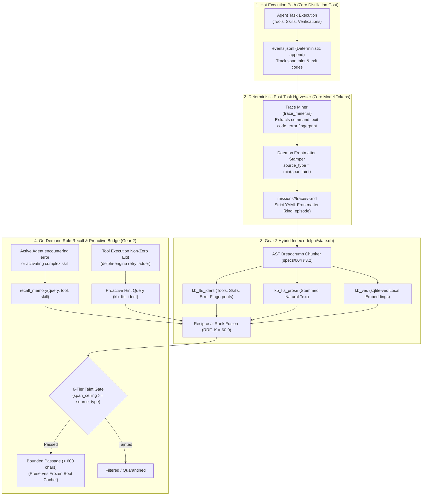

# Spec 065: Agent Episodic Memory, Trace Distillation, and Tool-Conditioned Retrieval

**Status.** Approved by the operator on 2026-11-01 following an adversarial council deliberation between `architect`, `red-team`, `strategist`, and `orchestrator`. Builds upon [`specs/004`](004-memory-and-coaching.md) (Dual-Tier Memory), [`specs/030`](030-console-sessions-and-conversation-context.md) (Sessions), [`specs/031`](031-layered-learning-and-training-mode.md) (Layered Learning), [`specs/050`](050-memory-lifecycle-types-supersession-and-trace-mining.md) (Memory Lifecycle & Trace Mining), and [`specs/064`](064-knowledge-retrieval-for-agents-and-mcp.md) (Knowledge Retrieval Service).

---

## 1. Scope & Objectives

This specification defines Delphi's **Long-Term Episodic and Tool-Conditioned Memory Subsystem**:
1. **The Core Objective:** Enable specialized agents (e.g. `builder`, `investigator`, `architect`) to accumulate persistent episodic memory across sessions and missions—recalling past tool usage patterns, compiler/environment resolutions, debugging bisects, and research discoveries—without suffering from prompt-cache churn, token bloat, taint laundering, or cognitive rutting.
2. **Dual-Tier Boundary Preservation:** Guarantee that the **Frozen Boot Snapshot** ([`specs/004`](004-memory-and-coaching.md) §2.1) remains 100% static and pinned in the model provider's KV cache. Episodic memory operates strictly in **Gear 2 (Archival SQLite Hybrid RAG)** and is accessed **on-demand**.
3. **Deterministic Zero-Token Ingestion:** Eliminate raw transcript bloat and negative token ROI by extracting structured, bounded Markdown episode records (`missions/<id>/traces/<role>-<task>.md`) with daemon-enforced frontmatter directly from execution event streams (`events.jsonl`) at **zero model token cost**.
4. **Tool- and Skill-Conditioned Hybrid Retrieval:** Index episodes into `.delphi/state.db` under `zone: episodes` using Delphi's dual FTS5 tokenizers (`kb_fts_ident` for exact tools, error codes, and symbols; `kb_fts_prose` for stemmed natural language), local `sqlite-vec` embeddings, and reciprocal rank fusion.
5. **Defensive Safeguards:** Enforce the 6-tier taint lattice (`[H-004]`) with immutable daemon taint stamping, symmetric negative-example retrieval (anti-rutting), proactive retry-ladder bridge hints, and deterministic supersession/expiry (`specs/050` ML-2/ML-3).

### 1.1 Simpler Alternatives Considered & Rejected
* **Alternative 1 (Boot-Prefix Injection of Recent Sessions):** Injecting the last 5 session digests or past role turns into the task handoff prefix.  
  *Why Rejected:* Destroys provider KV prompt cache hit rate ($95\% \to 0\%$), drastically inflates token costs, and consumes the task context window before code or specs are even read.
* **Alternative 2 (Unconstrained Raw Transcript Vectorization):** Embedding raw JSON-RPC event logs into an external vector store (e.g. Chroma/Qdrant).  
  *Why Rejected:* Violates Delphi's zero-external-server invariant; raw compiler dumps and git diffs dilute semantic vector embeddings; exact tokens (`[H-004]`, `EMFILE`, `rusqlite::Error`) are lost in dense vector noise; introduces massive write amplification and SQLite lock contention.

---

## 2. Architectural Blueprint & Memory Lifecycle



---

## 3. Data Model: The `Episode` Record

Episodic traces are authored as standalone Markdown files under `missions/<mission-id>/traces/` and indexed in `state.db` under `zone: episodes`.

### 3.1 YAML Frontmatter Schema (`schemas/episode.schema.json`)
```yaml
---
id: ep-2026-11-01-builder-cargo-deadlock-t0198
title: "Builder: Resolving Cargo Lock Contention in Concurrent Worktrees"
author: builder
role: builder
timestamp: 2026-11-01T14:22:00Z
kind: episode
source_type: internal_empirical
confidence: high
status: active
valid_until: null

# Execution Provenance
mission: 2026-11-01-core-engine-refactor
session_id: s_0042
task_id: t_0198

# Telemetry Facets (Tokenized into kb_fts_ident)
skills_used: [tdd-execution, worktree-isolation]
tools_invoked: [shell-worktree-scoped, test-runner]
outcome: resolved_after_failure   # success | failure | resolved_after_failure | rejected_gate
error_fingerprints: ["Blocking waiting for file lock on package cache", "exit code 101"]
target_files: ["Cargo.lock", "crates/delphi-engine/Cargo.toml"]

# Memory Lifecycle (Spec 050)
supersedes: []
tags: [cargo, flock, concurrency, worktrees, deadlocks]
---
```

### 3.2 Structured Markdown Sections
To maximize AST breadcrumb precision ([`specs/004`](004-memory-and-coaching.md) §3.2), each episode body follows a rigid three-part structure capped at **3,000 characters (~500 tokens)**:

```markdown
# Episode: Resolving Cargo Lock Contention in Concurrent Worktrees

## Context & Obstacle
When running parallel integration tests across two git worktrees (`@worktree/task-1` and `@worktree/task-2`), the second test run blocked indefinitely waiting for the cargo package cache lock.

## Tool & Execution Signature
- Tool: `shell-worktree-scoped`
- Failed Command: `cargo test -p delphi-engine --locked`
- Observed Failure: Process hung on shared `~/.cargo/.package-cache` lock file with exit timeout after 60s.

## Resolution & Pattern
Set `CARGO_TARGET_DIR` to a path inside the isolated worktree (`@worktree/target`) and pass `--offline` after initial workspace warming. Tests completed concurrently without lock contention.
```

---

## 4. Ingestion Engine & Taint Governance

### 4.1 Deterministic Trace Miner (Default, 0 Model Tokens)
A daemon post-task hook in `delphi-engine` reads `events.jsonl` upon task completion:
1. **Harvest Significance Filter:** An episode is generated only if the task meets at least one significance condition:
   * A tool returned a non-zero exit code or error event before eventual success (`resolved_after_failure`).
   * A verification gate failed (Gate 1 test failure or Gate 4 `REVIEW.md` P0/P1).
   * An operator approval card was denied.
   * Explicit task completion with $>3$ tool calls.
   * Trivial informational turns (e.g. `delphi help`, quick status queries) are **discarded**.
2. **Quota Bounds & Anti-Flapping:**
   * **Max 1 episode per task.**
   * **Max 3 episodes per mission.**
   * Deduplication key: `blake3(role + tool + error_fingerprint)`. Flapping loops hitting the same error repeatedly emit exactly **one** episode.
3. **Daemon Taint Stamping (SEC-01 / SEC-02 Invariant):**
   * The YAML frontmatter is **stamped directly by the Rust daemon**, never by an LLM.
   * The daemon computes `source_type = min(span.taint)` across the task's execution span.
   * If any tool call read `external_untrusted` or `federated_peer` content, the episode's `source_type` is permanently fixed to `external_untrusted`.
4. **Body Assembly:** Extracted command strings, exit codes, error fingerprints, and touched files are fenced and escaped.

---

## 5. Storage & Hybrid Search Engine Integration

Episodic memory integrates seamlessly into [`crates/delphi-engine/src/kb.rs`](../crates/delphi-engine/src/kb.rs) and the unified retrieval service ([`specs/064`](064-knowledge-retrieval-for-agents-and-mcp.md) §3).

### 5.1 Schema Invariants in `state.db`
1. **Zone Definition:** Episodes reside in `zone: episodes`.
2. **FTS5 Identifiers Table (`kb_fts_ident`):**
   * Indexed tokens include: `role:<role>`, `tool:<tool_name>`, `skill:<skill_name>`, `outcome:<status>`, plus every extracted `error_fingerprint` and file path.
   * Tokenizer: `unicode61 tokenchars '_-.:/@#'` preserves exact identifier boundaries.
3. **FTS5 Prose Table (`kb_fts_prose`):**
   * Indexes the Problem, Action, and Resolution paragraphs under standard Porter stemming.
4. **Vector Embedding (`kb_chunk_vec`):**
   * Chunks are embedded via the binary’s compiled-in `Embedder` (specs 004-A1 / 064 §3).

### 5.2 Role Visibility & Isolation
* An agent querying `recall_memory` has its search automatically constrained to:
  `WHERE (author = ? OR author = 'shared') AND zone = 'episodes'`
* Specialist roles never encounter raw cognitive residue from unrelated roles unless explicitly requested by the operator or orchestrator.

### 5.3 Proactive Retry-Ladder Bridge
When an agent's tool execution fails with a non-zero exit code during the retry ladder ([`specs/003`](003-collaboration-and-council.md) §3.2), `delphi-engine` automatically performs a fast lexical lookup in `kb_fts_ident` using the error string. If an existing episode with `outcome: resolved_after_failure` or `outcome: success` matches, Delphi automatically injects a single 300-character hint into the retry handoff without waiting for the agent to guess.

---

## 6. Defensive Safeguards & Council Findings

| Finding / Risk | Architectural Countermeasure in Spec 065 |
| :--- | :--- |
| **`SEC-01` & `SEC-02`: Taint Laundering via Synthesis** | **Immutable Daemon Rust Stamping:** Frontmatter is authored exclusively in Rust code from `events.jsonl` using `min(span.taint)`. No LLM writes or alters frontmatter. Untrusted episode content is permanently tagged `source_type: external_untrusted` and fenced. |
| **`ROI-01`: Synthesis Token Tax** | **Pure Deterministic Default (0 Tokens):** Stage 2 LLM synthesis is turned off by default. Extraction uses zero model calls. |
| **`DOS-01`: State DB Exhaustion via Loops** | **Hard Ingestion Quotas:** Max 1 episode per task, max 3 per mission, and `blake3(role + tool + error_fingerprint)` deduplication. |
| **Prompt Cache Invalidation** | **Strict Zero Boot-Prefix Mutation:** Episodic memory is 100% Gear 2 (archival). It is never loaded into `heuristics.md` or the system prompt. Boot prompt cache hit rate remains $\ge 95\%$. |
| **Cognitive Rutting / Echo Chamber** | **Symmetric Negative Precedents:** Trace miner indexes gate rejections and failed patterns (`outcome: failure`), warning agents against repeating known failure traps. |
| **`UX-01`: Idle Tool Neglect** | **Proactive Retry Bridge:** Runtime automatically injects matching resolution hints upon tool failure during retries. |

---

## 7. Accepted Risks & Minority Report

```markdown
## Accepted Risks & Minority Report (Red-Team / Dissent)

1. [`red-team` - Concur with Remediations]:
   The shift to 100% daemon-owned frontmatter stamping and pure-deterministic extraction
   resolves SEC-01 and SEC-02. However, `red-team` notes one accepted residual risk:
   - Residual Risk RT-01: An attacker who can induce a deterministic error string (e.g.
     a compiler error containing crafted text) can still populate the text of an
     `external_untrusted` episode. While the taint lattice prevents this episode from
     being returned in clean operator contexts, it remains queryable if an agent is already
     operating in untrusted mode.
   - Mitigation: Spec 065 mandates that all retrieved episode passages are injected
     as fenced, untrusted data, never as executable instructions.

2. [`strategist` - Concur with Sequencing]:
   The elimination of mandatory Stage 2 LLM distillation reduces token overhead to zero,
   resolving ROI-01. `strategist` notes:
   - Residual Risk ST-01: Implementation slice E1 should focus on deterministic harvesting
     and schema validation without blocking on external models.
```

---

## 8. Build Plan & Implementation Slices

| Slice | Focus | Deliverables |
| :-- | :-- | :-- |
| **E1** | Schema & Deterministic Trace Miner | `schemas/episode.schema.json`, deterministic event harvester (`crates/delphi-engine/src/trace_miner.rs`), daemon taint stamper, markdown generator. |
| **E2** | KB Indexing (`zone: episodes`) | Update `kb.rs` to index `missions/**/traces/*.md`, populating `kb_fts_ident` with tool/skill facets and role isolation filters. |
| **E3** | Agent Tool & Engine Wiring | Implement `recall_memory` tool in `crates/delphi-engine/src/tools.rs` calling the unified retrieval service (`specs/064`). |
| **E4** | Proactive Retry Bridge & Retro Supersession | Implement proactive error matching on retry ladder; connect `/retro` to mark `supersedes` on outdated episodes. |
