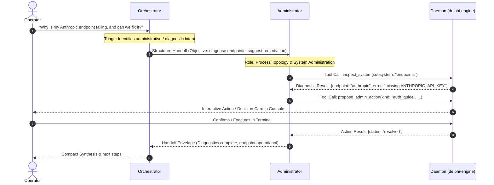
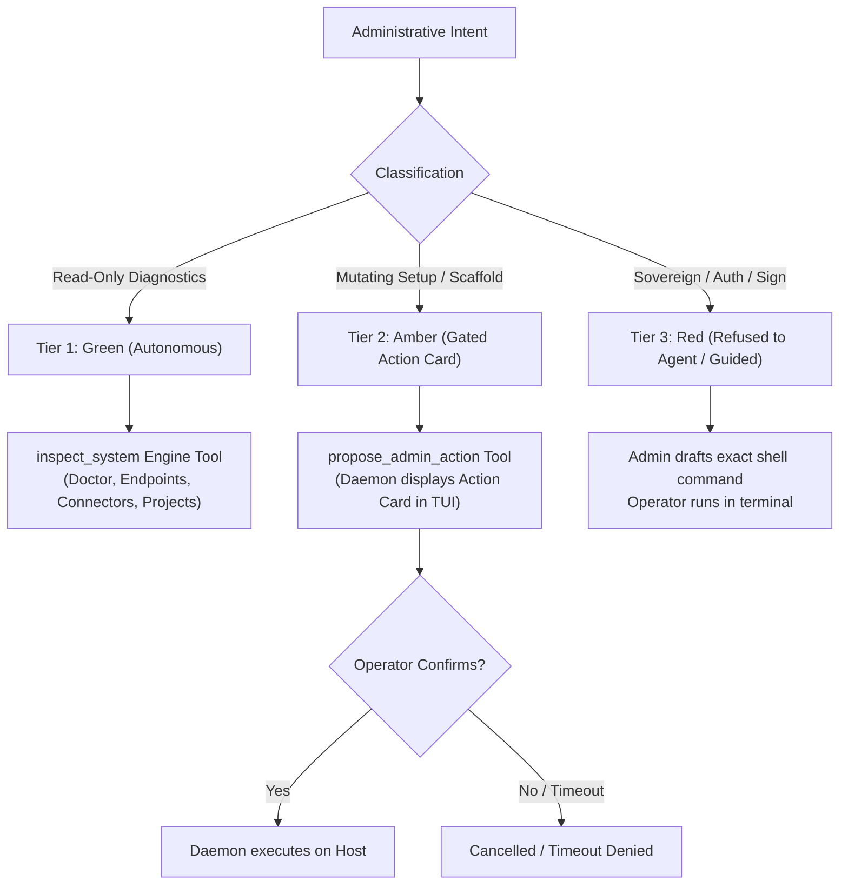

# Spec 069: Workspace Administration, Diagnostic Inspection, and Governed Operator Assistance

> **Status: Approved by the operator on 2026-11-02.** Ratified unanimously with amendments by Council 014 (`architect`, `administrator`, `orchestrator`, `red-team`, `strategist`) on 2026-11-02. Builds on [`specs/001`](001-governance-and-manifests.md) (Governance), [`specs/003`](003-collaboration-and-council.md) (Collaboration), [`specs/010`](010-connectors-and-tool-access.md) (Connectors), [`specs/015`](015-provisional-decisions.md) (Decision Cards), [`specs/020`](020-harness-tool-bridge.md) (Tool Bridges), [`specs/054`](054-first-minute.md) (First Minute & Setup), [`specs/058`](058-project-scopes-scaffolding-and-promotion.md) (Project Scopes), and [`specs/067`](067-fleet-expansion-administrator-assistant-advocate.md) (Administrator Role).

---

## 1. Problem & Intent

Operators conversing with Delphi in the console or via external MCP hosts frequently need assistance with workspace administration, including:
1. **Initial setup & onboarding:** configuring model endpoints, detecting CLI tools, wiring OAuth, and setting up workspace directories.
2. **Environment diagnostics:** investigating why a model endpoint timed out, why a connector is unpinned, or why a build gate failed.
3. **Project topology & scaffolding:** registering directory scopes (`delphi project register`), scaffolding project structures (`delphi project init`), and refreshing indexes (`delphi project index --refresh`).
4. **Bundle & skill management:** auditing installed bundles, checking compatibility, and mapping connector permissions.

Currently, an operator must leave the conversational console or host, switch to a raw shell, recall specific CLI subcommands and flags (`delphi endpoints test`, `delphi project list`, `delphi connectors status`), and diagnose issues manually.

The operator's natural desire is for Delphi to handle setup and operations conversationally. However, granting the lead `orchestrator` raw execution privilege over the Delphi CLI violates core governance invariants:
- **Role Creep (`FM-1.2`):** Orchestrator is chartered strictly for complexity triage, dynamic model scaling, council moderation, and coaching ([`agents/orchestrator/AGENT.md`](../agents/orchestrator/AGENT.md)). Making it a general sysadmin/shell-runner degrades its core focus.
- **Sovereignty & Self-Approval Breach ([`GOVERNANCE.md`](../GOVERNANCE.md) §1 & §5):** The Delphi CLI contains sovereign operator actions (`delphi decisions ratify`, `delphi bundle trust`, `delphi validation latch raise`, `delphi claims validate`). If an agent can execute arbitrary CLI commands, it can self-ratify proposals and dissolve all security gates.
- **Prompt Injection Vulnerability ([`[H-004]`](../GOVERNANCE.md) §4.3):** Orchestrator ingests untrusted project files and web research. Direct shell execution of CLI commands risks host privilege escalation or configuration tampering.

This specification designs a **governed 3-tier assistance architecture** that delivers full conversational setup and operations while enforcing strict role specialization by empowering the **`administrator`** role.

---

## 2. Invariants & Governance Boundaries

1. **The Monotonic Authority Invariant ([`specs/001`](001-governance-and-manifests.md) §2.3):** No tool or role may widen an agent's authority outside sandboxed limits. Agent seats cannot execute commands that elevate their own trust or mutate the host environment without human consent.
2. **Strict Refusal of Sovereign Actions Inside Agent Seats:** Subcommands that record human ratification (`decisions ratify`, `validation latch raise`, `bundle trust`, `claims validate`, `claims confirm`) or cryptographic/identity proofs (`auth login`, `bundle sign`, `relay totp-*`) remain hard-coded to refuse execution inside any agent seat.
3. **[RED-01] Path Containment Invariant:** All target paths passed to mutating tools (`propose_admin_action`) must be strictly checked by `pathguard` (`canonicalize`). Paths attempting directory traversal or pointing outside `$DELPHI_HOME` and registered project roots are refused by the daemon before any Action Card is presented.
4. **[RED-02] Taint Gate Enforcement ([`[H-004]`](../GOVERNANCE.md) §4.3):** Any span with taint $\le L_1$ (`external_untrusted`, `federated_peer`) is prohibited from invoking `propose_admin_action`. The daemon rejects the call with `untrusted_context_mutation_denied`.
5. **[RED-03] Visual Disambiguation & ANSI/Bidi Sanitization:** All text rendered inside an Action Card (title, summary, command, blast radius) is stripped of ANSI escape sequences, control characters, and Unicode bidi overrides (`crates/delphi-core/src/terminal.rs`). The operator always sees the exact bytes to be executed.
6. **[RED-04] Non-Composition Invariant:** An Action Card may never target credentials under `.delphi/auth/`, security deny hooks under `[hooks]`, or governance foundations (`GOVERNANCE.md`, `REVIEW.md`, `context/heuristics.md`). These require Tier 3 consultative guidance and manual operator action.
7. **[ADM-01] Action Batching & Anti-Spam:** Compound administrative workflows (e.g. `delphi project init` followed by `delphi project index --refresh`) must be batched into a single unified plan card. A task may emit at most one active Administrative Action Card per turn.
8. **Enforcement in Code, Not Prose ([`GOVERNANCE.md`](../GOVERNANCE.md) §5.6):** Safety boundaries are enforced deterministically by the daemon (`delphi-engine`), never by prompt instructions alone.

---

## 3. Division of Responsibilities: Orchestrator vs. Administrator

To prevent the **Role Creep (`FM-1.2`)** failure mode, operational duties are cleanly partitioned between `orchestrator` and `administrator`:



### 3.1 The Role of Orchestrator
- **Conversational Front Door & Intent Triage:** Orchestrator receives the operator's operational intent in the console.
- **Fast Diagnostic Triage:** Orchestrator has direct read-only access to `inspect_system` to inspect endpoint availability prior to dispatching tasks.
- **Routing & Delegation:** For all multi-step diagnostic investigations, project scaffolding, and configuration changes, Orchestrator delegates to `administrator` via structured handoffs (`specs/003`).
- **Synthesis:** Compacts the findings from Administrator and presents the high-level summary to the operator.

### 3.2 The Expanded Scope of Administrator
In [`specs/067`](067-fleet-expansion-administrator-assistant-advocate.md), Administrator is defined as the master of process topology, dependency sequencing, and delivery frameworks. This spec establishes Administrator as the **Workspace Topology & System Administrator**:
- Audits and maintains workspace health (`delphi doctor`).
- Diagnoses model endpoints, providers, and token budgets (`delphi endpoints`, `delphi models`).
- Manages connector statuses and tool availability (`delphi connectors`, `delphi capabilities`).
- Manages project directory scopes, scaffolding, and indexes (`delphi project *`).
- Structures clean, batched **Administrative Action Cards** for the operator.

---

## 4. The 3-Tier Governed Assistance Model

Operations are divided into three strictly governed tiers:



### 4.1 Tier 1: Read-Only System Diagnostics (Autonomous / Green)
Available to `administrator` and `orchestrator`:
- **Covered operations:** `delphi doctor --check`, `delphi endpoints test`, `delphi connectors status`, `delphi project list`, `delphi project scope`, `delphi bundle list`, `delphi capabilities`.
- **Execution:** Runs in-process inside `delphi-engine` by querying existing daemon state or read-only probes. Has zero filesystem or process side effects.
- **Output:** Structured JSON schema describing subsystem health, latency, missing dependencies, or unconfigured keys.

### 4.2 Tier 2: Mutating Operations via Governed Action Cards (Amber / Gated)
Exclusive to `administrator`:
- **Covered operations:** `delphi project init`, `delphi project index --refresh`, `delphi connectors pin <name>`, `delphi bundle add <path>`, `delphi setup` (scaffolding non-secret defaults).
- **Execution Mechanism:**
  1. `administrator` calls the engine tool `propose_admin_action`.
  2. The daemon validates `pathguard` containment ([RED-01]) and checks that caller taint $\ge L_2$ ([RED-02]).
  3. The daemon generates a high-visibility **Administrative Action Card** in the console UI with sanitized text ([RED-03]).
  4. The card details: Target command, affected directory, risk assessment, and blast radius.
  5. The operator approves with a single keypress (`[Enter]` / `[Y]`) or denies (`[Esc]` / `[N]`).
  6. If unattended for 5 minutes, the card automatically defaults to **denied** ([OD-01]).
  7. Upon operator approval, the daemon executes the bounded operation on the host.

### 4.3 Tier 3: Sovereign, Cryptographic & Interactive Actions (Red / Consultative Only)
Covers actions that require human sovereignty, interactive TTY authentication, or local cryptographic keys:
- **Covered operations:** `delphi auth login`, `delphi bundle sign`, `delphi decisions ratify`, `delphi validation latch raise`, `delphi relay totp-enroll`.
- **Invariant:** Strictly refused inside any agent seat. The daemon will return an immediate error if an agent attempts invocation.
- **Assistance Pattern:** Administrator acts as an interactive setup coach:
  - Explains the exact requirement (e.g. why an OAuth token or TOTP enrollment is needed).
  - Emits the exact terminal command formatted in a copy-pasteable code block.
  - Monitors subsystem state via Tier 1 tools until the condition is cleared.

---

## 5. Engine Tool Definitions & Schemas

### 5.1 `inspect_system` (Tier 1: Read-Only Diagnostic)
Registered in `crates/delphi-engine/src/tools.rs`:

```json
{
  "name": "inspect_system",
  "description": "Inspect Delphi system health, model endpoints, connectors, project scopes, or bundles. Read-only and side-effect free. Administrator and Orchestrator only.",
  "parameters": {
    "type": "object",
    "required": ["subsystem"],
    "properties": {
      "subsystem": {
        "type": "string",
        "enum": ["doctor", "endpoints", "connectors", "projects", "bundles", "capabilities"],
        "description": "The subsystem to inspect."
      },
      "target": {
        "type": "string",
        "description": "Optional specific target (e.g. endpoint name, project path, or connector name)."
      }
    },
    "additionalProperties": false
  }
}
```

### 5.2 `propose_admin_action` (Tier 2: Gated Operational Proposal)
Registered in `crates/delphi-engine/src/tools.rs`:

```json
{
  "name": "propose_admin_action",
  "description": "Propose an administrative action that modifies workspace configuration, project scaffolding, or connectors. Emits an Action Card for synchronous operator approval. Administrator only.",
  "parameters": {
    "type": "object",
    "required": ["action_type", "title", "summary", "command", "blast_radius"],
    "properties": {
      "action_type": {
        "type": "string",
        "enum": ["project_init", "project_index", "connector_pin", "bundle_add", "setup_scaffold"]
      },
      "title": { "type": "string", "maxLength": 100 },
      "summary": { "type": "string", "maxLength": 400 },
      "command": { "type": "string", "description": "The exact delphi command to execute upon approval." },
      "blast_radius": {
        "type": "array",
        "items": { "type": "string" },
        "description": "Files, directories, or config sections modified by this action."
      }
    },
    "additionalProperties": false
  }
}
```

---

## 6. Console UX & Action Card Workflow

When `propose_admin_action` is invoked, the daemon suspends the agent's turn and renders an **Administrative Action Card** in the active console deck (Ink TUI):

```
┌─ Administrative Action Required ──────────────────────────────────────────┐
│                                                                           │
│  Action:   Initialize Project Scaffolding                                 │
│  Role:     administrator                                                  │
│  Command:  delphi project init ./crates/delphi-web --yes                  │
│                                                                           │
│  Summary:  Creates missing project markers and generates _index.md for    │
│            the newly added web adapter crate. Existing files preserved.  │
│                                                                           │
│  Impact:   + crates/delphi-web/_index.md                                  │
│            + .delphi/projects.toml [entry: delphi-web]                    │
│                                                                           │
│  [Enter] Execute Action       [Esc] Deny Action      [5:00 Timeout]       │
└───────────────────────────────────────────────────────────────────────────┘
```

- If approved (`[Enter]`): Daemon invokes the CLI subcommand handler directly in the host process, captures stdout/stderr, and returns the result to `administrator` as the tool output.
- If denied (`[Esc]` or timeout): Tool result returns `{ "status": "denied", "reason": "operator declined action or timeout expired" }`.

---

## 7. Simpler Alternative Considered

Per [`GOVERNANCE.md`](../GOVERNANCE.md) §2 (Architect Charter):

1. **Alternative 1: Give Orchestrator generic shell access (`exec_command("delphi ...")`).**
   - *Why rejected:* Violates `FM-1.2` (role creep). Bypasses taint tracking. Allows prompt-injected tasks to run arbitrary commands on the operator's machine or self-ratify unverified code.
2. **Alternative 2: Add administrative tools directly to Orchestrator.**
   - *Why rejected:* Causes prompt bloat and dilutes Orchestrator's attention budget from its primary mission (complexity triage, scaling, and council arbitration).
3. **Alternative 3: Status quo (operator leaves chat and types commands in a separate terminal).**
   - *Why rejected:* Poor user experience during onboarding ("the first minute") and high friction during common project operations.

The chosen design routes intent through Orchestrator to Administrator, uses dedicated engine tools for diagnostics, and gates mutations through explicit Action Cards.

---

## 8. Implementation Slices

| Slice | Name | Scope | Dependencies |
| :--- | :--- | :--- | :--- |
| **S1** | **Diagnostic Tool Engine Wiring** | Implement `inspect_system` in `crates/delphi-engine/src/tools.rs` mapping to `doctor`, `endpoints`, `connectors`, and `project` query logic. Available to `administrator` and `orchestrator`. | None |
| **S2** | **Action Card & Proposal Wiring** | Implement `propose_admin_action` in `tools.rs` with `pathguard` containment ([RED-01]), taint check ([RED-02]), ANSI sanitization ([RED-03]), and hook into daemon approval card flow in `crates/delphi-engine/src/service.rs`. | S1 |
| **S3** | **Administrator Role & Skill Updates** | Update `agents/administrator/AGENT.md` to authorize `inspect_system` and `propose_admin_action`. Add skill `skills/workspace-administration/SKILL.md`. | S1, S2 |
| **S4** | **Orchestrator Triage & Route Integration** | Update `agents/orchestrator/AGENT.md` to authorize `inspect_system` and add guidelines for triaging administrative intents and delegating to `administrator`. | S3 |
| **S5** | **TUI Card Rendering & Docs** | Add TUI renderer for Administrative Action Cards in `ui/src/`. Update `docs/reference/` and verify clean repo lint. | S2, S3, S4 |

---

## 9. Council 014 Ratified Decisions

Council 014 deliberated on 2026-11-02 and resolved all open questions unanimously:
- **OD-1 (Timeout on Action Cards):** Ratified. If an operator does not respond to an Administrative Action Card within 5 minutes, it automatically defaults to `denied` (`GOVERNANCE.md` §5.4), logging `timeout_denied` (`specs/039`).
- **OD-2 (Tier 1 Access for Orchestrator):** Ratified. `orchestrator` is granted direct read-only access to `inspect_system` for fast triage, but `propose_admin_action` remains strictly exclusive to `administrator`.

---

## 10. Acceptance Gates

```sh
CARGO_INCREMENTAL=0 CARGO_PROFILE_DEV_DEBUG=0 cargo test --workspace --locked
cargo clippy --workspace --all-targets --locked -- -D warnings
cargo run -q --locked -p delphi -- lint --repo .
cargo test -p delphi --test docs
```
