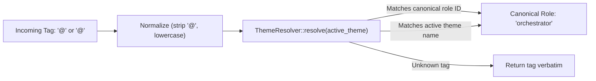

# Spec 077: Host Mention Routing, Themed Alias Resolution, and Front-Door Problem Solving

> **Status: Approved by the operator on 2026-11-04.**  
> **Extends:** [`specs/062`](062-delphi-as-host-agent-mcp-server.md) (Delphi as host agent MCP server), [`specs/071`](071-host-plugin-marketplace-and-durable-mcp-enablement.md) (Host plugin marketplace), [`specs/072`](072-host-cognitive-parity-and-external-orchestration.md) (Host cognitive parity), and [`specs/074`](074-stable-launch-path-and-delphi-connect.md) (Launch path and `delphi connect`).  
> **Complements:** [`specs/003`](003-collaboration-and-council.md) (Orchestrator escalation ladder) and [`specs/001`](001-governance-and-manifests.md) (Theme display vs role ID invariant).

---

## 1. Scope & Objectives

When developers work outside the native Delphi terminal TUI—in external harnesses such as Claude Code, Cursor, Copilot CLI, or Codex—they require a natural, cohesive conversational interface to interact with Delphi's agent team.

This specification establishes the **Inside/Outside Mention & Invocation Surface**:

1. **The Front-Door Conductor (`@delphi`):** Mentioning `@delphi` invokes the **Lead Orchestrator (`orchestrator`)** in triage and problem-solving mode. Rather than an undifferentiated general assistant, Orchestrator acts as Delphi's conductor: assessing task complexity against the escalation ladder (Levels 1–4 under `specs/003`), inspecting workspace and spec status (`specs_status`, `scaffold_status`), formulating the execution contract, and recommending or summoning the appropriate specialist agents.
2. **Dual-Key Themed Alias Resolution (`@<name>` and `@<role>`):** Enables natural addressing of any specialist by either their **themed display name** or their **canonical role ID** (e.g. `@<display_name>` and `@<role_id>` both work). Aliases resolve dynamically against the workspace's active theme (`config.toml` $\to$ `[theme] name = "..."`).
3. **MCP Alias Tolerance:** Extends Delphi's Model Context Protocol (MCP) server endpoints (`get_agent`, `spawn_agent_pack`, `prompts/get`, `query_memory`) to accept both canonical role IDs and active theme aliases interchangeably, normalizing to canonical role IDs at the boundary.
4. **Self-Discovery Affordance (`@delphi roster`):** Provides a lightweight query for operators to inspect the active workspace's name-to-role mappings, badges, and capability summaries.
5. **Summoning & Handoff Protocol:** Defines structured turn handoffs so that Orchestrator can transition execution to a specialist agent in the host chat or trigger an in-host federated Council (`specs/072` §8).
6. **Cross-Boundary Session Sync:** Preserves audit parity by logging external consultations into `missions/<active-id>/sessions.jsonl` upon task handoff.

---

## 2. Core Invariants & Security Boundaries

1. **Role IDs, Not Theme Names, in Core Logic ([`AGENTS.md`](../AGENTS.md), [`specs/001`](001-governance-and-manifests.md) §6):**
   Theme names exist solely for user-facing display and conversational parsing. The daemon, engine, event stream (`events.jsonl`), state database (`.delphi/state.db`), and security gate evaluations must operate exclusively on **canonical role IDs** (`orchestrator`, `architect`, `builder`, `red-team`, `strategist`, `investigator`, `scout`, `writer`, `messenger`). Alias resolution occurs strictly at the entry boundary.
2. **Instructions, Not System Authority ([`specs/072`](072-host-cognitive-parity-and-external-orchestration.md) §1.1):**
   Agents invoked in external hosts (such as Claude Code) possess **cognitive parity, not system authority**. They cannot approve specs, bypass merge gates, or execute unsandboxed shell commands without explicit host operator confirmation. Orchestrator must clearly remind the operator of approval checkpoints (e.g. *"I have drafted spec 078; review and ratify before implementation begins"*).
3. **Monotonic Capability Envelope (`[INV-SEC-TOOLGATE]`):**
   Mentioning an agent or resolving an alias can never widen an external harness's permissions. Tool schemas exposed to external hosts remain strictly bounded by the static `AGENT.md` manifest and fail-closed taint gates.
4. **Theme Isolation & Graceful Fallback:**
   If a workspace specifies a theme that does not exist or has unratified files, alias resolution safely falls back to canonical role IDs without throwing panics or halting MCP servers.

---

## 3. Design Specification

### 3.1 The Front-Door Dispatcher (`@delphi`)

When an operator mentions `@delphi <prompt>` in Claude Code or another host:
1. The host plugin matches `@delphi` and routes the request to the `consult_orchestrator` MCP tool.
2. Delphi’s MCP server responds with the **Lead Orchestrator (`orchestrator`)**:
   - Evaluates the prompt's ambiguity and blast radius against the 4-tier complexity ladder ([`specs/003`](003-collaboration-and-council.md) §2):
     - **Level 1 (Direct Hunt):** Single specialist lookup (`investigator` / `scout`).
     - **Level 2 (Scoped Pipeline):** Linear 2-node chain (`architect` $\to$ `builder` $\to$ `red-team`).
     - **Level 3 (Spec-First DAG):** Multi-seat specification and TDD build.
     - **Level 4 (Council Mode):** 3-round sparse adversarial debate.
   - Outputs the canonical attribution signature: `⟦•─•⟧ <display_name> (orchestrator) via delphi`.
   - Emits structured next-step summoning directives (e.g., `Summon: @<architect_tag> to draft spec`, `Summon: @<red_team_tag> to audit security risks`).

### 3.2 Dual-Key Themed Alias Resolution

Delphi's core already implements alias mapping in `crates/delphi/src/chat.rs`:
```rust
pub fn resolve_role(names: &HashMap<String, String>, tag: &str) -> String
```
Under this specification, alias resolution is extracted to `crates/delphi-core/src/theme_names.rs` so both the CLI chat interface and the engine MCP server share identical logic:



#### Mapping Table:

| Mention Tag | Active Themed Alias Tag | Canonical Role ID | Primary Cognitive Specialization |
| :--- | :--- | :--- | :--- |
| `@delphi` | `@<orchestrator_alias>` | `orchestrator` | Problem triage, complexity escalation & summoning |
| `@<name>` / `@orchestrator` | `@<orchestrator_alias>` | `orchestrator` | Task decomposition, roadmap, coaching & council moderation |
| `@<name>` / `@architect` | `@<architect_alias>` | `architect` | Specification authoring, API contracts, boundary design |
| `@<name>` / `@red-team` | `@<red_team_alias>` | `red-team` | Adversarial audit, threat modeling, P0/P1 defect hunting |
| `@<name>` / `@builder` | `@<builder_alias>` | `builder` | Spec-driven TDD, isolated worktree coding, refactoring |
| `@<name>` / `@strategist` | `@<strategist_alias>` | `strategist` | Scope auditing, ROI checks, anti-gold-plating, alignment |
| `@<name>` / `@investigator` | `@<investigator_alias>` | `investigator` | Deep code investigation, bug triage, diagnostic traces |
| `@<name>` / `@scout` | `@<scout_alias>` | `scout` | Sourced web research, external documentation discovery |
| `@<name>` / `@writer` | `@<writer_alias>` | `writer` | Technical documentation, architecture reports, release notes |
| `@<name>` / `@messenger` | `@<messenger_alias>` | `messenger` | Ecosystem integration, CLI bridges, notifications |

### 3.3 Engine MCP Enhancements (`mcp_host.rs` & `mcp_packs.rs`)

1. **`resolve_role` at MCP Entry:**
   In `crates/delphi-engine/src/mcp_host.rs`, every tool accepting a `role` parameter (`get_agent`, `query_memory`, `spawn_agent_pack`) and every prompt in `prompts/get` resolves the argument through `ThemeResolver::resolve`:
   ```rust
   let canonical_role = self.resolve_role(&requested_tag);
   ```
2. **`list_roles` Extension:**
   The `list_roles` tool output schema is extended with theme metadata:
   ```json
   {
     "id": "orchestrator",
     "name": "<Display-Name>",
     "title": "Lead Orchestrator, Coach, Council Arbiter & Model Scaler",
     "badge": "⟦•─•⟧",
     "aliases": ["@<display_name>", "@orchestrator", "@delphi"],
     "purpose": "Problem triage, decomposition, and specialist coordination."
   }
   ```
3. **`delphi_roster` Discovery Tool:**
   Expose a lightweight, operator-facing markdown summary tool `delphi_roster` (invoked via `@delphi roster` or `@delphi help`) returning the active table of agents, badges, and duties.

### 3.4 Host Integration: Claude Code Plugin & Project Directives

#### 3.4.1 Skill Definition (`ecosystem/claude-code/delphi/skills/delphi/SKILL.md`)
The Claude Code plugin skill frontmatter captures all role mentions:

```yaml
---
name: delphi
description: Triggers whenever the user mentions @delphi or a Delphi specialist role (@orchestrator, @architect, @red-team, @builder, @strategist, @investigator, @scout, @writer, @messenger, @validator, @administrator, @assistant, @advocate) or active themed alias. Connects Claude Code to Delphi's MCP server to adopt specialist agent personas, query specs, and access workspace memory.
---
```

#### 3.4.2 Project Instructions Template (`CLAUDE.md`)
Delphi’s project scaffolding template (`templates/CLAUDE.md.tpl`) instructs the host model on mention behavior:
- If prompt begins with `@delphi`: Call `consult_orchestrator(task: "<user query>")`. Adopt Orchestrator's persona, assess complexity level, check `specs_status`, and output concrete next-step summon commands.
- If prompt begins with `@<name>` or `@<role>`: Call `get_agent(role: "<name>")`. Adopt the specialist's persona, render their badge and attribution line, apply their heuristics, and proceed with the task.

---

## 4. Simpler Alternatives Considered & Rejected

### Alternative 1: Hardcoding Themed Names Directly in MCP Schemas
Hardcoding specific theme names directly into tool JSON schemas.
* **Why Rejected:** Violates the fundamental architecture invariant: *"Role IDs, not theme names, outside `themes/`"*. Themes are pluggable user configurations (`themes/<name>`). Hardcoding specific theme names in engine schemas would break when a user switches to another theme pack. Dynamic resolution based on `config.toml` maintains clean separation of concerns.

### Alternative 2: Treating `@delphi` as an Autonomous Background Subagent
Routing `@delphi` to spawn an external detached daemon process rather than adopting Orchestrator in the host.
* **Why Rejected:** In an interactive CLI tool like Claude Code, the user expects conversational, immediate feedback. Forcing background daemon task dispatch for simple architectural questions introduces latency, requires polling, and breaks interactive dialogue. Orchestrator provides interactive in-session guidance, and can delegate to background daemons (`request_council`, `request_research`) only when heavy computation or worktree isolation is needed.

---

## 5. Verification Plan

1. **Theme Name Resolution Unit Tests (`crates/delphi-core/src/theme_names.rs`):**
   - Assert `resolve("@<alias>")` $\to$ `"orchestrator"`.
   - Assert `resolve("<alias>")` $\to$ `"architect"`.
   - Assert `resolve("@<alias>")` $\to$ `"red-team"`.
   - Assert `resolve("unknown_tag")` $\to$ `"unknown_tag"`.
   - Assert fallback to canonical role ID when theme file is missing.
2. **MCP Tool Integration Tests (`crates/delphi-engine/tests/mcp_mentions.rs`):**
   - Call `get_agent(role: "<alias>")`; verify returns agent pack with attribution signature `⟦•─•⟧ <display_name> (orchestrator) via delphi`.
   - Call `get_agent(role: "orchestrator")`; verify identical pack is returned.
   - Call `list_roles`; verify every entry includes `aliases` containing the `@<display_name>` and `@<role_id>`.
3. **Plugin Contract Test (`crates/delphi/tests/docs.rs`):**
   - Verify that `ecosystem/claude-code/delphi/skills/delphi/SKILL.md` passes schema validation and docs ecosystem check.

---

## 6. Implementation Slices (One PR per Slice)

| Slice | Title | Scope & Deliverables | Est. Effort |
| :--- | :--- | :--- | --: |
| **S0** | **Spec Approval & Tracker** | Ratify `specs/077-host-mention-routing-and-themed-alias-resolution.md`; update `spec-tracker.md`. | 1 h |
| **S1** | **Core Theme Resolver** | Extract `ThemeResolver` to `crates/delphi-core/src/theme_names.rs`. Share with `crates/delphi/src/chat.rs`. Add comprehensive unit tests. | 3 h |
| **S2** | **MCP Dynamic Alias Wiring** | Wire `ThemeResolver` into `crates/delphi-engine/src/mcp_host.rs` and `mcp_packs.rs`. Support themed tags in `get_agent`, `spawn_agent_pack`, `query_memory`, and `prompts/get`. Extend `list_roles` and add `delphi_roster`. | 4 h |
| **S3** | **Plugin Skill & Project Scaffold** | Update `ecosystem/claude-code/delphi/skills/delphi/SKILL.md` and `templates/CLAUDE.md.tpl` with `@delphi` front-door routing and dual-key mention triggers. Add E2E tests. | 3 h |

**Total Estimated Effort:** ~11 engineering hours across 4 slices.
