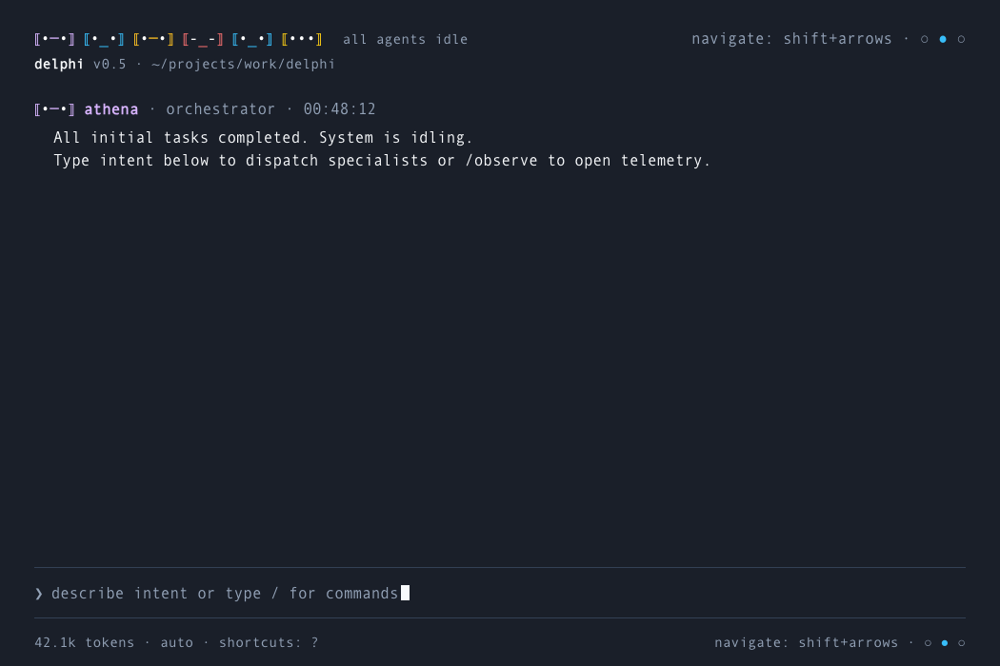
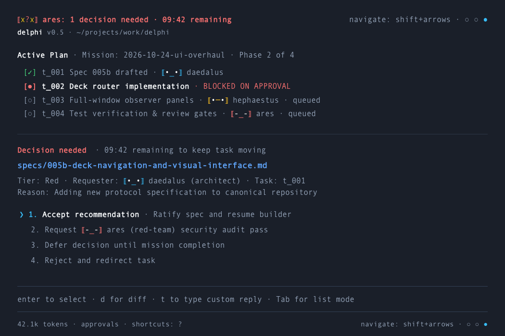
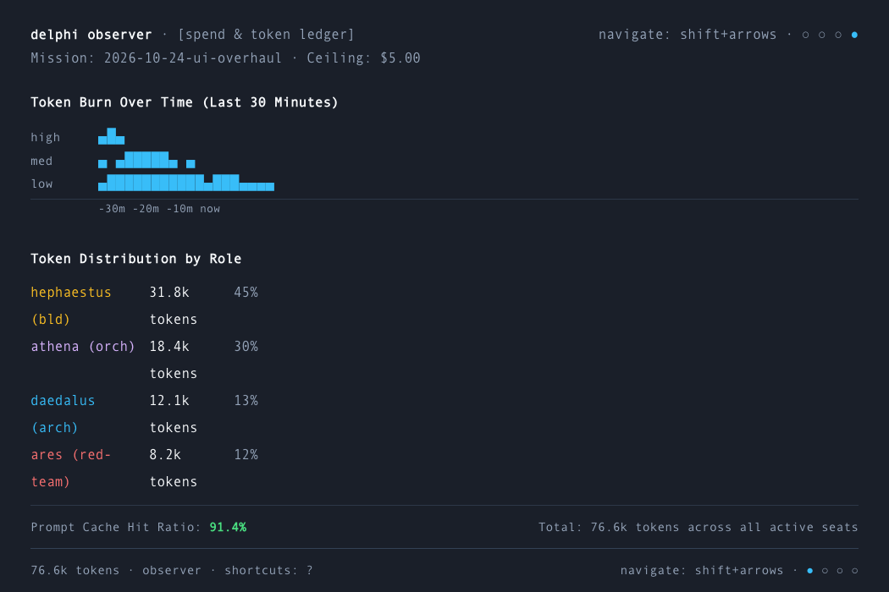
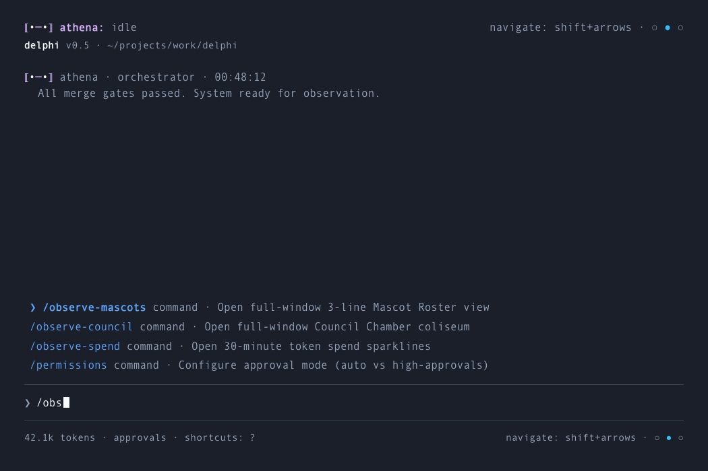
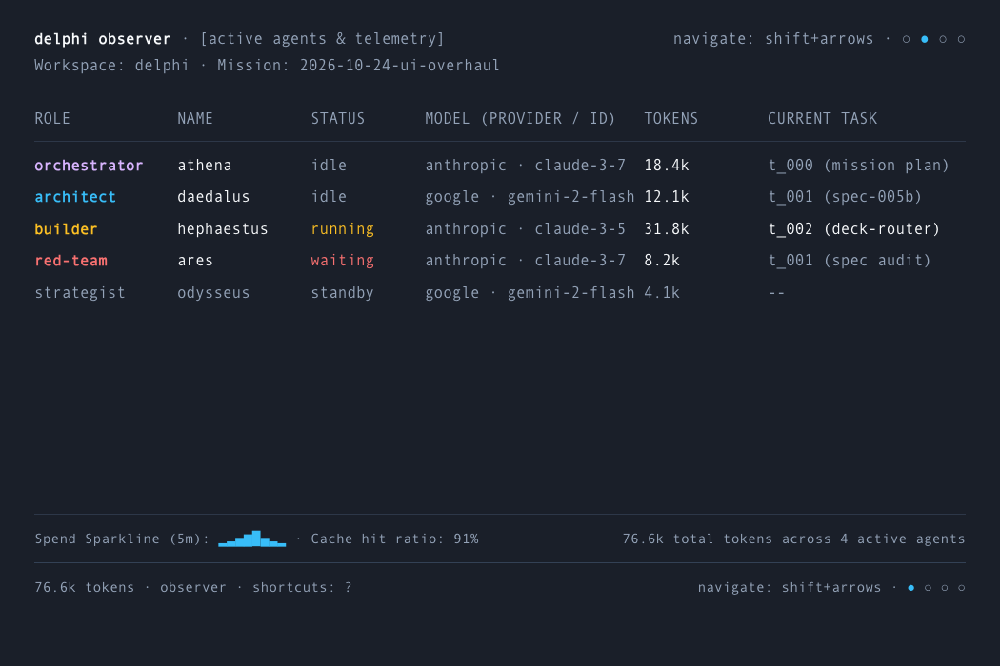

# Delphi Interface Architecture & Visual Blueprints

> Status: Ratified Design Architecture (v0.8 Stacked Header & Mascot Roster)  
> Companion Specification: [`005b-deck-navigation-and-visual-interface.md`](005b-deck-navigation-and-visual-interface.md)  
> Dependencies: [`005-console-and-narrator-tui.md`](005-console-and-narrator-tui.md), [`005a-terminal-avatar-system.md`](005a-terminal-avatar-system.md)

---

## 1. The Core Interaction Model & Aesthetic Foundations

Delphi organizes developer interaction into two synchronized surfaces:

### 1.1 The Operator Deck (Window 1 — `delphi`)
The operator deck uses **3 horizontal decks** navigated via `Shift+Left` and `Shift+Right`:
1. **Center Deck (Primary Chat):** Easy, quiet, uncluttered communication with the orchestrator. Clear syntheses, clean conversation, persistent pinned prompt. No verbose logs or streaming noise.
2. **Left Deck (Activity & Thinking Stream):** High-density live telemetry feed (`Shift+Left`). Displays unfiltered thinking messages, tool-call execution parameters, and real-time worktree code deltas so the primary chat stays pristine.
3. **Right Deck (Plan & Decisions):** Situational awareness and control (`Shift+Right`). Shows **where in the plan we are right now** (active phase, task states) and **what is needed from you to keep it on track** (arrow-navigable decision cards and approvals).

### 1.2 Two-Line Stacked Header Architecture
The header uses a **two-line stacked hierarchy** to prioritize agent telemetry:
- **Line 1 (Top Priority Line):** 
  - *Active Work:* Displays the single active agent status top-left (`⟦•─•⟧ orchestrator: decomposing architecture into 3 tasks`).
  - *Decision Alert:* Prioritizes the blocker (`⟦x?x⟧ red-team: decision needed · 09:42 remaining`).
  - *Idle / Slow:* Shows the full strip of 1-line agent badges in their canonical colors (`⟦•─•⟧ ⟦•_•⟧ ⟦•─•⟧ ⟦-_-⟧ ⟦•_•⟧ ⟦•••⟧`), with no label (005b-A2).
- **Line 2 (Sub-Header Line):** Clean tool branding and path after one blank row (`delphi v0.5 · ~/projects/work/delphi · chat`; the last item is the pane: `activity`, `chat` or `decisions`; 005b-A2).

### 1.3 Minimal Footer & Typography Rules
- **Simplified Footer:** Removed all cost and spend figures to prevent distraction (financial telemetry is isolated in `delphi observe spend`). Left side shows session token spend (`42.1k tokens`), autonomy mode only when it is not the default (`accept edits` or `auto`). Right side shows `← / ? → · ○ ● ○` (005b-A2) with unbracketed dots so they are never confused with robot avatar brackets (`⟦...⟧`).
- **Avatar Eye Contrast:** Every 1-line badge uses the agent's chassis color for brackets and mouth, with bright contrasting eyes (white `#FFFFFF` or gold `#FACC15` for alert red-team).
- **Typography:** Strict macOS standard `Andale Mono 12` on a true monospace character cell grid. No emojis; all structure conveyed through calm indentation, typographic weight, and ANSI color.

---

## 2. Visual Blueprint Suite (Rendered in Native Andale Mono 12)

### 2.1 Center Deck: Primary Chat (Active Turn with Stacked Header)
* **File:** [`assets/delphi_main_chat_dark.png`](assets/delphi_main_chat_dark.png)

*High-contrast dark canvas (`#1A1F29`), Line 1 active status, Line 2 tool path, 1-line badges next to agent names (`⟦•─•⟧ orchestrator`, `⟦•_•⟧ architect`), Rust syntax highlighting, block cursor `█`, and two-sided quiet footer.*

---

### 2.2 Center Deck: Primary Chat (Idle State — Full Badge Strip)
* **File:** [`assets/delphi_main_chat_idle.png`](assets/delphi_main_chat_idle.png)

*When work idles or 30s pass without changes, Line 1 displays the full strip of 6 agent badges in their vibrant chassis colors.*

---

### 2.3 Center Deck: Primary Chat (Light Mode Responsive)
* **File:** [`assets/delphi_main_chat_light.png`](assets/delphi_main_chat_light.png)

*Demonstrating terminal palette responsiveness: crisp white background, dark charcoal text (`#0F172A`), and saturated ANSI accents.*

---

### 2.4 Right Deck: Decision Inbox (Focus Mode — Priority Alert on Line 1)
* **File:** [`assets/delphi_approval_focus_mode.png`](assets/delphi_approval_focus_mode.png)

*Line 1 commands immediate attention (`⟦x?x⟧ red-team: decision needed`). Interactive arrow-navigable form (`❯ 1. Accept recommendation`), requester badge `⟦•_•⟧ architect`, and inline unified diff.*

---

### 2.5 Right Deck: Plan Progress & Decision Center
* **File:** [`assets/delphi_plan_and_decisions.png`](assets/delphi_plan_and_decisions.png)

*Top: "Where in the plan are we right now?" with active task progress. Bottom: "What is needed to keep it on track?" with arrow-navigable decision choices.*

---

### 2.6 Left Deck: Live Activity & Thinking Stream
* **File:** [`assets/delphi_activity_stream.png`](assets/delphi_activity_stream.png)

*Unfiltered live telemetry feed: orchestrator planning thoughts, architect tool calls with invariant checks, red-team gate alerts, and builder live code deltas with green addition lines.*

---

### 2.7 Observer: Alternate Agents Panel (3-Line Mascot Cards View)
* **File:** [`assets/delphi_narrator_mascots.png`](assets/delphi_narrator_mascots.png)

*Full-window observer view: 3-line ASCII block mascots (Spec 005a) with crowns and ears on the left, paired with 3 grouped lines of data: name/role, model/tier/tokens, runtime, and expanded worktree status.*

---

### 2.8 Observer: Live Evolving Council Debate
* **File:** [`assets/delphi_narrator_council_live.png`](assets/delphi_narrator_council_live.png)

*Live debate evolution across rounds: architect (Cyan) defending hyperlinks with adaptive fallback vs. red-team (Crimson) cross-examining multiplexer compatibility, with orchestrator consensus synthesis.*

---

### 2.9 Observer: Token Spend Sparkline Over Time
* **File:** [`assets/delphi_narrator_spend_sparkline.png`](assets/delphi_narrator_spend_sparkline.png)

*ASCII sparkline graph displaying token spend over the last 30 minutes, breakdown by role, and prompt-cache efficiency.*

---

### 2.10 Right Deck: Decision Inbox (List Mode / Triage Table)
* **File:** [`assets/delphi_approval_list_mode.png`](assets/delphi_approval_list_mode.png)

*Bird's-eye triage table showing all pending approval requests grouped by tier (Red, Amber), arrow navigation, and batch operations (`[a] Approve All Amber`).*

---

### 2.11 Primary Console: Slash Command Menu
* **File:** [`assets/delphi_slash_menu.png`](assets/delphi_slash_menu.png)

*Unboxed autocomplete overlay positioned immediately above the prompt bar, featuring fuzzy filter matching and key shortcuts.*

---

### 2.12 Observer: High-Density Agent Telemetry Matrix
* **File:** [`assets/delphi_narrator_agents.png`](assets/delphi_narrator_agents.png)

*High-density full-window view detailing every active agent's role, engine provider, token metrics, cache ratios, and live step descriptions.*
